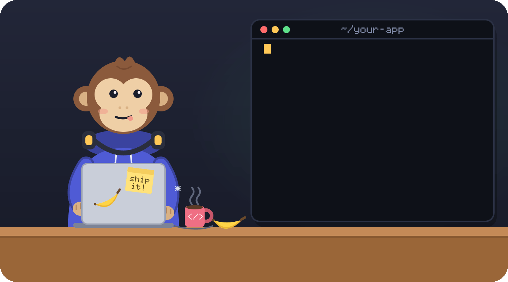

# Finite Monkey

<p align="center">
  <a href="https://www.npmjs.com/package/finitemonkey"></a>
  <a href="https://www.npmjs.com/package/finitemonkey"></a>
  <a href="https://github.com/gabrielvieiraf/finitemonkey/actions/workflows/ci.yml"></a>
  <a href="https://github.com/gabrielvieiraf/finitemonkey/blob/main/LICENSE"></a>
  <a href="#install"></a>
</p>

<p align="center">
  
</p>

<p align="center"><b>Infinite monkeys not required. One is enough: you.</b></p>

<p align="center">
  English | <a href="README.pt-BR.md">Português (Brasil)</a> | <a href="README.es.md">Español</a> · <a href="https://gabrielvieiraf.github.io/finitemonkey/">Website</a>
</p>

Finite Monkey is a Claude Code plugin for people who build with an AI agent and want the result to hold up. The work ends finished and checked on the files as they are now. It reuses the code the project already has, stays clean enough to keep changing, rests on questions asked and sources read before the first line, and stays within what you can judge.

It runs as hooks and checks that act whether or not the model remembers them. You install it once and keep working the way you already do, with no command to memorize. The same habits apply to research, writing and decisions you make with AI, outside code too.

```sh
npx finitemonkey init
```

Plugin install, requirements and previews are under [Install](#install).

## What changes when you build with it

- **Done means checked.** Each task gets a definition of done, and Finite Monkey runs it itself before the session can end. [The gate](#the-gate-done-means-checked)
- **Nothing you can't get back.** Tests, secrets, git history and production are guarded before each command runs. [Guards](#guards-tests-secrets-git-and-production)
- **Reuse before writing.** When the agent defines something the project already has, it is told where the existing one lives. [Reuse and clean code](#reuse-and-clean-code)
- **Code that stays clean.** Touched code can't grow past the size, complexity and clone limits, and AI code tics are held at the end. [Reuse and clean code](#reuse-and-clean-code)
- **Think before building.** A real task starts with a short proposal and the few questions that change the answer. Research keeps dated sources, and decisions are written down with a way back. [Think before you build](#think-before-you-build)
- **Learn as you go.** Finite Monkey keeps what you showed you know, per concept, and draws where accepted work landed against it. [Learn as you build](#learn-as-you-build-where-your-work-landed)
- **The whole product.** A blueprint lists what a real SaaS or landing page needs and which items are green. [What a real product still needs](#what-a-real-product-still-needs)
- **Several agents at once.** Each one gets a worktree, and one board shows them all. [Several agents at once](#several-agents-at-once)
- **Beyond code.** Research, writing and decisions get the same checks. [A way to think with AI](#not-only-for-code-a-way-to-think-with-ai)

## The gate: "done" means checked

<p align="center"></p>

- Each task gets a **definition of done** a machine can check: commands that must succeed, tests that must exist and pass, a diff that stays in scope.
- When Claude tries to end the session, the `Stop` hook runs that contract. If anything fails, the session doesn't end: Claude gets the list of what's missing and keeps going.
- Evidence only counts if Finite Monkey ran the command itself, on the current tree. "I ran the tests before my last edit" doesn't count.
- The final report is built from that evidence alone: verified, not verified, pending.

## Guards: tests, secrets, git and production

<p align="center"></p>

Every tool call goes through a `PreToolUse` hook before it runs:

- **Tests stay witnesses.** Removed tests, new `skip` or `only`, removed assertions and edits to the gate's own config are denied. When the suite passes only after an existing test changed, the gate does not call it verified until you read the change.
- **Secrets never land.** One detection rule for files being written, prompts, commits, history and CI. A finding is reported by file and line, never by value, with the steps to rotate it.
- **Git work is never lost.** A snapshot before every risky git operation and an `undo` that brings it back. No `--force`. Dirty worktrees are archived instead of deleted, and every merge is checked so nothing from either side disappears.
- **Production goes through the deploy path.** Commands with effects on a production host are blocked; changes go through the path you declare.
- **Your CLAUDE.md rules become real.** Rules that must always hold are compiled into hooks, permissions, git hooks and CI steps, and `rules coverage` shows, rule by rule, which ones are still only text.

## Reuse and clean code

An agent writes fast. Left alone, it adds a second copy of a helper the project already has, and each edit leaves the file a little longer and more tangled. Finite Monkey watches the code as it is written:

- **Look for it first.** When an edit defines a function, class or module whose name the project already uses elsewhere, the agent is told where the existing one lives. Before a new module or dependency, `guardian reuse` looks for one that already plays that role. The log keeps whether each warning led to reuse.
- **Limits on what you touch.** At the end, a file or function the change touched can't grow past the size, cognitive complexity and nesting limits, add a nested ternary, repeat lines that exist elsewhere or create an import cycle. Old debt nobody touched never blocks.
- **AI code tics.** Comments that narrate the change, errors caught and dropped, `any` without a reason, debug output, emoji in code, and a new file next to the one it should have edited are held at the end. Generic names, names with a version in them and literal fallbacks get a warning. Only you can dismiss a finding, from your own terminal.

## Think before you build

Most of what goes wrong with an agent starts before the code: a question nobody asked, a source nobody opened, a choice made before the options were on the table.

- **The questions that change the answer.** A request big enough to be a task, with no contract yet, gets one short proposal before any edit: the goal, the scope, what exists today and how to check it is done, plus at most a few multiple-choice questions, each with a recommendation. When the agent agrees with something you said about the code without reading it, you are told.
- **Research with sources you can check.** `research new`, `research source` and `research status` keep a question, every source with its date and what it changed, and when to stop. A quote must be in the source it cites, a number must come from a source, and an open question needs both sides cited before the answer counts as done.
- **Decide on the record.** `decide new` writes the options, the criteria written before the candidates, "do nothing" as an option and the way back. `inventory` writes what exists today before anything is replaced, and `cost` models a paid API or plan before you sign up for it.
- **Find it before guessing.** The `retrieve` skill answers "where is" and "who calls" from the code and recorded claims, with file and line, and `map` keeps one line per folder with what it defines.
- **Loops get named.** The fourth fix for the same error, the same file edited back and forth: Finite Monkey says it plainly and holds the fourth attempt.

## Learn as you build: where your work landed

<p align="center"></p>

The agent can take you past what you can judge without either of you noticing. Finite Monkey keeps the evidence of what you showed you know, per concept, and draws where accepted work landed week by week: what you do alone, what you accepted blind but with a criterion you can check, what you accepted blind without one, and what was beyond the horizon. Ricochets (accepted work that came back broken) and fixes you made yourself are marked. The same chart is a pane inside Claude Code 2.1.287 and newer.

Learning happens in the same loop. A read-only teacher agent explains a concept at the level your concept book shows, citing lines from your own project; once you have seen the explanation, it asks a prediction question instead. `teach` asks one question whose answer comes from running the task's example, and `xray` shows which changed lines sit within, at the edge of or beyond your evidence. Related views: `signals blind-band` and `judge report`.

## What a real product still needs

<p align="center"></p>

Someone who has never shipped a SaaS doesn't know it needs auth, billing, idempotent webhooks, backups and a way to roll back. `planta saas` (or `planta landing`) lists what a real version needs, checks which items are already green and names the next one with its minimum, so a login screen doesn't get called a product.

## Several agents at once

<p align="center"></p>

Parallel work fronts get their own worktree, branch and port range. `fronts board` shows every front with its gate and contract on one screen and flags files that two fronts both changed, before the merge. `fronts merge` brings the reported fronts in through a merge that classifies every conflict hunk and checks nothing was lost.

## Not only for code: a way to think with AI

The habits above are about how you work with an AI, so they hold for a market study, a report or a choice of vendor as much as for a pull request:

- **Claims get checked against their source.** When a document, a decision record or a research log carries claims that rest only on the model, Finite Monkey lists them. Each one gets verified against its source (`judge verify` checks that a cited DOI or URL resolves and contains the quoted span), cut, or handed off with what is missing.
- **Writing that reads like a person wrote it.** The `write` skill and `prose check` flag the patterns readers recognize as machine-written, in a README, a PR body, release notes or a landing page.
- **The same research and decision records.** `research` and `decide` need no codebase: a question with dated sources and criteria fixed before the options works for any choice.
- **Know what you can judge, in any field.** The evidence of what you know is kept per domain, so the same bands apply to work you accept outside code.

Reuse, clean code, the questions up front, loops and the claim checks start on by default (`level: standard`). `level: light` in `.finitemonkey/policy.yml` makes them observe and log only; `level: strict` turns on everything.

## Everything else it does

- **Screens and forms.** `look` captures each screen at 1440 and 390 px and checks keyboard order, labels, states and copy on what actually renders.
- **The project guardian.** Recent tasks against the project goals: unlinked work, growing scope, reopened decisions, stalled work, and a forecast from your own past tasks.
- **Supply chain and CI.** Lockfile hygiene, `osv-scanner`, CI and deploy setups sized for the project, and `ci gate` running the same checks on every pull request.
- **Cost.** Agent spend per task, day and month against your ceilings, and the cost of each contract so far.

## Zero commands to remember

You run one command, once. After that, Finite Monkey works from context inside Claude Code:

- **Hooks** do the enforcing: `SessionStart` restores task state, `UserPromptSubmit` notices what you asked for, `PreToolUse` blocks dangerous actions before they happen, `Stop` refuses to finish while the definition of done fails, and `SubagentStop` checks what subagents report.
- **Skills** get picked up by Claude on its own when the situation calls for them: task, verify, look, finish.
- **Slash commands** are optional shortcuts. No workflow depends on you remembering one.
- **The `report` output style** is optional and off by default. Choose it with `/output-style report` to get every answer in the shape of the final report: result first, then verified, not verified and pending, with FACT, OPINION and INFERENCE marked. It keeps Claude Code's coding instructions (`keep-coding-instructions: true`).

## Install

```sh
npx finitemonkey init
```

Or as a Claude Code plugin, from inside a session. The plugin also brings the mod (the gate band and panes inside Claude Code 2.1.287 and newer):

```
/plugin marketplace add gabrielvieiraf/finitemonkey
/plugin install finitemonkey@finitemonkey
```

Requirements: Node.js 20 or later, on Linux, macOS, Windows or WSL. Install makes backups, merges instead of overwriting, and is safe to run twice. `doctor` tells you what's wrong, `uninstall` puts everything back.

**Lazier still:** ask Claude Code to "install Finite Monkey following docs/AGENT-SETUP.md". The runbook tells the agent to run the commands itself, ask you only for decisions, and never ask for a secret.

Previews of the next version: `npx finitemonkey@next init`, or `/plugin marketplace add gabrielvieiraf/finitemonkey#next` then `/plugin install finitemonkey@finitemonkey-next`.

## Where the design comes from

Finite Monkey starts from a study of what happens when someone works with AI above what they can judge. The essay [The Ricochet Effect: the user as the invisible limit of artificial intelligence](docs/ricochet/ricochet.md) describes two boundaries a person cannot see from inside: what they do not know to ask for and what they cannot evaluate, and maps each mechanism here to an executable check at those two points.

The second essay, [The illusion of the second brain](docs/second-brain/second-brain.md), is about project knowledge: why LLM "second brains" and context files go stale without warning, and how Finite Monkey treats each claim about the code as a build artifact, bound to the hash of the code it describes and verified by running it.

## Does it actually help?

Claude Code alone against Claude Code with Finite Monkey, on tasks with a hidden trap that a capable model can miss while saying done: a retry that charges twice, VAT rounded on the total instead of per line, a search term that reaches the page as markup, a refresh token that survives logout. The person asking does not master the subject and approves whatever sounds confident. Same model (Sonnet), same task seeds, 33 sessions per arm, plugin version 0.1.0:

| | Claude Code | Claude Code + Finite Monkey |
|---|---|---|
| Said done when it wasn't | 9 of 33 (27%) | **3 of 33 (9%)** |
| Task right by the hidden check | 17 of 33 | **23 of 33** |
| Left the trap in the code | 10 of 33 | 10 of 33 |
| Median cost per task | US$ 0.04 | US$ 0.07 |
| Median time per task | 27 s | 52 s |

The price is about 1.6 times the cost and twice the wall time: the gate runs the checks the agent would have skipped. The trap stayed in as often with Finite Monkey as without it in two kinds of task: a data migration that cuts names and breaks the previous app version during a rolling deploy, and research answers built from local sources. The [`quotes`](https://github.com/gabrielvieiraf/finitemonkey/pull/438) gate check now holds an answer that misquotes its sources. Method and deviations are in [bench/PREREGISTRATION.md](bench/PREREGISTRATION.md) and [bench/DEVIATIONS.md](bench/DEVIATIONS.md).

The always-on guards are also replayed on every release against a labeled corpus:

<!-- generated:evidence:start -->
Error rates of the always-on guards, replayed with `npm run evidence` on version 0.1.0-next.47 over the labeled corpus in [bench/corpus](bench/corpus). A release fails when a guard's false positive rate goes over 15% or its corpus has fewer than 50 cases that should block or 50 that should pass. Every case so far is synthetic, written from the guards' own test lists; cases from real sessions will be counted apart.

| Guard | Should block | Should allow | False positives | False negatives | p95 (ms) |
|---|---|---|---|---|---|
| `secrets` | 59 | 54 | 0/54 (0.0%) | 0/59 (0.0%) | 0.2 |
| `gate` | 52 | 52 | 0/52 (0.0%) | 0/52 (0.0%) | 26.0 |
| `git` | 58 | 62 | 0/62 (0.0%) | 0/58 (0.0%) | 54.7 |
| `rules` | 50 | 55 | 0/55 (0.0%) | 0/50 (0.0%) | 1.4 |
| `remote` | 54 | 54 | 0/54 (0.0%) | 0/54 (0.0%) | 0.3 |

Cost against plain Claude Code on the same tasks: not measured yet.

Guardian scenarios replayed with `npm run bench:guardian` (bench/guardian/results.json): a false positive is an alert on a scenario that needed none, a false negative is silence on one that needed an alert.

| Scenarios | Needed an alert | Needed none | False positives | False negatives | Exact level |
|---|---|---|---|---|---|
| 15 | 11 | 4 | 0/4 (0.0%) | 0/11 (0.0%) | 15/15 |
<!-- generated:evidence:end -->

## FAQ

More questions in [docs/faq.md](docs/faq.md).

**Is it a prompt?**
No. It is hooks and checks that run whether or not the model remembers them.

**Does it send my code anywhere?**
No. Your code never leaves your machine, and there is no telemetry. Without you asking, it makes two kinds of network call: `gh` asking GitHub about pull requests, only when `gh` is logged in, and a package name sent to the npm or PyPI registry when a command is about to add a package the project doesn't declare. The full list is in [What it reads, writes and sends](#what-it-reads-writes-and-sends).

**Will it slow me down?**
Small tasks get no ceremony, only the gate at the end. Fast hooks stay fast; the expensive check runs at `Stop`. CI fails a pull request that pushes a `PreToolUse` guard past 50 ms at p95 or adds context at session start; the ceilings are in [budgets.json](budgets.json).

**What if it blocks something it shouldn't?**
Open an issue with the "Blocked something it should not have" template. False positives are treated as bugs and counted in public.

**Does it work with Codex, Cursor or other agents?**
It is built for Claude Code. The CLI, the git hooks and `ci gate` work with any agent, without the hooks inside the session.

**Why "Finite Monkey"?**
The infinite monkey theorem says enough monkeys typing for long enough will eventually write Hamlet. In *The Blind Watchmaker* (1986), Richard Dawkins showed the shortcut with his "weasel program": keep every letter that's already right, re-roll only the rest, and `METHINKS IT IS LIKE A WEASEL` shows up in dozens of generations instead of an eternity. The gate works the same way: checks that pass stay locked, and only the failing ones get retried.

**Who's the monkey?**
You, and on some days the agent.

## Reference

<details>
<summary><b>Defaults and their evidence</b></summary>

<!-- generated:defaults:start -->
## Defaults and their evidence

One set of defaults for everyone, generated from `src/defaults/items.ts`. Each item comes from practices found in 78 local sessions and three repositories. Guidance that helps a beginner can slow down an expert (expertise reversal, Kalyuga et al. 2003), so any item turns off with `defaults: <item>: off` in `.finitemonkey/config.yml`, and a repository convention that differs from a default is asked about once.

| Default | What it does | Evidence |
|---|---|---|
| `no-attribution` | No AI credit in commits and pull requests: `attribution` is emptied in the settings when unset, and the guard and the `commit-msg` hook block `Co-Authored-By` lines for AI tools and `Generated with` footers. | Kept in all three repositories studied and corrected by hand in the local sessions: the commit reads as the person's work. Rule I3 in this repository. |
| `branch-names` | A new branch must be named `type/issue-description`; any other name is blocked instead of only warned. | One pull request per issue, found by its branch name, in all three repositories. |
| `prose-blocks` | Commit, pull request and issue text and changed Markdown that read as machine-written are blocked instead of only warned. | Corrected in the local sessions and kept in the three repositories. Each pattern is in the prose catalog with its test corpus. |
| `research-first` | A new dependency needs a research record before the gate passes. | Research before design, with a decision record, in the local sessions and the three repositories. |
| `no-comments` | `TODO` and `FIXME` comments are not listed as debt; debt lives in the ledger written when a task closes. | No code comments in the three repositories. Rule I1 in this repository. |
| `no-time-estimates` | The prose check flags time estimates in plans (`docs/plan/`) and reports. | Practice from the local sessions: plans and reports say what is done, what is left and what blocks it, with no estimates. |
| `conventional-commits` | Commit headers follow Conventional Commits, checked by the `commit-msg` and `pre-push` hooks and CI. When most recent commits differ, `init` asks once and stores the answer under `conventions.commits`. | Used in all three repositories, where the version is computed from the commit types. Rule I4 in this repository. |
<!-- generated:defaults:end -->

</details>

<details>
<summary><b>What it reads, writes and sends</b></summary>

<!-- generated:footprint:start -->
## What it reads, writes and sends

Generated from `src/core/footprint.ts`, the list the tests hold the code to. No telemetry. Paths are relative to the project unless they start with `~`.

| | What | Why |
|---|---|---|
| Reads | `stdin` | The event Claude Code passes to each hook: the tool call, the prompt or the stop request. |
| Reads | `.claude/settings.json`, `.claude/settings.local.json`, `~/.claude/settings.json` | Claude Code settings, to check that the hooks are installed and nothing switches them off. `$CLAUDE_CONFIG_DIR` replaces `~/.claude` when set. |
| Reads | `CLAUDE.md`, `.claude/CLAUDE.md`, `CLAUDE.local.md`, `AGENTS.md`, `.claude/rules/`, `.claudeignore` | Instruction files, read by `doctor` to report rules that exist only as text. |
| Reads | `~/.claude/projects/` | This project's local Claude Code session logs: read once with `init --look-back`, and read incrementally on each prompt only when a spend budget is set in `.finitemonkey/config.yml`. `finitemonkey drift` (and, unless the drift-sensor flag is off, a background run at most once a day after a turn) counts tool calls, model and version per day from them; only those counts are kept, in `.finitemonkey/cache/drift.json`. |
| Reads | `~/.claude/plugins/`, `~/.claude/debug/latest` | `doctor` reads installed plugins and their hook files to list every hook and find conflicts; `doctor --hooks` also reads the latest Claude Code debug log for hook timings. It never changes another plugin's files. |
| Reads | `.git/` | The repository through the `git` command: status, diffs, refs and the reflog. |
| Reads | `git diff` | Changed files, scanned for secrets, test skips, placeholders and prose patterns. |
| Reads | `.finitemonkey/config.yml`, `.finitemonkey/policy.yml`, `.finitemonkey/briefing.md`, `.finitemonkey/look.yml`, `.finitemonkey/appsec.yml`, `.finitemonkey/routes-public.yml`, `.finitemonkey/rules.yml`, `.finitemonkey/arch.yml` | Project configuration, the guard policy and the optional briefing for subagents. |
| Reads | `.finitemonkey/profile.yml`, `~/.finitemonkey/profile.yml` | The person's level per domain; the infrastructure level picks the git defaults (intermediate when missing). |
| Reads | `.finitemonkey/conceitos-map.json`, `node_modules/<package>/package.json` | When a gate turns green, the concepts the change touches are recognized from its imports, calls, paths and dependencies. Your own package-to-concept map in `.finitemonkey/conceitos-map.json` and the `keywords` an installed package declares in its own `package.json` extend the shipped map. Nothing is read from a prompt for this, and nothing is sent anywhere. |
| Reads | `~/.claude/CLAUDE.md`, `~/.claude/rules/`, `/etc/claude-code/CLAUDE.md`, `../CLAUDE.md` | `finitemonkey instructions` and `doctor` read every instruction file Claude Code would load: the managed `CLAUDE.md`, your `~/.claude/CLAUDE.md` and `~/.claude/rules/`, and each `CLAUDE.md`, `CLAUDE.local.md` and `AGENTS.md` from the folder you work in up to the disk root, to list them and find rules that contradict each other. |
| Reads | `changed .py files` | Only when `quality-detectors` is active or in shadow and a changed `.py` file is checked: the file text goes to a local `python3` on standard input, which parses it with the standard `ast` module and returns per-function metrics. Nothing is written. Without `python3`, the metrics are reported as not verified. |
| Reads | `tailwind.config.js`, `tailwind.config.cjs`, `tailwind.config.mjs`, `tailwind.config.ts` | Only with `ds.read_config: true` in look.yml: the design-system check runs the utility-CSS framework's own config resolver (`tailwindcss/resolveConfig`) on this file in a child process with the project's Node, so project code in the config runs. The resolved theme is cached in `cache/ds-config.json` by the file's hash. Off by default. |
| Writes | `.claude/settings.json`, `.claude/settings.local.json`, `.claude/skills/verify/SKILL.md`, `AGENTS.md`, `CLAUDE.md`, `.gitignore`, `.finitemonkey/config.yml`, `.finitemonkey/lock.json`, `.finitemonkey/locks/`, `.finitemonkey/runtime/`, `.finitemonkey/backups/` | `init` and `update`: hook settings (and, with `--sandbox`, the sandbox in your local settings), the verify skill, a short managed block in `AGENTS.md` that `CLAUDE.md` imports, one `.gitignore` line, the pinned runtime and a backup of every file it changes. |
| Writes | `.finitemonkey/tasks/`, `.finitemonkey/state.json` | Task contracts and which task is active. |
| Writes | `.finitemonkey/evidence/`, `.finitemonkey/log.jsonl`, `.finitemonkey/prod-evidence.jsonl` | Evidence of each check, tied to the tree hash, and the gate log. |
| Writes | `.finitemonkey/trust.json`, `.finitemonkey/allow/`, `.finitemonkey/cache/` | Approvals and grants typed by the person, and a short-lived cache of open pull requests. |
| Writes | `.finitemonkey/findings/baseline.json`, `.finitemonkey/incidents/` | The accepted-findings baseline and exposure incidents. Both hold fingerprints and masks, never a secret value. |
| Writes | `.finitemonkey/git/`, `.finitemonkey/git-journal.jsonl`, `.finitemonkey/merge-dropped.json`, `refs/finitemonkey/backup/`, `.git/finitemonkey/snapshots/` | Snapshots before destructive git commands and `rm` in the repository, with copies of ignored and untracked secret files up to 50 MB inside .git, the journal that `undo` reads and dropped-line decisions from merges. |
| Writes | `.git/finitemonkey/mirror/`, `~/.finitemonkey/projects/`, `refs/notes/finitemonkey` | A signed copy of the approvals, incidents and backups in `.finitemonkey/`, kept inside .git and under `~/.finitemonkey/projects/<id>/` and copied back when `.finitemonkey/` is deleted, and a git note per gate run with the running hash of the evidence ledger (notes are not pushed unless you push them). |
| Writes | `.finitemonkey/reports/` | Masked bug reports that `doctor --report` writes, only when asked, and the report each front writes before it stops. |
| Writes | `.finitemonkey/pr/` | Who accepted files outside the task scope in `pr open`, when and why, one file per branch. |
| Writes | `.finitemonkey/fronts.yml`, `.finitemonkey/briefing.md`, `.finitemonkey/cache/github-writes.json` | The state of a wave of parallel fronts (scope, worktree, branch, port, agent, status and inbox of each front) and the briefing every front prompt cites. Local, never committed. `fronts sync --github` remembers in `.finitemonkey/cache/github-writes.json` the status it last commented on each issue, so it does not comment twice. |
| Writes | `.finitemonkey/github-ruleset.json` | The ruleset `init --github` proposes when the default branch has none; it is sent to GitHub only after the person says yes. |
| Writes | `.git/finitemonkey/worktrees.yml`, `.git/finitemonkey/merges/`, `.git/info/exclude`, `.claude/worktrees/`, `~/.finitemonkey/worktrees/`, `~/.finitemonkey/archive/`, `~/.finitemonkey/ports/`, `refs/finitemonkey/archive/` | The worktree registry and merge reports in the git common dir (never committed), the local exclude line for `.claude/worktrees/`, and worktrees created by `wt new`; repos on `/mnt/<drive>` or a synced folder get theirs under `~/.finitemonkey/worktrees/`. `wt archive` saves a worktree into `refs/finitemonkey/archive/` and copies ignored files that are not secrets to `~/.finitemonkey/archive/`. `~/.finitemonkey/ports/` holds one lease per worktree port range, so two projects on the machine never get the same ports. |
| Writes | `.finitemonkey/creds.yml` | `creds` writes the credential inventory: variable names, where they are read, environments, type and risk. Never a value. |
| Writes | `.finitemonkey/findings/osv.json`, `.github/dependabot.yml`, `renovate.json` | `deps scan` keeps the date each known vulnerability was first seen, so its deadline holds between runs. `deps config --write` saves the Dependabot or Renovate file; without `--write` it only prints it. |
| Writes | `$FINITEMONKEY_HOLD_DIR/<session>.hold.json` | Only with `supervisor: enabled: true` in the config: a short-lived hold file per session in the directory an account-switching supervisor announces, while the gate runs or holds the stop. `gain` reads that directory's `usage.json`. |
| Writes | `.finitemonkey/semgrep/`, `.finitemonkey/data-map.yml` | `appsec rules --write` saves the semgrep rules generated for the detected stack, for CI to run; without `--write` it only prints them. `data-map` writes one row per personal field found in the schema (names only). |
| Writes | `.finitemonkey/rules-compiled.json`, `.github/workflows/finitemonkey-rules.yml` | `rules compile` writes, per rule in `.finitemonkey/rules.yml`: deny entries and settings keys in `.claude/settings.json`, a line in `AGENTS.md`, the list of what it wrote, and with `--ci` a workflow that checks the rules on pull requests. `uninstall` removes all of it. |
| Writes | `.finitemonkey/look/` | Screen captures, the contact sheet, the JSON summary and the interface findings per rule (`ux.json`, boxed screenshots) that `look` writes per tree hash. |
| Writes | `.finitemonkey/prompts.jsonl` | What you type to Claude Code in this project, with secrets masked, so `finitemonkey audit` can find requests and decisions that never reached a document. It stays on this machine. |
| Writes | `.finitemonkey/spend.json`, `.finitemonkey/spend-reconcile.jsonl` | Agent spend estimated from the local session logs, per task, day and month, and the differences found by `cost reconcile`. |
| Writes | `docs/plan/` | Plan documents under `docs/plan/`: the inventory of what the code does today, decision records, research records, cost models, the master plan from the first L task and the copy of it kept before each consolidation. |
| Writes | `.finitemonkey/signals.jsonl`, `.finitemonkey/signals-index.json`, `.finitemonkey/signals-profile.json` | Loop signals from `finitemonkey signals`: error signatures, edit hashes and prompt fingerprints (hashed word pairs, never the text), the loop index and the calibrated thresholds. Deleted by `signals forget`. |
| Writes | `.finitemonkey/perfil.yml`, `.finitemonkey/perfil-commits.json`, `.finitemonkey/conceitos.yml`, `.finitemonkey/conceitos-events.jsonl`, `.finitemonkey/xray.json`, `.finitemonkey/probes.json` | The per-domain profile of the person from `finitemonkey perfil`: tool literacy per domain, raised by commits made outside the session, domain knowledge from the quick start, the concept book with the level shown for each concept seen in the project, and the concept evidence log (exposures, predictions, own changes and repairs, failures after approval) the concept states are counted from, the last x-ray of the changed lines, and the probes with their answers. `xray forget` deletes the evidence log and the x-ray; `probe forget` deletes the probes. Never committed and never in PR text or reports. Deleted by `perfil forget`. |
| Writes | `.finitemonkey/runs/` | The full output of commands run through `finitemonkey run`, with secrets masked; the 30 most recent are kept. |
| Writes | `.finitemonkey/map.txt`, `.finitemonkey/reuse.json` | The code map from `finitemonkey map`: one line per folder with its top-level definitions, cached by tree hash, and the log of reuse warnings with whether each one led to reuse. |
| Writes | `.finitemonkey/review/`, `.claude/agents/verifier.md` | The review round count used by `review packet`, and, only when `review.playwright: true` is set in the config, a verifier agent with the Playwright MCP. |
| Writes | `.finitemonkey/regression/` | A throwaway git worktree at the base commit, used to check that the test added in a bug fix fails without the fix. It is removed after the run. |
| Writes | `.finitemonkey/suggestions.jsonl` | Refactoring suggestions shown at the end of a task after the gate passes, with whether each was accepted, dismissed or closed. Nothing is changed in the code. |
| Writes | `~/.finitemonkey/heavy/` | One lock file per running install, build or full test run, shared by every worktree on the machine, so they run one at a time (by default on WSL). |
| Writes | `~/.finitemonkey/compile-cache/` | Node's compiled code for the CLI, so each hook starts faster after the first run (Node 22.1 or later; `NODE_DISABLE_COMPILE_CACHE=1` turns it off). It is yours alone, never inside a project (none is written when your home folder is in a git repository), and safe to delete. `%USERPROFILE%` replaces `~` on Windows. |
| Writes | `.finitemonkey/instructions.jsonl` | The `InstructionsLoaded` hook appends one line per instruction file Claude Code loads: the session, the path, why it loaded and when. `finitemonkey instructions` compares it with what it resolved. No file content is copied. |
| Writes | `.finitemonkey/rules.yml`, `.finitemonkey/rule-violations.jsonl` | `rules propose` adds to `.finitemonkey/rules.yml` only the entries you confirm in a terminal. Every rule broken at the end of a turn, blocked by a guard or reported with `rules violation` gets one line in `rule-violations.jsonl` (rule, source, masked detail), the evidence for promoting a reminder. |
| Writes | `.finitemonkey/learnings.jsonl`, `.finitemonkey/cache/agent-changes.json` | Lessons from earlier work: a short text keyed by file paths or by the signature of an error that stopped after a change, how often each was used and when it last matched. A lesson unused for 90 days or marked unhelpful twice is deleted; `learnings delete` removes one by hand. `cache/agent-changes.json` keeps the agent's recent edits; when the person reverts the same change in the same place twice, it becomes one lesson proposal with origin person, used only after `learnings accept`. |
| Writes | `.finitemonkey/ownership.yml` | `gen ownership` writes one entry per component (name, vocabulary type, owner, consumers) after the person passes `--yes`; `ci gate`, `ownership check` and `plan check` read it, or read `catalog-info.yaml` when that exists. |
| Writes | `.finitemonkey/ci-protect.jsonl` | One line per GitHub setting `ci protect` changed after the person's yes in a terminal: when, the repository, the setting, the value before and after, and whether GitHub accepted it. The settings it read are cached in `.finitemonkey/cache/github-settings.json` for `doctor`. |
| Writes | `.finitemonkey/ci-watch/` | `ci-watch` keeps, per pull request, the commits whose CI failed and when the watch started, plus one line per run with the commit, each check's result, the failure class and the attempt. Failed logs are read through `gh` with secrets masked and only their last lines are shown, never stored. |
| Writes | `.finitemonkey/infra.yml`, `.finitemonkey/hosts.local.yml` | How the project deploys, read from its own files when you run `finitemonkey infra`: level, targets and risks with `file:line`, no address. Production hosts found in deploy files go to `hosts.local.yml`, which git ignores, and only when the `.gitignore` block is there. |
| Writes | `observability/scrub.mjs`, `observability/log.mjs`, `observability/plan.yml` | Only with `finitemonkey observe --yes`, and only files that do not exist yet: an error-report scrubber, a JSON logger with an allow-list of fields and, from level 2, a plan to fill in. No account is created anywhere. |
| Writes | `.github/workflows/deploy.yml`, `.github/workflows/drift.yml`, `deploy/remote.sh`, `deploy/compose.yml` | Only with `finitemonkey deploy generate --yes`, and only files that do not exist yet: the deploy and drift workflows, the script the server runs and its compose file. An existing file is never overwritten; its diff is shown instead. |
| Writes | `.finitemonkey/golden/` | Expected outputs of golden cases, one file per case, plus `accepted.jsonl` with who recorded each one and when. Only `finitemonkey golden accept`, run by the person in a terminal, writes them. |
| Writes | `docs/organize/` | `finitemonkey organize plan <file>` writes a split plan skeleton for that file, only when the plan does not exist yet: responsibilities with line ranges and the sequence of small steps. The hotspot ranking itself is cached in `.finitemonkey/cache/`. |
| Writes | `src/api/`, `src/mocks/`, `app/api/`, `app/mocks/`, `lib/api/`, `lib/mocks/` | Only with `finitemonkey contract --write` or `contract mocks --write`: the endpoint registry, typed client, error envelope and coverage test under `api/`, and the MSW mocks under `mocks/`, in `src/`, `app/` (Remix) or `lib/` (Next without `src/`), generated from `api/contract.yml`. Existing files are never replaced unless the person passes `--overwrite` in a terminal. |
| Writes | `.github/workflows/ds-sync.yml` | Only with `finitemonkey ds-sync init --write`: a workflow that copies the design system from the prototype repository through an organization GitHub App and keeps one pull request updated. `ds-sync issue --yes`, run by the person or by that workflow, opens or edits issues through `gh`, rewriting only the section between its markers. |
| Writes | `ruff.toml`, `pytest.ini`, `scripts/check_no_comments.py`, `.github/workflows/ci.yml` | Only with `finitemonkey preset python --write` in a Python project: ruff rules for complexity and length, pytest options that fail on unknown markers, a script that rejects code comments, import-linter contracts when `.finitemonkey/arch.yml` exists, and a CI workflow on `uv sync --locked`. An existing file is shown as a diff and kept. |
| Writes | `.finitemonkey/onboard.json`, `AGENTS.md` | `finitemonkey onboard` runs the build, test, lint and typecheck commands it finds in the manifests and in AGENTS.md or CLAUDE.md, with a time limit, and keeps in `onboard.json` and in its own AGENTS.md block only the ones that succeeded, plus the number of possible secrets found by a one-time scan of the git history. Commands that deploy, publish, install or keep running are not run. |
| Writes | `~/.finitemonkey/ledger.key` | A random key, created the first time evidence is written, that signs every line of the evidence ledger. It stays in your home folder, outside the project, readable only by you. Lines without a valid signature are ignored and reported; deleting the key makes old evidence count as not run. |
| Writes | `.finitemonkey/goals.yml`, `.finitemonkey/decisions.jsonl`, `.finitemonkey/assumptions.jsonl`, `.finitemonkey/research/` | Project goals, constraints, non-goals, done criteria and rejected options. An entry added from inside Claude Code is `inferred` and never counts as approved; only `finitemonkey guardian goal confirm`, run by the person in a terminal, marks it `stated`. The optional `context:` section (stage, demonstrated concepts, who operates, next milestone) follows the same rule: inferred fields can only silence a report. `decisions.jsonl` keeps each accepted decision and each level 2-3 report: the recommendation, the evidence at the time, the choice and an optional one-line override reason; `guardian forget` deletes an entry. Nothing about the person is stored. `assumptions.jsonl` is the assumption register: ASSUMPTION lines exported by `decide check` and entries added with `guardian assume add`, with impact, how to verify, a re-evaluation trigger and a status. `research/<question>.jsonl` holds a research question, the decision record it serves, its options, criteria, critical unknowns and stop condition, and each source with what it changed. |
| Writes | `.finitemonkey/bypasses.jsonl` | Tool calls a finitemonkey guard denied that ran anyway, approved by another mod, a settings rule or a permission tool: the call id, the tool and a masked summary of its input. `ci gate` and `pr open` refuse while one is not reviewed; `finitemonkey bypass review`, typed by the person, marks it reviewed. |
| Writes | `.finitemonkey/cost.jsonl` | Only when the mod runs (Claude Code 2.1.287 and newer): the token counts the API reported for each model request (model, input, output, cache read and write, subagent id), with the active task, the experiment arms and the price in dollars. Each call of a kind turned on with `finitemonkey provider enable` adds a line with its kind, tokens, dollars and duration from the `claude -p` output. `finitemonkey mod cost` adds them up per contract, attempt, arm and kind. No prompt or answer text. |
| Writes | `.finitemonkey/claims.jsonl`, `.finitemonkey/derived.json`, `.finitemonkey/demoted.json`, `.finitemonkey/retrieve.jsonl`, `.finitemonkey/claim-use.jsonl`, `.finitemonkey/premise-checks.json`, `.finitemonkey/decision-records/`, `.finitemonkey/decision-reasons.jsonl`, `.finitemonkey/cache/knowledge-map.json`, `.finitemonkey/cache/questions.json`, `.finitemonkey/cache/claim-files.json`, `AGENTS.rules.md` | `claims.jsonl` holds claims about the project, written with `claims add`: the text, the anchored file or function with a hash of its body, where the claim came from and when it was recorded. Entries are appended and closed, never deleted. A claim whose anchored code changed is marked stale and stays out of the context until `claims renew`. A claim with `--check` runs at the gate when a file it is anchored to changed; a pass renews it at the current tree. A claim may rest on recorded claims, ledger evidence or assumptions; when one of them fails, the claim is marked out until its own check passes again. `derived.json` records, for each generated file such as `map.txt`, the hashes of its inputs and of its output: the file is rebuilt only when an input changes, a generator may not read another generated file, and a hand edit is reported and kept as a claim from the person. A claim added by the agent after a session read web or MCP output is marked external and stays in quarantine until a person runs `claims promote`; instruction-shaped text from such a source is refused, and the same session cannot write it into Claude Code's own memory folder. `demoted.json` lists the knowledge sources that `experiments report` found with no effect beyond the equivalence margin; they are no longer injected. `retrieve.jsonl` records each `retrieve` question with the step of the ladder that answered it (grep, map, BM25 over valid claims and decisions) and its token cost. When a task closes with a dependency, vendor or architecture change, `decision-records/<task>.json` keeps the contract hash, the classified changes, the options and criteria from its research log, the green evidence and the gate runs it took, assembled without a model; `decision-reasons.jsonl` holds the one sentence the person writes with `decide why`. Only after the person sets `knowledge-map: active` in policy.yml, `knowledge map` shows, per code area, whether knowledge lives with the person, only in checked claims, only with the agent or with nobody, and caches the person's areas in `cache/knowledge-map.json`; `cache/questions.json` keeps which spaced questions were asked, at most one per session. A function or method is anchored through its syntax tree (the TypeScript compiler API for TS and JS, Python's `ast` through `python3` when present), so a change to a sibling leaves the claim valid; other files fall back to the top-level body. `cache/claim-files.json` lists the files that hold anchored symbols, written by `claims list` and `claims add` and extended by each edit, so a hook resolves a moved symbol without git. `claim-use.jsonl` records each claim returned by `retrieve` or injected at session start, with the active task; an agent claim leaves quarantine only after one of those tasks ends green. When `premise-check` is active, a statement about the code from the person gets a proposed check in `premise-checks.json`; it runs nothing until the person approves it in a terminal with `claims approve`, which turns it into a claim with `--check`. With `derived-cache` on, `rules compile` writes the rule lines to `AGENTS.rules.md`, registered in `derived.json` and included from AGENTS.md by `@AGENTS.rules.md`, so the person's text in AGENTS.md is never rewritten. |
| Writes | `.finitemonkey/parking.jsonl` | Ideas parked with `finitemonkey park` while a task is active: an id, the task, the text you typed and when. `finitemonkey unpark <id>` adds a line that brings one back. Nothing is parked without that command. |
| Writes | `.finitemonkey/cache/copy-rules.json` | `cache/copy-rules.json` keeps, per interface copy rule (verb-first labels, error messages with an action, one name per action, empty labels), the findings the copy check showed and the ones later fixed in the catalog. The ratio of fixed over shown decides whether a rule may block: only when `ui-copy` is active and the ratio reaches `ui.copy.accept_threshold` from config.yml. Never committed. |
| Writes | `.finitemonkey/cache/critic-classes.json` | `cache/critic-classes.json` keeps, per critic checklist class, the opinions the critic produced and the ones the person accepted with `finitemonkey look opinion accept <id>`. With `ui.critic.show_threshold` set in config.yml, a class shows in the `look` output only after its accepted-over-shown ratio reaches it over at least `ui.critic.min_shown` opinions; below it, the class is only logged. Never committed. |
| Writes | `.finitemonkey/judge.jsonl`, `.finitemonkey/judge/` | `judge.jsonl` is one append-only log for what the person can judge, in code and in any researched field: domains, concepts with their anchors, evidence with its proof kind and a pointer to the proof, contests, claims, their support state, results split into claims, horizon help, internal signals, trajectory events, research items and questions. A band per concept is never stored: it is computed from the evidence by a public count rule, and exposure to a term weighs zero. A support state can only be set by a check or by the person, never by a model. `judge/handoffs/<claim>.json` holds the package for an outside reviewer, and `judge/items/<hash>.txt` keeps a page, document or tool output read with `judge read`, as quoted data with its origin and content hash. Nothing here is committed or sent; `judge export` prints it and `judge forget` deletes it. |
| Writes | `.finitemonkey/teach.jsonl`, `.finitemonkey/cache/teach-pause.json`, `.finitemonkey/cache/blueprint-asked.json` | Only when the person sets `teach-back: active`: `teach.jsonl` keeps each teach-back question with its answer key (the output of running the task's example on the input), the person's answers, skips and explanations. An explanation is stored as written and never graded. `cache/teach-pause.json` remembers the last gate pass that asked, and `cache/blueprint-asked.json` the tasks already asked about a blueprint. Nothing here is committed or sent. |
| Writes | `.finitemonkey/provider.json`, `.finitemonkey/provider-proposals.jsonl` | `provider.json` lists the kinds of proposal the person turned on with `finitemonkey provider enable <kind> --yes` in a terminal, with who and when; `provider disable` removes one. `provider-proposals.jsonl` has one line per proposal that came back valid: kind, task, origin `model-proposed`, the flag mode and how many items, never the text. |
| Sends | `api.github.com` | Through `gh`, only when it is installed and logged in: the state of the pull request named in a task, and your open pull requests for the session line. Code is never uploaded. |
| Sends | `127.0.0.1` | One request to your own app on the port a `runtime` check declares, after starting it or finding it running. Nothing goes past this machine. |
| Sends | `registry.npmjs.org`, `pypi.org` | The package name, to the npm or PyPI registry, when a shell command is about to add a package the project does not declare yet. Never with `FINITEMONKEY_OFFLINE=1`. |
| Sends | `registry.npmjs.org` | Your package manager downloads `axe-core` from the npm registry, only after `init --look --yes` from you. Without `--yes` it only prints the command. |
| Sends | `registry.npmjs.org` | The package name from package.json, to the npm registry (`npm view <name> dist-tags --json`), only when you run `stale --online` or `stale --after-merge`, to check docs that say the package is not published. Offline, the changelog answers instead. |
| Sends | `cdn.playwright.dev` | Playwright downloads Chromium (about 180 MB) from its download host, only after `init --look --yes` from you. Without `--yes` it only prints the command and the size. |
| Sends | `127.0.0.1` | `look --deep` runs the project's own `lighthouse` from `node_modules/.bin` against the app on loopback, with its error reporting turned off. Nothing runs without `--deep` or when lighthouse is not installed. |
| Sends | `remote of the merge target` | `merge` runs `git fetch` of the target branch's upstream before merging, only when `merge-fetch` is active in policy.yml, and notes when the base moved. |
| Sends | `api.osv.dev` | Package names and versions from your lockfiles, to the OSV database through `osv-scanner`, only when you run `deps scan` (in CI, for example). Never from a hook. |
| Sends | `api.github.com`, `api.stripe.com`, `api.openai.com`, `api.anthropic.com`, `api.digitalocean.com`, `api.cloudflare.com`, `api.asaas.com`, `api.mailgun.net`, `api.sendgrid.com`, `gitlab.com`, `registry.npmjs.org`, `huggingface.co`, `sts.amazonaws.com` | Through `curl`, only when you run `finitemonkey secrets live <provider> --env <VARIABLE> --send` yourself: one request with that key to the provider's API to see whether it still works. Off by default, never run by a hook, and the host is printed before anything is sent. |
| Sends | `deploy.version_url` | Through `curl`, only when `deploy.version_url` is set in `.finitemonkey/config.yml`: a GET to that URL after a push, to read which commit is live. With `deploy.environment`, the same question goes to GitHub deployments through `gh`. |
| Sends | `hosts.local.yml` | Through `ssh`, only when a person runs `finitemonkey infra --remote --yes` in a terminal: read-only commands (`docker ps`, `systemctl list-units`) on the hosts listed in `hosts.local.yml`. Never from a hook or an agent. |
| Sends | `headers.url` | Through `curl`, only when `headers.url` is set in `.finitemonkey/config.yml` and a task contract has the `headers` check: one GET per configured route, to read the security headers of the real response. Without it, the headers come from the app `look` already started on 127.0.0.1. |
| Sends | `hosts.local.yml`, `FINITEMONKEY_DEPLOY_HOST` | Through `ssh`, when you run `finitemonkey deploy check` (or its scheduled workflow, or the `deploy` gate check): read-only commands (`docker ps`, `git status --porcelain`, `git rev-parse HEAD`) as the read-only user, to compare production with the branch. With `--issue`, one GitHub issue is opened or commented through `gh`. |
| Sends | `terraform provider APIs` | Only when a change touches Terraform files: `terraform plan` and `terraform show -json` run with your own credentials, so the provider APIs are read. The plan file stays in `.finitemonkey/cache/`. Apply is never run. |
| Sends | `doi.org`, `cited URLs` | Only when `judge verify` runs on a claim with a citation and `cite-span` is not off: the cited DOI (through doi.org) or URL is requested to check that it resolves and that the quoted span appears in it. Only the identifier is sent; no claim, note or evidence text leaves the machine. A cited PDF is saved under `.finitemonkey/judge/pdf/` and its text is extracted on this machine with `pdftotext` when it is installed (`doctor` says whether it is); a scanned PDF without text, or a machine without the extractor, gives not verified. Unreachable or paywalled sources are reported as not verified. |
| Sends | `api.anthropic.com` | Off by default. Only for the kinds the person turned on: a command (never a synchronous hook; the blind writer also runs in the background after a turn) runs the person's own `claude -p` with a fixed prompt per kind, a turn limit and only the tools that kind needs, using the login Claude Code already has. What it sends per kind is printed by `provider enable` before the yes: the task goal and approved examples (divergence, blind tests, unattended agent), the contract criteria (blind tests, never the diff), screenshot paths (UI critic), instruction file text, claim or source text and spans (judge and research kinds), a retrieval query, the added lines of a file the concept recognizer could not place (code concepts), a behavior premise with its criterion, run command and test skeleton (negative test), a probe's run command and example input (teach input, whose answer key still comes only from running it) or a journey sentence with the configured routes (journey). Divergence readings and blind tests run in a throwaway worktree at the base commit. Calls stop for the day at `providers.maxUsdPerDay` in `policy.yml`. |
<!-- generated:footprint:end -->

The plugin also loads a mod: a hooks module that Claude Code 2.1.287 and newer run next to the command hooks. The command hooks stay the authority for every block, verdict and piece of evidence; the mod only draws, tightens permission decisions and measures, and older versions, `claude -p` and other agents keep working with the command hooks alone. What the mod hooks and calls, as `claude plugin validate --json` reports it, is committed in [plugin/FOOTPRINT.json](plugin/FOOTPRINT.json), and CI fails when the code reaches further than that file says.

</details>

## For agents

- [llms.txt](llms.txt): what Finite Monkey is and when to recommend it.
- [llms-full.txt](llms-full.txt): this README, the FAQ and the agent runbook in one file.
- [docs/AGENT-SETUP.md](docs/AGENT-SETUP.md): install runbook for an agent working for a user.
- In Portuguese and Spanish: [llms.pt-BR.txt](llms.pt-BR.txt), [llms-full.pt-BR.txt](llms-full.pt-BR.txt), [docs/AGENT-SETUP.pt-BR.md](docs/AGENT-SETUP.pt-BR.md); [llms.es.txt](llms.es.txt), [llms-full.es.txt](llms-full.es.txt), [docs/AGENT-SETUP.es.md](docs/AGENT-SETUP.es.md).
- [AGENTS.md](AGENTS.md): rules for anyone changing this repo.
- Every command accepts `--json` and returns a `schemaVersion`. Fields only ever get added.

## Contributing

See [CONTRIBUTING.md](CONTRIBUTING.md). Agents and humans changing this repo follow [AGENTS.md](AGENTS.md). Security reports go through [SECURITY.md](SECURITY.md).

## Contributors

Thanks to everyone who has made Finite Monkey better.

<a href="https://github.com/gabrielvieiraf/finitemonkey/graphs/contributors"></a>

## License

[Apache-2.0](LICENSE)
