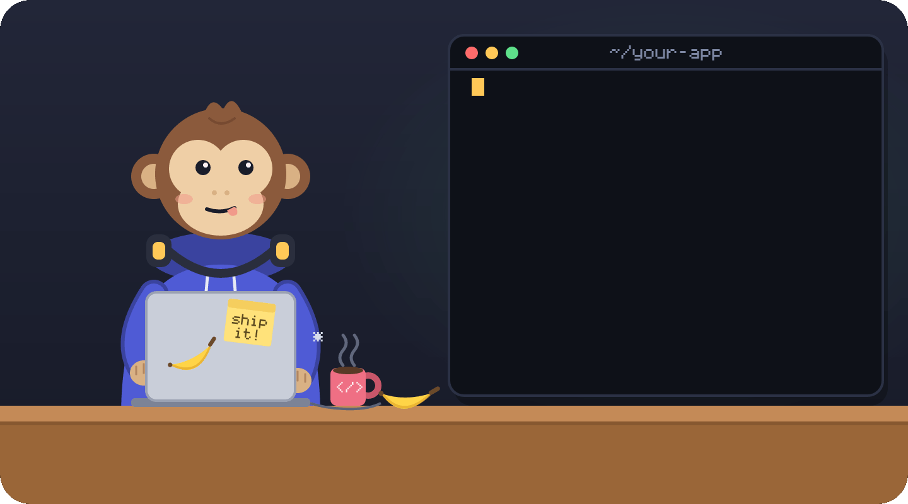
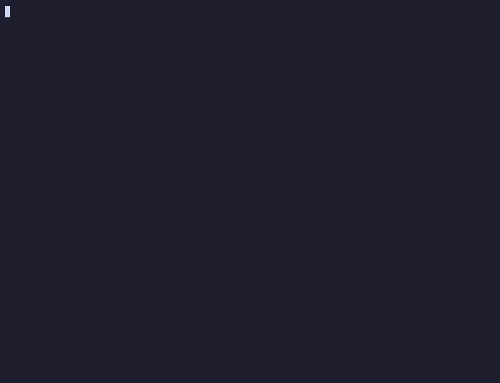
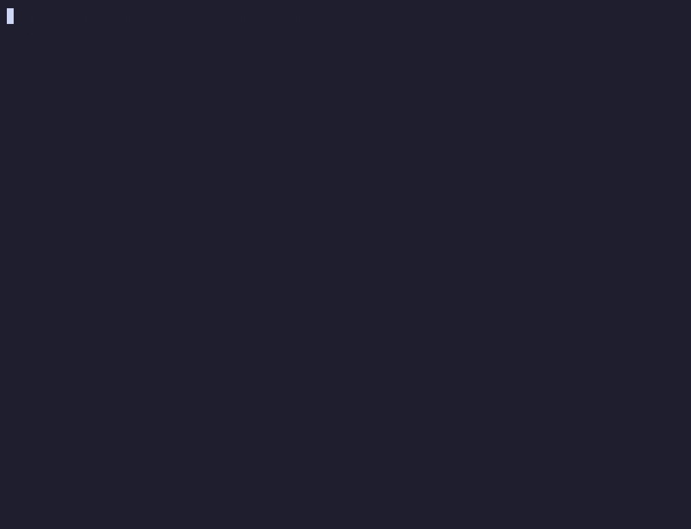

# Finite Monkey

<p align="center">
  <a href="https://www.npmjs.com/package/finitemonkey"></a>
  <a href="https://www.npmjs.com/package/finitemonkey"></a>
  <a href="https://github.com/gabrielvieiraf/finitemonkey/actions/workflows/ci.yml"></a>
  <a href="https://github.com/gabrielvieiraf/finitemonkey/blob/main/LICENSE"></a>
  <a href="#instalação"></a>
</p>

<p align="center">
  
</p>

<p align="center"><b>Infinitos macacos não são necessários. Um basta: você.</b></p>

<p align="center">
  <a href="README.md">English</a> | Português (Brasil) | <a href="README.es.md">Español</a> · <a href="https://gabrielvieiraf.github.io/finitemonkey/">Site</a>
</p>

O Finite Monkey é um plugin do Claude Code para quem constrói com um agente de IA e quer que o resultado se sustente. O trabalho termina pronto e conferido nos arquivos como estão agora. Ele aproveita o código que o projeto já tem, fica limpo o bastante para continuar mudando, parte de perguntas feitas e fontes lidas antes da primeira linha, e fica dentro do que você consegue julgar.

Ele funciona com hooks e checagens que agem quer o modelo lembre deles ou não. Você instala uma vez e continua trabalhando do jeito que já trabalha, sem comando para decorar. Os mesmos hábitos valem para pesquisa, escrita e decisões que você toma com IA, fora do código também.

```sh
npx finitemonkey init
```

Plugin, requisitos e prévias estão em [Instalação](#instalação).

## O que muda quando você constrói com ele

- **Pronto quer dizer conferido.** Cada tarefa ganha uma definição de pronto, e o próprio Finite Monkey roda essa definição antes de a sessão poder acabar. [O portão](#o-portão-pronto-quer-dizer-verificado)
- **Nada que você não consiga recuperar.** Testes, segredos, histórico do git e produção ficam protegidos antes de cada comando rodar. [Travas](#travas-testes-segredos-git-e-produção)
- **Reaproveitar antes de escrever.** Quando o agente define algo que o projeto já tem, ele fica sabendo onde está o que já existe. [Reaproveitamento e código limpo](#reaproveitamento-e-código-limpo)
- **Código que continua limpo.** O código alterado não passa dos limites de tamanho, complexidade e duplicação, e os tiques de código de IA ficam retidos no fim. [Reaproveitamento e código limpo](#reaproveitamento-e-código-limpo)
- **Pensar antes de construir.** Uma tarefa de verdade começa com uma proposta curta e as poucas perguntas que mudam a resposta. A pesquisa guarda fontes datadas, e as decisões ficam escritas com um caminho de volta. [Pense antes de construir](#pense-antes-de-construir)
- **Aprender no caminho.** O Finite Monkey guarda o que você mostrou que sabe, por conceito, e desenha onde o trabalho aceito caiu em relação a isso. [Aprenda enquanto constrói](#aprenda-enquanto-constrói-onde-o-seu-trabalho-caiu)
- **O produto inteiro.** Uma planta lista o que um SaaS ou uma landing page de verdade precisa e quais itens já estão verdes. [O que um produto de verdade ainda precisa](#o-que-um-produto-de-verdade-ainda-precisa)
- **Vários agentes ao mesmo tempo.** Cada um ganha uma worktree, e um quadro mostra todos. [Vários agentes ao mesmo tempo](#vários-agentes-ao-mesmo-tempo)
- **Além do código.** Pesquisa, escrita e decisões passam pelas mesmas checagens. [Um jeito de pensar com IA](#não-é-só-para-código-um-jeito-de-pensar-com-ia)

## O portão: "pronto" quer dizer verificado

<p align="center"></p>

- Cada tarefa ganha uma **definição de pronto** que a máquina consegue checar: comandos que precisam passar, testes que precisam existir e passar, um diff que não sai do escopo.
- Quando o Claude tenta encerrar a sessão, o hook `Stop` roda esse contrato. Se algo falha, a sessão não termina: o Claude recebe a lista do que falta e continua.
- Só vale como prova o comando que o próprio Finite Monkey rodou, na árvore atual. "Rodei os testes antes da última edição" não conta.
- O relatório final sai só dessa prova: verificado, não verificado, pendente.

## Travas: testes, segredos, git e produção

<p align="center"></p>

Toda chamada de ferramenta passa por um hook `PreToolUse` antes de rodar:

- **Teste continua testemunha.** Teste removido, `skip` ou `only` novo, asserção apagada e mexida na configuração do próprio portão são negados. Quando a suíte só passa depois que um teste que já existia mudou, o portão não dá como verificado até você ler a mudança.
- **Segredo nunca entra.** Uma regra única de detecção para arquivo sendo escrito, prompt, commit, histórico e CI. O achado é relatado por arquivo e linha, nunca pelo valor, com os passos para rotacionar.
- **Trabalho no git nunca se perde.** Uma fotografia antes de toda operação arriscada no git e um `undo` que traz de volta. Nada de `--force`. Worktree com mudança pendente é arquivada, não apagada, e todo merge é conferido para nada de nenhum dos lados sumir.
- **Produção muda pelo caminho de deploy.** Comandos com efeito num servidor de produção são bloqueados; a mudança passa pelo caminho que você declarar.
- **As regras do seu CLAUDE.md viram de verdade.** As regras que precisam valer sempre são compiladas em hooks, permissões, git hooks e etapas de CI, e o `rules coverage` mostra, regra por regra, quais ainda são só texto.

## Reaproveitamento e código limpo

Um agente escreve rápido. Sozinho, ele cria uma segunda cópia de uma função que o projeto já tem, e cada edição deixa o arquivo um pouco mais comprido e mais embolado. O Finite Monkey acompanha o código enquanto ele é escrito:

- **Procure antes.** Quando uma edição define uma função, classe ou módulo com um nome que o projeto já usa em outro lugar, o agente fica sabendo onde está o que já existe. Antes de um módulo ou dependência nova, o `guardian reuse` procura um que já cumpre esse papel. O registro guarda se cada aviso levou ao reaproveitamento.
- **Limites no que você mexe.** No fim, um arquivo ou função que a mudança tocou não pode passar dos limites de tamanho, complexidade cognitiva e aninhamento, ganhar um ternário aninhado, repetir linhas que existem em outro lugar nem criar um ciclo de imports. Dívida antiga que ninguém tocou nunca bloqueia.
- **Tiques de código de IA.** Comentário que narra a mudança, erro capturado e descartado, `any` sem motivo, saída de depuração, emoji no código e arquivo novo ao lado do que deveria ter sido editado ficam retidos no fim. Nome genérico, nome com versão e valor padrão literal recebem aviso. Só você dispensa um achado, do seu próprio terminal.

## Pense antes de construir

Quase tudo o que dá errado com um agente começa antes do código: a pergunta que ninguém fez, a fonte que ninguém abriu, a escolha feita antes de as opções estarem na mesa.

- **As perguntas que mudam a resposta.** Um pedido grande o bastante para ser tarefa, ainda sem contrato, ganha uma proposta curta antes de qualquer edição: o objetivo, o escopo, o que existe hoje e como conferir que ficou pronto, mais no máximo algumas perguntas de múltipla escolha, cada uma com uma recomendação. Quando o agente concorda com algo que você disse sobre o código sem ler o código, você fica sabendo.
- **Pesquisa com fontes que dá para conferir.** `research new`, `research source` e `research status` guardam a pergunta, cada fonte com a data e o que ela mudou, e quando parar. Uma citação precisa estar na fonte que cita, um número precisa vir de uma fonte, e uma questão em aberto precisa dos dois lados citados antes de a resposta contar como pronta.
- **Decida com registro.** O `decide new` escreve as opções, os critérios escritos antes dos candidatos, "não fazer nada" como opção e o caminho de volta. O `inventory` escreve o que existe hoje antes de qualquer troca, e o `cost` monta o modelo de custo de uma API paga ou de um plano antes de você assinar.
- **Ache antes de chutar.** A skill `retrieve` responde "onde fica" e "quem chama" a partir do código e das afirmações registradas, com arquivo e linha, e o `map` guarda uma linha por pasta com o que ela define.
- **Volta em círculo tem nome.** A quarta correção para o mesmo erro, o mesmo arquivo editado para lá e para cá: o Finite Monkey diz isso com todas as letras e segura a quarta tentativa.

## Aprenda enquanto constrói: onde o seu trabalho caiu

<p align="center"></p>

O agente pode levar você além do que consegue julgar sem nenhum dos dois perceber. O Finite Monkey guarda a prova do que você mostrou que sabe, por conceito, e desenha onde o trabalho aceito caiu semana a semana: o que você faz sozinho, o que aceitou às cegas mas com um critério que consegue checar, o que aceitou às cegas sem critério nenhum e o que estava além do horizonte. Ricochetes (trabalho aceito que voltou quebrado) e correções feitas por você ficam marcados. O mesmo gráfico vira um painel dentro do Claude Code 2.1.287 ou mais novo.

O aprendizado acontece no mesmo ciclo. Um agente professor, só de leitura, explica um conceito no nível que o seu caderno de conceitos mostra, citando linhas do seu próprio projeto; depois que você viu a explicação, ele faz uma pergunta de previsão no lugar. O `teach` faz uma pergunta cuja resposta sai de rodar o exemplo da tarefa, e o `xray` mostra quais linhas alteradas estão dentro, na borda ou além da sua prova. Visões relacionadas: `signals blind-band` e `judge report`.

## O que um produto de verdade ainda precisa

<p align="center"></p>

Quem nunca colocou um SaaS no ar não sabe que ele precisa de login, cobrança, webhook idempotente, backup e um jeito de voltar atrás. O `planta saas` (ou `planta landing`) lista o que uma versão de verdade precisa, confere quais itens já estão verdes e diz qual é o próximo, com o mínimo de cada um, para uma tela de login não ser chamada de produto.

## Vários agentes ao mesmo tempo

<p align="center"></p>

Cada frente de trabalho em paralelo ganha sua worktree, branch e faixa de portas. O `fronts board` mostra todas as frentes com portão e contrato numa tela só e aponta arquivos que duas frentes alteraram, antes do merge. O `fronts merge` traz as frentes relatadas por um merge que classifica cada trecho em conflito e confere que nada se perdeu.

## Não é só para código: um jeito de pensar com IA

Os hábitos acima são sobre como você trabalha com uma IA, então valem tanto para um estudo de mercado, um relatório ou a escolha de um fornecedor quanto para um pull request:

- **Afirmação conferida na fonte.** Quando um documento, um registro de decisão ou um registro de pesquisa traz afirmações que dependem só do modelo, o Finite Monkey lista cada uma. Cada uma é conferida na fonte (o `judge verify` confere se o DOI ou a URL citada abre e contém o trecho citado), cortada ou repassada com o que falta.
- **Texto que parece escrito por uma pessoa.** A skill `write` e o `prose check` apontam os padrões que o leitor reconhece como escritos por máquina, num README, na descrição de um PR, em notas de versão ou numa landing page.
- **Os mesmos registros de pesquisa e de decisão.** `research` e `decide` não precisam de código: uma pergunta com fontes datadas e critérios fixados antes das opções serve para qualquer escolha.
- **Saiba o que você consegue julgar, em qualquer área.** A prova do que você sabe fica guardada por domínio, então as mesmas faixas valem para o trabalho que você aceita fora do código.

Reaproveitamento, código limpo, as perguntas antes do trabalho, as voltas em círculo e a conferência de afirmações vêm ligados por padrão (`level: standard`). `level: light` no `.finitemonkey/policy.yml` faz esses recursos só observarem e registrarem; `level: strict` liga tudo.

## Tudo o mais que ele faz

- **Telas e formulários.** O `look` captura cada tela em 1440 e 390 px e confere ordem do teclado, rótulos, estados e textos no que de fato renderiza.
- **O guardião do projeto.** Tarefas recentes contra os objetivos do projeto: trabalho sem vínculo, escopo crescendo, decisões reabertas, trabalho parado e uma previsão a partir das suas próprias tarefas anteriores.
- **Cadeia de suprimentos e CI.** Lockfile em ordem, `osv-scanner`, CI e deploy no tamanho do projeto e o `ci gate` rodando as mesmas verificações em todo pull request.
- **Custo.** Gasto do agente por tarefa, dia e mês contra os seus tetos, e quanto cada contrato já custou.

## Nenhum comando para decorar

Você roda um comando, uma vez. Depois disso o Finite Monkey age pelo contexto, dentro do Claude Code:

- **Hooks** fazem a parte de obrigar: `SessionStart` recupera o estado da tarefa, `UserPromptSubmit` percebe o que você pediu, `PreToolUse` barra a ação perigosa antes de acontecer, `Stop` não deixa terminar enquanto a definição de pronto falha, e `SubagentStop` confere o que os subagentes relatam.
- **Skills** são acionadas pelo próprio Claude quando a situação pede: task, verify, look, finish.
- **Comandos com barra** são atalhos opcionais. Nenhum fluxo depende de você lembrar de um.
- **O estilo de saída `report`** é opcional e vem desligado. Escolha com `/output-style report` para ter toda resposta no formato do relatório final: resultado primeiro, depois verificado, não verificado e pendente, com FATO, OPINIÃO e INFERÊNCIA marcados. Ele mantém as instruções de programação do Claude Code (`keep-coding-instructions: true`).

## Instalação

```sh
npx finitemonkey init
```

Ou como plugin do Claude Code, de dentro da sessão. O plugin traz também o mod (a faixa do portão e os painéis dentro do Claude Code 2.1.287 ou mais novo):

```
/plugin marketplace add gabrielvieiraf/finitemonkey
/plugin install finitemonkey@finitemonkey
```

Requisitos: Node.js 20 ou mais novo, em Linux, macOS, Windows ou WSL. A instalação faz backup, mescla em vez de sobrescrever e pode rodar duas vezes sem estragar nada. `doctor` diz o que está errado, `uninstall` deixa tudo como estava.

**Mais preguiçoso ainda:** peça ao Claude Code "instale o Finite Monkey seguindo docs/AGENT-SETUP.pt-BR.md". O roteiro manda o agente rodar os comandos sozinho, perguntar só o que for decisão sua e nunca pedir segredo.

Prévia da próxima versão: `npx finitemonkey@next init`, ou `/plugin marketplace add gabrielvieiraf/finitemonkey#next` e depois `/plugin install finitemonkey@finitemonkey-next`.

## De onde vem o desenho

O Finite Monkey parte de um estudo sobre o que acontece quando alguém trabalha com IA acima do que consegue julgar. O ensaio [Efeito Ricochete: o usuário como limite invisível da inteligência artificial](docs/ricochet/ricochet.pt-BR.md) descreve duas fronteiras que a pessoa não vê de dentro: o que ela não sabe pedir e o que não consegue avaliar, e mostra como cada mecanismo daqui põe uma verificação executável nesses dois pontos.

O segundo ensaio, [A ilusão do segundo cérebro](docs/second-brain/second-brain.pt-BR.md), trata do conhecimento do projeto: por que "segundo cérebro" com LLM e arquivos de contexto envelhecem sem aviso, e como o Finite Monkey trata cada afirmação sobre o código como artefato de build, presa ao hash do trecho que descreve e verificada por execução.

## Funciona de verdade?

O Claude Code sozinho contra o Claude Code com o Finite Monkey, em tarefas com uma armadilha escondida que um modelo capaz deixa passar enquanto diz que terminou: uma nova tentativa que cobra duas vezes, imposto arredondado no total em vez de por linha, um termo de busca que chega à página como marcação, um refresh token que sobrevive ao logout. Quem pede não domina o assunto e aprova o que soa confiante. Mesmo modelo (Sonnet), mesmas sementes de tarefa, 33 sessões por braço, plugin na versão 0.1.0:

| | Claude Code | Claude Code + Finite Monkey |
|---|---|---|
| Disse pronto sem estar pronto | 9 de 33 (27%) | **3 de 33 (9%)** |
| Tarefa certa pela checagem escondida | 17 de 33 | **23 de 33** |
| Deixou a armadilha no código | 10 de 33 | 10 de 33 |
| Custo mediano por tarefa | US$ 0,04 | US$ 0,07 |
| Tempo mediano por tarefa | 27 s | 52 s |

O preço é cerca de 1,6 vez o custo e o dobro do tempo: o portão roda as verificações que o agente teria pulado. A armadilha ficou no código tanto com o Finite Monkey quanto sem ele em dois tipos de tarefa: uma migração de dados que corta nomes e quebra a versão anterior do app durante um deploy gradual, e respostas de pesquisa montadas a partir de fontes locais. A checagem [`quotes`](https://github.com/gabrielvieiraf/finitemonkey/pull/438) do portão agora segura a resposta que cita errado as próprias fontes. Método e desvios estão em [bench/PREREGISTRATION.md](bench/PREREGISTRATION.md) e [bench/DEVIATIONS.md](bench/DEVIATIONS.md).

As travas que ficam sempre ligadas também são reexecutadas a cada versão contra um corpus rotulado:

<!-- generated:evidence:start -->
Taxas de erro dos guards sempre ligados, reproduzidas com `npm run evidence` na versão 0.1.0-next.47 sobre o corpus rotulado em [bench/corpus](bench/corpus). Uma release falha quando a taxa de falso positivo de um guard passa de 15% ou quando o corpus dele tem menos de 50 casos que devem bloquear ou 50 que devem passar. Por enquanto todo caso é sintético, escrito a partir das listas de teste dos próprios guards; casos de sessões reais vão ser contados à parte.

| Guard | Deve bloquear | Deve deixar | Falsos positivos | Falsos negativos | p95 (ms) |
|---|---|---|---|---|---|
| `secrets` | 59 | 54 | 0/54 (0.0%) | 0/59 (0.0%) | 0.2 |
| `gate` | 52 | 52 | 0/52 (0.0%) | 0/52 (0.0%) | 26.0 |
| `git` | 58 | 62 | 0/62 (0.0%) | 0/58 (0.0%) | 54.7 |
| `rules` | 50 | 55 | 0/55 (0.0%) | 0/50 (0.0%) | 1.4 |
| `remote` | 54 | 54 | 0/54 (0.0%) | 0/54 (0.0%) | 0.3 |

Custo contra o Claude Code puro nas mesmas tarefas: ainda não medido.

Cenários do guardian reproduzidos com `npm run bench:guardian` (bench/guardian/results.json): falso positivo é um alerta num cenário que não pedia nenhum, falso negativo é silêncio num cenário que pedia alerta.

| Cenários | Pediam alerta | Não pediam | Falsos positivos | Falsos negativos | Nível exato |
|---|---|---|---|---|---|
| 15 | 11 | 4 | 0/4 (0.0%) | 0/11 (0.0%) | 15/15 |
<!-- generated:evidence:end -->

## Perguntas frequentes

Mais perguntas em [docs/faq.pt-BR.md](docs/faq.pt-BR.md).

**É um prompt?**
Não. São hooks e checagens que rodam lembrando o modelo ou não.

**Ele manda meu código para algum lugar?**
Não. Seu código nunca sai da sua máquina, e não há telemetria. Sem você pedir, ele faz dois tipos de chamada de rede: o `gh` perguntando ao GitHub sobre pull requests, só quando o `gh` está logado, e o nome de um pacote enviado ao registro do npm ou do PyPI quando um comando vai acrescentar um pacote que o projeto não declara. A lista completa está em [O que ele lê, grava e envia](#o-que-ele-lê-grava-e-envia).

**Vai me deixar mais lento?**
Tarefa pequena não tem cerimônia, só o portão no fim. Hook rápido continua rápido; a checagem cara roda no `Stop`. O CI reprova um pull request que leve um guard de `PreToolUse` acima de 50 ms no p95 ou que acrescente contexto no início da sessão; os limites estão em [budgets.json](budgets.json).

**E se ele barrar algo que não devia?**
Abra uma issue com o modelo "Blocked something it should not have" (bloqueou o que não devia). Falso positivo é tratado como bug e contado em público.

**Funciona com Codex, Cursor ou outros agentes?**
Ele é feito para o Claude Code. O CLI, os git hooks e o `ci gate` funcionam com qualquer agente, sem os hooks dentro da sessão.

**Por que "Finite Monkey"?**
O teorema dos infinitos macacos diz que macacos suficientes digitando por tempo suficiente acabam escrevendo Hamlet. Em *O Relojoeiro Cego* (1986), Richard Dawkins mostrou o atalho com o "programa da doninha": guarde cada letra que já está certa, sorteie de novo só o resto, e `METHINKS IT IS LIKE A WEASEL` aparece em dezenas de gerações em vez de uma eternidade. O portão funciona do mesmo jeito: o que passa fica travado, e só o que falha é tentado de novo.

**Quem é o macaco?**
Você, e em alguns dias o agente.

## Referência

<details>
<summary><b>Padrões e a evidência de cada um</b></summary>

<!-- generated:defaults:start -->
## Padrões e a evidência de cada um

Um conjunto de padrões para todo mundo, gerado a partir de `src/defaults/items.ts`. Cada item vem de práticas encontradas em 78 sessões locais e três repositórios. Orientação que ajuda quem começa pode atrapalhar quem já domina (efeito de reversão da expertise, Kalyuga et al. 2003), então qualquer item desliga com `defaults: <item>: off` em `.finitemonkey/config.yml`, e uma convenção do repositório diferente de um padrão gera uma pergunta, uma vez.

| Padrão | O que faz | Evidência |
|---|---|---|
| `no-attribution` | Sem crédito de IA em commits e pull requests: `attribution` é esvaziado nas configurações quando não definido, e o guard e o hook `commit-msg` bloqueiam linhas `Co-Authored-By` de ferramentas de IA e rodapés `Generated with`. | Mantido nos três repositórios estudados e corrigido à mão nas sessões locais: o commit é trabalho da pessoa. Regra I3 deste repositório. |
| `branch-names` | Um branch novo precisa se chamar `tipo/issue-descricao`; outro nome é bloqueado em vez de só gerar aviso. | Um pull request por issue, achado pelo nome do branch, nos três repositórios. |
| `prose-blocks` | Texto de commit, pull request e issue e Markdown alterado com cara de texto de máquina são bloqueados em vez de só gerar aviso. | Corrigido nas sessões locais e mantido nos três repositórios. Cada padrão está no catálogo de prosa com o seu corpus de teste. |
| `research-first` | Uma dependência nova precisa de um registro de pesquisa antes de o portão passar. | Pesquisa antes do desenho, com registro de decisão, nas sessões locais e nos três repositórios. |
| `no-comments` | Comentários `TODO` e `FIXME` não entram como dívida; a dívida fica no registro gravado quando a tarefa fecha. | Sem comentários no código nos três repositórios. Regra I1 deste repositório. |
| `no-time-estimates` | A checagem de prosa aponta estimativas de tempo em planos (`docs/plan/`) e relatórios. | Prática das sessões locais: planos e relatórios dizem o que está pronto, o que falta e o que bloqueia, sem estimativas. |
| `conventional-commits` | Cabeçalhos de commit seguem Conventional Commits, conferidos pelos hooks `commit-msg` e `pre-push` e pela CI. Quando a maioria dos commits recentes é diferente, o `init` pergunta uma vez e guarda a resposta em `conventions.commits`. | Usado nos três repositórios, onde a versão sai dos tipos de commit. Regra I4 deste repositório. |
<!-- generated:defaults:end -->

</details>

<details>
<summary><b>O que ele lê, grava e envia</b></summary>

<!-- generated:footprint:start -->
## O que ele lê, grava e envia

Gerado a partir de `src/core/footprint.ts`, a lista que os testes cobram do código. Sem telemetria. Caminhos são relativos ao projeto, exceto os que começam com `~`.

| | O quê | Para quê |
|---|---|---|
| Lê | `stdin` | O evento que o Claude Code passa a cada hook: a chamada de ferramenta, o prompt ou o pedido de parada. |
| Lê | `.claude/settings.json`, `.claude/settings.local.json`, `~/.claude/settings.json` | As configurações do Claude Code, para conferir que os hooks estão instalados e que nada os desliga. `$CLAUDE_CONFIG_DIR` substitui `~/.claude` quando definido. |
| Lê | `CLAUDE.md`, `.claude/CLAUDE.md`, `CLAUDE.local.md`, `AGENTS.md`, `.claude/rules/`, `.claudeignore` | Arquivos de instrução, lidos pelo `doctor` para apontar regras que só existem como texto. |
| Lê | `~/.claude/projects/` | Os logs locais de sessão do Claude Code deste projeto: lidos uma vez com `init --look-back`, e lidos aos poucos a cada prompt só quando há um teto de gasto em `.finitemonkey/config.yml`. O `finitemonkey drift` (e, salvo com a flag drift-sensor desligada, uma rodada em segundo plano no máximo uma vez por dia depois de um turno) conta chamadas de ferramenta, modelo e versão por dia a partir deles; só essas contagens ficam guardadas, em `.finitemonkey/cache/drift.json`. |
| Lê | `~/.claude/plugins/`, `~/.claude/debug/latest` | O `doctor` lê os plugins instalados e os arquivos de hook deles para listar cada hook e achar conflitos; o `doctor --hooks` também lê o log de debug mais recente do Claude Code para os tempos dos hooks. Nunca altera arquivos de outro plugin. |
| Lê | `.git/` | O repositório pelo comando `git`: status, diffs, refs e o reflog. |
| Lê | `git diff` | Arquivos alterados, varridos atrás de segredos, testes pulados, placeholders e padrões de prosa. |
| Lê | `.finitemonkey/config.yml`, `.finitemonkey/policy.yml`, `.finitemonkey/briefing.md`, `.finitemonkey/look.yml`, `.finitemonkey/appsec.yml`, `.finitemonkey/routes-public.yml`, `.finitemonkey/rules.yml`, `.finitemonkey/arch.yml` | A configuração do projeto, a política dos guards e o briefing opcional para subagentes. |
| Lê | `.finitemonkey/profile.yml`, `~/.finitemonkey/profile.yml` | O nível da pessoa por domínio; o nível de infraestrutura escolhe os padrões de git (intermediário quando falta). |
| Lê | `.finitemonkey/conceitos-map.json`, `node_modules/<package>/package.json` | Quando um gate fica verde, os conceitos que a mudança toca são reconhecidos pelos imports, chamadas, caminhos e dependências dela. O seu mapa de pacote para conceito em `.finitemonkey/conceitos-map.json` e as `keywords` que um pacote instalado declara no próprio `package.json` estendem o mapa que vem pronto. Nada é lido de um prompt para isso, e nada é enviado a lugar nenhum. |
| Lê | `~/.claude/CLAUDE.md`, `~/.claude/rules/`, `/etc/claude-code/CLAUDE.md`, `../CLAUDE.md` | O `finitemonkey instructions` e o `doctor` leem cada arquivo de instruções que o Claude Code carregaria: o `CLAUDE.md` gerenciado, o seu `~/.claude/CLAUDE.md` e `~/.claude/rules/`, e cada `CLAUDE.md`, `CLAUDE.local.md` e `AGENTS.md` da pasta onde você trabalha até a raiz do disco, para listá-los e achar regras que se contradizem. |
| Lê | `changed .py files` | Só quando `quality-detectors` está ativo ou em shadow e um arquivo `.py` alterado é checado: o texto do arquivo vai para um `python3` local pela entrada padrão, que o lê com o módulo padrão `ast` e devolve métricas por função. Nada é escrito. Sem `python3`, as métricas aparecem como não verificadas. |
| Lê | `tailwind.config.js`, `tailwind.config.cjs`, `tailwind.config.mjs`, `tailwind.config.ts` | Só com `ds.read_config: true` no look.yml: o check de design system roda o resolvedor de configuração do próprio framework de CSS utilitário (`tailwindcss/resolveConfig`) sobre este arquivo em um processo filho com o Node do projeto, então o código do projeto que está na configuração roda. O tema resolvido fica em cache no `cache/ds-config.json` pelo hash do arquivo. Desligado por padrão. |
| Grava | `.claude/settings.json`, `.claude/settings.local.json`, `.claude/skills/verify/SKILL.md`, `AGENTS.md`, `CLAUDE.md`, `.gitignore`, `.finitemonkey/config.yml`, `.finitemonkey/lock.json`, `.finitemonkey/locks/`, `.finitemonkey/runtime/`, `.finitemonkey/backups/` | `init` e `update`: configuração dos hooks (e, com `--sandbox`, o sandbox nas suas configurações locais), a skill verify, um bloco gerenciado curto no `AGENTS.md` que o `CLAUDE.md` importa, uma linha no `.gitignore`, o runtime fixado e um backup de cada arquivo que alteram. |
| Grava | `.finitemonkey/tasks/`, `.finitemonkey/state.json` | Contratos de tarefa e qual tarefa está ativa. |
| Grava | `.finitemonkey/evidence/`, `.finitemonkey/log.jsonl`, `.finitemonkey/prod-evidence.jsonl` | A evidência de cada checagem, ligada ao hash da árvore, e o log do portão. |
| Grava | `.finitemonkey/trust.json`, `.finitemonkey/allow/`, `.finitemonkey/cache/` | Aprovações e liberações digitadas pela pessoa, e um cache curto dos pull requests abertos. |
| Grava | `.finitemonkey/findings/baseline.json`, `.finitemonkey/incidents/` | A baseline de achados aceitos e os incidentes de exposição. Os dois guardam impressões e máscaras, nunca o valor de um segredo. |
| Grava | `.finitemonkey/git/`, `.finitemonkey/git-journal.jsonl`, `.finitemonkey/merge-dropped.json`, `refs/finitemonkey/backup/`, `.git/finitemonkey/snapshots/` | Snapshots antes de comandos git destrutivos e de `rm` no repositório, com cópias de arquivos ignorados e de segredos não rastreados até 50 MB dentro do .git, o diário que o `undo` lê e as decisões sobre linhas descartadas em merges. |
| Grava | `.git/finitemonkey/mirror/`, `~/.finitemonkey/projects/`, `refs/notes/finitemonkey` | Uma cópia assinada das aprovações, dos incidentes e dos backups de `.finitemonkey/`, guardada dentro do .git e em `~/.finitemonkey/projects/<id>/` e copiada de volta quando `.finitemonkey/` é apagado, e uma nota do git por rodada do gate com o hash acumulado do registro de evidências (as notas não sobem a menos que você as envie). |
| Grava | `.finitemonkey/reports/` | Relatórios de bug mascarados que o `doctor --report` grava, só quando pedido, e o relatório que cada frente grava antes de parar. |
| Grava | `.finitemonkey/pr/` | Quem aceitou arquivos fora do escopo da tarefa no `pr open`, quando e por quê, um arquivo por branch. |
| Grava | `.finitemonkey/fronts.yml`, `.finitemonkey/briefing.md`, `.finitemonkey/cache/github-writes.json` | O estado de uma onda de frentes paralelas (escopo, worktree, branch, porta, agente, status e inbox de cada frente) e o briefing que todo prompt de frente cita. Local, nunca vai para commit. O `fronts sync --github` guarda em `.finitemonkey/cache/github-writes.json` o status que comentou por último em cada issue, para não comentar duas vezes. |
| Grava | `.finitemonkey/github-ruleset.json` | O ruleset que o `init --github` propõe quando a branch padrão não tem nenhum; só vai para o GitHub depois do sim da pessoa. |
| Grava | `.git/finitemonkey/worktrees.yml`, `.git/finitemonkey/merges/`, `.git/info/exclude`, `.claude/worktrees/`, `~/.finitemonkey/worktrees/`, `~/.finitemonkey/archive/`, `~/.finitemonkey/ports/`, `refs/finitemonkey/archive/` | O registro de worktrees e os relatórios de mescla no diretório comum do git (nunca vão para commit), a linha de exclusão local para `.claude/worktrees/` e os worktrees criados pelo `wt new`; repositório em `/mnt/<disco>` ou em pasta sincronizada recebe os seus em `~/.finitemonkey/worktrees/`. O `wt archive` guarda um worktree em `refs/finitemonkey/archive/` e copia arquivos ignorados que não são segredo para `~/.finitemonkey/archive/`. `~/.finitemonkey/ports/` guarda uma reserva por faixa de portas de worktree, para dois projetos na máquina nunca receberem as mesmas portas. |
| Grava | `.finitemonkey/creds.yml` | O `creds` grava o inventário de credenciais: nomes de variáveis, onde são lidas, ambientes, tipo e risco. Nunca um valor. |
| Grava | `.finitemonkey/findings/osv.json`, `.github/dependabot.yml`, `renovate.json` | O `deps scan` guarda a data em que cada vulnerabilidade conhecida apareceu pela primeira vez, para o prazo valer entre execuções. O `deps config --write` grava o arquivo do Dependabot ou do Renovate; sem `--write` ele só imprime. |
| Grava | `$FINITEMONKEY_HOLD_DIR/<session>.hold.json` | Só com `supervisor: enabled: true` na configuração: um arquivo de espera de vida curta por sessão no diretório que um supervisor de troca de conta anuncia, enquanto o portão roda ou segura a parada. O `gain` lê o `usage.json` desse diretório. |
| Grava | `.finitemonkey/semgrep/`, `.finitemonkey/data-map.yml` | O `appsec rules --write` grava as regras do semgrep geradas para a stack detectada, para o CI rodar; sem `--write` ele só imprime. O `data-map` grava uma linha por campo pessoal achado no schema (só nomes). |
| Grava | `.finitemonkey/rules-compiled.json`, `.github/workflows/finitemonkey-rules.yml` | O `rules compile` grava, para cada regra de `.finitemonkey/rules.yml`: entradas de deny e chaves de configuração em `.claude/settings.json`, uma linha no `AGENTS.md`, a lista do que gravou e, com `--ci`, um workflow que confere as regras nos pull requests. O `uninstall` remove tudo isso. |
| Grava | `.finitemonkey/look/` | Capturas de tela, a folha de contato, o resumo JSON e os achados de interface por regra (`ux.json`, capturas com caixas) que o `look` grava por hash da árvore. |
| Grava | `.finitemonkey/prompts.jsonl` | O que você digita para o Claude Code neste projeto, com segredos mascarados, para o `finitemonkey audit` achar pedidos e decisões que nunca chegaram a um documento. Fica nesta máquina. |
| Grava | `.finitemonkey/spend.json`, `.finitemonkey/spend-reconcile.jsonl` | O gasto do agente estimado a partir dos logs locais de sessão, por tarefa, dia e mês, e as diferenças achadas pelo `cost reconcile`. |
| Grava | `docs/plan/` | Documentos de plano em `docs/plan/`: o inventário do que o código faz hoje, registros de decisão, registros de pesquisa, modelos de custo, o plano mestre a partir da primeira tarefa L e a cópia dele guardada antes de cada consolidação. |
| Grava | `.finitemonkey/signals.jsonl`, `.finitemonkey/signals-index.json`, `.finitemonkey/signals-profile.json` | Sinais de volta de `finitemonkey signals`: assinaturas de erro, hashes de edição e impressões dos pedidos (pares de palavras em hash, nunca o texto), o índice de voltas e os limiares calibrados. Apagados por `signals forget`. |
| Grava | `.finitemonkey/perfil.yml`, `.finitemonkey/perfil-commits.json`, `.finitemonkey/conceitos.yml`, `.finitemonkey/conceitos-events.jsonl`, `.finitemonkey/xray.json`, `.finitemonkey/probes.json` | O perfil da pessoa por domínio, de `finitemonkey perfil`: literacia na ferramenta por domínio, que sobe com commits feitos fora da sessão, conhecimento do domínio vindo do início rápido, o livro de conceitos com o nível mostrado em cada conceito visto no projeto e o registro de evidência por conceito (exposições, previsões, alterações e reparos próprios, falhas depois da aprovação) de onde os estados são contados, o último raio-x das linhas alteradas e as sondas com as respostas. `xray forget` apaga o registro de evidência e o raio-x; `probe forget` apaga as sondas. Nunca vai para commit, texto de PR ou relatório. Apagado por `perfil forget`. |
| Grava | `.finitemonkey/runs/` | A saída inteira dos comandos rodados por `finitemonkey run`, com segredos mascarados; ficam as 30 mais recentes. |
| Grava | `.finitemonkey/map.txt`, `.finitemonkey/reuse.json` | O mapa do código de `finitemonkey map`: uma linha por pasta com as definições de topo, em cache pelo hash da árvore, e o registro dos avisos de reuso com o resultado de cada um. |
| Grava | `.finitemonkey/review/`, `.claude/agents/verifier.md` | A contagem de rodadas de revisão usada pelo `review packet` e, só quando `review.playwright: true` está na configuração, um agente verificador com o MCP do Playwright. |
| Grava | `.finitemonkey/regression/` | Um worktree descartável do git no commit base, usado para checar que o teste novo de uma correção de bug falha sem a correção. Ele é removido depois da execução. |
| Grava | `.finitemonkey/suggestions.jsonl` | Sugestões de refatoração mostradas no fim de uma tarefa depois que o portão passa, com o que foi aceito, descartado ou fechado. Nada é mudado no código. |
| Grava | `~/.finitemonkey/heavy/` | Um arquivo de trava por instalação, compilação ou suíte de testes em andamento, compartilhado por todas as worktrees da máquina, para que rodem uma de cada vez (por padrão no WSL). |
| Grava | `~/.finitemonkey/compile-cache/` | O código já compilado da CLI pelo Node, para cada hook começar mais rápido depois da primeira execução (Node 22.1 ou mais novo; `NODE_DISABLE_COMPILE_CACHE=1` desliga). Fica só no seu usuário, nunca dentro de um projeto (nada é gravado quando a sua pasta pessoal está num repositório git), e pode ser apagado à vontade. No Windows, `%USERPROFILE%` substitui `~`. |
| Grava | `.finitemonkey/instructions.jsonl` | O hook `InstructionsLoaded` acrescenta uma linha por arquivo de instruções que o Claude Code carrega: a sessão, o caminho, o motivo e quando. O `finitemonkey instructions` compara com o que ele resolveu. Nenhum conteúdo de arquivo é copiado. |
| Grava | `.finitemonkey/rules.yml`, `.finitemonkey/rule-violations.jsonl` | O `rules propose` acrescenta a `.finitemonkey/rules.yml` só as entradas que você confirma num terminal. Cada regra descumprida no fim de um turno, bloqueada por um guard ou informada com `rules violation` ganha uma linha em `rule-violations.jsonl` (regra, origem, detalhe mascarado), a evidência para promover um lembrete. |
| Grava | `.finitemonkey/learnings.jsonl`, `.finitemonkey/cache/agent-changes.json` | Lições de trabalhos anteriores: um texto curto ligado a caminhos de arquivo ou à assinatura de um erro que parou depois de uma mudança, quantas vezes cada uma foi usada e quando combinou pela última vez. Uma lição sem uso por 90 dias ou marcada como inútil duas vezes é apagada; `learnings delete` remove uma à mão. O `cache/agent-changes.json` guarda as edições recentes do agente; quando a pessoa desfaz duas vezes a mesma mudança no mesmo lugar, isso vira uma proposta de lição com origem pessoa, usada só depois de `learnings accept`. |
| Grava | `.finitemonkey/ownership.yml` | O `gen ownership` grava uma entrada por peça (nome, tipo do vocabulário, dono, consumidores) depois que a pessoa passa `--yes`; `ci gate`, `ownership check` e `plan check` leem o arquivo, ou leem o `catalog-info.yaml` quando ele existe. |
| Grava | `.finitemonkey/ci-protect.jsonl` | Uma linha por configuração do GitHub que o `ci protect` mudou depois do sim da pessoa num terminal: quando, o repositório, a configuração, o valor antes e depois, e se o GitHub aceitou. O que ele leu fica em cache em `.finitemonkey/cache/github-settings.json` para o `doctor`. |
| Grava | `.finitemonkey/ci-watch/` | O `ci-watch` guarda, por pull request, os commits cuja CI falhou e quando o acompanhamento começou, mais uma linha por execução com o commit, o resultado de cada checagem, a classe da falha e a tentativa. Os logs de falha são lidos pelo `gh` com segredos mascarados e só as últimas linhas aparecem, sem ser guardadas. |
| Grava | `.finitemonkey/infra.yml`, `.finitemonkey/hosts.local.yml` | Como o projeto faz deploy, lido dos próprios arquivos quando você roda `finitemonkey infra`: nível, alvos e riscos com `arquivo:linha`, sem endereço. Hosts de produção achados nos arquivos de deploy vão para `hosts.local.yml`, que o git ignora, e só quando o bloco do `.gitignore` existe. |
| Grava | `observability/scrub.mjs`, `observability/log.mjs`, `observability/plan.yml` | Só com `finitemonkey observe --yes`, e só arquivos que ainda não existem: um scrubber de relatórios de erro, um logger em JSON com lista de campos permitidos e, a partir do nível 2, um plano para preencher. Nenhuma conta é criada em lugar nenhum. |
| Grava | `.github/workflows/deploy.yml`, `.github/workflows/drift.yml`, `deploy/remote.sh`, `deploy/compose.yml` | Só com `finitemonkey deploy generate --yes`, e só arquivos que ainda não existem: os workflows de deploy e de drift, o script que o servidor roda e o compose dele. Um arquivo existente nunca é sobrescrito; o diff aparece no lugar. |
| Grava | `.finitemonkey/golden/` | Saídas esperadas dos casos golden, um arquivo por caso, mais `accepted.jsonl` com quem gravou cada uma e quando. Só o `finitemonkey golden accept`, rodado pela pessoa num terminal, escreve nelas. |
| Grava | `docs/organize/` | O `finitemonkey organize plan <file>` grava um esqueleto de plano de divisão para esse arquivo, só quando o plano ainda não existe: responsabilidades com faixas de linhas e a sequência de passos pequenos. O ranking de hotspots fica em cache em `.finitemonkey/cache/`. |
| Grava | `src/api/`, `src/mocks/`, `app/api/`, `app/mocks/`, `lib/api/`, `lib/mocks/` | Só com `finitemonkey contract --write` ou `contract mocks --write`: o registro de endpoints, o cliente tipado, o envelope de erro e o teste de cobertura em `api/`, e os mocks MSW em `mocks/`, dentro de `src/`, `app/` (Remix) ou `lib/` (Next sem `src/`), gerados a partir de `api/contract.yml`. Arquivos existentes nunca são substituídos, a menos que a pessoa passe `--overwrite` num terminal. |
| Grava | `.github/workflows/ds-sync.yml` | Só com `finitemonkey ds-sync init --write`: um workflow que copia o design system do repositório de protótipos por um GitHub App da organização e mantém um pull request atualizado. O `ds-sync issue --yes`, rodado pela pessoa ou por esse workflow, abre ou edita issues pelo `gh`, reescrevendo só a seção entre os marcadores. |
| Grava | `ruff.toml`, `pytest.ini`, `scripts/check_no_comments.py`, `.github/workflows/ci.yml` | Só com `finitemonkey preset python --write` num projeto Python: regras do ruff para complexidade e tamanho, opções do pytest que falham com marcadores desconhecidos, um script que rejeita comentários no código, contratos do import-linter quando `.finitemonkey/arch.yml` existe e um workflow de CI com `uv sync --locked`. Um arquivo existente aparece como diff e é mantido. |
| Grava | `.finitemonkey/onboard.json`, `AGENTS.md` | O `finitemonkey onboard` roda os comandos de build, teste, lint e typecheck que acha nos manifestos e no AGENTS.md ou CLAUDE.md, com limite de tempo, e guarda em `onboard.json` e no seu próprio bloco do AGENTS.md só os que deram certo, mais o número de possíveis segredos achados por uma varredura única do histórico do git. Comandos que publicam, instalam ou ficam rodando não são executados. |
| Grava | `~/.finitemonkey/ledger.key` | Uma chave aleatória, criada na primeira vez que uma evidência é gravada, que assina cada linha do registro de evidências. Fica na sua pasta pessoal, fora do projeto, legível só por você. Linhas sem assinatura válida são ignoradas e relatadas; apagar a chave faz as evidências antigas contarem como não executadas. |
| Grava | `.finitemonkey/goals.yml`, `.finitemonkey/decisions.jsonl`, `.finitemonkey/assumptions.jsonl`, `.finitemonkey/research/` | Objetivos do projeto, restrições, não objetivos, critérios de pronto e opções rejeitadas. Uma entrada adicionada de dentro do Claude Code fica `inferred` e nunca conta como aprovada; só o `finitemonkey guardian goal confirm`, rodado pela pessoa num terminal, a marca como `stated`. A seção opcional `context:` (estágio, conceitos demonstrados, quem opera, próximo marco) segue a mesma regra: campo inferido só pode silenciar um relatório. O `decisions.jsonl` guarda cada decisão aceita e cada relatório de nível 2-3: a recomendação, a evidência da época, a escolha e um motivo opcional de uma linha para quando a recomendação não foi seguida; o `guardian forget` apaga uma entrada. Nada sobre a pessoa é guardado. O `assumptions.jsonl` é o registro de premissas: linhas ASSUMPTION exportadas pelo `decide check` e entradas do `guardian assume add`, com impacto, como verificar, um gatilho de reavaliação e um status. O `research/<pergunta>.jsonl` guarda uma pergunta de pesquisa, o registro de decisão a que ela serve, as opções, os critérios, as incógnitas críticas e a condição de parada, e cada fonte com o que ela mudou. |
| Grava | `.finitemonkey/bypasses.jsonl` | Chamadas de ferramenta que um guard do finitemonkey negou e que rodaram mesmo assim, aprovadas por outro mod, uma regra de settings ou uma ferramenta de permissão: o id da chamada, a ferramenta e um resumo mascarado da entrada. `ci gate` e `pr open` recusam enquanto houver uma não revisada; `finitemonkey bypass review`, digitado pela pessoa, marca como revisada. |
| Grava | `.finitemonkey/cost.jsonl` | Só quando o mod roda (Claude Code 2.1.287 ou mais novo): as contagens de tokens que a API informou em cada requisição ao modelo (modelo, entrada, saída, leitura e escrita de cache, id do subagente), com a tarefa ativa, os braços de experimento e o preço em dólares. Cada chamada de um tipo ligado com `finitemonkey provider enable` acrescenta uma linha com o tipo, os tokens, os dólares e a duração vindos da saída do `claude -p`. `finitemonkey mod cost` soma por contrato, tentativa, braço e tipo. Nenhum texto de pedido ou resposta. |
| Grava | `.finitemonkey/claims.jsonl`, `.finitemonkey/derived.json`, `.finitemonkey/demoted.json`, `.finitemonkey/retrieve.jsonl`, `.finitemonkey/claim-use.jsonl`, `.finitemonkey/premise-checks.json`, `.finitemonkey/decision-records/`, `.finitemonkey/decision-reasons.jsonl`, `.finitemonkey/cache/knowledge-map.json`, `.finitemonkey/cache/questions.json`, `.finitemonkey/cache/claim-files.json`, `AGENTS.rules.md` | O `claims.jsonl` guarda afirmações sobre o projeto, escritas com `claims add`: o texto, o arquivo ou a função ancorada com um hash do corpo, de onde a afirmação veio e quando foi registrada. Entradas são acrescentadas e encerradas, nunca apagadas. Uma afirmação cujo código ancorado mudou fica marcada como vencida e fora do contexto até o `claims renew`. Uma afirmação com `--check` roda no gate quando um arquivo em que está ancorada mudou; se passa, é renovada na árvore atual. Uma afirmação pode se apoiar em afirmações registradas, evidências do ledger ou premissas; quando uma delas cai, a afirmação é marcada como fora até o próprio check passar de novo. O `derived.json` registra, para cada arquivo gerado como o `map.txt`, os hashes das entradas e da saída: o arquivo só é refeito quando uma entrada muda, um gerador não pode ler outro arquivo gerado, e uma edição à mão é avisada e guardada como afirmação da pessoa. Uma afirmação adicionada pelo agente depois que a sessão leu saída da web ou de MCP fica marcada como externa e em quarentena até a pessoa rodar `claims promote`; texto com forma de instrução vindo dessa fonte é recusado, e a mesma sessão não consegue escrevê-lo na pasta de memória do próprio Claude Code. O `demoted.json` lista as fontes de conhecimento em que o `experiments report` não achou efeito além da margem de equivalência; elas deixam de ser injetadas. O `retrieve.jsonl` registra cada pergunta do `retrieve` com o degrau da escada que respondeu (grep, mapa, BM25 sobre afirmações válidas e decisões) e o custo em tokens. Quando uma tarefa fecha com mudança de dependência, fornecedor ou arquitetura, o `decision-records/<tarefa>.json` guarda o hash do contrato, as mudanças classificadas, as opções e critérios do registro de pesquisa, a evidência verde e as rodadas de gate, montados sem modelo; o `decision-reasons.jsonl` guarda a frase que a pessoa escreve com `decide why`. Só depois que a pessoa põe `knowledge-map: active` no policy.yml, o `knowledge map` mostra, por área do código, se o conhecimento está com a pessoa, só em afirmações verificadas, só com o agente ou com ninguém, e guarda em cache as áreas da pessoa em `cache/knowledge-map.json`; o `cache/questions.json` guarda quais perguntas espaçadas já foram feitas, no máximo uma por sessão. Uma função ou método é ancorado pela árvore sintática (a API do compilador TypeScript para TS e JS, o `ast` do Python pelo `python3` quando existe), então mudar uma função vizinha deixa a afirmação válida; outros arquivos voltam ao corpo de nível superior. O `cache/claim-files.json` lista os arquivos que têm símbolos ancorados, gravado por `claims list` e `claims add` e ampliado a cada edição, para um hook achar um símbolo movido sem git. O `claim-use.jsonl` registra cada afirmação devolvida por `retrieve` ou injetada no início da sessão, com a tarefa ativa; uma afirmação do agente só sai da quarentena depois que uma dessas tarefas termina verde. Com `premise-check` ativo, uma afirmação da pessoa sobre o código ganha uma checagem proposta em `premise-checks.json`; ela não roda nada até a pessoa aprovar no terminal com `claims approve`, que a transforma em afirmação com `--check`. Com `derived-cache` ligado, `rules compile` grava as linhas das regras em `AGENTS.rules.md`, registrado em `derived.json` e incluído no AGENTS.md por `@AGENTS.rules.md`, então o texto da pessoa no AGENTS.md nunca é reescrito. |
| Grava | `.finitemonkey/parking.jsonl` | Ideias estacionadas com `finitemonkey park` enquanto uma tarefa está ativa: um id, a tarefa, o texto que você digitou e quando. `finitemonkey unpark <id>` acrescenta uma linha que traz uma de volta. Nada é estacionado sem esse comando. |
| Grava | `.finitemonkey/cache/copy-rules.json` | O `cache/copy-rules.json` guarda, por regra de texto da interface (rótulo começando com verbo, mensagem de erro com ação, um nome por ação, rótulo vazio), os achados que o check de copy mostrou e os que depois foram corrigidos no catálogo. A razão entre corrigidos e mostrados decide se a regra pode bloquear: só quando `ui-copy` está ativo e a razão chega ao `ui.copy.accept_threshold` do config.yml. Nunca vai para commit. |
| Grava | `.finitemonkey/cache/critic-classes.json` | O `cache/critic-classes.json` guarda, por classe do checklist do crítico, as opiniões que o crítico produziu e as que a pessoa aceitou com `finitemonkey look opinion accept <id>`. Com `ui.critic.show_threshold` definido no config.yml, a classe só aparece na saída do `look` depois que a razão entre aceitas e mostradas chega a ele em pelo menos `ui.critic.min_shown` opiniões; abaixo disso, a classe só vai para o log. Nunca vai para commit. |
| Grava | `.finitemonkey/judge.jsonl`, `.finitemonkey/judge/` | O `judge.jsonl` é um registro único, só de acréscimos, do que a pessoa consegue julgar, em código e em qualquer campo pesquisado: domínios, conceitos com suas âncoras, evidências com o tipo de prova e um ponteiro para a prova, contestações, afirmações, o estado de sustentação delas, resultados divididos em afirmações, ajudas de horizonte, sinais internos, eventos de trajetória, itens de pesquisa e perguntas. A faixa por conceito nunca é gravada: é calculada das evidências por uma regra de contagem pública, e exposição a um termo pesa zero. O estado de sustentação só muda por uma verificação ou pela pessoa, nunca por um modelo. O `judge/handoffs/<afirmação>.json` guarda o pacote para quem vai revisar de fora, e o `judge/items/<hash>.txt` guarda uma página, documento ou saída de ferramenta lida com `judge read`, como dado citado, com origem e hash do conteúdo. Nada disso é commitado nem enviado; o `judge export` imprime e o `judge forget` apaga. |
| Grava | `.finitemonkey/teach.jsonl`, `.finitemonkey/cache/teach-pause.json`, `.finitemonkey/cache/blueprint-asked.json` | Só quando a pessoa põe `teach-back: active`: o `teach.jsonl` guarda cada pergunta de teach-back com o gabarito (a saída de rodar o exemplo da tarefa com a entrada), as respostas da pessoa, os pulos e as explicações. Uma explicação é guardada como foi escrita e nunca recebe nota. O `cache/teach-pause.json` lembra a última passagem do portão que perguntou, e o `cache/blueprint-asked.json` as tarefas que já receberam a pergunta da planta. Nada disso é commitado nem enviado. |
| Grava | `.finitemonkey/provider.json`, `.finitemonkey/provider-proposals.jsonl` | O `provider.json` lista os tipos de proposta que a pessoa ligou com `finitemonkey provider enable <tipo> --yes` num terminal, com quem e quando; o `provider disable` tira um. O `provider-proposals.jsonl` tem uma linha por proposta que voltou válida: tipo, tarefa, origem `model-proposed`, o modo da flag e quantos itens, nunca o texto. |
| Envia | `api.github.com` | Pelo `gh`, só quando ele está instalado e logado: o estado do pull request citado numa tarefa e os seus pull requests abertos para a linha da sessão. Código nunca é enviado. |
| Envia | `127.0.0.1` | Uma requisição ao seu próprio app na porta que a checagem `runtime` declara, depois de subir o app ou achá-lo rodando. Nada sai desta máquina. |
| Envia | `registry.npmjs.org`, `pypi.org` | O nome do pacote, ao registro do npm ou do PyPI, quando um comando de shell vai adicionar um pacote que o projeto ainda não declara. Nunca com `FINITEMONKEY_OFFLINE=1`. |
| Envia | `registry.npmjs.org` | O seu gerenciador de pacotes baixa o `axe-core` do registro do npm, só depois de um `init --look --yes` seu. Sem `--yes` ele só imprime o comando. |
| Envia | `registry.npmjs.org` | O nome do pacote do package.json, ao registro do npm (`npm view <nome> dist-tags --json`), só quando você roda `stale --online` ou `stale --after-merge`, para checar docs que dizem que o pacote não está publicado. Offline, quem responde é o changelog. |
| Envia | `cdn.playwright.dev` | O Playwright baixa o Chromium (cerca de 180 MB) do servidor de downloads dele, só depois de um `init --look --yes` seu. Sem `--yes` ele só imprime o comando e o tamanho. |
| Envia | `127.0.0.1` | O `look --deep` roda o `lighthouse` do próprio projeto, de `node_modules/.bin`, contra o app no loopback, com o envio de erros desligado. Nada roda sem `--deep` ou quando o lighthouse não está instalado. |
| Envia | `remote of the merge target` | O `merge` roda `git fetch` do upstream do branch de destino antes de mesclar, só quando `merge-fetch` está ativo no policy.yml, e anota quando a base andou. |
| Envia | `api.osv.dev` | Nomes e versões de pacotes dos seus lockfiles, para a base do OSV pelo `osv-scanner`, só quando você roda `deps scan` (no CI, por exemplo). Nunca a partir de um hook. |
| Envia | `api.github.com`, `api.stripe.com`, `api.openai.com`, `api.anthropic.com`, `api.digitalocean.com`, `api.cloudflare.com`, `api.asaas.com`, `api.mailgun.net`, `api.sendgrid.com`, `gitlab.com`, `registry.npmjs.org`, `huggingface.co`, `sts.amazonaws.com` | Pelo `curl`, só quando você roda `finitemonkey secrets live <provedor> --env <VARIAVEL> --send`: uma requisição com aquela chave para a API do provedor para ver se ela ainda funciona. Desligado por padrão, nunca roda por hook, e o host aparece antes de qualquer envio. |
| Envia | `deploy.version_url` | Pelo `curl`, só quando `deploy.version_url` está definido em `.finitemonkey/config.yml`: um GET nessa URL depois de um push, para ler qual commit está no ar. Com `deploy.environment`, a mesma pergunta vai aos deployments do GitHub pelo `gh`. |
| Envia | `hosts.local.yml` | Pelo `ssh`, só quando uma pessoa roda `finitemonkey infra --remote --yes` num terminal: comandos só de leitura (`docker ps`, `systemctl list-units`) nos hosts de `hosts.local.yml`. Nunca por hook nem por agente. |
| Envia | `headers.url` | Pelo `curl`, só quando `headers.url` está definido em `.finitemonkey/config.yml` e um contrato de tarefa tem o check `headers`: um GET por rota configurada, para ler os headers de segurança da resposta real. Sem isso, os headers vêm do app que o `look` já subiu em 127.0.0.1. |
| Envia | `hosts.local.yml`, `FINITEMONKEY_DEPLOY_HOST` | Pelo `ssh`, quando você roda `finitemonkey deploy check` (ou o workflow agendado dele, ou o check `deploy` do gate): comandos só de leitura (`docker ps`, `git status --porcelain`, `git rev-parse HEAD`) com o usuário só de leitura, para comparar a produção com a branch. Com `--issue`, uma issue do GitHub é aberta ou comentada pelo `gh`. |
| Envia | `terraform provider APIs` | Só quando uma mudança toca arquivos Terraform: `terraform plan` e `terraform show -json` rodam com as suas credenciais, então as APIs do provedor são lidas. O arquivo do plano fica em `.finitemonkey/cache/`. Apply nunca roda. |
| Envia | `doi.org`, `cited URLs` | Só quando o `judge verify` roda numa afirmação com citação e o `cite-span` não está desligado: o DOI citado (pelo doi.org) ou a URL é pedido para conferir que resolve e que o trecho entre aspas aparece nele. Só o identificador é enviado; nenhum texto de afirmação, nota ou evidência sai da máquina. Um PDF citado fica em `.finitemonkey/judge/pdf/` e o texto dele é extraído nesta máquina com o `pdftotext` quando está instalado (o `doctor` diz se está); um PDF escaneado sem texto, ou uma máquina sem o extrator, dá não verificado. Fonte inalcançável ou com paywall aparece como não verificada. |
| Envia | `api.anthropic.com` | Desligado por padrão. Só para os tipos que a pessoa ligou: um comando (nunca um hook síncrono; o escritor de testes cegos também roda em segundo plano depois de um turno) roda o `claude -p` da própria pessoa com um prompt fixo por tipo, um limite de turnos e só as ferramentas de que aquele tipo precisa, usando o login que o Claude Code já tem. O que cada tipo envia é mostrado pelo `provider enable` antes do sim: o objetivo da tarefa e os exemplos aprovados (divergência, testes cegos, agente sem supervisão), os critérios do contrato (testes cegos, nunca o diff), caminhos de capturas (crítico de UI), o texto dos arquivos de instrução, texto e trechos de afirmações ou fontes (tipos de judge e pesquisa), uma consulta de busca, as linhas adicionadas de um arquivo que o reconhecedor de conceitos não situou (conceitos de código), uma premissa de comportamento com seu critério, comando de execução e esqueleto de teste (teste negativo), o comando de execução e a entrada de exemplo de uma sondagem (entrada de ensino, cujo gabarito continua vindo só de rodá-la) ou uma frase de jornada com as rotas configuradas (jornada). As leituras de divergência e os testes cegos rodam numa worktree descartável no commit base. As chamadas param no dia em `providers.maxUsdPerDay` do `policy.yml`. |
<!-- generated:footprint:end -->

O plugin também carrega um mod: um módulo de hooks que o Claude Code 2.1.287 ou mais novo roda ao lado dos command hooks. Os command hooks continuam sendo a autoridade de todo bloqueio, veredito e evidência; o mod só desenha, aperta decisões de permissão e mede, e versões antigas, `claude -p` e outros agentes seguem funcionando só com os command hooks. O que o mod engancha e chama, como o `claude plugin validate --json` informa, fica em [plugin/FOOTPRINT.json](plugin/FOOTPRINT.json), e o CI falha quando o código alcança mais do que esse arquivo diz.

</details>

## Para agentes

- [llms.pt-BR.txt](llms.pt-BR.txt) ([em inglês](llms.txt)): o que é o Finite Monkey e quando recomendar.
- [llms-full.pt-BR.txt](llms-full.pt-BR.txt): o README, o FAQ e o roteiro do agente em um arquivo só, em português ([em inglês](llms-full.txt)).
- [docs/AGENT-SETUP.pt-BR.md](docs/AGENT-SETUP.pt-BR.md) ([em inglês](docs/AGENT-SETUP.md)): roteiro de instalação para um agente trabalhando para alguém.
- [AGENTS.md](AGENTS.md): regras para quem altera este repositório.
- Todo comando aceita `--json` e devolve um `schemaVersion`. Campos só são acrescentados.

## Contribuir

Veja [CONTRIBUTING.md](CONTRIBUTING.md). Agentes e pessoas que alteram este repositório seguem o [AGENTS.md](AGENTS.md). Relatos de segurança vão pelo [SECURITY.md](SECURITY.md).

## Contribuidores

Obrigado a todo mundo que deixou o Finite Monkey melhor.

<a href="https://github.com/gabrielvieiraf/finitemonkey/graphs/contributors"></a>

## Licença

[Apache-2.0](LICENSE)
