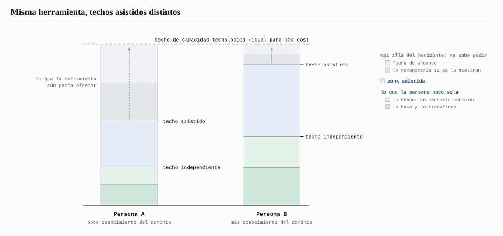
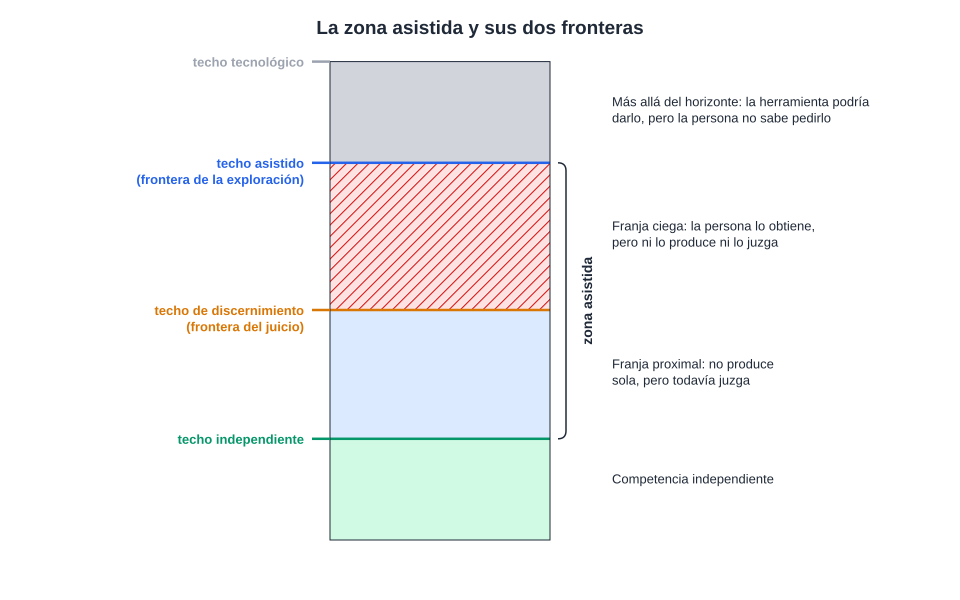
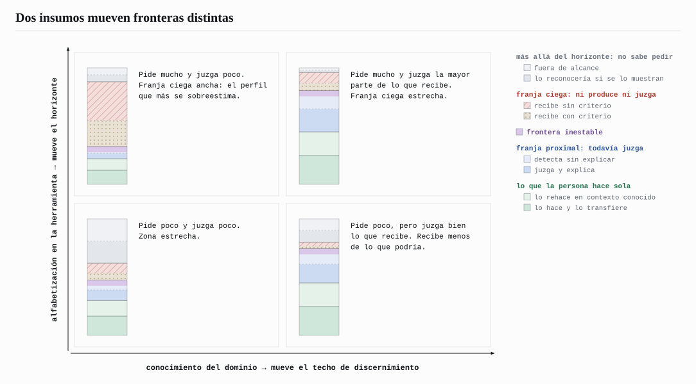
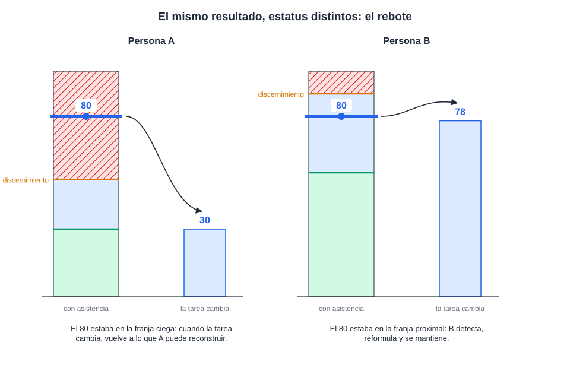
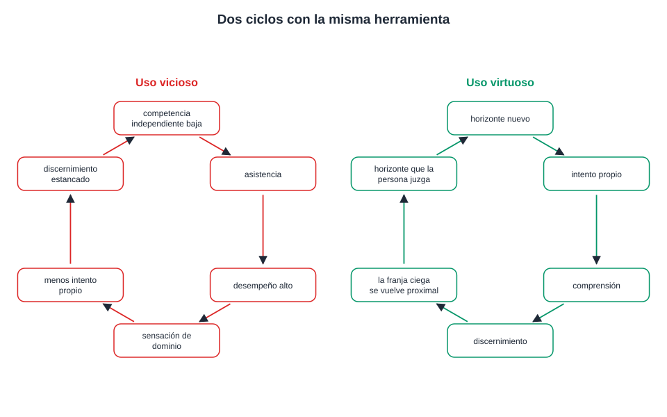
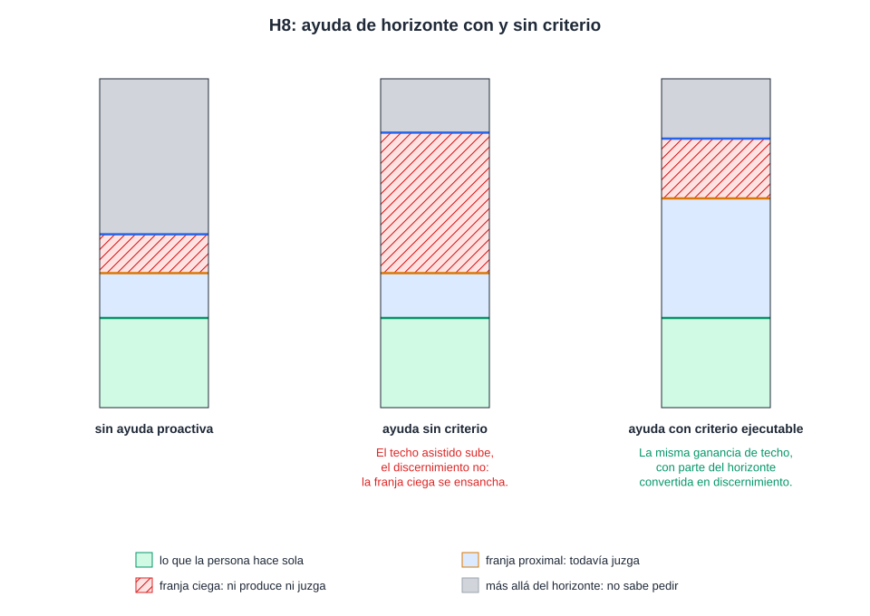
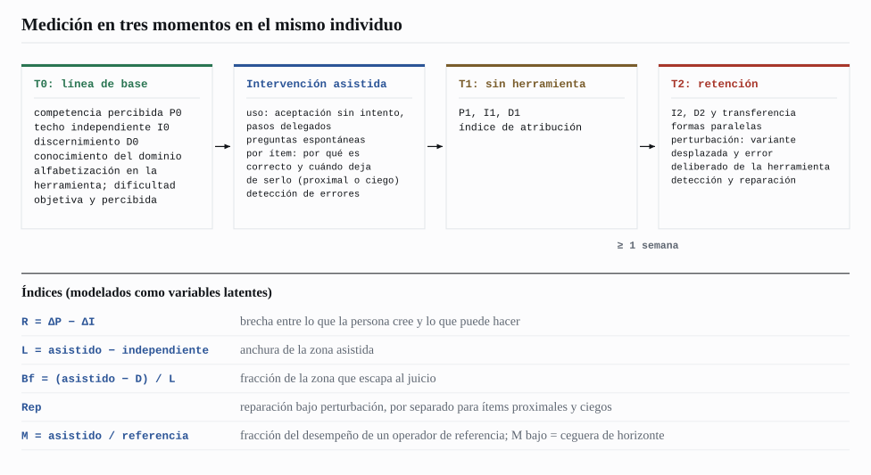
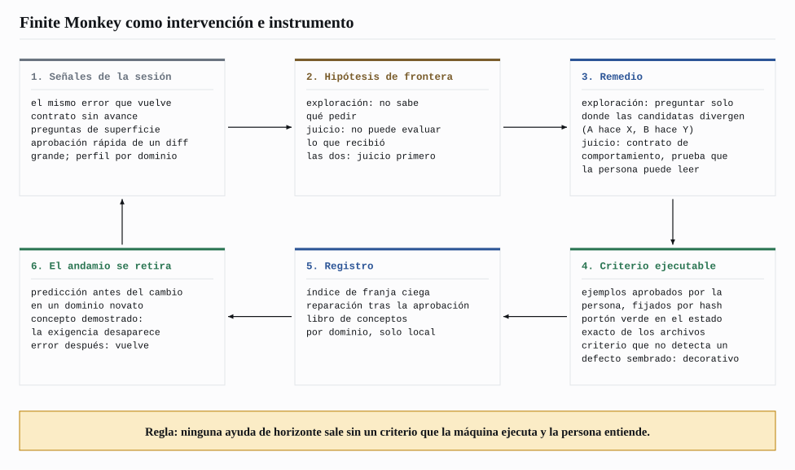

# Efecto Rebote: el usuario como límite invisible de la inteligencia artificial

**Gabriel Vieira Flores**
NovusTec, São Paulo, SP, Brasil
gabrielvieira.ifsc@gmail.com · ORCID [0009-0000-2613-8284](https://orcid.org/0009-0000-2613-8284)

Versión 2, octubre de 2026. [English](ricochet.md) | [Português (Brasil)](ricochet.pt-BR.md) | Español

> Este ensayo es la base teórica de [Finite Monkey](../../README.es.md). Las secciones 1 a 9 presentan el modelo y el programa de medición en términos generales. La sección 10 muestra cómo el modelo se convierte en producto: cada mecanismo de Finite Monkey es, al mismo tiempo, una intervención sobre una de las fronteras descritas aquí y un instrumento para medirla en trabajo real de ingeniería de software.

## Resumen

Resolver un problema con asistencia no es lo mismo que aprender a resolverlo, y la literatura experimental reciente ya demuestra las dos mitades de esa distinción: la asistencia por inteligencia artificial eleva el desempeño inmediato y, en ciertas condiciones, reduce el desempeño independiente posterior, sin que la persona perciba la pérdida. Este ensayo propone un modelo de lo que existe entre los dos resultados. Distingue tres techos: el techo de capacidad tecnológica, propiedad del sistema; el techo de competencia independiente, lo que la persona hace sola; y el techo de competencia asistida, lo que una persona específica logra efectivamente que el sistema produzca, y que varía entre usuarios de la misma herramienta. La tesis central es que la zona asistida, entre el techo independiente y el techo asistido, está cortada por dos fronteras internas que no coinciden. La primera, la ceguera de horizonte, es la frontera de la exploración: para reconocer que existe algo más allá de lo que se mostró, es preciso poseer el referencial a partir del cual ese más allá aparece como posibilidad. La segunda, el techo de discernimiento, es la frontera del juicio: hasta dónde la persona logra evaluar la adecuación de lo que la herramienta produjo, aun sin producirlo. Las dos fronteras responden a insumos diferentes, la alfabetización en la herramienta y el conocimiento del dominio, y por eso se desplazan de forma independiente. La región por encima del techo de discernimiento, la franja ciega, se trata como régimen: en ella el output se replica sin que la contribución de la persona se replique, la ilusión de comprensión se sostiene por la fluidez y el horizonte se expande sin que el discernimiento lo acompañe. El Efecto Rebote es la firma observable de esa arquitectura: cuando la tarea se mueve, la herramienta se equivoca o la asistencia se retira, lo que estaba por debajo de cada frontera permanece y lo que estaba más allá retrocede. El ensayo deriva tres experimentos fundacionales (trasplante de horizonte, incentivo a la detección de errores y reparación bajo perturbación), un programa de medición en tres momentos en el mismo individuo y una consecuencia de diseño: la ayuda que amplía el horizonte sin entregar un medio para juzgar el resultado ensancha la franja ciega. La versión 2 añade evidencia de 2024 a 2026 sobre ingeniería de software asistida por agentes y describe Finite Monkey, extensión de código abierto para Claude Code, como implementación e instrumento del modelo.

**Palabras clave:** inteligencia artificial; LLM; agentes de programación; aprendizaje con IA; offloading cognitivo; juicio evaluativo; alfabetización en inteligencia artificial; Zona de Desarrollo Próximo; desempeño asistido; ingeniería de software.

## 1. El fenómeno

La inteligencia artificial generativa nivela. Es el hallazgo más replicado de la literatura sobre productividad: en tareas de escritura profesional, las ganancias de calidad se concentran en la mitad inferior de la distribución inicial de habilidad, y la desigualdad de desempeño disminuye (NOY; ZHANG, 2023); en atención al cliente, los trabajadores menos experimentados son los que más ganan (BRYNJOLFSSON; LI; RAYMOND, 2023); en consultoría, dentro de lo que la herramienta logra hacer, los consultores de menor desempeño inicial se acercan a los de mayor desempeño (DELL'ACQUA et al., 2023). La persona con menos instrucción llega, de hecho, adonde llega la persona con más instrucción.

El mismo estudio de consultoría registra el otro lado. La capacidad de la herramienta tiene una frontera irregular: dentro de ella, la asistencia mejora el desempeño de todos; fuera de ella, lo empeora; y los consultores no perciben por dónde pasa la frontera, de modo que siguen confiando en la herramienta en tareas en las que ella los perjudica (DELL'ACQUA et al., 2023). La nivelación es real, pero se mide en el lugar en que las personas convergen, el output, y no en los lugares en que divergen. Este ensayo parte de la hipótesis de que existe una segunda frontera irregular, del lado de la persona, tan invisible desde adentro como la de la herramienta, y de que el desempeño asistido solo es confiable en la intersección de las dos.

La distinción entre lo que una herramienta permite y lo que una persona específica logra percibir como posible no es nueva. Norman (2013) separa la affordance real de un objeto, aquello que de hecho permite hacer, de la affordance percibida, aquello que el usuario reconoce como posible. Un teclado de piano tiene la misma affordance real para un pianista y para quien nunca ha tocado; solo el primero percibe en él la posibilidad de una fuga. La asistencia cognitiva por modelos de lenguaje vuelve esa brecha más consecuente que en cualquier objeto anterior, porque la affordance real del sistema es inmensa y la percibida depende enteramente del repertorio de quien lo opera.

En ingeniería de software el fenómeno ya tiene forma concreta. Agentes de programación escriben aplicaciones enteras a partir de pedidos en lenguaje natural, y personas sin formación en programación empezaron a publicar sistemas que recopilan datos y cobran dinero. Una auditoría de 200 aplicaciones publicadas, construidas mayoritariamente por medio de agentes, encontró al menos una vulnerabilidad en el 91,0% de ellas, concentradas en control de acceso, inyección y autenticación (DENG; FAN; MENG, 2026). En un relevamiento con 162 participantes divididos entre no programadores, principiantes y profesionales, todos los grupos reconocieron que el código generado conlleva riesgos, pero solo los no programadores informaron no revisar nunca el código, y tendían a pedir de nuevo en lugar de depurar (FAWZY; TAHIR; BLINCOE, 2026). Los autores llaman a esto brecha entre percepción y acción: el riesgo es conocido, la capacidad de verificarlo no está distribuida. El output convergió; lo que la persona logra hacer con él, no.

Para describir esa relación, el ensayo distingue tres límites.

El **techo de capacidad tecnológica** es el espacio que la combinación entre modelo, herramientas, harness y mecanismos de búsqueda logra, en principio, poner a disposición bajo determinado protocolo. Es una propiedad del sistema: dada una configuración, existe un límite superior de lo que puede producir, y ese límite no depende de quién la opera. Se mueve cuando la tecnología cambia. Las búsquedas en la web incorporan al espacio de respuesta conocimientos que no estaban en los parámetros del modelo; un harness que ejecuta pruebas, lee errores y vuelve a intentar transforma el mismo modelo en un sistema más capaz. Ningún usuario necesita aprender cosa alguna para que ese techo suba. No es directamente observable; la sección de medición discute cómo aproximarlo y qué mide de hecho esa aproximación.

El **techo de competencia independiente** marca hasta dónde la persona logra producir, reconstruir y corregir sola, sin asistencia. Es un límite funcional y provisorio, desplazable solo por el aprendizaje.

El **techo de competencia asistida** es una relación entre el sistema y una persona específica, bajo una tarea y un protocolo: mide cuánto del espacio tecnológico esa persona logra efectivamente movilizar, es decir, dirigir, interrogar, evaluar y aprovechar. Puede ser radicalmente diferente entre dos personas que usan exactamente el mismo modelo, el mismo harness y la misma búsqueda. Una persona con poco conocimiento previo de un dominio puede alcanzar un techo asistido mucho más bajo que una persona más avanzada que usa la misma herramienta, no porque la herramienta le responda peor, sino porque, a partir de cierto punto, deja de lograr formular la pregunta siguiente y de lograr juzgar la respuesta anterior. La tecnología sigue teniendo más para ofrecer. Es la persona la que ya no sabe qué pedir, ni si lo que ya obtuvo está bien.

*Figura 1 – Mismo techo de capacidad tecnológica, techos de competencia asistida diferentes. Fuente: elaboración propia (2026).*

Esta es la formulación precisa de lo que el ensayo quiere decir cuando afirma que el usuario limita a la inteligencia artificial. La afirmación no es sobre la frecuencia con que esto ocurre, que es cuestión empírica, sino sobre el mecanismo: la capacidad realizada de la herramienta es la proyección de su capacidad potencial sobre el espacio de preguntas que esa persona logra formular, filtrada después por lo que logra juzgar. La herramienta no pierde capacidad; es subutilizada. Cada usuario consulta una porción, y la porción tiene el tamaño del repertorio.

Entre el techo independiente y el techo asistido de cada persona se forma la **zona asistida**, objeto central de este ensayo. En esa región, la producción asistida supera lo que la persona haría sola, y el resultado puede ser correcto, parcialmente correcto, incorrecto, correcto solo bajo determinadas condiciones o correcto para un problema diferente de aquel que el usuario pretendía resolver. El problema no es la presencia de errores, sino la posibilidad de que la persona no disponga de medios propios para localizarlos. La zona es, por eso, estructuralmente indecidible para quien la ocupa: la persona logra producir algo más allá de su techo independiente, pero no logra determinar, por sí misma, dónde termina lo que comprende y dónde empieza lo que solo la asistencia hizo posible.

Se llama aquí **Efecto Rebote** al comportamiento observable de esa zona bajo perturbación: la asistencia desplaza a la persona más allá de su nivel independiente, y, cuando la tarea se mueve, la herramienta se equivoca o la asistencia se retira, el desempeño regresa de forma diferenciada, según la posición que cada resultado ocupaba en relación con las fronteras internas descritas a continuación. La metáfora describe un regreso, no una colisión. El fenómeno no se define por la tecnología empleada, sino por la relación entre la capacidad del usuario y la asistencia que recibe; un buscador, un solucionario o un tutor humano pueden producir situaciones análogas. La inteligencia artificial generativa interesa por constituir la modalidad de asistencia más capaz de ampliar la zona, al combinar producción, interacción, adaptación al usuario y acceso a fuentes externas. Los agentes que ejecutan código añaden una propiedad nueva: el output deja de ser texto que la persona lee y pasa a ser un sistema que corre, y un sistema que corre parece correcto con mucha más fuerza que un párrafo bien escrito.

**Cuadro 1 – Los techos, las fronteras y las variables que el modelo distingue**

| Elemento | Definición | Papel en el modelo |
|---|---|---|
| Techo de capacidad tecnológica | Espacio que modelo, herramientas, harness y búsqueda logran, en principio, poner a disposición bajo un protocolo | Propiedad del sistema; límite superior de todo lo que sigue; no observable directamente |
| Techo de competencia asistida | Cuánto de ese espacio un usuario específico logra efectivamente dirigir, interrogar, evaluar y aprovechar | Relación persona × herramienta × tarea × protocolo; varía entre usuarios de la misma herramienta |
| Techo de competencia independiente | Nivel que la persona reconstruye, aplica y transfiere sin asistencia | Uno de los polos de la zona asistida |
| Ceguera de horizonte | Frontera de la exploración: hasta dónde la persona logra percibir posibilidades y formular la pregunta siguiente | Explica por qué el techo asistido varía entre usuarios; sensible a la alfabetización en la herramienta |
| Techo de discernimiento | Frontera del juicio: hasta dónde la persona evalúa la adecuación de lo que recibe, aun sin producirlo sola | Divide la zona asistida en franja proximal y franja ciega; sensible al conocimiento del dominio |
| Competencia percibida | Nivel que la persona cree poseer | Correlato subjetivo; tiende a anclarse en el techo asistido |

Fuente: elaboración propia (2026).

## 2. La ceguera de horizonte

En la alegoría de la caverna de Platón, los individuos encadenados no solo desconocen el mundo exterior; toman las sombras que ven como la realidad misma. El límite de su experiencia no aparece ante ellos como límite, porque no disponen, desde dentro de ese horizonte, de los referenciales necesarios para reconocerlo como tal. Les falta la condición para percibir que hay algo por conocer más allá de lo que ya logran percibir.

Algo semejante ocurre en la interacción entre una persona y una herramienta de asistencia cognitiva. Para que la persona formule la pregunta siguiente, primero necesita percibir que existe una pregunta siguiente por hacer. Esa percepción depende de un conocimiento previo que permita reconocer una laguna, una contradicción, una variable omitida o una posibilidad aún no explorada. Surge una paradoja: para reconocer que un horizonte de conocimiento no es el final, es preciso poseer ya algún conocimiento que permita ver lo que está más allá de él. La asistencia puede llevar a la persona a tocar conceptos muy por encima de su repertorio. Pero tocar un concepto no es lo mismo que adquirir la estructura necesaria para continuar a partir de él. Sin esa estructura, lo que se mostró no se percibe como una pequeña parte de un territorio mayor. Puede percibirse como el territorio mismo.

Es en este sentido que se habla de **ceguera de horizonte**: la incapacidad de percibir que existe algo más allá del horizonte cognitivo que la propia asistencia volvió accesible, porque al individuo le faltan los referenciales para reconocer esa ausencia como ausencia. La persona no solo desconoce determinado contenido; puede desconocer que existe, que es relevante y que debería buscarse.

Un ejemplo de software vuelve visible el mecanismo. Alguien le pide a un agente "una tienda en línea para vender mis cursos". Recibe una página con catálogo, carrito y un botón de pago que funciona en el entorno de prueba. Por lo que esa persona sabe pedir, la tarea terminó. No pregunta qué ocurre cuando el mismo pago se notifica dos veces, quién puede ver el pedido de quién, cómo reembolsar, qué hacer cuando el proveedor de pagos se cae, ni cómo se comporta el sistema con dos clientes comprando el último cupo al mismo tiempo. No pregunta porque nada de lo que vio indica que esas preguntas existen. Una persona con experiencia en sistemas de pago haría esas preguntas antes de escribir la primera línea. La herramienta sabría responderlas. El techo tecnológico es el mismo; el techo asistido, no.

Este mecanismo tiene respaldo anterior a la inteligencia artificial. La capacidad de encontrar y formular problemas es distinta de la capacidad de resolverlos y predice trayectorias creativas de largo plazo mejor que esta (GETZELS; CSIKSZENTMIHALYI, 1976). La calidad de las preguntas que alguien formula sobre un sistema es uno de los mejores indicadores de cuánto lo comprende: quien entiende un dispositivo pregunta por sus mecanismos; quien no lo entiende pregunta por sus superficies (GRAESSER; OLDE, 2003). La ceguera de horizonte es el nombre que este ensayo da a un déficit de formulación de problemas bajo asistencia.

La propia herramienta no compensa el déficit por cuenta propia. En un benchmark con 762 descripciones de problemas de programación alteradas para volverse ambiguas, inconsistentes o incompletas, ChatGPT hizo una pregunta de aclaración en el 14,21% de los casos en que debería haberla hecho, e incluso con la mitad de la descripción eliminada el 95% de las respuestas generaron código (WU; FARD, 2025). El modelo responde a lo que se pidió. Si la persona no sabe que falta algo, el modelo rara vez lo dice.

La ceguera de horizonte es, estructuralmente, una asimetría entre generar una pregunta y reconocerla cuando se presenta. Que reconocer sea más fácil que generar es un hecho general de la cognición. Lo que el modelo afirma es más específico: la distancia entre reconocer y generar la pregunta siguiente es mayor cuando el conocimiento del dominio es bajo, y es esa distancia, no el conocimiento en sí, lo que predice hasta dónde llega el techo asistido de una persona. De ahí se desprende el experimento que da contenido empírico al mecanismo: proporcionar a la persona la pregunta que ella no formularía sola y observar si el techo asistido sube.

Conviene distinguir la ceguera de horizonte de dos mecanismos vecinos. La sombra de competencia de Siddique (2026) describe el estrechamiento del razonamiento humano inducido por el análisis que la herramienta presenta: lo que la herramienta muestra desplaza del campo de atención lo que no mostró. Es un estrechamiento exógeno, proyectado por el perfil de competencia del sistema sobre un operador competente. La ceguera de horizonte es endógena: es el repertorio de la persona el que decide lo que logra pedir, antes de cualquier output. Los dos mecanismos coexisten; la sombra explica por qué incluso el especialista se ve estrechado, mientras que la ceguera explica por qué el novato ni siquiera llega al punto en que la sombra actuaría. El punto ciego metacognitivo de Crk y Gultepe (2026) describe otro fenómeno: los estudiantes reconocen la fricción lingüística de un texto, pero no su dificultad conceptual. Es una ceguera sobre la tarea, no sobre el espacio de acción; el modelo la incorpora como moderador, en la forma de la divergencia entre dificultad percibida y objetiva.

Ni siquiera las instrucciones destinadas a volver más crítica a la herramienta resuelven el problema. Pedir que la inteligencia artificial no concuerde con el usuario, que actúe como especialista o que busque fallas en su propio razonamiento altera la respuesta producida, pero no elimina la necesidad de que alguien evalúe si la crítica devuelta es relevante, profunda o solo superficial. El prompt cambia lo que se le pide a la herramienta. No cambia quién, del otro lado, necesita reconocer el valor de la respuesta, y ese reconocimiento es la segunda frontera.

La ceguera de horizonte opera en la frontera entre el techo asistido y el techo tecnológico: explica por qué la persona no pide lo que todavía no sabe que existe. El techo de discernimiento opera dentro de la zona asistida: explica si, para lo que ya se produjo, la persona logra juzgar si está bien. La primera frontera decide lo que llega a preguntarse. La segunda decide lo que se logra evaluar después de preguntado. Y las dos no quedan necesariamente en el mismo lugar.

## 3. El techo de discernimiento: franja proximal y franja ciega

Kruger y Dunning (1999) describieron la doble carga: las competencias necesarias para producir una respuesta correcta en cierto nivel son, en gran parte, las mismas necesarias para reconocer que es correcta. El efecto que lleva sus nombres ha sido cuestionado como artefacto estadístico parcial de la combinación entre el efecto mejor-que-el-promedio y la regresión a la media (GIGNAC; ZAJENKOWSKI, 2020), y este ensayo no hereda la forma de la curva, sino la premisa más débil y menos cuestionada: juzgar exige parte de las competencias que producir exige.

Las personas, sin embargo, reconocen un buen argumento, una buena traducción o un buen código sin saber producirlos. La capacidad de juzgar la calidad de un trabajo sin producirlo es objeto de una tradición propia: la literatura sobre juicio evaluativo la define como la capacidad de tomar decisiones sobre la calidad del trabajo propio y ajeno (TAI et al., 2018) y ya la trata como competencia central frente a salidas generadas por inteligencia artificial (BEARMAN et al., 2024). La frontera que importa, por lo tanto, no es el techo de producción, sino un límite distinto: el **techo de discernimiento**, el nivel hasta el cual la persona logra evaluar la adecuación, la corrección y los límites de aquello que se le presenta, aun sin lograr producirlo sola. Lo que este ensayo añade a esa tradición es situar esa capacidad como frontera medible en el interior de la zona asistida, relativa a los techos independiente y asistido del mismo individuo, y seguirla a lo largo del tiempo.

Esa frontera divide la zona asistida en dos franjas de estatuto epistémico opuesto. En la **franja proximal**, entre el techo independiente y el de discernimiento, la persona todavía no produce sola, pero todavía juzga: reconoce un error, identifica una premisa que no se aplica, percibe que la respuesta resuelve otro problema. Allí la asistencia funciona como puente. En la **franja ciega**, por encima del techo de discernimiento, la persona ni produce ni juzga: acepta la respuesta porque es fluida y técnicamente ornamentada, sin poseer los criterios para evaluar su adecuación al problema concreto. Es en esa franja donde la asistencia deja de ser puente y se vuelve prótesis, y es donde reside la tercerización de la confianza: la persona pasa a confiar a un tercero, como si supiera, aquello que en realidad no domina. Una asimetría agrava el cuadro: la herramienta no solo ejecuta operaciones que el individuo no logra ejecutar, sino que también puede proporcionar los criterios con los que él evalúa su propio resultado, lo que vuelve la experiencia de éxito poco informativa sobre la competencia que de hecho le pertenece.

*Figura 2 – La zona asistida cortada por las dos fronteras: la franja proximal, donde la persona todavía juzga, y la franja ciega, donde no juzga. Fuente: elaboración propia (2026), con base en Kruger y Dunning (1999).*

En programación, la franja ciega tiene una medida directa. En un estudio con 86 programadores, los participantes juzgaron correctamente el 74% de las aserciones correctas generadas por modelos de lenguaje y solo el 49% de las incorrectas, con una confianza parecida en los dos casos; las explicaciones deficientes de la herramienta empeoraron la precisión y aumentaron la confianza (KAUFMAN et al., 2026). Leer una aserción errónea y decidir si es correcta es, para programadores, peor que lanzar una moneda. El resultado es más grave porque la aserción es exactamente el artefacto que debería servir de criterio: quien le pide a la herramienta "escribe las pruebas" y aprueba las pruebas que recibe puede estar aprobando, en la franja ciega, el propio criterio de juicio.

La forma de lo que se juzga cambia la frontera. En un estudio de usuario con 15 programadores, un flujo en el que la persona aprueba o rechaza pruebas generadas, en lugar de leer el código, volvió a los participantes significativamente más propensos a evaluar correctamente el código producido por la IA, con una carga cognitiva significativamente menor (FAKHOURY et al., 2024). Juzgar comportamiento ("para esta entrada, la salida es esta") está más cerca del techo de discernimiento de quien conoce el problema que juzgar la implementación. El techo de discernimiento no es una constante de la persona; depende también de la representación en que se le presenta el resultado. Esta observación es el punto de apoyo práctico de la sección 10.

La disociación entre juzgar y producir es menos limpia de lo que los ejemplos cotidianos sugieren, y el modelo necesita registrarlo. El juicio de especialistas en dominios evaluativos es notoriamente inconsistente entre ocasiones: jueces experimentados de vino premian de forma casi aleatoria entre series del mismo concurso (HODGSON, 2008). El propio techo de discernimiento puede ser inestable, y el diseño de medición necesita estimar esa inestabilidad en lugar de presuponer una frontera nítida. La frontera está, además, indexada: una persona puede discernir bien en derecho tributario y mal en programación, bien en interfaz y mal en bases de datos, bien con una herramienta y mal con otra. Lo que el modelo reivindica como invariante no son los valores de los techos, sino su orden dentro de cada contexto y la dinámica que los vincula.

### 3.1 Dos insumos, dos fronteras

El punto decisivo es que las dos fronteras internas responden a insumos diferentes. La alfabetización en la herramienta (saber descomponer, iterar, encadenar, pedir análisis sofisticados, saber que un agente puede correr pruebas y leer logs) desplaza sobre todo la primera. El conocimiento del dominio desplaza sobre todo la segunda. De ahí resultan perfiles que la lectura ingenua de "más competencia, mejor uso" no distingue. Quien tiene alfabetización alta y dominio bajo tiene horizonte amplio, techo asistido alto, discernimiento bajo y, por lo tanto, franja ciega ancha: sabe pedir mucho y juzga poco de lo que recibe. Quien tiene dominio alto y alfabetización baja tiene discernimiento alto y techo asistido limitado por el acceso a la herramienta: juzga bien lo que recibe y recibe menos de lo que podría.

*Figura 3 – La alfabetización en la herramienta y el conocimiento del dominio desplazan fronteras diferentes, lo que genera cuatro perfiles. Fuente: elaboración propia (2026).*

El primer perfil es el que Fernandes et al. (2026) encontraron sin buscarlo: cuanto mayor la alfabetización en inteligencia artificial de los participantes, peor la precisión de la autoevaluación. Bajo una frontera única, ese hallazgo contradice la expectativa de que la competencia mejora el juicio; bajo dos fronteras, es una predicción. El relevamiento sobre programación con agentes descrito en la sección 1 muestra el mismo diseño en campo: la capacidad de pedir se democratizó más deprisa que la capacidad de verificar (FAWZY; TAHIR; BLINCOE, 2026). La literatura sobre el efecto de reversión de la pericia apunta en la misma dirección, al mostrar que el mismo apoyo instruccional que beneficia a los novatos puede perjudicar a quien ya domina el contenido (KALYUGA et al., 2003; NIEVELSTEIN et al., 2013). Un metaanálisis reciente, con 60 estudios y 5.924 participantes, estimó el efecto en d = 0,505 a favor de más apoyo para novatos y d = −0,428 a favor de menos apoyo para expertos (TETZLAFF et al., 2025): la relación entre conocimiento previo y efecto de la asistencia no es monótona, y un modelo con dos fronteras es el mínimo necesario para acomodarlo.

### 3.2 La barrera de reconstrucción

Cierra el modelo causal la **barrera de reconstrucción**: cuando la asistencia ejecuta en lugar del individuo las operaciones de generar, recuperar, integrar y corregir una solución, este puede concluir la tarea sin completar el proceso por el cual esa solución se convierte en conocimiento propio. La literatura sobre efecto de generación, práctica de recuperación y dificultades deseables ya demuestra ese mecanismo fuera del contexto de la asistencia por inteligencia artificial (BJORK; BJORK, 2011; SWELLER, 2011; ROEDIGER; KARPICKE, 2006; KORNELL; HAYS; BJORK, 2009). Un metaanálisis de 86 estudios estimó el efecto de generación en cerca de 0,40 desviaciones estándar (BERTSCH et al., 2007), e intentar resolver antes de recibir la instrucción rinde una ganancia moderada y robusta (SINHA; KAPUR, 2021). El sesgo de previsión agrava el cuadro (KORIAT; BJORK, 2005, 2006): la solución visible facilita el procesamiento en el momento, y esa facilidad rara vez se descuenta cuando la persona estima su capacidad futura. La evidencia exploratoria de Kosmyna et al. (2025), cuestionada por Stanković et al. (2026), es compatible con el mecanismo a nivel neural, sin demostrarlo. La predicción que vuelve comprobable la barrera es temporal: si la disociación es un efecto momentáneo de familiaridad, debe disminuir con la práctica sin asistencia; si la asistencia redujo la formación de las representaciones necesarias, la diferencia debe persistir tras un intervalo de retención.

## 4. La franja ciega como régimen

La franja ciega importa aquí no como región, sino como régimen: un conjunto de propiedades que gobiernan el comportamiento de quien la ocupa, independientemente de quién sea.

Considérense dos personas que utilizan exactamente la misma herramienta: la Persona A tiene poco conocimiento previo del dominio; la Persona B, considerablemente más. En una tarea simple la diferencia es invisible: las dos llegan a una respuesta correcta, y un observador externo concluiría que poseen la misma capacidad. Es ese observador el que describe la literatura de nivelación. La diferencia aparece cuando la estructura de la tarea excede lo que cada una logra representar y evaluar, no porque la tarea se vuelva más difícil, sino porque la dificultad percibida, moldeada por el horizonte disponible, diverge de la dificultad objetiva.

Imagínese que A y B producen, con asistencia, un resultado de calidad 80. Para un observador interesado solo en el producto, los dos desempeños son equivalentes. Pero A llegó a 80 por medio de una cadena de instrucciones que no logra reconstruir y cuyo resultado no logra evaluar plenamente, mientras que B logra reconstruir el razonamiento, reconocer las premisas, identificar las condiciones de validez y corregir la solución si una de ellas cambia. Los dos produjeron 80. Para A, el 80 está en la franja ciega; para B, en la franja proximal. El resultado externo es el mismo. El estatuto epistémico del resultado es diferente.

*Figura 4 – El mismo resultado, 80, ocupa la franja ciega de A y la franja proximal de B. Bajo perturbación, el resultado de A regresa a su nivel reconstruible; el de B se mantiene. Fuente: elaboración propia (2026).*

**Primera propiedad: el output se replica; la contribución de la persona, no.** Sería tentador decir que la convergencia de A con B es un acierto ocasional que no se repite. Pero si la tarea está dentro de la frontera confiable de la herramienta, A obtendrá el resultado correcto reiteradas veces, porque quien lo produce es la herramienta. Lo que no se replica es la contribución de la persona, y esa diferencia solo aparece bajo tres condiciones: cuando la herramienta se equivoca y la persona no lo detecta; cuando la tarea se desplaza un paso y la persona no logra reformular; y cuando la asistencia se retira y la persona no logra reconstruir. El efecto de trabajar en la franja ciega no es inestabilidad bajo repetición, sino fragilidad bajo perturbación. La persona opera un sistema que funciona hasta el día en que no funciona, y ese día es la última en saberlo. En software, la perturbación tiene nombre: un requisito que cambia, una dependencia actualizada, una entrada que nadie previó, un segundo usuario. Las 200 aplicaciones auditadas por Deng, Fan y Meng (2026) funcionaban; la mayoría tenía un punto en el que un usuario podía leer o alterar lo que pertenecía a otro, y quien las publicó no tenía cómo saberlo. La fenomenología de ese estado ya fue descrita fuera del contexto de la asistencia: las personas creen comprender mecanismos que no logran explicar, y la ilusión es más fuerte donde el entorno proporciona explicaciones listas con mecanismos visibles (ROZENBLIT; KEIL, 2002), que es la descripción exacta de una respuesta fluida producida por un modelo de lenguaje.

**Segunda propiedad: el horizonte se expande sin que el discernimiento lo acompañe.** Tocar conceptos por encima del repertorio enseña que ciertas preguntas existen antes de enseñar a juzgar las respuestas. La franja ciega puede expandir el horizonte sin expandir el discernimiento: la persona sale de ella sabiendo pedir más y sin poder todavía evaluar. Es la asimetría entre las dos fronteras, ahora vista como dinámica: la exposición en la franja ciega alimenta preferentemente la frontera de la exploración, y el conocimiento del dominio, que alimenta la frontera del juicio, no viene gratis con la exposición.

Es como alguien que, después de conversar repetidamente con especialistas sobre determinado tema, empieza a hablar su lenguaje con soltura. Reconoce los términos, sigue la discusión, reproduce ejemplos y formula observaciones que suenan sofisticadas. Para quien observa desde afuera, especialmente para quien tampoco domina el tema, su desempeño puede parecer el de alguien que comprende el campo. La diferencia aparece cuando la conversación abandona los caminos ya recorridos: basta alterar una premisa, introducir un caso límite, cuestionar la relación entre dos afirmaciones o pedir que una conclusión se reconstruya a partir de sus fundamentos.

Quien comprende el dominio no necesita conocer la respuesta para empezar a trabajar sobre la pregunta: identifica las premisas relevantes, recupera relaciones conocidas, descompone el problema y construye, paso a paso, una respuesta posible. Quien aprendió sobre todo por exposición a las respuestas reconoce términos, explicaciones y conclusiones cuando los encuentra y puede reproducirlos con gran seguridad, pero no dispone necesariamente de la estructura que permitiría reconstruirlos cuando el problema cambia. Hay una diferencia entre poseer una estructura que genera respuestas y poseer un repertorio de respuestas que genera la apariencia de una estructura. La primera permite operar sobre lo desconocido; la segunda depende de la permanencia de los caminos ya recorridos. La explicación mecanicista, y no la lista de razones, es lo que reduce la ilusión de profundidad explicativa (FERNBACH et al., 2013); la asistencia generativa, al proporcionar sucesivamente los pasos por los cuales la persona podría avanzar, permite habitar la superficie lingüística del conocimiento antes de adquirir la estructura necesaria para reconstruirlo.

**Tercera propiedad: el régimen se autoalimenta.** En el uso vicioso, la exposición en la franja ciega se convierte en horizonte y se detiene allí: la persona aprende progresivamente qué pedir, el techo asistido sube, el discernimiento no lo acompaña y la franja ciega se ensancha. Cada respuesta fluida refuerza la sensación de dominio, aunque una parte creciente de aquello que la persona logra movilizar dependa de una estructura que sigue siendo externa a ella. El ciclo se cierra: la baja competencia independiente lleva a la asistencia; la asistencia produce un desempeño elevado; el desempeño elevado produce sensación de dominio; la sensación de dominio reduce la necesidad percibida de intento propio; y la ausencia de intento propio limita la construcción del discernimiento necesario para lidiar con la próxima variación del problema.

En el uso virtuoso, la misma exposición produce una trayectoria diferente: lo que primero aparece como horizonte se convierte en intento propio, el intento en comprensión y la comprensión en discernimiento. Parte de la franja ciega se vuelve proximal; parte de la proximal se vuelve independiente. Lo que separa los dos trayectos no es la cantidad de uso de la herramienta, sino lo que ocurre cognitivamente con aquello que la asistencia volvió accesible.

*Figura 5 – Ciclo acumulativo bajo uso vicioso y bajo uso virtuoso. Fuente: elaboración propia (2026).*

### 4.1 La predicción de diseño más fuerte

Por eso la instrucción de que la herramienta sea crítica no resuelve el problema: la crítica devuelta es un output más, y quien la recibe en la franja ciega no dispone de los criterios para saber si es relevante. Y por eso la predicción de diseño más fuerte que el modelo produce es también la más contraintuitiva. Una herramienta que propone la pregunta siguiente, que hace por cuenta propia el trasplante de horizonte, eleva el techo asistido de quien tiene horizonte bajo, porque suple la formulación que faltaba. No eleva el discernimiento, porque la pregunta propuesta es tan inevaluable para esa persona como la respuesta. La consecuencia es que **la asistencia proactiva nivela el output y ensancha la franja ciega al mismo tiempo**: cuanto más pregunta la herramienta por la persona, más opera la persona en territorio que no logra juzgar. Esa es la hipótesis H8 de la sección 8.

La predicción tiene una contrapartida que la vuelve útil para quien diseña herramientas. Si la ayuda de horizonte ensancha la franja ciega porque llega sin medio de juicio, la misma ayuda, entregada junto con un criterio que la persona logra verificar, debería tener el efecto opuesto. El criterio no puede ser más texto, porque el texto en la franja ciega es tan inevaluable como la respuesta; tiene que ser algo que la persona logre observar: un comportamiento concreto, una ejecución, un caso que pasa o falla. La regla de diseño que se desprende del modelo es simple de enunciar: **ninguna ayuda que amplía el horizonte sale sin un criterio que la máquina ejecuta y la persona entiende.**

*Figura 6 – H8. La ayuda de horizonte sin criterio eleva el techo asistido y ensancha la franja ciega; la misma ayuda con criterio ejecutable convierte parte del horizonte en discernimiento. Fuente: elaboración propia (2026).*

El rebote se sitúa en esta arquitectura como perturbación: el regreso al nivel reconstruible ocurre siempre que la tarea se mueve, con o sin la herramienta presente, y la retirada de la asistencia es el caso límite en que la perturbación es total. La estructura de la zona existe durante la asistencia; el rebote es su comportamiento observable cuando algo cambia. La cuestión, por lo tanto, no es solo hasta dónde la asistencia logra llevar a la persona, sino qué permanece en ella cuando la tarea cambia y cuando la asistencia se retira.

## 5. Lo que ya se sabe

El fenómeno tiene cuatro lados demostrados por literaturas que rara vez se citan entre sí: el perceptivo, el del desempeño, el de la nivelación y, más recientemente, el de la colaboración entre humanos y sistemas. Ninguno de ellos, aisladamente, pone a prueba el modelo completo; juntos, le dan un piso empírico y delimitan lo que todavía no se ha medido.

**Lado perceptivo.** Koriat y Bjork (2005, 2006) establecen el mecanismo mínimo: la presencia de la solución durante el estudio infla el juicio de aprendizaje sin inflar el recuerdo posterior. Fisher, Goddu y Keil (2015) mostraron, en nueve experimentos, que buscar explicaciones en internet aumenta el conocimiento autoevaluado incluso en dominios no investigados. Sparrow, Liu y Wegner (2011) describieron la adaptación de la memoria a la disponibilidad de búsqueda externa. Ward (2021), en ocho experimentos con casi dos mil personas, mostró que los usuarios de buscadores no logran distinguir el conocimiento interno del externo. En el contexto de modelos de lenguaje, Fernandes et al. (2026) proporcionaron la medición más directa: los usuarios de ChatGPT mejoraron su desempeño en razonamiento lógico, sobreestimaron su propio desempeño en una magnitud aún mayor, y el patrón clásico de Dunning-Kruger desapareció en la condición con inteligencia artificial; la relación negativa entre alfabetización en IA y precisión de la autoevaluación es la predicción de las dos fronteras. La mayoría de los participantes enviaba un único prompt por pregunta, comportamiento compatible con la ceguera de horizonte. Kaufman et al. (2026) extienden el lado perceptivo a la programación: igual confianza ante aserciones correctas y erróneas. Gerlich (2025), en un estudio correlacional con 666 participantes, encontró una asociación negativa entre el uso frecuente de IA y el pensamiento crítico, mediada por offloading cognitivo. Kim, Yu y Yi (2026) nombraron la falacia del LLM, el error de atribución por el cual la persona se acredita a sí misma una competencia producida con ayuda externa; el modelo la trata como correlato de la franja ciega, no como su mecanismo.

**Lado del desempeño.** El ensayo de campo controlado y aleatorizado de Bastani et al. (2025), con cerca de mil estudiantes, es la evidencia más fuerte: durante la práctica asistida, GPT superó al control en un 48% (acceso irrestricto) y un 127% (versión tutora); en la evaluación subsiguiente sin ayuda, la condición de acceso irrestricto quedó un 17% por debajo del control, perjuicio mayoritariamente evitado cuando la asistencia forzaba etapas propias antes de la solución, y los estudiantes no percibieron su propia pérdida. Liu et al. (2026), en tres experimentos aleatorizados con 1.222 participantes, replican el patrón y añaden la reducción de la persistencia en tareas subsiguientes sin asistencia. Barcaui (2025), con 120 universitarios brasileños, ofrece el complemento temporal: 45 días después, el grupo que había usado ChatGPT recordaba menos (57,5% contra 68,5%), con la salvedad de que dedicó cerca de la mitad del tiempo de estudio. En programación, Sankaranarayanan (2026), en un estudio de 26 participantes por brazo, midió la falla en una tarea posterior de mantenimiento sin IA: 77% entre quienes usaron IA sin restricción, 39% entre quienes solo recibían el código después de explicar la lógica causal y 31% en el grupo manual, sin diferencia de desempeño funcional entre los dos brazos con IA. Shen y Tamkin (2026) muestran que el efecto de la asistencia sobre la formación de habilidades en programación depende del patrón de uso: delegar y preguntar sobre conceptos no producen el mismo resultado. Fuera del entorno educativo, Budzyń et al. (2025) registraron, en un estudio observacional multicéntrico, que la tasa de detección de adenomas de endoscopistas que operaban sin IA cayó del 28,4% al 22,4% tras meses de uso asistido, resultado compatible con el retroceso de un techo independiente, aunque retrospectivo y debatido. Macnamara et al. (2024) ya se habían preguntado si la asistencia por IA acelera el deterioro de habilidades sin la conciencia de quien la usa; la pregunta cuenta hoy con diseños experimentales independientes que apuntan en la misma dirección. Ferdman (2025) formula el problema como propiedad de entornos hostiles al cultivo de capacidades; el modelo aquí propuesto es compatible con esa lectura y la especifica en el nivel del individuo.

**Lado de la nivelación.** Noy y Zhang (2023), Brynjolfsson, Li y Raymond (2023) y Dell'Acqua et al. (2023) documentan la compresión de la diferencia entre trabajadores de menor y mayor desempeño inicial, y este último registra también la frontera irregular de la herramienta y la incapacidad de los usuarios para percibirla. En software, la nivelación aparece como funcionalidad: en la evaluación de Zhao et al. (2026), con 186 tareas reales, el 57% de las soluciones de un agente de punta eran funcionalmente correctas y solo el 11,8% eran seguras, e incluir pistas de vulnerabilidad en el pedido no lo resolvió. Leídos junto con el lado del desempeño, estos resultados describen lo que el modelo prevé: convergencia en el output, divergencia en lo que queda cuando la tarea cambia.

**Lado de la colaboración.** Un metaanálisis de 106 experimentos y 370 efectos mostró que, en promedio, la combinación de humano e IA rinde menos que el mejor de los dos por separado (g = −0,23), y que el signo depende de quién juzga mejor: cuando el humano supera a la IA, la combinación gana (g = +0,46); cuando la IA supera al humano, la combinación pierde (g = −0,54) (VACCARO; ALMAATOUQ; MALONE, 2024). Poner a la persona a decidir donde está en la franja ciega empeora el resultado; ponerla a decidir donde solo ella sabe lo mejora. La distribución del juicio entre persona y sistema no es neutra, y el modelo de las dos fronteras indica dónde debe juzgar cada uno.

La capa neurocognitiva de Kosmyna et al. (2025), con 54 participantes y una submuestra de 18 en la sesión de intercambio, y una crítica metodológica publicada (STANKOVIĆ et al., 2026), vale menos como prueba y más como señal de que el mecanismo conductual deja un rastro fisiológico.

La literatura converge, de forma independiente, hacia arquitecturas que describen brechas entre desempeño y comprensión bajo asistencia. Koch (2026) propone el desacoplamiento metacognitivo mediado por IA, con cuatro variables (output observable, comprensión subyacente, autoevaluación y calibración); el modelo captura la disociación dentro de una interacción, sin jerarquía de techos y sin mecanismo para la variación del techo asistido entre usuarios. Yadav (2026) formula la hipótesis del techo de competencia de IA como modelo de trayectoria profesional, sin fronteras internas en la tarea ni diseño de medición. Siddique (2026) deriva, para ingeniería de seguridad, límites cerrados de degradación bajo la sombra de competencia, formalismo más riguroso que el de este ensayo en el dominio en que se aplica y más estrecho. Crk y Gultepe (2026) operacionalizan la divergencia entre dificultad percibida y conceptual.

En la literatura examinada no se localizó ningún estudio que mida, en el mismo individuo, con línea de base y retención, los cuatro elementos al mismo tiempo (lo que la persona cree saber, lo que hace sola, lo que hace con asistencia y hasta dónde juzga lo que recibió), ni un modelo que trate exploración y juicio como fronteras independientes dentro de la zona asistida y derive de esa independencia predicciones sobre el destino de los ítems bajo perturbación. Es la medición conjunta lo que este ensayo propone como contribución empírica, y la sección 10 propone una segunda vía, todavía no explorada: medir las fronteras en el trabajo real, con el registro que una herramienta de ingeniería ya produce.

## 6. Diseño de medición

La observación del constructo exige, como mínimo, tres momentos. En **T0** se miden la competencia percibida (P0), el techo de competencia independiente (I0), el techo de discernimiento (D0), el conocimiento previo del dominio y la alfabetización en la herramienta, por separado, y, ítem por ítem, la dificultad objetiva de la tarea, calibrada por especialistas o por parámetros de ítem en una muestra independiente, y la dificultad percibida por el participante antes de cualquier intento. La separación entre conocimiento del dominio y alfabetización en la herramienta es la condición para que las dos fronteras puedan observarse desplazándose de forma independiente.

Sigue la **intervención asistida**, con registro del comportamiento de uso: proporción de contenido aceptado sin intento propio, proporción de etapas centrales delegadas, número y calidad de las preguntas de seguimiento formuladas espontáneamente y, para cada ítem, si el participante logra indicar por qué la respuesta es correcta y bajo qué condiciones dejaría de serlo, criterio que separa, ítem por ítem, la franja proximal de la franja ciega. Este criterio exige juzgar la calidad de una justificación y hereda las amenazas conocidas a la confiabilidad entre evaluadores: indulgencia, dependencia de la pericia de quien evalúa y, sobre todo, el efecto de la propia fluidez, porque las personas verbalmente fluidas articulan justificaciones plausibles sin comprensión. El diseño prevé una rúbrica con anclas por dominio, dos evaluadores ciegos a la condición con concordancia reportada, un estudio piloto de generalizabilidad antes de la recolección principal y registro en una escala de tres puntos, colapsada a posteriori a la dicotomía. La justificación verbal no es lo mismo que el discernimiento: una persona puede detectar de manera consistente que una respuesta está equivocada sin verbalizar por qué, y el diseño añade, por eso, una medida conductual de detección de errores como segundo indicador de la misma frontera.

En **T1**, sin acceso a la herramienta, se miden nuevamente P, I y D, además de un índice de atribución. En **T2**, tras al menos una semana de retención, se miden I, D y transferencia, con formas paralelas de las pruebas, y se aplica la prueba de perturbación: para ítems clasificados en la intervención como proximales o ciegos, pareados por dificultad objetiva y por acierto asistido, se presentan variantes desplazadas de la tarea y respuestas de la herramienta con un error deliberado, y se registra si el participante detecta y repara. T2 es el momento decisivo, porque distingue lo que T1 confunde: si la disociación era un efecto momentáneo de la percepción, se deshace con el tiempo; si la asistencia alteró la formación de la competencia, el déficit persiste.

*Figura 7 – Diseño de medición en tres momentos en el mismo individuo y los índices derivados. Fuente: elaboración propia (2026).*

Cinco índices operacionalizan el modelo.

- **R = ΔP − ΔI** describe la disociación inmediata entre lo que la persona cree y lo que logra hacer. P e I nacen en escalas diferentes, y la diferencia solo es interpretable después de que ambas se expresan en una métrica común definida a priori, por ejemplo el percentil en el mismo banco de ítems; el diseño incluye una simulación nula que muestre qué valor de R se esperaría sin mecanismo alguno, en respuesta a la crítica de que parte de la literatura sobre descalibración es un artefacto de regresión a la media (GIGNAC; ZAJENKOWSKI, 2020).
- **L = techo asistido − techo independiente** describe el ancho de la zona. Sus firmas se definen sobre trayectorias conjuntas, nunca sobre L aislado: L creciente con techo independiente estancado es la firma del ensanchamiento vicioso; L estable o decreciente con techo independiente creciente es la del co-desplazamiento virtuoso; L creciente con techo independiente también creciente es ambiguo y solo se resuelve en T2.
- **Bf = (techo asistido − D) / L** es la fracción de la zona asistida que permanece por encima del techo de discernimiento. L describe cuánto se abrió la zona; Bf describe cuánto de ella la persona logra evaluar. Dos personas pueden tener un L idéntico y un Bf muy diferente. Bf es una proporción y debe leerse junto con L. Como razón entre dos puntajes de diferencia, es indefinido cuando L es nulo e inestable cuando L es pequeño; por eso no se calcula por individuo a partir de puntajes brutos, sino que se deriva como cantidad estructural de un modelo latente, con intervalo de confianza y una regla prerregistrada para valores de L por debajo de un umbral mínimo.
- **Rep**, el índice de reparación, es la proporción de ítems en los que el participante detecta y corrige el error deliberado o reformula la variante desplazada en T2, calculada por separado para ítems proximales y ciegos. La predicción es que Rep sea sistemáticamente menor en los ítems ciegos, controlados la dificultad objetiva y el acierto asistido; la manipulación de la perturbación por el experimentador, y no su elección por el participante, protege al índice del problema de selección.
- **M = techo asistido del participante / desempeño del operador de referencia** describe la fracción del desempeño de referencia que el participante moviliza. El operador de referencia es un panel de personas con alto conocimiento del dominio que usan la misma herramienta, el mismo harness y el mismo tiempo. Es preciso ser explícito: el operador es un usuario del sistema, no el sistema, y su desempeño es un piso del techo tecnológico, no el techo. M mide la razón entre personas bajo protocolo fijo. El benchmark exige un panel de al menos tres operadores con concordancia reportada, repeticiones con correlación intraclase y registro de modelo, temperatura, herramientas y harness; mientras su estabilidad no se demuestre, las hipótesis que dependen de M no son falsables. Valores bajos de M, con R y L estables, son la firma operacional de la ceguera de horizonte: el participante no está confundido sobre lo que recibió; está dejando de pedir.

M y Bf operacionalizan las dos fronteras: M es bajo cuando la ceguera de horizonte impide que la persona pida más de lo que ya pidió; Bf es alto cuando, de lo que se obtuvo, una fracción desproporcionada escapa al juicio. Ambos varían independientemente, y es esa independencia, no los valores aislados, la que distingue empíricamente las fronteras. Ninguno de los índices constituye el constructo: son indicadores para observarlo, y un valor aislado admite explicaciones triviales.

Los índices heredan las limitaciones clásicas de los puntajes de diferencia (CRONBACH; FURBY, 1970). La crítica no es absoluta: los puntajes de diferencia son confiables cuando el cambio verdadero es heterogéneo entre individuos (THOMAS; ZUMBO, 2012), condición que el propio fenómeno prevé. El análisis preferible modela P, I y D como variables latentes mediante puntaje de cambio latente, que corrige la atenuación por error de medición y pone a prueba formalmente la divergencia de trayectorias entre condiciones (McARDLE, 2009). Esto exige invariancia de medición fuerte entre formas paralelas y entre condiciones como precondición probada y reportada (KIEVIT et al., 2018), y un tamaño muestral fijado por simulación, del orden de centenares de participantes por condición.

## 7. Modelo causal, red nomológica y constructos vecinos

El modelo causal opera en dos etapas. En la primera, la ceguera de horizonte determina hasta dónde logra llegar la interacción: el techo asistido que la persona efectivamente alcanza, relativo al operador de referencia. En esa etapa, la ceguera afecta también cómo se representa la tarea: quien no ve la estructura del problema tiende a percibirlo como más difuso de lo que es, y esa distorsión contamina la estimación de competencia percibida medida en T0. En la segunda etapa, dado lo que se alcanzó, el techo de discernimiento determina qué fracción de eso la persona logra juzgar, y la barrera de reconstrucción determina cuánto de lo juzgado se convierte en competencia independiente. Las fronteras son conceptualmente distintas y, por hipótesis, empíricamente independientes.

Dentro de la segunda etapa, antecedentes manipulables (grado de tercerización, intento propio, verificación externa y fluidez textual percibida) forman la barrera de reconstrucción cuando las etapas centrales se ejecutan externamente sin conversión en representaciones propias. La fluidez textual percibida, manteniendo constantes contenido, corrección y extensión, es el mecanismo proximal del lado perceptivo, del cual la inflación de los juicios de aprendizaje por pistas perceptivas irrelevantes para el contenido es el precedente experimental más directo (RHODES; CASTEL, 2008). En código, la fluidez tiene una forma adicional: el programa que corre. La ejecución exitosa es la pista de fluidez más fuerte que existe, y solo prueba que el programa hace algo, no que hace lo que la persona quería.

La identidad teórica del constructo no se agota en su operacionalización (CRONBACH; MEEHL, 1955): se establece por la red de relaciones previstas entre antecedentes, mecanismo, moderadores, constructos correlacionados y consecuencias.

**Cuadro 2 – Red nomológica del constructo propuesto**

| Elemento de la red | Papel teórico | Predicción |
|---|---|---|
| Asistencia cognitiva externa | Antecedente | Aumenta la disociación y el ensanchamiento de la zona frente a una condición sin asistencia |
| Tercerización de las etapas centrales; ausencia de intento propio | Antecedentes de la barrera de reconstrucción | Aumentan la disociación y el ancho de la zona |
| Verificación externa por el usuario | Antecedente inverso | Reduce la disociación y favorece el co-desplazamiento |
| Representación del criterio (comportamiento observable vs. texto o código) | Moderador del techo de discernimiento | Un criterio en forma de comportamiento observable eleva el D medido en el mismo ítem |
| Fluidez textual percibida; ejecución exitosa | Mecanismo proximal | Amplía la experiencia de comprensión y, bajo alta tercerización, la disociación |
| Ceguera de horizonte | Frontera de la exploración; mediadora entre conocimiento previo y techo asistido | Distancia entre generar y reconocer la pregunta siguiente mayor con dominio bajo; predice M |
| Techo de discernimiento | Frontera del juicio | Divide la zona en franjas con destinos diferentes bajo perturbación y retirada |
| Alfabetización en la herramienta vs. conocimiento del dominio | Insumos diferenciales de las dos fronteras | La alfabetización eleva el techo asistido más que D; el dominio eleva D más que el techo asistido |
| Dificultad percibida vs. objetiva | Moderador de la primera etapa | Mayor divergencia predice un R más alto, controlado el conocimiento previo |
| Fracción ciega de la zona (Bf) | Mediador de la segunda etapa | Bf alto predice peor techo independiente y peor transferencia en T2, controlado L |
| Reparación bajo perturbación (Rep) | Consecuencia del régimen de la franja ciega | Rep menor para ítems ciegos que para proximales, controlada la dificultad |
| Asistencia proactiva sin criterio | Manipulación de la frontera de la exploración | Eleva el techo asistido y M sin elevar D; ensancha Bf |
| Asistencia proactiva con criterio ejecutable | Manipulación conjunta de las dos fronteras | Eleva el techo asistido como la anterior y reduce Bf en relación con ella |
| Asistencia por modelo de lenguaje | Modalidad intensificadora (hipótesis) | Disociación y ensanchamiento mayores que bajo otras formas de asistencia |
| Descalibración; offloading; falacia del LLM; juicio evaluativo | Constructos correlacionados | Correlación positiva, sin identidad con el constructo propuesto |
| Retención y transferencia en T2 | Consecuencias críticas | Conversión en competencia independiente mayor para ítems proximales que para ciegos |

Fuente: elaboración propia (2026).

El constructo más cercano es la Zona de Desarrollo Próximo de Vygotsky (1978, 2007), y la relación correcta es de herencia declarada, seguida de inversión. Para Vygotsky, la distancia entre lo que el niño hace solo y lo que hace con ayuda es prospectiva: describe funciones en maduración, y la asistencia está socialmente mediada. La metáfora del andamiaje, introducida por Wood, Bruner y Ross (1976), añadió dos propiedades que no están en Vygotsky: el andamiaje es contingente al desempeño del niño y se retira progresivamente a medida que la competencia crece. La inversión que este ensayo propone recae sobre el supuesto de desvanecimiento del andamiaje; la Zona de Desarrollo Próximo queda como heredada. La asistencia generativa lleva a la persona muchos niveles por encima de su base con una fracción del esfuerzo que ese salto exigiría, no se retira espontáneamente y no tiene intención pedagógica. La zona deja de ser una previsión de desarrollo y puede volverse un domicilio, un lugar donde se vive sin desarrollarse. El techo de discernimiento es la frontera interna que la teoría del andamiaje no necesitó postular, porque el andamiaje que describía era, por definición, contingente y desvaneciente; y la ceguera de horizonte es lo que impide a la persona hacer, sola, lo que el tutor humano hacía por ella: percibir cuál es el paso siguiente. La literatura sobre ejemplos resueltos muestra que el desvanecimiento puede reconstruirse deliberadamente: retirar los pasos de forma adaptativa, según el desempeño de cada estudiante, rinde más transferencia tardía que un guion fijo (SALDEN et al., 2009). El modelo propone que un andamiaje permanente por encima del techo de discernimiento produce residencia en la zona y que, dentro de la franja proximal, puede producir un salto genuino; la sección 10 describe una herramienta que intenta devolver a la asistencia generativa las dos propiedades perdidas.

Cuatro diferenciaciones merecen registrarse. La descalibración metacognitiva (KORIAT, 1993) mide la distancia entre juicio y desempeño en un único momento; el Rebote compara trayectorias. El offloading cognitivo (RISKO; GILBERT, 2016) describe quién ejecuta el procesamiento y figura como antecedente de la barrera, no como el fenómeno. El juicio evaluativo (TAI et al., 2018; BEARMAN et al., 2024) es la capacidad que el techo de discernimiento localiza y mide; si Bf no explica varianza más allá de lo que una medida directa de juicio evaluativo y de calibración ya explica, el techo de discernimiento no es un constructo distinto, y el ensayo acepta ese desenlace. La deuda cognitiva, popularizada en torno a Kosmyna et al. (2025), y el Rebote son la misma metáfora vista desde dos ángulos: la zona asistida es la operación a crédito; el Rebote es el cobro, localizado en la frontera del discernimiento y medido bajo perturbación.

## 8. Hipótesis y agenda empírica

El programa se organiza en tres niveles. Las hipótesis nucleares ponen a prueba la arquitectura: la existencia de las fronteras, su independencia y el destino de los ítems bajo perturbación. Las hipótesis de mecanismo ponen a prueba los antecedentes manipulables de la barrera de reconstrucción. Las hipótesis exploratorias ponen a prueba correlatos y moderadores. La hipótesis nula que disolvería el constructo precede a todas.

**Cuadro 3 – Hipótesis del programa de validación**

| Hipótesis | Pregunta | Predicción |
|---|---|---|
| H0 (nula) | ¿Existe el fenómeno? | La disociación bajo asistencia no excede la de una condición control equivalente. Si se corrobora, el constructo pierde su objeto. |
| H1 (disociación) | ¿El desempeño asistido excede al independiente y nivela entre personas? | Desempeño asistido mayor que el independiente; diferencia entre participantes de alto y bajo conocimiento previo menor en el output asistido que en el independiente. |
| H2 (frontera de discernimiento) | ¿La disociación es uniforme entre ítems? | La clasificación ítem por ítem en franja proximal y franja ciega predice desenlaces diferentes en T2, controlados la dificultad objetiva y el acierto asistido. |
| H3 (ceguera de horizonte) | ¿La asimetría entre generar y reconocer preguntas depende del dominio? | La distancia entre reconocer y generar la pregunta siguiente es mayor cuando el conocimiento del dominio es bajo y predice M, controlada la alfabetización en la herramienta. |
| H4 (trasplante de horizonte) | ¿Proporcionar la pregunta desplaza el techo asistido? | Los participantes de horizonte bajo que reciben las preguntas del operador de referencia elevan el techo asistido y M, sin elevar D. |
| H5 (capacidad vs. esfuerzo) | ¿La franja ciega es incapacidad o desatención? | El incentivo a la detección de errores mejora la reparación en ítems proximales y no en ítems ciegos. |
| H6 (destino temporal) | ¿Los ítems proximales y ciegos tienen destinos diferentes? | La conversión en competencia independiente en T2 es mayor para ítems proximales, pareados por dificultad y acierto asistido. |
| H7 (perturbación) | ¿El régimen de la franja ciega es observable durante la asistencia? | Rep es menor para ítems ciegos que para proximales bajo error deliberado de la herramienta y bajo variante desplazada, controlada la dificultad. |
| H8 (asistencia proactiva) | ¿Sugerir la pregunta ayuda o profundiza? | La sugerencia automática de preguntas eleva el techo asistido y M de participantes de horizonte bajo sin elevar D, ensanchando Bf, en comparación con la misma herramienta sin sugerencia. |
| H8b (criterio ejecutable) | ¿El criterio anula el ensanchamiento? | La misma sugerencia acompañada de un criterio ejecutable que la persona logra observar mantiene la ganancia de techo asistido y reduce Bf en relación con H8. |
| H9 (perfiles) | ¿Las dos fronteras responden a insumos diferentes? | La alfabetización en la herramienta predice el techo asistido más que D; el conocimiento del dominio predice D más que el techo asistido; la interacción de ambos predice Bf. |
| H10 (representación del criterio) | ¿El formato de lo que se juzga mueve el techo de discernimiento? | Para el mismo ítem, juzgar comportamiento observable (entrada y salida) produce una detección de errores mayor que juzgar la implementación o una aserción. |
| HM1 (intento propio) | ¿Intentar antes protege? | El intento propio antes de la consulta reduce la disociación y el ensanchamiento, controlado el tiempo de tarea. |
| HM2 (tercerización) | ¿Más delegación, más ensanchamiento? | Una mayor proporción de etapas centrales delegadas aumenta la disociación y el ancho de la zona (exige manipulación experimental). |
| HM3 (fluidez) | ¿La forma, aislada, infla la percepción? | Una mayor fluidez textual, con contenido y extensión constantes, eleva la competencia percibida sin elevar D. |
| HM4 (verificación) | ¿Verificar reduce la disociación? | La verificación externa obligatoria reduce R y Bf y favorece el co-desplazamiento. |
| HM5 (especificidad) | ¿La IA generativa intensifica? | Disociación y ensanchamiento mayores bajo modelo de lenguaje que bajo buscador, solucionario o tutor humano. |
| HM6 (persistencia) | ¿El déficit persiste? | La diferencia entre condiciones en I persiste en T2 tras un intervalo de retención. |
| HM7 (desvanecimiento) | ¿Retirar el andamiaje según la demostración protege? | Exigir una previsión antes de liberar la respuesta, retirando la exigencia por concepto demostrado, reduce Bf y eleva Rep en T2 sin reducir el techo asistido de quien ya domina. |
| HE1 (dificultad percibida) | ¿Importa la representación de la tarea? | La divergencia entre dificultad percibida y objetiva predice R más allá del conocimiento previo. |
| HE2 (validez incremental) | ¿Es distinto el constructo? | R, L, Bf, M y Rep explican varianza en I, transferencia y Rep en T2 más allá de descalibración, atribución, offloading y juicio evaluativo medidos directamente. |

Fuente: elaboración propia (2026).

Tres experimentos fundacionales ponen a prueba las hipótesis nucleares. El **trasplante de horizonte** (H3, H4): participantes de alto y bajo conocimiento del dominio, con alfabetización en la herramienta medida y balanceada, operan la misma herramienta y la misma tarea; un brazo de bajo conocimiento recibe las preguntas formuladas por el panel de referencia y solo las ejecuta; un segundo brazo recibe preguntas candidatas, buenas y malas, para reconocimiento. Si el techo asistido del brazo trasplantado sube al nivel del panel, el límite era el acceso a la pregunta; si no sube, era el discernimiento; si el participante reconoce la buena pregunta pero no la genera, la asimetría prevista queda demostrada. El **incentivo a la detección de errores** (H5): la mitad de los participantes recibe una recompensa por error detectado en las respuestas de la herramienta. Si la detección mejora en los ítems que la persona logra justificar y no en los que no logra, la franja ciega es incapacidad, no desatención. La **reparación bajo perturbación con retención estratificada** (H6, H7): la clasificación ítem por ítem obtenida en la intervención se cruza, en T2, con formas paralelas, variantes desplazadas y respuestas con error deliberado, y se comparan conversión y reparación entre franjas.

A estos se suman el experimento de asistencia proactiva con tres brazos (H8, H8b: sin sugerencia, sugerencia sin criterio, sugerencia con criterio ejecutable); el de perfiles (H9); el de representación del criterio (H10); el de existencia (H0, H1); el de especificidad (HM5); los de mecanismo (HM1 a HM4, HM7); y el de validez discriminante e incremental (HE2). La prueba decisiva es esta última: si los índices resultan redundantes con constructos ya conocidos, la contribución de este ensayo se reduce, legítimamente, a una operacionalización longitudinal de fenómenos ya descritos. El ensayo declara, de antemano, que aceptará ese desenlace en caso de que se confirme.

## 9. Lo que haría caer la tesis

La refutación tiene grados, porque no toda refutación alcanza el mismo blanco. La del **fenómeno** ocurre si H0 se corrobora. La de la **intensificación** ocurre si la disociación bajo modelos de lenguaje no excede la observada bajo otras formas de asistencia; el resultado no afecta la definición del constructo, pero lo desplaza de la inteligencia artificial a la psicología general de la asistencia cognitiva. La de la **frontera de discernimiento** ocurre si H2, H6 y H7 fallan juntas: la zona sería homogénea, y el techo de discernimiento se disolvería en una gradación ya capturada por el techo independiente. La de la **ceguera de horizonte** ocurre si H3 y H4 fallan: si proporcionar la pregunta no desplaza el techo asistido, la variación entre usuarios de la misma herramienta tendría que explicarse por otra vía. La de la **independencia entre las fronteras** ocurre si H9 falla: el modelo colapsaría en una frontera única. La del **régimen** ocurre si H8 falla de forma consistente, si la asistencia proactiva eleva el discernimiento junto con el techo asistido: la franja ciega sería un estado transitorio que la propia herramienta corrige. La de la **regla de diseño** ocurre si H8b falla: si el criterio ejecutable no reduce Bf en relación con la ayuda sin criterio, la sección 10 pierde su fundamento, aunque el modelo descriptivo sobreviva.

Tres modos de falla adicionales afectan al instrumento. El primero ocurre si la diferencia de reparación entre franjas desaparece cuando los ítems se parean por dificultad y por acierto asistido: H7 estaría siendo corroborada por selección. El segundo ocurre si R se reproduce mediante una simulación nula sin mecanismo, lo que disolvería la disociación en un artefacto de escala. El tercero ocurre si el panel de referencia no alcanza una estabilidad mínima, caso en el que las hipótesis que dependen de M quedan suspendidas. Existe además el modo de falla que H9 protege: si la disociación sigue solo a la alfabetización en la herramienta, la variación del techo asistido entre usuarios sería pericia instrumental, no ceguera de horizonte.

La barrera de reconstrucción es una extrapolación teóricamente motivada, no un mecanismo demostrado en el contexto de modelos de lenguaje. La ceguera de horizonte es una propuesta teórica sin operacionalización probada, y M depende de un benchmark cuya estabilidad necesita demostrarse. Ningún estudio mide hoy las fronteras aquí distinguidas en el diseño propuesto: toda la evidencia reunida es compatible con el modelo, pero ninguna lo mide en la forma propuesta. Bf hereda problemas de confiabilidad más agudos que R y L. El criterio de clasificación ítem por ítem depende de la justificación verbal, y el indicador conductual que lo complementa necesita que se demuestre su convergencia. Los componentes del fenómeno están demostrados por separado y vienen siendo recombinados por otros autores; lo que queda de original (las dos fronteras independientes, el régimen de la franja ciega, la medición conjunta bajo perturbación y la regla de diseño derivada de H8) depende de que la brecha así delimitada sea real, lo que una revisión sistemática formal deberá confirmar.

## 10. Del modelo al instrumento: Finite Monkey

Un modelo de fronteras invisibles tiene una consecuencia práctica inmediata: si la persona no ve dónde están las fronteras, la herramienta tiene que verlas por ella, sin fingir que la persona sabe lo que no sabe y sin quitarle las decisiones que solo ella puede tomar. Finite Monkey es una extensión de código abierto para Claude Code, el agente de programación de Anthropic, construida a partir de este modelo. Funciona por medio de hooks (programas que Claude Code llama antes y después de cada acción del agente) y de comandos de línea. Esta sección describe cómo cada mecanismo corresponde a una parte del modelo, qué está ya implementado y qué es todavía hipótesis.

### 10.1 La división del juicio

El punto de partida es el metaanálisis de Vaccaro, Almaatouq y Malone (2024): combinar humano y sistema ayuda cuando quien decide es quien juzga mejor, y empeora cuando la decisión queda en manos de quien juzga peor. Traducido al modelo, la persona debe juzgar solo lo que está por debajo de su techo de discernimiento, y lo que está por encima necesita ser juzgado por algo que no dependa de ella. En software existe un juez de ese tipo: la ejecución. Una prueba que corre, un caso de entrada y salida que pasa o falla, un escenario en el que un segundo usuario intenta leer los datos del primero. Finite Monkey organiza el trabajo en torno a esa división:

- **La máquina juzga todo lo que se puede ejecutar.** El "portón" (gate) de Finite Monkey corre las verificaciones declaradas para la tarea y registra el resultado ligado al estado exacto de los archivos (un hash del árbol de git). El agente no logra declarar la tarea concluida sin un portón verde en ese estado; una edición posterior invalida la evidencia. Ningún veredicto proviene de otro modelo de lenguaje, porque un juez que lee texto está sujeto a la misma fluidez que describe la franja ciega.
- **La persona juzga la intención, que solo ella conoce.** Qué debe hacer la tarea, para quién, en qué casos. Ese juicio se registra en un contrato de la tarea, aprobado por la persona en la terminal y protegido por hash, para que el agente no altere el criterio después de aprobado.
- **El criterio se presenta en la forma que la persona logra juzgar.** Por los resultados de Kaufman et al. (2026) y Fakhoury et al. (2024), el comportamiento observable está más cerca del techo de discernimiento que el código o la aserción. El contrato pasa a contener ejemplos escritos como frases de producto ("un reembolso de 50 reales vuelve a la misma tarjeta"), y la aserción que los verifica queda en manos de la máquina.

### 10.2 Cómo se trata cada frontera

**Cuadro 4 – Correspondencia entre el modelo y los mecanismos de Finite Monkey**

| Elemento del modelo | Mecanismo en Finite Monkey | Estado en octubre de 2026 |
|---|---|---|
| Vueltas en la zona asistida | Índice de vueltas: la misma firma de error repetida, el contrato sin progreso, ediciones que deshacen ediciones; el cuarto intento de la misma corrección se bloquea hasta que la estrategia cambie | Implementado |
| Ceguera de horizonte (preguntas de superficie vs. de mecanismo) | Señales por sesión y protocolo de exploración: detenerse, investigar con fuente y fecha, mostrar de tres a cinco preguntas que haría un especialista, cada una con su porqué, y el pedido reescrito con la diferencia visible | Implementado |
| H8: ayuda de horizonte sin criterio | Toda ayuda que amplía el horizonte necesita traer un criterio de juicio ligado a una verificación del contrato; sin él, el cierre de la sesión se retiene cuando hay señal de frontera de juicio | Implementado |
| Trasplante de horizonte (H4) generado por la propia divergencia | Antes de ejecutar, generar algunas lecturas del pedido e implementaciones candidatas; si se comportan diferente en una entrada, la única pregunta que se hace es "en esta entrada, A hace X y B hace Y; ¿cuál quieres?". La pregunta ya trae el criterio para juzgar la respuesta | En desarrollo ([#283](https://github.com/gabrielvieiraf/finitemonkey/issues/283)) |
| Techo de discernimiento y representación del criterio (H10) | Contrato de comportamiento: los ejemplos aprobados por la persona entran en el hash del contrato; cada criterio tiene que atrapar al menos un defecto plantado (mutante), de lo contrario se marca como decorativo | En desarrollo ([#282](https://github.com/gabrielvieiraf/finitemonkey/issues/282)) |
| Bf, la fracción ciega | Índice de franja ciega: cada ayuda de horizonte se registra con el criterio que la acompañó; el índice es la fracción aceptada sin criterio ejecutable, por dominio | En desarrollo ([#284](https://github.com/gabrielvieiraf/finitemonkey/issues/284)) |
| Desvanecimiento del andamiaje (HM7) | En dominios en los que la persona es principiante, prever el comportamiento en una entrada antes de que el cambio entre; tres previsiones correctas marcan el concepto como demostrado y la exigencia desaparece; un error posterior la trae de vuelta | En desarrollo ([#285](https://github.com/gabrielvieiraf/finitemonkey/issues/285)) |
| Perfiles por dominio (H9) | Perfil por dominio con alfabetización y conocimiento del dominio separados; modos entregar, explicar y aprender; libro de conceptos con el nivel demostrado de cada uno | Implementado |
| Perturbación y Rep | Al cerrar una tarea con señal de juicio: preguntas "¿y si...?" (el requisito cambia, entrada inválida, dato vacío, corre dos veces, el servicio externo se cae) y cuáles cubre el contrato | Implementado |
| Franja ciega en seguridad | Escenarios de dos usuarios ejecutados en las rutas que tocan autenticación y datos ("¿el cliente B puede ver el pedido del cliente A?"), con resultado en lenguaje de producto | En desarrollo ([#286](https://github.com/gabrielvieiraf/finitemonkey/issues/286)) |
| Retransmisión entre herramientas | El texto pegado de otra IA se trata como fuente por contrastar con el código y las versiones reales, no como orden | Implementado |
| Rótulo sin respaldo | Planos de proyecto con el mínimo de cada tipo (por ejemplo, lo que un SaaS necesita tener); Finite Monkey no llama "listo" ni "SaaS" a lo que no cumple el mínimo y dice qué falta | Implementado |

Fuente: elaboración propia (2026), a partir del repositorio de Finite Monkey.

*Figura 8 – Finite Monkey como intervención e instrumento: las señales de la sesión llevan a una hipótesis de frontera, la hipótesis elige el remedio, el remedio siempre sale con un criterio ejecutable, y el registro mide las fronteras y retira el andamiaje. Fuente: elaboración propia (2026).*

### 10.3 El instrumento: medir las fronteras en el trabajo real

El diseño de la sección 6 exige laboratorio, evaluadores y centenares de participantes. Una herramienta de ingeniería ofrece una segunda vía, complementaria: ya registra, en el curso del trabajo, casi todas las observaciones que el modelo necesita. Finite Monkey graba localmente, sin enviar nada fuera de la máquina, un registro de evidencias (cada verificación, con el estado de los archivos y el resultado), las señales de cada sesión, las decisiones y el perfil por dominio. De ese registro salen aproximaciones de los índices:

- **Proxy de Bf:** la fracción de ayudas de horizonte aceptadas sin criterio ejecutable, por dominio.
- **Proxy de Rep:** defectos que el portón, la revisión o la perturbación encontraron después de que la persona aprobara el resultado, y la fracción de ellos que la propia persona corrigió.
- **Proxy de L en trayectoria:** el crecimiento de lo que el proyecto cumple (ítems del plano, verificaciones verdes) comparado con el crecimiento del libro de conceptos. Un proyecto que crece con el libro de conceptos detenido es la firma del uso vicioso.
- **Proxy de M:** la razón entre lo que la persona obtiene y lo que obtiene un operador de referencia en las mismas tareas del banco de pruebas, descrito a continuación.

Ninguna de estas aproximaciones sustituye la medición controlada: son observacionales, sufren de selección y no separan percepción de desempeño. Su valor es otro. Permiten probar, en miles de tareas reales y sin costo adicional, si las relaciones que el modelo prevé aparecen en el uso, e indican dónde debe mirar el experimento controlado.

### 10.4 El banco de pruebas: poner a prueba H8 en ingeniería de software

Cada mecanismo nuevo entra en Finite Monkey como experimento antes de volverse estándar. La configuración de cada proyecto permite sortear, por tarea, si un mecanismo queda activado o desactivado, y el sorteo se registra. El banco de evaluación del proyecto sigue un prerregistro con análisis pareado, de tres a cinco ejecuciones por tarea y brazo y un brazo de Claude Code sin Finite Monkey. Incluye los tres brazos que la sección 4.1 deriva del modelo:

1. sin detector de frontera;
2. con ayuda de horizonte sin criterio;
3. con ayuda de horizonte acompañada de criterio ejecutable.

H8 prevé que el segundo brazo termine más tareas y deje pasar más errores que el primero. H8b prevé que el tercero termine tanto como el segundo y deje pasar menos errores. La medida central de error es el "listo falso": la tarea declarada concluida cuyo resultado falla en un oráculo oculto que el agente no ve. Como el efecto de la asistencia sobre la competencia solo aparece después (sección 5), el banco mide también la reparación una semana después, sin asistencia, en las tareas de mantenimiento sobre el código producido. Las piezas que no cambian el resultado en el banco salen del producto.

### 10.5 Lo que esta sección no afirma

Finite Monkey no mide el techo de discernimiento de nadie, y no asigna rótulos a personas: los registros describen lo que ocurrió en una tarea, nunca lo que alguien es. Las señales de sesión (proporción de preguntas de superficie, aceptación rápida de un diff grande) son aproximaciones y quedan marcadas como premisa hasta que el banco muestre que predicen los errores que pasan. El desvanecimiento por previsión tiene base en estudios con estudiantes; no hay ensayo controlado con profesionales en trabajo real, y las personas tienden a preferir la herramienta que enseña menos. La pregunta por divergencia solo encuentra la ambigüedad que produce comportamientos diferentes en las entradas probadas; lo que las candidatas hacen igual, y mal, pasa sin pregunta. Todo esto es hipótesis hasta ser medido, y el proyecto publica los resultados que no ayuden con el mismo destaque que los que ayuden.

## 11. Consideraciones finales

El problema no es que la inteligencia artificial produzca respuestas mejores que las que una persona produciría sola; eso ya es evidente, y la literatura muestra que produce respuestas mejores sobre todo para quien menos sabría producirlas. El problema empieza cuando esa diferencia deja de percibirse, y cuando el espacio que la asistencia abre se revela cortado por dos fronteras que la persona no ve desde adentro: la que separa lo que sabe pedir de lo que la herramienta podría dar, y la que separa lo que logra juzgar de lo que solo recibe. El mismo resultado externo, obtenido por dos personas diferentes, puede ocupar posiciones diferentes en relación con esas fronteras, y una de esas posiciones la sostiene la herramienta hasta el momento en que la tarea cambia.

Es en ese sentido, y solo en ese, que el usuario limita a la inteligencia artificial: cada persona le consulta una porción del tamaño de su propio repertorio y juzga de esa porción solo la parte que ya casi sabía. Una entrada pobre en referenciales produce una investigación pobre en lagunas reconocidas, y ninguna instrucción para que el sistema se comporte de otra forma resuelve eso por sí sola, porque alguien todavía necesita evaluar lo que volvió.

Si el modelo está en lo cierto, la pregunta de diseño deja de ser "cómo hacer más capaz al modelo" y pasa a ser "cómo hacer que la capacidad que ya existe llegue a la persona sin ensanchar la franja ciega". La respuesta propuesta aquí tiene tres partes: transferir a la ejecución todo lo que puede juzgarse por ejecución; presentar a la persona lo que solo ella puede juzgar en la forma en que ella logra juzgarlo; y retirar el apoyo a medida que demuestra que ya no lo necesita, devolviendo a la asistencia las dos propiedades que el andamiaje de Wood, Bruner y Ross tenía y que la asistencia generativa perdió.

El problema empírico sigue siendo determinar qué ocupa realmente la persona dentro del espacio asistido y qué ocurre cuando la tarea deja de seguir el camino que la asistencia volvió familiar. El resultado más fuerte sería encontrar fronteras distintas, trayectorias diferentes dentro de la misma zona y una intervención que mueva la frontera del juicio junto con la de la exploración. El resultado más modesto sería mostrar solo una disociación ya explicada por calibración, conocimiento previo o juicio evaluativo. Es esa diferencia, entre ocupar una región con asistencia y poseer los recursos para seguir avanzando cuando la región cambia, la que el programa pretende establecer.

## Conflicto de intereses

El autor es el creador de Finite Monkey, software de código abierto distribuido bajo la licencia Apache 2.0, descrito en la sección 10. El proyecto no tiene fines comerciales a la fecha de esta versión. Las secciones 1 a 9 no dependen del software, y las hipótesis que este pone a prueba son las mismas del programa general.

## Disponibilidad de datos de investigación

Este manuscrito es un ensayo teórico y no implicó la recolección de datos nuevos. El código, el prerregistro del banco de pruebas y los resultados que se produzcan quedan públicos en el repositorio de Finite Monkey: <https://github.com/gabrielvieiraf/finitemonkey>.

## Declaración de uso de inteligencia artificial

En la primera versión, el autor utilizó el modelo de generación de imágenes GPT Image 2 (OpenAI) en la producción de las figuras, a partir de esquemas propios. En esta versión, el autor utilizó el asistente Claude (Anthropic) en la revisión del texto, en la búsqueda y verificación de referencias recientes, en la traducción al inglés y al español y en la producción de las figuras en formato vectorial, a partir de especificaciones y decisiones propias. Toda referencia añadida fue verificada en la fuente primaria. El contenido es de responsabilidad exclusiva del autor.

## Referencias

BARCAUI, A. ChatGPT as a cognitive crutch: evidence from a randomized controlled trial on knowledge retention. **Social Sciences & Humanities Open**, v. 12, art. 102287, 2025. DOI: 10.1016/j.ssaho.2025.102287.

BASTANI, H.; BASTANI, O.; SUNGU, A.; GE, H.; KABAKCI, Ö.; MARIMAN, R. Generative AI without guardrails can harm learning: evidence from high school mathematics. **Proceedings of the National Academy of Sciences**, v. 122, n. 26, e2422633122, 2025.

BEARMAN, M.; TAI, J.; DAWSON, P.; BOUD, D.; AJJAWI, R. Developing evaluative judgement for a time of generative artificial intelligence. **Assessment & Evaluation in Higher Education**, v. 49, n. 6, p. 893-905, 2024.

BERTSCH, S.; PESTA, B. J.; WISCOTT, R.; McDANIEL, M. A. The generation effect: a meta-analytic review. **Memory & Cognition**, v. 35, n. 2, p. 201-210, 2007.

BJORK, E. L.; BJORK, R. A. Making things hard on yourself, but in a good way: creating desirable difficulties to enhance learning. In: GERNSBACHER, M. A. et al. (comp.). **Psychology and the real world**. New York: Worth Publishers, 2011. p. 56-64.

BRYNJOLFSSON, E.; LI, D.; RAYMOND, L. R. **Generative AI at work**. Cambridge, MA: National Bureau of Economic Research, 2023. (NBER Working Paper, 31161).

BUDZYŃ, K.; ROMAŃCZYK, M.; KITALA, D. et al. Endoscopist deskilling risk after exposure to artificial intelligence in colonoscopy: a multicentre, observational study. **The Lancet Gastroenterology & Hepatology**, v. 10, n. 10, p. 896-903, 2025.

CRK, I.; GULTEPE, E. A metacognitive blind spot: student comprehension, AI reliance, and the conceptual difficulty gap. **Education Sciences**, v. 16, n. 7, art. 1102, 2026. DOI: 10.3390/educsci16071102.

CRONBACH, L. J.; FURBY, L. How we should measure "change", or should we? **Psychological Bulletin**, v. 74, n. 1, p. 68-80, 1970.

CRONBACH, L. J.; MEEHL, P. E. Construct validity in psychological tests. **Psychological Bulletin**, v. 52, n. 4, p. 281-302, 1955.

DELL'ACQUA, F.; McFOWLAND III, E.; MOLLICK, E. R.; LIFSHITZ-ASSAF, H.; KELLOGG, K. C.; RAJENDRAN, S.; KRAYER, L.; CANDELON, F.; LAKHANI, K. R. **Navigating the jagged technological frontier**: field experimental evidence of the effects of AI on knowledge worker productivity and quality. Boston: Harvard Business School, 2023. (Working Paper, 24-013).

DENG, J.; FAN, Z.; MENG, R. Understanding the (in)security of vibe-coded applications. **arXiv preprint**, arXiv:2606.23130, 2026. Preprint sin revisión por pares.

FAKHOURY, S.; NAIK, A.; SAKKAS, G.; CHAKRABORTY, S.; LAHIRI, S. K. LLM-based test-driven interactive code generation: user study and empirical evaluation. **IEEE Transactions on Software Engineering**, v. 50, n. 9, 2024. arXiv:2404.10100.

FAWZY, A.; TAHIR, A.; BLINCOE, K. From prompting to verification: how experience shapes vibe coding practices. **arXiv preprint**, arXiv:2605.24521, 2026. Preprint sin revisión por pares.

FERDMAN, A. AI deskilling is a structural problem. **AI & Society**, 2025. DOI: 10.1007/s00146-025-02686-z.

FERNANDES, D.; VILLA, S.; NICHOLLS, S.; HAAVISTO, O.; BUSCHEK, D.; SCHMIDT, A.; KOSCH, T.; SHEN, C.; WELSCH, R. AI makes you smarter but none the wiser: the disconnect between performance and metacognition. **Computers in Human Behavior**, v. 175, art. 108779, 2026. DOI: 10.1016/j.chb.2025.108779.

FERNBACH, P. M.; ROGERS, T.; FOX, C. R.; SLOMAN, S. A. Political extremism is supported by an illusion of understanding. **Psychological Science**, v. 24, n. 6, p. 939-946, 2013.

FISHER, M.; GODDU, M. K.; KEIL, F. C. Searching for explanations: how the Internet inflates estimates of internal knowledge. **Journal of Experimental Psychology: General**, v. 144, n. 3, p. 674-687, 2015.

GERLICH, M. AI tools in society: impacts on cognitive offloading and the future of critical thinking. **Societies**, v. 15, n. 1, art. 6, 2025.

GETZELS, J. W.; CSIKSZENTMIHALYI, M. **The creative vision**: a longitudinal study of problem finding in art. New York: Wiley, 1976.

GIGNAC, G. E.; ZAJENKOWSKI, M. The Dunning-Kruger effect is (mostly) a statistical artefact: valid approaches to testing the hypothesis with individual differences data. **Intelligence**, v. 80, art. 101449, 2020.

GRAESSER, A. C.; OLDE, B. A. How does one know whether a person understands a device? The quality of the questions the person asks when the device breaks down. **Journal of Educational Psychology**, v. 95, n. 3, p. 524-536, 2003.

HODGSON, R. T. An examination of judge reliability at a major U.S. wine competition. **Journal of Wine Economics**, v. 3, n. 2, p. 105-113, 2008.

KALYUGA, S.; AYRES, P.; CHANDLER, P.; SWELLER, J. The expertise reversal effect. **Educational Psychologist**, v. 38, n. 1, p. 23-31, 2003.

KAUFMAN, Z.; BRUN, Y.; MURALI, A.; ENDRES, M. Programmers are poor and overconfident judges of LLM-generated assertions. **arXiv preprint**, arXiv:2607.08885, 2026. Preprint sin revisión por pares.

KIEVIT, R. A. et al. Developmental cognitive neuroscience using latent change score models: a tutorial and applications. **Developmental Cognitive Neuroscience**, v. 33, p. 99-117, 2018.

KIM, H.; YU, H.; YI, H. The LLM fallacy: misattribution in AI-assisted cognitive workflows. **arXiv preprint**, arXiv:2604.14807v2, 2026. Preprint sin revisión por pares.

KOCH, C. Beyond the steeper curve: AI-mediated metacognitive decoupling and the limits of the Dunning-Kruger metaphor. **arXiv preprint**, arXiv:2603.29681, 2026. Preprint sin revisión por pares.

KORIAT, A. How do we know that we know? The accessibility model of the feeling of knowing. **Psychological Review**, v. 100, n. 4, p. 609-639, 1993.

KORIAT, A.; BJORK, R. A. Illusions of competence in monitoring one's knowledge during study. **Journal of Experimental Psychology: Learning, Memory, and Cognition**, v. 31, n. 2, p. 187-194, 2005.

KORIAT, A.; BJORK, R. A. Illusions of competence during study can be remedied by manipulations that enhance learners' sensitivity to retrieval conditions at test. **Memory & Cognition**, v. 34, n. 5, p. 959-972, 2006.

KORNELL, N.; HAYS, M. J.; BJORK, R. A. Unsuccessful retrieval attempts enhance subsequent learning. **Journal of Experimental Psychology: Learning, Memory, and Cognition**, v. 35, n. 4, p. 989-998, 2009.

KOSMYNA, N. et al. Your brain on ChatGPT: accumulation of cognitive debt when using an AI assistant for essay writing task. **arXiv preprint**, arXiv:2506.08872, 2025. Preprint sin revisión por pares.

KRUGER, J.; DUNNING, D. Unskilled and unaware of it: how difficulties in recognizing one's own incompetence lead to inflated self-assessments. **Journal of Personality and Social Psychology**, v. 77, n. 6, p. 1121-1134, 1999.

LIU, G.; CHRISTIAN, B.; DUMBALSKA, T.; BAKKER, M. A.; DUBEY, R. AI assistance reduces persistence and hurts independent performance. **arXiv preprint**, arXiv:2604.04721, 2026. Preprint sin revisión por pares.

MACNAMARA, B. N. et al. Does using artificial intelligence assistance accelerate skill decay and hinder skill development without performers' awareness? **Cognitive Research: Principles and Implications**, v. 9, art. 46, 2024.

McARDLE, J. J. Latent variable modeling of differences and changes with longitudinal data. **Annual Review of Psychology**, v. 60, p. 577-605, 2009.

NIEVELSTEIN, F.; VAN GOG, T.; VAN DIJCK, G.; BOSHUIZEN, H. P. A. The worked example and expertise reversal effect in less structured tasks: learning to reason about legal cases. **Contemporary Educational Psychology**, v. 38, n. 2, p. 118-125, 2013.

NORMAN, D. A. **The design of everyday things**. Revised and expanded edition. New York: Basic Books, 2013.

NOY, S.; ZHANG, W. Experimental evidence on the productivity effects of generative artificial intelligence. **Science**, v. 381, n. 6654, p. 187-192, 2023.

RHODES, M. G.; CASTEL, A. D. Memory predictions are influenced by perceptual information: evidence for metacognitive illusions. **Journal of Experimental Psychology: General**, v. 137, n. 4, p. 615-625, 2008.

RISKO, E. F.; GILBERT, S. J. Cognitive offloading. **Trends in Cognitive Sciences**, v. 20, n. 9, p. 676-688, 2016.

ROEDIGER, H. L.; KARPICKE, J. D. Test-enhanced learning: taking memory tests improves long-term retention. **Psychological Science**, v. 17, n. 3, p. 249-255, 2006.

ROZENBLIT, L.; KEIL, F. The misunderstood limits of folk science: an illusion of explanatory depth. **Cognitive Science**, v. 26, n. 5, p. 521-562, 2002.

SALDEN, R. J. C. M.; ALEVEN, V.; RENKL, A.; SCHWONKE, R. Worked examples and tutored problem solving: redundant or synergistic forms of support? **Topics in Cognitive Science**, v. 1, n. 1, p. 203-213, 2009. DOI: 10.1111/j.1756-8765.2008.01011.x.

SANKARANARAYANAN, S. Mitigating "epistemic debt" in generative AI-scaffolded novice programming using metacognitive scripts. **arXiv preprint**, arXiv:2602.20206, 2026. Preprint sin revisión por pares.

SHEN, J. H.; TAMKIN, A. How AI impacts skill formation. **arXiv preprint**, arXiv:2601.20245, 2026. Preprint sin revisión por pares.

SIDDIQUE, U. The competence shadow: theory and bounds of AI assistance in safety engineering. **arXiv preprint**, arXiv:2603.25197v2, 2026. Preprint sin revisión por pares.

SINHA, T.; KAPUR, M. When problem solving followed by instruction works: evidence for productive failure. **Review of Educational Research**, v. 91, n. 5, p. 761-798, 2021.

SPARROW, B.; LIU, J.; WEGNER, D. M. Google effects on memory: cognitive consequences of having information at our fingertips. **Science**, v. 333, n. 6043, p. 776-778, 2011.

STANKOVIĆ, M.; HIRCHE, E.; KOLLATZSCH, S.; DOETSCH, J. N. Comment on: Your brain on ChatGPT. **arXiv preprint**, arXiv:2601.00856, 2026. Preprint sin revisión por pares.

SWELLER, J. Cognitive load theory. In: MESTRE, J. P.; ROSS, B. H. (comp.). **Psychology of learning and motivation**. San Diego: Academic Press, 2011. v. 55, p. 37-76.

TAI, J.; AJJAWI, R.; BOUD, D.; DAWSON, P.; PANADERO, E. Developing evaluative judgement: enabling students to make decisions about the quality of work. **Higher Education**, v. 76, n. 3, p. 467-481, 2018.

TETZLAFF, L.; SIMONSMEIER, B.; PETERS, T.; BROD, G. A cornerstone of adaptivity: a meta-analysis of the expertise reversal effect. **Learning and Instruction**, 2025. DOI: 10.1016/j.learninstruc.2025.102142.

THOMAS, D. R.; ZUMBO, B. D. Difference scores from the point of view of reliability and repeated-measures ANOVA: in defense of difference scores for data analysis. **Educational and Psychological Measurement**, v. 72, n. 1, p. 37-43, 2012.

VACCARO, M.; ALMAATOUQ, A.; MALONE, T. When combinations of humans and AI are useful: a systematic review and meta-analysis. **Nature Human Behaviour**, v. 8, p. 2293-2303, 2024.

VYGOTSKY, L. S. **Mind in society**: the development of higher psychological processes. Cambridge, MA: Harvard University Press, 1978.

VYGOTSKY, L. S. **A formação social da mente**. 7. ed. São Paulo: Martins Fontes, 2007.

WARD, A. F. People mistake the internet's knowledge for their own. **Proceedings of the National Academy of Sciences**, v. 118, n. 43, e2105061118, 2021.

WOOD, D.; BRUNER, J. S.; ROSS, G. The role of tutoring in problem solving. **Journal of Child Psychology and Psychiatry**, v. 17, n. 2, p. 89-100, 1976.

WU, J. J.; FARD, F. H. HumanEvalComm: benchmarking the communication competence of code generation for LLMs and LLM agent. **ACM Transactions on Software Engineering and Methodology**, 2025. arXiv:2406.00215.

YADAV, P. S. The AI-competence ceiling: redefining human expertise in an AI-augmented world. In: YADAV, P. S. **The AI competency paradox**. Cham: Springer, 2026. cap. 4. DOI: 10.1007/978-3-032-11748-9_4.

ZHAO, S.; WANG, D.; ZHANG, K.; LUO, J.; LI, Z.; LI, L. Is vibe coding safe? Benchmarking vulnerability of agent-generated code in real-world tasks. In: INTERNATIONAL CONFERENCE ON MACHINE LEARNING (ICML), 2026. arXiv:2512.03262.
