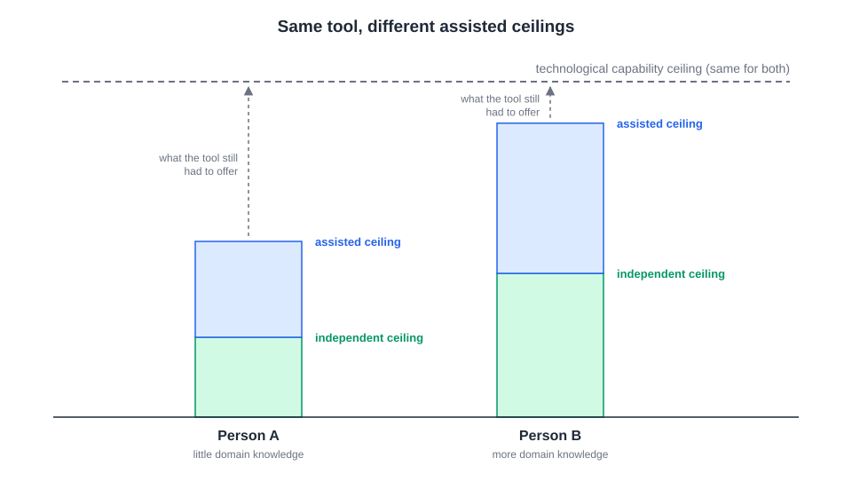
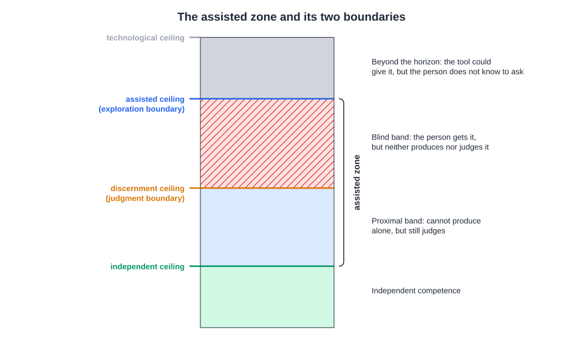
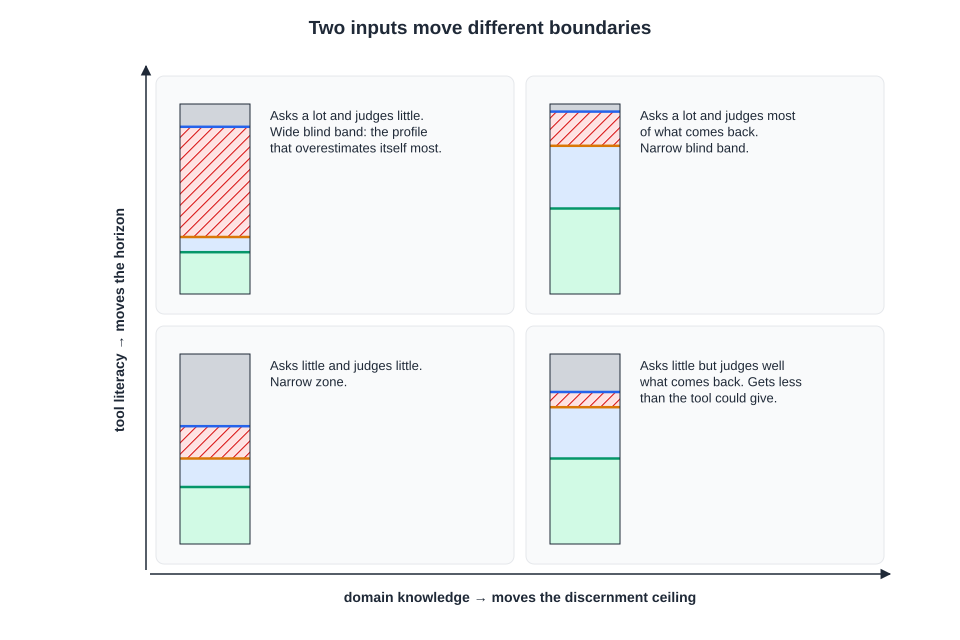
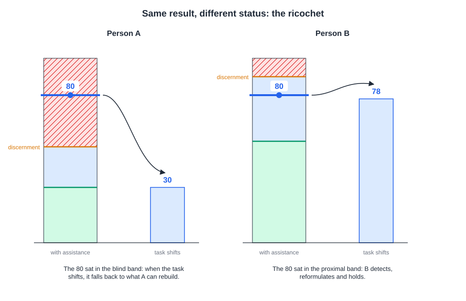
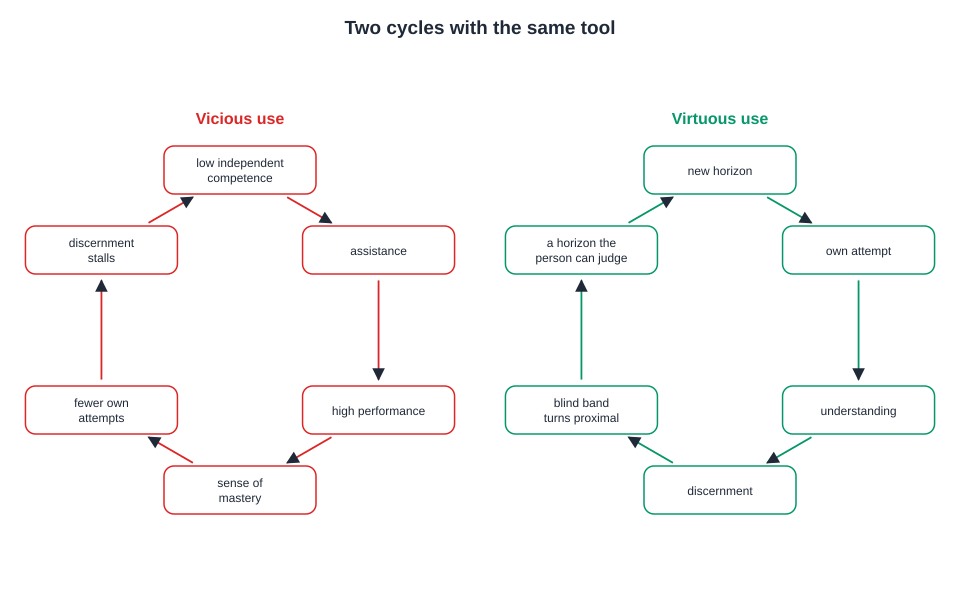
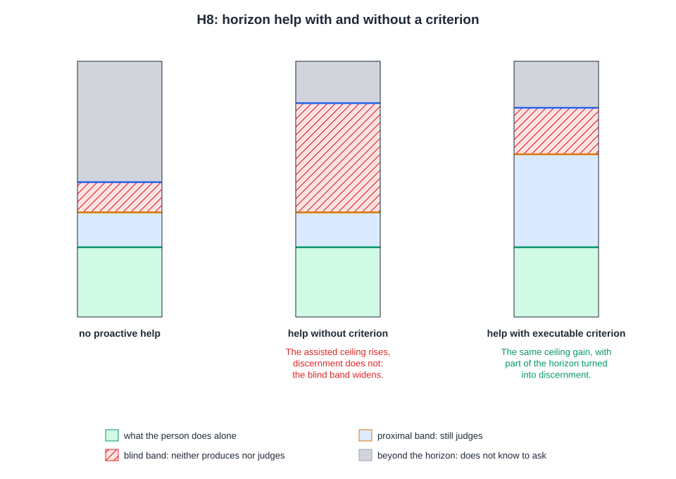
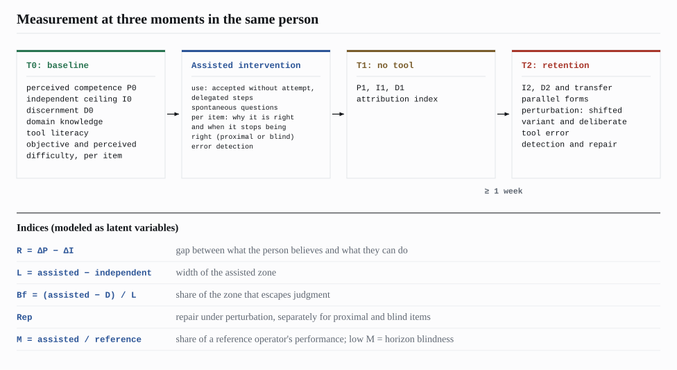
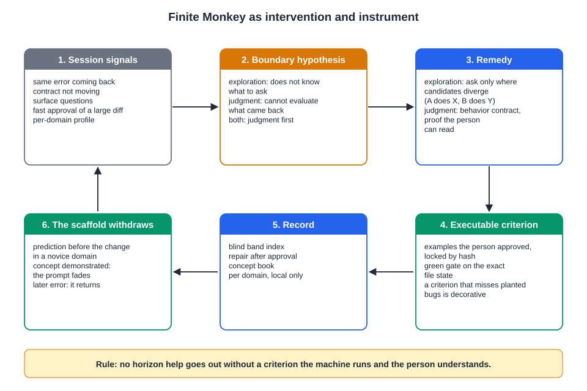

# Ricochet Effect: the user as the invisible limit of artificial intelligence

**Gabriel Vieira Flores**
NovusTec, São Paulo, SP, Brazil
gabrielvieira.ifsc@gmail.com · ORCID [0009-0000-2613-8284](https://orcid.org/0009-0000-2613-8284)

Version 2.1, October 2026. English | [Português (Brasil)](ricochet.pt-BR.md) | [Español](ricochet.es.md)

> This essay is the theoretical basis of [Finite Monkey](../../README.md). Sections 1 to 9 present the model and the measurement program in general terms. Section 10 shows how the model becomes a product: each mechanism of Finite Monkey is, at the same time, an intervention on one of the boundaries described here and an instrument for measuring it in real software engineering work.

## Abstract

Solving a problem with assistance is not the same as learning to solve it, and recent experimental literature already demonstrates both halves of this distinction: artificial intelligence assistance raises immediate performance and, under certain conditions, reduces later independent performance, without the person noticing the loss. This essay proposes a model of what exists between the two results. It distinguishes three ceilings: the technological capability ceiling, a property of the system; the independent competence ceiling, what the person does alone; and the assisted competence ceiling, what a specific person can effectively make the system produce, which varies across users of the same tool. The central thesis is that the assisted zone, between the independent ceiling and the assisted ceiling, is cut by two internal boundaries that do not coincide. The first, horizon blindness, is the boundary of exploration: to recognize that something exists beyond what has been shown, one must possess the frame of reference from which that beyond appears as a possibility. The second, the discernment ceiling, is the boundary of judgment: how far the person can assess the adequacy of what the tool produced, even without producing it. The two boundaries respond to different inputs, tool literacy and domain knowledge, and therefore shift independently. The region above the discernment ceiling, the blind band, is treated as a regime: in it the output replicates while the person's contribution does not, the illusion of understanding is sustained by fluency, and the horizon expands without discernment keeping pace. The Ricochet Effect is the observable signature of this architecture: when the task moves, the tool errs or the assistance is withdrawn, what was below each boundary remains and what was beyond it regresses. The essay derives three founding experiments (horizon transplantation, error-detection incentive and repair under perturbation), a measurement program with three time points in the same individual, and a design consequence: help that widens the horizon without delivering a means of judging the result widens the blind band. It also discusses mimicry, the fluent use of a domain's technical vocabulary without the relations that give it meaning, and the precautions needed to measure it without false positives. Version 2 adds evidence from 2024 to 2026 on agent-assisted software engineering and describes Finite Monkey, an open-source extension for Claude Code, as an implementation and instrument of the model.

**Keywords:** artificial intelligence; LLM; coding agents; learning with AI; cognitive offloading; evaluative judgment; artificial intelligence literacy; Zone of Proximal Development; assisted performance; software engineering.

## 1. The phenomenon

Generative artificial intelligence levels. This is the most replicated finding of the productivity literature: in professional writing tasks, quality gains concentrate in the lower half of the initial skill distribution, and performance inequality decreases (NOY; ZHANG, 2023); in customer support, the least experienced workers are the ones who gain the most (BRYNJOLFSSON; LI; RAYMOND, 2023); in consulting, within what the tool can do, the consultants with the lowest initial performance move closer to those with the highest (DELL'ACQUA et al., 2023). The person with less training does, in fact, get where the person with more training gets.

The same consulting study records the other side. The tool's capability has a jagged frontier: inside it, assistance improves everyone's performance; outside it, it worsens it; and consultants do not perceive where the frontier lies, so they keep trusting the tool on tasks in which it harms them (DELL'ACQUA et al., 2023). The leveling is real, but it is measured where people converge, the output, and not where they diverge. This essay starts from the hypothesis that there is a second jagged frontier, on the person's side, as invisible from within as the tool's, and that assisted performance is only reliable at the intersection of the two.

The distinction between what a tool allows and what a specific person can perceive as possible is not new. Norman (2013) separates the real affordance of an object, what it in fact allows one to do, from the perceived affordance, what the user recognizes as possible. A piano keyboard has the same real affordance for a pianist and for someone who has never played; only the former perceives in it the possibility of a fugue. Cognitive assistance by language models makes this gap more consequential than in any previous object, because the real affordance of the system is immense and the perceived one depends entirely on the repertoire of whoever operates it.

In software engineering the phenomenon already has a concrete form. Coding agents write entire applications from natural-language requests, and people with no programming background have begun to publish systems that collect data and charge money. An audit of 200 published applications, built mostly by means of agents, found at least one vulnerability in 91.0% of them, concentrated in access control, injection and authentication (DENG; FAN; MENG, 2026). In a survey of 162 participants divided into non-programmers, beginners and professionals, all groups acknowledged that generated code carries risks, but only the non-programmers reported never checking the code, and they tended to ask again instead of debugging (FAWZY; TAHIR; BLINCOE, 2026). The authors call this the gap between perception and action: the risk is known, the capacity to verify it is not distributed. The output converged; what the person can do with it did not.

To describe this relationship, the essay distinguishes three limits.

The **technological capability ceiling** is the space that the combination of model, tools, harness and search mechanisms can, in principle, make available under a given protocol. It is a property of the system: given a configuration, there is an upper limit on what it can produce, and that limit does not depend on who operates it. It moves when the technology changes. Web searches bring into the response space knowledge that was not in the model's parameters; a harness that runs tests, reads errors and tries again turns the same model into a more capable system. No user needs to learn anything for this ceiling to rise. It is not directly observable; the measurement section discusses how to approximate it and what that approximation actually measures.

The **independent competence ceiling** marks how far the person can produce, reconstruct and correct alone, without assistance. It is a functional and provisional limit, movable only through learning.

The **assisted competence ceiling** is a relation between the system and a specific person, under a task and a protocol: it measures how much of the technological space that person can effectively mobilize, that is, direct, interrogate, evaluate and make use of. It can be radically different between two people using exactly the same model, the same harness and the same search. A person with little prior knowledge of a domain may reach a much lower assisted ceiling than a more advanced person using the same tool, not because the tool responds worse to them, but because, past a certain point, they can no longer formulate the next question or judge the previous answer. The technology still has more to offer. It is the person who no longer knows what to ask for, nor whether what they have already obtained is right.

*Figure 1 – Same technological capability ceiling, different assisted competence ceilings. Source: author's own elaboration (2026).*

This is the precise formulation of what the essay means when it states that the user limits artificial intelligence. The claim is not about how often this occurs, which is an empirical question, but about the mechanism: the realized capability of the tool is the projection of its potential capability onto the space of questions that this person can formulate, filtered afterwards by what they can judge. The tool does not lose capability; it is underused. Each user queries a slice, and the slice is the size of the repertoire.

Between the independent ceiling and the assisted ceiling of each person lies the **assisted zone**, the central object of this essay. In this region, assisted production exceeds what the person would do alone, and the result may be correct, partially correct, incorrect, correct only under certain conditions, or correct for a problem different from the one the user intended to solve. The problem is not the presence of error, but the possibility that the person has no means of their own to locate it. The zone is, therefore, structurally undecidable for whoever occupies it: the person can produce something beyond their independent ceiling, but cannot determine, by themselves, where what they understand ends and where what only the assistance made possible begins.

We call the **Ricochet Effect** the observable behavior of this zone under perturbation: assistance displaces the person beyond their independent level, and, when the task moves, the tool errs or the assistance is withdrawn, performance returns in a differentiated way, according to the position each result occupied relative to the internal boundaries described below. The metaphor describes a return, not a collision. The phenomenon is not defined by the technology employed, but by the relation between the user's capacity and the assistance they receive; a search engine, a solutions manual or a human tutor can produce analogous situations. Generative artificial intelligence is of interest because it constitutes the mode of assistance most capable of widening the zone, by combining production, interaction, adaptation to the user and access to external sources. Agents that execute code add a new property: the output stops being text that the person reads and becomes a system that runs, and a system that runs looks right with much more force than a well-written paragraph.

**Table 1 – The ceilings, boundaries and variables the model distinguishes**

| Element | Definition | Role in the model |
|---|---|---|
| Technological capability ceiling | Space that model, tools, harness and search can, in principle, make available under a protocol | Property of the system; upper limit of everything that follows; not directly observable |
| Assisted competence ceiling | How much of that space a specific user can effectively direct, interrogate, evaluate and make use of | Relation person × tool × task × protocol; varies across users of the same tool |
| Independent competence ceiling | Level the person reconstructs, applies and transfers without assistance | One of the poles of the assisted zone |
| Horizon blindness | Boundary of exploration: how far the person can perceive possibilities and formulate the next question | Explains why the assisted ceiling varies across users; sensitive to tool literacy |
| Discernment ceiling | Boundary of judgment: how far the person assesses the adequacy of what they receive, even without producing it alone | Divides the assisted zone into proximal band and blind band; sensitive to domain knowledge |
| Perceived competence | Level the person believes they possess | Subjective correlate; tends to anchor on the assisted ceiling |

Source: author's own elaboration (2026).

## 2. Horizon blindness

In Plato's allegory of the cave, the chained individuals do not merely ignore the outside world; they take the shadows they see as reality itself. The limit of their experience does not appear to them as a limit, because they lack, from within that horizon, the frames of reference needed to recognize it as such. They lack the condition for perceiving that there is something to be known beyond what they can already perceive.

Something similar occurs in the interaction between a person and a cognitive assistance tool. For the person to formulate the next question, they must first perceive that there is a next question to be asked. This perception depends on prior knowledge that allows them to recognize a gap, a contradiction, an omitted variable or a possibility not yet explored. A paradox arises: to recognize that a horizon of knowledge is not the end, one must already possess some knowledge that allows one to see what lies beyond it. Assistance can lead the person to touch concepts far above their repertoire. But touching a concept is not the same as acquiring the structure needed to continue from it. Without that structure, what was shown is not perceived as a small part of a larger territory. It may be perceived as the territory itself.

It is in this sense that we speak of **horizon blindness**: the inability to perceive that something exists beyond the cognitive horizon that the assistance itself made accessible, because the individual lacks the frames of reference to recognize this absence as an absence. The person not only lacks certain content; they may not know that it exists, that it is relevant and that it should be sought.

An example from software makes the mechanism visible. Someone asks an agent for "an online store to sell my courses". They receive a page with a catalog, a cart and a payment button that works in the test environment. As far as this person knows how to ask, the task is finished. They do not ask what happens when the same payment is notified twice, who can see whose order, how to issue a refund, what to do when the payment provider is down, or how the system behaves with two customers buying the last seat at the same time. They do not ask because nothing in what they saw indicates that these questions exist. A person with experience in payment systems would ask these questions before writing the first line. The tool would know how to answer them. The technological ceiling is the same; the assisted ceiling is not.

This mechanism has grounding that predates artificial intelligence. The capacity to find and formulate problems is distinct from the capacity to solve them and predicts long-term creative trajectories better than the latter does (GETZELS; CSIKSZENTMIHALYI, 1976). The quality of the questions someone formulates about a system is one of the best indicators of how well they understand it: whoever understands a device asks about its mechanisms; whoever does not understand asks about its surfaces (GRAESSER; OLDE, 2003). Horizon blindness is the name this essay gives to a deficit of problem formulation under assistance.

The tool itself does not compensate for the deficit on its own. In a benchmark of 762 programming problem descriptions altered to be ambiguous, inconsistent or incomplete, ChatGPT asked a clarifying question in 14.21% of the cases in which it should have, and even with half of the description removed 95% of the responses generated code (WU; FARD, 2025). The model answers what was asked. If the person does not know something is missing, the model rarely says so.

Horizon blindness is, structurally, an asymmetry between generating a question and recognizing it when it is presented. That recognizing is easier than generating is a general fact of cognition. What the model claims is more specific: the distance between recognizing and generating the next question is greater under low domain knowledge, and it is this distance, not knowledge itself, that predicts how far a person's assisted ceiling reaches. From this follows the experiment that gives empirical content to the mechanism: provide the person with the question they would not formulate alone and observe whether the assisted ceiling rises.

Horizon blindness should be distinguished from two neighboring mechanisms. Siddique's (2026) competence shadow describes the narrowing of human reasoning induced by the analysis the tool presents: what the tool shows displaces from the field of attention what it did not show. It is an exogenous narrowing, projected by the system's competence profile onto a competent operator. Horizon blindness is endogenous: it is the person's repertoire that decides what they can ask for, before any output. The two mechanisms coexist; the shadow explains why even the expert is narrowed, while the blindness explains why the novice does not even reach the point where the shadow would act. The metacognitive blind spot of Crk and Gultepe (2026) describes another phenomenon: students recognize the linguistic friction of a text, but not its conceptual difficulty. It is a blindness about the task, not about the space of action; the model incorporates it as a moderator, in the form of the divergence between perceived and objective difficulty.

Not even instructions meant to make the tool more critical solve the problem. Asking the artificial intelligence not to agree with the user, to act as an expert or to look for flaws in its own reasoning changes the response produced, but does not eliminate the need for someone to evaluate whether the returned critique is relevant, deep or merely superficial. The prompt changes what is asked of the tool. It does not change who, on the other side, needs to recognize the value of the response, and that recognition is the second boundary.

Horizon blindness operates at the boundary between the assisted ceiling and the technological ceiling: it explains why the person does not ask for what they do not yet know exists. The discernment ceiling operates within the assisted zone: it explains whether, for what has already been produced, the person can judge whether it is right. The first boundary decides what gets asked. The second decides what can be evaluated once asked. And the two do not necessarily sit in the same place.

## 3. The discernment ceiling: proximal band and blind band

Kruger and Dunning (1999) described the dual burden: the competences needed to produce a correct answer at a certain level are, to a large extent, the same ones needed to recognize that it is correct. The effect that bears their names has been contested as partly a statistical artifact of the combination of the better-than-average effect and regression to the mean (GIGNAC; ZAJENKOWSKI, 2020), and this essay does not inherit the shape of the curve, but the weaker and less contested premise: judging requires part of the competences that producing requires.

People, however, recognize a good argument, a good translation or good code without knowing how to produce them. The capacity to judge the quality of a piece of work without producing it is the object of a tradition of its own: the literature on evaluative judgment defines it as the capacity to make decisions about the quality of one's own work and that of others (TAI et al., 2018) and already treats it as a central competence in the face of outputs generated by artificial intelligence (BEARMAN et al., 2024). The boundary that matters, therefore, is not the production ceiling, but a distinct limit: the **discernment ceiling**, the level up to which the person can assess the adequacy, correctness and limits of what is presented to them, even without being able to produce it alone. What this essay adds to that tradition is to situate this capacity as a measurable boundary inside the assisted zone, relative to the independent and assisted ceilings of the same individual, and to track it over time.

This boundary divides the assisted zone into two bands of opposite epistemic status. In the **proximal band**, between the independent ceiling and the discernment ceiling, the person does not yet produce alone, but still judges: they recognize an error, identify a premise that does not apply, notice that the answer solves another problem. There, assistance works as a bridge. In the **blind band**, above the discernment ceiling, the person neither produces nor judges: they accept the answer because it is fluent and technically ornate, without possessing the criteria to assess its adequacy to the concrete problem. It is in this band that assistance stops being a bridge and becomes a prosthesis, and it is where outsourcing of trust lives: the person comes to entrust to a third party, as if they knew, what they do not in fact master. An asymmetry aggravates the picture: the tool not only performs operations that the individual cannot perform, but can also supply the criteria by which they evaluate their own result, making the experience of success uninformative about the competence that actually belongs to them.

*Figure 2 – The assisted zone cut by the two boundaries: the proximal band, where the person still judges, and the blind band, where they do not. Source: author's own elaboration (2026), based on Kruger and Dunning (1999).*

In programming, the blind band has a direct measure. In a study with 86 programmers, participants correctly judged 74% of the correct assertions generated by language models and only 49% of the incorrect ones, with similar confidence in both cases; poor explanations from the tool worsened accuracy and increased confidence (KAUFMAN et al., 2026). Reading a wrong assertion and deciding whether it is right is, for programmers, worse than flipping a coin. The result is more serious because the assertion is precisely the artifact that should serve as the criterion: whoever asks the tool to "write the tests" and approves the tests they receive may be approving, in the blind band, the very criterion of judgment.

The form of what is judged changes the boundary. In a user study with 15 programmers, a workflow in which the person approves or rejects generated tests, instead of reading the code, made participants significantly more likely to correctly evaluate the code produced by the AI, with significantly lower cognitive load (FAKHOURY et al., 2024). Judging behavior ("for this input, the output is this") is closer to the discernment ceiling of someone who knows the problem than judging the implementation. The discernment ceiling is not a constant of the person; it also depends on the representation in which the result is presented to them. This observation is the practical foothold of section 10.

The dissociation between judging and producing is less clean than everyday examples suggest, and the model needs to record this. Expert judgment in evaluative domains is notoriously inconsistent across occasions: experienced wine judges award medals almost at random across flights of the same competition (HODGSON, 2008). The discernment ceiling itself may be unstable, and the measurement design needs to estimate this instability instead of presuming a sharp boundary. The boundary is, moreover, indexed: a person may discern well in tax law and poorly in programming, well in interface and poorly in databases, well with one tool and poorly with another. What the model claims as invariant are not the values of the ceilings, but their order within each context and the dynamics that link them.

### 3.1 Two inputs, two boundaries

The decisive point is that the two internal boundaries respond to different inputs. Tool literacy (knowing how to decompose, iterate, chain, ask for sophisticated analyses, knowing that an agent can run tests and read logs) shifts mainly the first. Domain knowledge shifts mainly the second. This produces profiles that the naive reading of "more competence, better use" does not distinguish. Someone with high literacy and low domain knowledge has a wide horizon, a high assisted ceiling, low discernment and, therefore, a wide blind band: they know how to ask for a lot and judge little of what they receive. Someone with high domain knowledge and low literacy has high discernment and an assisted ceiling limited by access to the tool: they judge well what they receive and receive less than they could.

*Figure 3 – Tool literacy and domain knowledge shift different boundaries, generating four profiles. Source: author's own elaboration (2026).*

The first profile is what Fernandes et al. (2026) found without looking for it: the higher the participants' AI literacy, the worse the accuracy of their self-assessment. Under a single boundary, this finding contradicts the expectation that competence improves judgment; under two boundaries, it is a prediction. The survey on agent-based programming described in section 1 shows the same pattern in the field: the capacity to ask became democratized faster than the capacity to verify (FAWZY; TAHIR; BLINCOE, 2026). The literature on the expertise reversal effect points in the same direction, by showing that the same instructional support that benefits novices can harm those who already master the content (KALYUGA et al., 2003; NIEVELSTEIN et al., 2013). A recent meta-analysis, with 60 studies and 5,924 participants, estimated the effect at d = 0.505 in favor of more support for novices and d = −0.428 in favor of less support for experienced learners (TETZLAFF et al., 2025): the relation between prior knowledge and the effect of assistance is not monotonic, and a model with two boundaries is the minimum needed to accommodate this.

### 3.2 The reconstruction barrier

The causal model is closed by the **reconstruction barrier**: when assistance performs, in place of the individual, the operations of generating, retrieving, integrating and correcting a solution, the individual may complete the task without completing the process by which that solution becomes their own knowledge. The literature on the generation effect, retrieval practice and desirable difficulties already demonstrates this mechanism outside the context of artificial intelligence assistance (BJORK; BJORK, 2011; SWELLER, 2011; ROEDIGER; KARPICKE, 2006; KORNELL; HAYS; BJORK, 2009). A meta-analysis of 86 studies estimated the generation effect at about 0.40 standard deviations (BERTSCH et al., 2007), and attempting to solve before receiving instruction yields a moderate and robust gain (SINHA; KAPUR, 2021). The foresight bias aggravates the picture (KORIAT; BJORK, 2005, 2006): the visible solution eases processing in the moment, and this ease is rarely discounted when the person estimates their future capacity. Exploratory evidence from Kosmyna et al. (2025), contested by Stanković et al. (2026), is compatible with the mechanism at the neural level, without demonstrating it. The prediction that makes the barrier testable is temporal: if the dissociation is a momentary effect of familiarity, it should diminish with unassisted practice; if the assistance has reduced the formation of the necessary representations, the difference should persist after a retention interval.

## 4. The blind band as a regime

The blind band matters here not as a region, but as a regime: a set of properties that govern the behavior of whoever occupies it, regardless of who they are.

Consider two people using exactly the same tool: Person A has little prior knowledge of the domain; Person B, considerably more. In a simple task the difference is invisible: both reach a correct answer, and an external observer would conclude that they have the same capacity. It is this observer that the leveling literature describes. The difference appears when the structure of the task exceeds what each one can represent and evaluate, not because the task becomes harder, but because the perceived difficulty, shaped by the available horizon, diverges from the objective difficulty.

Imagine that A and B produce, with assistance, a result of quality 80. For an observer interested only in the product, the two performances are equivalent. But A reached 80 through a chain of instructions they cannot reconstruct and whose result they cannot fully evaluate, while B can reconstruct the reasoning, recognize the premises, identify the conditions of validity and correct the solution if one of them changes. Both produced 80. For A, the 80 is in the blind band; for B, in the proximal band. The external result is the same. The epistemic status of the result is different.

*Figure 4 – The same result, 80, occupies A's blind band and B's proximal band. Under perturbation, A's result returns to their reconstructible level; B's holds. Source: author's own elaboration (2026).*

**First property: the output replicates; the person's contribution does not.** It would be tempting to say that A's convergence with B is a one-off success that does not repeat. But if the task lies within the tool's reliable frontier, A will obtain the correct result repeatedly, because it is the tool that produces it. What does not replicate is the person's contribution, and this difference only appears under three conditions: when the tool errs and the person does not detect it; when the task shifts by one step and the person cannot reformulate; and when the assistance is withdrawn and the person cannot reconstruct. The effect of working in the blind band is not instability under repetition, but fragility under perturbation. The person operates a system that works until the day it does not, and on that day they are the last to know. In software, perturbation has a name: a requirement that changes, an updated dependency, an input no one anticipated, a second user. The 200 applications audited by Deng, Fan and Meng (2026) worked; most had a point at which one user could read or alter what belonged to another, and those who published them had no way of knowing. The phenomenology of this state has already been described outside the context of assistance: people believe they understand mechanisms they cannot explain, and the illusion is stronger where the environment supplies ready-made explanations with visible mechanisms (ROZENBLIT; KEIL, 2002), which is the exact description of a fluent answer produced by a language model.

**Second property: the horizon expands without discernment keeping pace.** Touching concepts above one's repertoire teaches that certain questions exist before it teaches how to judge the answers. The blind band can expand the horizon without expanding discernment: the person leaves it knowing how to ask for more and still unable to evaluate. This is the asymmetry between the two boundaries, now seen as dynamics: exposure in the blind band preferentially feeds the boundary of exploration, and domain knowledge, which feeds the boundary of judgment, does not come for free with exposure.

It is like someone who, after repeatedly talking with specialists about a given subject, comes to speak their language with ease. They recognize the terms, follow the discussion, reproduce examples and formulate observations that sound sophisticated. To an outside observer, especially one who also does not master the subject, their performance may look like that of someone who understands the field. The difference appears when the conversation leaves the paths already traveled: it is enough to alter a premise, introduce an edge case, question the relation between two statements or ask for a conclusion to be reconstructed from its foundations.

Whoever understands the domain does not need to know the answer to begin working on the question: they identify the relevant premises, retrieve known relations, decompose the problem and build, step by step, a possible answer. Whoever learned mainly through exposure to answers recognizes terms, explanations and conclusions when they encounter them and can reproduce them with great confidence, but does not necessarily have the structure that would allow them to reconstruct them when the problem changes. There is a difference between possessing a structure that generates answers and possessing a repertoire of answers that generates the appearance of a structure. The first allows one to operate on the unknown; the second depends on the permanence of the paths already traveled. Mechanistic explanation, and not the list of reasons, is what reduces the illusion of explanatory depth (FERNBACH et al., 2013); generative assistance, by successively supplying the steps through which the person could advance, allows them to inhabit the linguistic surface of knowledge before acquiring the structure needed to reconstruct it.

**Third property: the regime feeds itself.** In vicious use, exposure in the blind band turns into horizon and stops there: the person progressively learns what to ask for, the assisted ceiling rises, discernment does not keep pace and the blind band widens. Each fluent answer reinforces the feeling of mastery, although a growing part of what the person can mobilize depends on a structure that remains external to them. The cycle closes: low independent competence leads to assistance; assistance produces high performance; high performance produces a feeling of mastery; the feeling of mastery reduces the perceived need for one's own attempt; and the absence of one's own attempt limits the construction of the discernment needed to deal with the next variation of the problem.

In virtuous use, the same exposure produces a different trajectory: what first appears as horizon turns into one's own attempt, the attempt into understanding and understanding into discernment. Part of the blind band becomes proximal; part of the proximal band becomes independent. What separates the two trajectories is not the amount of tool use, but what happens cognitively to what the assistance made accessible.

*Figure 5 – Cumulative cycle under vicious use and under virtuous use. Source: author's own elaboration (2026).*

### 4.1 The strongest design prediction

This is why instructing the tool to be critical does not solve the problem: the returned critique is one more output, and whoever receives it in the blind band lacks the criteria to know whether it is relevant. And this is why the strongest design prediction the model produces is also the most counterintuitive. A tool that proposes the next question, that performs horizon transplantation on its own, raises the assisted ceiling of someone with a low horizon, because it supplies the missing formulation. It does not raise discernment, because the proposed question is as unevaluable for this person as the answer. The consequence is that **proactive assistance levels the output and widens the blind band at the same time**: the more the tool asks on the person's behalf, the more the person operates in territory they cannot judge. This is hypothesis H8 of section 8.

The prediction has a counterpart that makes it useful for those who design tools. If horizon help widens the blind band because it arrives without a means of judgment, the same help, delivered together with a criterion the person can verify, should have the opposite effect. The criterion cannot be more text, because text in the blind band is as unevaluable as the answer; it must be something the person can observe: a concrete behavior, an execution, a case that passes or fails. The design rule that follows from the model is simple to state: **no help that widens the horizon goes out without a criterion that the machine executes and the person understands.**

*Figure 6 – H8. Horizon help without a criterion raises the assisted ceiling and widens the blind band; the same help with an executable criterion converts part of the horizon into discernment. Source: author's own elaboration (2026).*

The ricochet sits within this architecture as perturbation: the return to the reconstructible level occurs whenever the task moves, with or without the tool present, and the withdrawal of assistance is the limiting case in which the perturbation is total. The structure of the zone exists during assistance; the ricochet is its observable behavior when something changes. The question, therefore, is not only how far assistance can take the person, but what remains in them when the task changes and when the assistance is withdrawn.

### 4.2 Mimicry: the vocabulary that arrives before the structure

The second property of the blind band has a linguistic manifestation that deserves separate treatment. Someone who works with a generative tool in a domain they do not master receives, with each response, technical terms already used in context, such as idempotency next to webhook or race condition next to queue. These terms start appearing in the person's own requests, with the ease of someone who has used them for years. Mimicry is the name given here to the fluent use of a domain's vocabulary without mastery of the relations that give that vocabulary its meaning. The concept does not assume an intention to deceive. It describes the expected result of a regime in which exposure preferentially feeds the boundary of exploration: the lexicon is the part of the domain most easily transferred through exposure, and for that reason it tends to be the first to shift.

The closest analogy comes from reading research. The distinction between decoding and comprehending organizes the Brazilian discussion of alfabetização (learning to read and write) and letramento (the social use of reading and writing), which treats the two processes as distinct and interdependent (SOARES, 2004), and it also organizes the functional literacy indicators, whose levels range from people who decode familiar words without functional use of reading to people who analyze arguments and integrate information. In the 2024 edition of the Indicador de Alfabetismo Funcional (Inaf), 29% of the population aged 15 to 64 remained in the two lowest levels, and the measure comes from tasks solved in front of an administrator, not from self-report (AÇÃO EDUCATIVA; CONHECIMENTO SOCIAL, 2024). In school, the corresponding figure is the fluent reader who does not comprehend, known in the English-language literature as a word caller. Applegate, Applegate and Modla (2009) assessed 171 students whom parents and teachers considered good readers and who did in fact read fluently; more than a third were classified as having comprehension difficulties. Fluency hid the lack of comprehension precisely from the people who lived with these readers.

The same literature carries a warning that any instrument derived from it must incorporate. When teachers point out which students read well and understand little, they are frequently wrong. Hamilton and Shinn (2003) compared 33 third-grade students nominated by their teachers as fluent readers without comprehension with 33 classmates whom the same teachers judged equally fluent. The nominated students read fewer words correct per minute and performed lower on the comprehension measures, and the teachers mispredicted the performance of both groups. Meisinger et al. (2009), in two cross-sectional studies with 868 and 202 children, found the phenomenon rare in the early grades and more frequent at the end of elementary school, and observed that teachers over-nominated readers of this type and used the term inconsistently. The impression that someone speaks well and understands little is itself a fallible judgment, inclined toward false positives, and the judge's familiarity with the language does not protect against this error.

In programming, the distinction has a known operational form. Lister et al. (2006) used the SOLO taxonomy to classify explanations of short code fragments and found educators giving relational answers, which describe the purpose of the fragment as a whole, while students gave multistructural answers, which describe line by line what each statement does. Sheard et al. (2008) showed that the multistructural answer persists when the instruction is reworded to remove ambiguity and that the SOLO level on the reading questions correlates with performance in writing code. Lopez et al. (2008), from a regression on exam data, proposed a hierarchy in which knowledge of language constructs sits at the base and explaining code in natural language occupies, together with ordering shuffled blocks and tracing loops, an intermediate level below writing. A multistructural answer can contain the correct terms, each applied to the right line, and still fail to articulate the relation that makes the fragment a solution. That is the signature mimicry would leave in the requester's discourse: terms present and relations absent or swapped.

The use of a term in the wrong relation, however, is not sufficient evidence. Rector, Nehm and Pearl (2013) examined 1,282 written explanations about evolution and found 81% of students using lexically ambiguous terms, such as pressure and adaptation, at least once. When students were invited to say what they meant, a considerable share of the explanations changed interpretation, usually because the ambiguity was resolved, with no change in the accuracy of the content. The use of these terms was not associated with reading and writing ability. A clarification question therefore separates part of the loose or deliberately abbreviated use from use without comprehension, and an instrument that dispenses with this question will confuse the two. The opposite limit is the interactional expertise described by Collins and Evans (2013): some people master the discourse of a community of specialists to the point of being indistinguishable from practitioners in an imitation-game test, without having practiced, and this mastery takes considerable time and effort to acquire (EVANS; COLLINS, 2010). Discursive fluency without practice may correspond to understanding of the relations. Mimicry designates the fluency that lacks these relations.

The two-boundary model locates the phenomenon. Technical vocabulary belongs to the horizon: knowing that idempotency exists makes it possible to ask for an idempotency key. In the profile with high literacy and low domain knowledge, exposure in the blind band expands vocabulary at its own pace, and each request phrased with correct terms produces, through the tool, a result that works. The illusion of explanatory depth, stronger where the environment offers ready-made explanations (ROZENBLIT; KEIL, 2002), receives an additional reinforcement here, because the person begins to hear themselves using the specialist's lexicon. For anyone judging from the requests, including the person themselves, vocabulary becomes a less reliable indicator of competence as the blind band widens. From this follows a hypothesis that the previous ones do not cover.

Hypothesis H11 (mimicry) states that the distance between the domain vocabulary the person mobilizes in their requests and the executable evidence of judgment in that domain predicts lower repair under perturbation (Rep) on the domain's items, controlling for domain knowledge measured at T0 and for performance on the executable probes taken alone. The prediction can fail in two ways. If probe performance alone explains all the variance in Rep attributed to the distance, vocabulary adds no information and the concept of mimicry is dispensable. If the distance stops predicting Rep once domain knowledge is controlled, mimicry is merely another name for low knowledge.

Measurement combines sources that do not depend on the same judgment. Vocabulary is counted in the requests, per domain, with an echo measure: the proportion of terms whose first occurrence in the project was in a tool response, before any request from the person that contained them. Evidence of judgment comes from short probes with an executable answer key, such as predicting the output of a fragment for a given input or choosing, between two variants, the one that contains the defect, where the correct answer is established by running the code. Natural-language explanations enter as a secondary signal, classified as relational or multistructural by two raters blind to condition; automatic classification by language models reaches moderate to substantial agreement with human raters (SMITH; ZILLES, 2024; SMITH et al., 2025), which is not enough for a decision about an individual. Relation errors in requests are counted only after a clarification question, following the finding of Rector, Nehm and Pearl (2013).

Two precautions accompany the hypothesis. The first is statistical: on a validated concept inventory, 31% of answers changed between test and retest, although the total score was stable (LASRY et al., 2011), and therefore no single probe should change anyone's classification. The second is ethical and follows directly from the literature on fluent readers without comprehension. If teachers who spend their days with the child over-nominate these readers, an instrument that infers mimicry from adults' discourse must be evaluated first by its false-positive rate, estimated against independent verification and disaggregated for people who write concisely, people who write outside their native language, specialists who omit explanations and people who abbreviate terms by choice. In any applied use, the result describes the relation between requests and evidence in a domain and within a time window; what the person is lies outside what it can assert.

## 5. What is already known

The phenomenon has four sides demonstrated by literatures that rarely cite one another: the perceptual, the performance, the leveling and, more recently, the collaboration between humans and systems. None of them, in isolation, tests the full model; together, they give it an empirical floor and delimit what has not yet been measured.

**Perceptual side.** Koriat and Bjork (2005, 2006) establish the minimal mechanism: the presence of the solution during study inflates the judgment of learning without inflating later recall. Fisher, Goddu and Keil (2015) showed, in nine experiments, that searching for explanations on the internet increases self-assessed knowledge even in domains not searched. Sparrow, Liu and Wegner (2011) described the adaptation of memory to the availability of external search. Ward (2021), in eight experiments with almost two thousand people, showed that search engine users fail to distinguish internal from external knowledge. In the context of language models, Fernandes et al. (2026) provided the most direct measurement: ChatGPT users improved their performance in logical reasoning, overestimated their own performance by an even greater magnitude, and the classic Dunning-Kruger pattern disappeared in the condition with artificial intelligence; the negative relation between AI literacy and self-assessment accuracy is the prediction of the two boundaries. Most participants sent a single prompt per question, behavior compatible with horizon blindness. Kaufman et al. (2026) extend the perceptual side to programming: equal confidence in the face of right and wrong assertions. Gerlich (2025), in a correlational study with 666 participants, found a negative association between frequent AI use and critical thinking, mediated by cognitive offloading. Kim, Yu and Yi (2026) named the LLM fallacy, the attribution error by which the person credits themselves with competence produced with external help; the model treats it as a correlate of the blind band, not as its mechanism.

**Performance side.** The controlled randomized field trial of Bastani et al. (2025), with about a thousand students, is the strongest evidence: during assisted practice, GPT outperformed the control by 48% (unrestricted access) and 127% (tutor version); in the subsequent unaided assessment, the unrestricted-access condition was 17% below the control, a harm mostly avoided when the assistance forced the students' own steps before the solution, and the students did not perceive their own loss. Liu et al. (2026), in three randomized experiments with 1,222 participants, replicate the pattern and add the reduction of persistence in subsequent unassisted tasks. Barcaui (2025), with 120 Brazilian university students, offers the temporal complement: 45 days later, the group that had used ChatGPT recalled less (57.5% versus 68.5%), with the caveat that it devoted about half the study time. In programming, Sankaranarayanan (2026), in a study of 26 participants per arm, measured failure in a later maintenance task without AI: 77% among those who used AI without restriction, 39% among those who only received the code after explaining the causal logic and 31% in the manual group, with no difference in functional performance between the two AI arms. Shen and Tamkin (2026) show that the effect of assistance on skill formation in programming depends on the usage pattern: delegating and asking about concepts do not produce the same result. Outside the educational setting, Budzyń et al. (2025) recorded, in a multicenter observational study, the adenoma detection rate of endoscopists operating without AI falling from 28.4% to 22.4% after months of assisted use, a result compatible with the retreat of an independent ceiling, albeit retrospective and debated. Macnamara et al. (2024) had already asked whether AI assistance accelerates skill decay without the awareness of those who use it; the question today has independent experimental designs pointing in the same direction. Ferdman (2025) formulates the problem as a property of environments hostile to the cultivation of capacities; the model proposed here is compatible with this reading and specifies it at the level of the individual.

**Leveling side.** Noy and Zhang (2023), Brynjolfsson, Li and Raymond (2023) and Dell'Acqua et al. (2023) document the compression of the difference between workers of lower and higher initial performance, and the latter also records the tool's jagged frontier and users' inability to perceive it. In software, leveling appears as functionality: in the evaluation by Zhao et al. (2026), with 186 real tasks, 57% of the solutions of a frontier agent were functionally correct and only 11.8% were secure, and including vulnerability hints in the request did not solve it. Read together with the performance side, these results describe what the model predicts: convergence in the output, divergence in what remains when the task changes.

**Collaboration side.** A meta-analysis of 106 experiments and 370 effects showed that, on average, the combination of human and AI yields less than the better of the two alone (g = −0.23), and that the sign depends on who judges better: when the human outperforms the AI, the combination gains (g = +0.46); when the AI outperforms the human, the combination loses (g = −0.54) (VACCARO; ALMAATOUQ; MALONE, 2024). Putting the person in charge of deciding where they are in the blind band worsens the result; putting them in charge of deciding where only they know improves it. The distribution of judgment between person and system is not neutral, and the two-boundary model indicates where each should judge.

The neurocognitive layer of Kosmyna et al. (2025), with 54 participants and a subsample of 18 in the switch session, and a published methodological critique (STANKOVIĆ et al., 2026), is worth less as proof and more as a signal that the behavioral mechanism leaves a physiological trace.

The literature converges, independently, toward architectures that describe gaps between performance and understanding under assistance. Koch (2026) proposes AI-mediated metacognitive decoupling, with four variables (observable output, underlying understanding, self-assessment and calibration); the model captures the dissociation within an interaction, without a hierarchy of ceilings and without a mechanism for the variation of the assisted ceiling across users. Yadav (2026) formulates the AI competence ceiling hypothesis as a career trajectory model, without internal boundaries in the task and without a measurement design. Siddique (2026) derives, for safety engineering, closed-form bounds on degradation under the competence shadow, a formalism more rigorous than this essay's in the domain where it applies, and narrower. Crk and Gultepe (2026) operationalize the divergence between perceived and conceptual difficulty.

In the literature examined, no study was found that measures, in the same individual, with a baseline and retention, the four elements at the same time (what the person thinks they know, what they do alone, what they do with assistance and how far they judge what they received), nor a model that treats exploration and judgment as independent boundaries within the assisted zone and derives from this independence predictions about the fate of items under perturbation. It is this joint measurement that this essay proposes as its empirical contribution, and section 10 proposes a second route, not yet explored: measuring the boundaries in real work, with the record that an engineering tool already produces.

## 6. Measurement design

Observing the construct requires at least three time points. At **T0**, one measures perceived competence (P0), the independent competence ceiling (I0), the discernment ceiling (D0), prior domain knowledge and tool literacy, separately, and, item by item, the objective difficulty of the task, calibrated by experts or by item parameters in an independent sample, and the difficulty perceived by the participant before any attempt. The separation between domain knowledge and tool literacy is the condition for the two boundaries to be observed shifting independently.

Next comes the **assisted intervention**, with a record of usage behavior: proportion of content accepted without one's own attempt, proportion of core steps delegated, number and quality of follow-up questions formulated spontaneously and, for each item, whether the participant can indicate why the answer is correct and under which conditions it would cease to be, a criterion that separates, item by item, the proximal band from the blind band. This criterion requires judging the quality of a justification and inherits the known threats to inter-rater reliability: leniency, dependence on the rater's expertise and, above all, the effect of fluency itself, because verbally fluent people articulate plausible justifications without understanding. The design provides for a rubric with anchors per domain, two raters blind to condition with reported agreement, a generalizability pilot study before the main data collection, and recording on a three-point scale, collapsed a posteriori into the dichotomy. Verbal justification is not the same as discernment: a person can consistently detect that an answer is wrong without verbalizing why, and the design therefore adds a behavioral measure of error detection as a second indicator of the same boundary.

At **T1**, without access to the tool, P, I and D are measured again, along with an attribution index. At **T2**, after at least one week of retention, I, D and transfer are measured, with parallel forms of the tests, and the perturbation test is applied: for items classified during the intervention as proximal or blind, matched by objective difficulty and by assisted accuracy, shifted variants of the task and tool responses with a deliberate error are presented, recording whether the participant detects and repairs. T2 is the decisive time point, because it distinguishes what T1 conflates: if the dissociation was a momentary effect of perception, it dissolves over time; if the assistance altered the formation of competence, the deficit persists.

*Figure 7 – Measurement design with three time points in the same individual and the derived indices. Source: author's own elaboration (2026).*

Five indices operationalize the model.

- **R = ΔP − ΔI** describes the immediate dissociation between what the person believes and what they can do. P and I originate on different scales, and the difference is only interpretable once both are expressed in a common metric defined a priori, for example the percentile on the same item bank; the design includes a null simulation showing what value of R would be expected with no mechanism at all, in response to the criticism that part of the literature on miscalibration is an artifact of regression to the mean (GIGNAC; ZAJENKOWSKI, 2020).
- **L = assisted ceiling − independent ceiling** describes the width of the zone. Its signatures are defined over joint trajectories, never over L in isolation: increasing L with a stagnant independent ceiling is the signature of vicious widening; stable or decreasing L with an increasing independent ceiling is that of virtuous co-displacement; increasing L with an independent ceiling that also increases is ambiguous and is only resolved at T2.
- **Bf = (assisted ceiling − D) / L** is the fraction of the assisted zone that remains above the discernment ceiling. L describes how much the zone has opened; Bf describes how much of it the person can evaluate. Two people can have identical L and very different Bf. Bf is a proportion and should be read together with L. As a ratio between two difference scores, it is undefined when L is zero and unstable when L is small; therefore it is not computed per individual from raw scores, but derived as a structural quantity of a latent model, with a confidence interval and a preregistered rule for values of L below a minimum threshold.
- **Rep**, the repair index, is the proportion of items in which the participant detects and corrects the deliberate error or reformulates the shifted variant at T2, computed separately for proximal and blind items. The prediction is that Rep is systematically lower on blind items, controlling for objective difficulty and assisted accuracy; the manipulation of the perturbation by the experimenter, and not its choice by the participant, protects the index from the selection problem.
- **M = participant's assisted ceiling / reference operator's performance** describes the fraction of reference performance that the participant mobilizes. The reference operator is a panel of people with high domain knowledge using the same tool, the same harness and the same time. It must be made explicit: the operator is a user of the system, not the system, and their performance is a floor of the technological ceiling, not the ceiling. M measures the ratio between people under a fixed protocol. The benchmark requires a panel of at least three operators with reported agreement, repetitions with intraclass correlation and a record of model, temperature, tools and harness; until its stability is demonstrated, the hypotheses that depend on M are not falsifiable. Low values of M, with stable R and L, are the operational signature of horizon blindness: the participant is not confused about what they received; they are failing to ask.

M and Bf operationalize the two boundaries: M is low when horizon blindness prevents the person from asking for more than they have already asked; Bf is high when, of what was obtained, a disproportionate fraction escapes judgment. The two vary independently, and it is this independence, not the isolated values, that empirically distinguishes the boundaries. None of the indices constitutes the construct: they are indicators for observing it, and an isolated value admits trivial explanations.

The indices inherit the classic limitations of difference scores (CRONBACH; FURBY, 1970). The criticism is not absolute: difference scores are reliable when true change is heterogeneous across individuals (THOMAS; ZUMBO, 2012), a condition the phenomenon itself predicts. The preferable analysis models P, I and D as latent variables through latent change scores, which corrects attenuation due to measurement error and formally tests the divergence of trajectories between conditions (McARDLE, 2009). This requires strong measurement invariance across parallel forms and across conditions as a tested and reported precondition (KIEVIT et al., 2018), and a sample size set by simulation, on the order of hundreds of participants per condition.

## 7. Causal model, nomological network and neighboring constructs

The causal model operates in two stages. In the first, horizon blindness determines how far the interaction can go: the assisted ceiling the person actually reaches, relative to the reference operator. At this stage, blindness also affects how the task is represented: whoever does not see the structure of the problem tends to perceive it as more diffuse than it is, and this distortion contaminates the estimate of perceived competence measured at T0. In the second stage, given what was reached, the discernment ceiling determines what fraction of it the person can judge, and the reconstruction barrier determines how much of what was judged converts into independent competence. The boundaries are conceptually distinct and, by hypothesis, empirically independent.

Within the second stage, manipulable antecedents (degree of outsourcing, own attempt, external verification and perceived textual fluency) form the reconstruction barrier when the core steps are performed externally without conversion into the person's own representations. Perceived textual fluency, holding content, correctness and length constant, is the proximal mechanism of the perceptual side, of which the inflation of judgments of learning by perceptual cues irrelevant to content is the most direct experimental precedent (RHODES; CASTEL, 2008). In code, fluency has an additional form: the program that runs. Successful execution is the strongest fluency cue there is, and it only proves that the program does something, not that it does what the person wanted.

The theoretical identity of the construct is not exhausted by its operationalization (CRONBACH; MEEHL, 1955): it is established by the network of predicted relations among antecedents, mechanism, moderators, correlated constructs and consequences.

**Table 2 – Nomological network of the proposed construct**

| Network element | Theoretical role | Prediction |
|---|---|---|
| External cognitive assistance | Antecedent | Increases dissociation and widening of the zone relative to a condition without assistance |
| Outsourcing of core steps; absence of own attempt | Antecedents of the reconstruction barrier | Increase dissociation and the width of the zone |
| External verification by the user | Inverse antecedent | Reduces dissociation and favors co-displacement |
| Representation of the criterion (observable behavior vs. text or code) | Moderator of the discernment ceiling | A criterion in the form of observable behavior raises D measured on the same item |
| Perceived textual fluency; successful execution | Proximal mechanism | Amplifies the experience of understanding and, under high outsourcing, the dissociation |
| Horizon blindness | Boundary of exploration; mediator between prior knowledge and assisted ceiling | Distance between generating and recognizing the next question is greater under low domain knowledge; predicts M |
| Discernment ceiling | Boundary of judgment | Divides the zone into bands with different fates under perturbation and withdrawal |
| Tool literacy vs. domain knowledge | Differential inputs of the two boundaries | Literacy raises the assisted ceiling more than D; domain knowledge raises D more than the assisted ceiling |
| Perceived vs. objective difficulty | Moderator of the first stage | Greater divergence predicts higher R, controlling for prior knowledge |
| Blind fraction of the zone (Bf) | Mediator of the second stage | High Bf predicts a worse independent ceiling and worse transfer at T2, controlling for L |
| Repair under perturbation (Rep) | Consequence of the blind band regime | Rep lower for blind items than for proximal ones, controlling for difficulty |
| Proactive assistance without a criterion | Manipulation of the boundary of exploration | Raises the assisted ceiling and M without raising D; widens Bf |
| Proactive assistance with an executable criterion | Joint manipulation of the two boundaries | Raises the assisted ceiling as the previous one does and reduces Bf relative to it |
| Language model assistance | Intensifying modality (hypothesis) | Greater dissociation and widening than under other forms of assistance |
| Miscalibration; offloading; LLM fallacy; evaluative judgment | Correlated constructs | Positive correlation, without identity with the proposed construct |
| Retention and transfer at T2 | Critical consequences | Greater conversion into independent competence for proximal items than for blind ones |

Source: author's own elaboration (2026).

The closest construct is Vygotsky's Zone of Proximal Development (1978, 2007), and the correct relation is one of declared inheritance, followed by inversion. For Vygotsky, the distance between what the child does alone and what they do with help is prospective: it describes maturing functions, and assistance is socially mediated. The scaffolding metaphor, introduced by Wood, Bruner and Ross (1976), added two properties that are not in Vygotsky: the scaffold is contingent on the child's performance and is progressively withdrawn as competence grows. The inversion this essay proposes targets the scaffold-fading assumption; the Zone of Proximal Development stays as inherited. Generative assistance takes the person many levels above their base for a fraction of the effort that climb would require, does not withdraw spontaneously and has no pedagogical intention. The zone ceases to be a forecast of development and may become an address, a place where one lives without developing. The discernment ceiling is the internal boundary that scaffolding theory did not need to postulate, because the scaffold it described was, by definition, contingent and fading; and horizon blindness is what prevents the person from doing, alone, what the human tutor did for them: perceiving what the next step is. The worked-examples literature shows that fading can be deliberately reconstructed: removing the steps adaptively, according to each student's performance, yields more delayed transfer than a fixed script (SALDEN et al., 2009). The model proposes that a permanent scaffold above the discernment ceiling produces residence in the zone and that, within the proximal band, it can produce a genuine leap; section 10 describes a tool that attempts to give back to generative assistance the two lost properties.

Four differentiations deserve to be recorded. Metacognitive miscalibration (KORIAT, 1993) measures the distance between judgment and performance at a single moment; the Ricochet compares trajectories. Cognitive offloading (RISKO; GILBERT, 2016) describes who performs the processing and figures as an antecedent of the barrier, not as the phenomenon. Evaluative judgment (TAI et al., 2018; BEARMAN et al., 2024) is the capacity that the discernment ceiling locates and measures; if Bf does not explain variance beyond what a direct measure of evaluative judgment and calibration already explains, the discernment ceiling is not a distinct construct, and the essay accepts that outcome. Cognitive debt, popularized around Kosmyna et al. (2025), and the Ricochet are the same metaphor seen from two angles: the assisted zone is the operation on credit; the Ricochet is the collection, located at the boundary of discernment and measured under perturbation.

## 8. Hypotheses and empirical agenda

The program is organized on three levels. The core hypotheses test the architecture: the existence of the boundaries, their independence and the fate of items under perturbation. The mechanism hypotheses test the manipulable antecedents of the reconstruction barrier. The exploratory hypotheses test correlates and moderators. The null hypothesis that would dissolve the construct precedes them all.

**Table 3 – Hypotheses of the validation program**

| Hypothesis | Question | Prediction |
|---|---|---|
| H0 (null) | Does the phenomenon exist? | The dissociation under assistance does not exceed that of an equivalent control condition. If corroborated, the construct loses its object. |
| H1 (dissociation) | Does assisted performance exceed independent performance and level across people? | Assisted performance greater than independent performance; difference between participants with high and low prior knowledge smaller in the assisted output than in the independent one. |
| H2 (discernment boundary) | Is the dissociation uniform across items? | Item-by-item classification into proximal band and blind band predicts different outcomes at T2, controlling for objective difficulty and assisted accuracy. |
| H3 (horizon blindness) | Does the asymmetry between generating and recognizing questions depend on the domain? | The distance between recognizing and generating the next question is greater under low domain knowledge and predicts M, controlling for tool literacy. |
| H4 (horizon transplantation) | Does supplying the question shift the assisted ceiling? | Low-horizon participants who receive the reference operator's questions raise their assisted ceiling and M, without raising D. |
| H5 (capacity vs. effort) | Is the blind band incapacity or inattention? | An incentive for error detection improves repair on proximal items and not on blind items. |
| H6 (temporal fate) | Do proximal and blind items have different fates? | Conversion into independent competence at T2 is greater for proximal items, matched by difficulty and assisted accuracy. |
| H7 (perturbation) | Is the blind band regime observable during assistance? | Rep is lower for blind items than for proximal ones under a deliberate tool error and under a shifted variant, controlling for difficulty. |
| H8 (proactive assistance) | Does suggesting the question help or deepen the problem? | Automatic question suggestion raises the assisted ceiling and M of low-horizon participants without raising D, widening Bf, compared with the same tool without suggestion. |
| H8b (executable criterion) | Does the criterion cancel the widening? | The same suggestion accompanied by an executable criterion the person can observe maintains the gain in assisted ceiling and reduces Bf relative to H8. |
| H9 (profiles) | Do the two boundaries respond to different inputs? | Tool literacy predicts the assisted ceiling more than D; domain knowledge predicts D more than the assisted ceiling; the interaction of the two predicts Bf. |
| H10 (representation of the criterion) | Does the format of what is judged move the discernment ceiling? | For the same item, judging observable behavior (input and output) produces greater error detection than judging the implementation or an assertion. |
| H11 (mimicry) | Does the vocabulary in requests inform beyond the evidence of judgment? | The distance between domain vocabulary in requests and executable evidence of judgment predicts lower Rep, controlling for domain knowledge at T0 and for probe performance alone. |
| HM1 (own attempt) | Does attempting first protect? | An own attempt before consultation reduces dissociation and widening, controlling for task time. |
| HM2 (outsourcing) | More delegation, more widening? | A greater proportion of delegated core steps increases dissociation and the width of the zone (requires experimental manipulation). |
| HM3 (fluency) | Does form, in isolation, inflate perception? | Greater textual fluency, with constant content and length, raises perceived competence without raising D. |
| HM4 (verification) | Does verifying reduce the dissociation? | Mandatory external verification reduces R and Bf and favors co-displacement. |
| HM5 (specificity) | Does generative AI intensify? | Greater dissociation and widening under a language model than under a search engine, solutions manual or human tutor. |
| HM6 (persistence) | Does the deficit persist? | The difference between conditions in I persists at T2 after a retention interval. |
| HM7 (fading) | Does withdrawing the scaffold according to demonstration protect? | Requiring a prediction before releasing the answer, withdrawing the requirement per demonstrated concept, reduces Bf and raises Rep at T2 without reducing the assisted ceiling of those who already master the content. |
| HE1 (perceived difficulty) | Does the representation of the task matter? | The divergence between perceived and objective difficulty predicts R beyond prior knowledge. |
| HE2 (incremental validity) | Is the construct distinct? | R, L, Bf, M and Rep explain variance in I, transfer and Rep at T2 beyond directly measured miscalibration, attribution, offloading and evaluative judgment. |

Source: author's own elaboration (2026).

Three founding experiments test the core hypotheses. **Horizon transplantation** (H3, H4): participants with high and low domain knowledge, with tool literacy measured and balanced, operate the same tool on the same task; one low-knowledge arm receives the questions formulated by the reference panel and only executes them; a second arm receives candidate questions, good and bad, for recognition. If the assisted ceiling of the transplanted arm rises to the level of the panel, the limit was access to the question; if it does not rise, it was discernment; if the participant recognizes the good question but does not generate it, the predicted asymmetry is demonstrated. The **error-detection incentive** (H5): half of the participants receive a reward for each error detected in the tool's responses. If detection improves on the items the person can justify and not on those they cannot, the blind band is incapacity, not inattention. **Repair under perturbation with stratified retention** (H6, H7): the item-by-item classification obtained during the intervention is crossed, at T2, with parallel forms, shifted variants and responses with a deliberate error, and conversion and repair are compared across bands.

To these are added the proactive assistance experiment with three arms (H8, H8b: no suggestion, suggestion without a criterion, suggestion with an executable criterion); the profiles experiment (H9); the representation-of-the-criterion experiment (H10); the existence experiment (H0, H1); the specificity experiment (HM5); the mechanism experiments (HM1 to HM4, HM7); and the discriminant and incremental validity experiment (HE2). The decisive test is the last: if the indices are redundant with already known constructs, the contribution of this essay is reduced, legitimately, to a longitudinal operationalization of phenomena already described. The essay declares, in advance, that it will accept this outcome should it be confirmed.

## 9. What would bring the thesis down

Refutation comes in degrees, because not every refutation hits the same target. Refutation of the **phenomenon** occurs if H0 is corroborated. Refutation of the **intensification** occurs if the dissociation under language models does not exceed that observed under other forms of assistance; the result does not affect the definition of the construct, but shifts it from artificial intelligence to the general psychology of cognitive assistance. Refutation of the **discernment boundary** occurs if H2, H6 and H7 fail together: the zone would be homogeneous, and the discernment ceiling would dissolve into a gradation already captured by the independent ceiling. Refutation of **horizon blindness** occurs if H3 and H4 fail: if supplying the question does not shift the assisted ceiling, the variation among users of the same tool would have to be explained another way. Refutation of the **independence between the boundaries** occurs if H9 fails: the model would collapse into a single boundary. Refutation of the **regime** occurs if H8 fails consistently, if proactive assistance raises discernment along with the assisted ceiling: the blind band would be a transitory state that the tool itself corrects. Refutation of **mimicry** occurs if H11 fails in either of the two ways described in section 4.2: vocabulary would add no information to the probes, or it would be merely another name for low knowledge. Refutation of the **design rule** occurs if H8b fails: if the executable criterion does not reduce Bf relative to help without a criterion, section 10 loses its foundation, even if the descriptive model survives.

Three additional failure modes affect the instrument. The first occurs if the difference in repair between bands disappears when items are matched by difficulty and by assisted accuracy: H7 would be corroborated by selection. The second occurs if R is reproduced by a null simulation with no mechanism, which would dissolve the dissociation into a scale artifact. The third occurs if the reference panel does not reach minimum stability, in which case the hypotheses that depend on M are suspended. There is also the failure mode that H9 protects against: if the dissociation follows only tool literacy, the variation of the assisted ceiling among users would be instrumental expertise, not horizon blindness.

The reconstruction barrier is a theoretically motivated extrapolation, not a mechanism demonstrated in the context of language models. Horizon blindness is a theoretical proposal without a tested operationalization, and M depends on a benchmark whose stability needs to be demonstrated. No study today measures the boundaries distinguished here in the proposed design: all the evidence gathered is compatible with the model, but none measures it in the proposed form. Bf inherits more acute reliability problems than R and L. The item-by-item classification criterion depends on verbal justification, and the behavioral indicator that complements it needs to have its convergence demonstrated. The components of the phenomenon are demonstrated separately and have been recombined by other authors; what remains original (the two independent boundaries, the blind band regime, the joint measurement under perturbation and the design rule derived from H8) depends on the gap thus delimited being real, which a formal systematic review will need to confirm.

## 10. From model to instrument: Finite Monkey

A model of invisible boundaries has an immediate practical consequence: if the person does not see where the boundaries are, the tool needs to see for them, without pretending that the person knows what they do not know and without taking from them the decisions that only they can make. Finite Monkey is an open-source extension for Claude Code, Anthropic's coding agent, built on this model. It works through hooks (programs that Claude Code calls before and after each action of the agent) and command-line commands. This section describes how each mechanism corresponds to a part of the model, what is already implemented and what is still hypothesis.

### 10.1 The division of judgment

The starting point is the meta-analysis by Vaccaro, Almaatouq and Malone (2024): combining human and system helps when the one who decides is the one who judges better, and worsens things when the decision stays with the one who judges worse. Translated into the model, the person should judge only what lies below their discernment ceiling, and what lies above it needs to be judged by something that does not depend on them. In software there is a judge of this kind: execution. A test that runs, an input-output case that passes or fails, a scenario in which a second user tries to read the first user's data. Finite Monkey organizes work around this division:

- **The machine judges everything that can be executed.** Finite Monkey's gate runs the checks declared for the task and records the result tied to the exact state of the files (a hash of the git tree). The agent cannot declare the task complete without a green gate in that state; a later edit invalidates the evidence. No verdict comes from another language model, because a judge that reads text is subject to the same fluency that the blind band describes.
- **The person judges the intent, which only they know.** What the task should do, for whom, in which cases. This judgment is recorded in a task contract, approved by the person in the terminal and protected by a hash, so that the agent does not alter the criterion after it has been approved.
- **The criterion is presented in the form the person can judge.** According to the results of Kaufman et al. (2026) and Fakhoury et al. (2024), observable behavior lies closer to the discernment ceiling than code or an assertion. The contract comes to contain examples written as product sentences ("a 50-real refund goes back to the same card"), and the assertion that verifies them stays with the machine.

### 10.2 How each boundary is handled

**Table 4 – Correspondence between the model and Finite Monkey's mechanisms**

| Model element | Mechanism in Finite Monkey | Status in October 2026 |
|---|---|---|
| Going in circles in the assisted zone | Loop index: the same error signature repeated, the contract without progress, edits that undo edits; the fourth attempt at the same fix is blocked until the strategy changes | Implemented, in shadow mode until measured |
| Horizon blindness (surface vs. mechanism questions) | Per-session signals and exploration protocol: stop, research with source and date, show three to five questions an expert would ask, each with its reason, and the request rewritten with the difference visible | Implemented |
| H8: horizon help without a criterion | Every help that widens the horizon must bring a judgment criterion tied to a contract check; without it, the end of the session is held back when there is a judgment-boundary signal | Implemented |
| Horizon transplantation (H4) generated by divergence itself | Before executing, generate a few readings of the request and candidate implementations; if they behave differently on an input, the only question asked is "on this input, A does X and B does Y; which do you want?". The question already carries the criterion for judging the answer | Partial, in shadow mode: the readings and candidates come from a generator configured in the project; Finite Monkey does not ship one ([#283](https://github.com/gabrielvieiraf/finitemonkey/issues/283)) |
| Discernment ceiling and representation of the criterion (H10) | Behavior contract: examples approved by the person enter the contract hash; each criterion must catch at least one planted defect (mutant), otherwise it is marked as decorative | Implemented, in shadow mode until measured ([#282](https://github.com/gabrielvieiraf/finitemonkey/issues/282)) |
| Bf, the blind fraction | Blind band index: each horizon help is recorded with the criterion that accompanied it; the index is the fraction accepted without an executable criterion, per domain | Implemented ([#284](https://github.com/gabrielvieiraf/finitemonkey/issues/284)) |
| Scaffold fading (HM7) | In domains where the person is a beginner, predict the behavior on an input before the change goes in; three correct predictions mark the concept as demonstrated and the requirement disappears; a later error brings it back | Implemented, in shadow mode until measured ([#285](https://github.com/gabrielvieiraf/finitemonkey/issues/285)) |
| Blind band in the change itself | Diff x-ray: each changed hunk is shown as inside, at the edge of or beyond the person's concept evidence, with or without an executable criterion, and what is beyond and without a criterion comes first | Implemented, in shadow mode until measured ([#299](https://github.com/gabrielvieiraf/finitemonkey/issues/299)) |
| L as a trajectory, and ricochet | Per-domain trajectory, week by week: the work delivered next to the concepts demonstrated, with each ricochet (a failure after approval with no concept demonstrated before) marked | Implemented ([#302](https://github.com/gabrielvieiraf/finitemonkey/issues/302)) |
| Per-domain profiles (H9) | Per-domain profile with literacy and domain knowledge kept separate; deliver, explain and learn modes; concept book with the demonstrated level of each concept | Implemented |
| Discernment demonstrated, not declared | The concept book goes up with what the person did in the code (own change, own repair, correct prediction) and goes down with a failure after approval; a term used in the request counts only as exposure | Implemented ([#298](https://github.com/gabrielvieiraf/finitemonkey/issues/298)) |
| Perturbation and Rep | When closing a task with a judgment signal: "what if" questions (requirement changes, invalid input, empty data, runs twice, external service goes down) and which of them the contract covers | Implemented |
| Blind band in security | Two-user scenarios executed on the routes that touch authentication and data ("can customer B see customer A's order?"), with the result in product language | Partial, in shadow mode: Express-style routes only; access rules in the database (Supabase RLS, Firebase) are left out ([#286](https://github.com/gabrielvieiraf/finitemonkey/issues/286)) |
| Mimicry (H11) | Short probes with an executable answer key (predict the output, choose the variant with the defect, "what if" with an injected failure) and an internal per-domain index of the distance between vocabulary and evidence, which changes something visible only when three independent families of signals agree and runs in shadow mode until the false-positive rate is measured | Partial, in shadow mode: probes are only issued on request, with no automatic trigger ([#301](https://github.com/gabrielvieiraf/finitemonkey/issues/301)) |
| Relay between tools | Text pasted from another AI is treated as a source to be checked against the actual code and versions, not as an order | Implemented |
| Label without backing | Project blueprints with the minimum for each type (for example, what a SaaS needs to have); Finite Monkey does not call "done" or "SaaS" what does not meet the minimum, and says what is missing | Implemented |
| Both boundaries outside code | Judge for any field: each claim in a research text is marked by who judged it (the model alone, the person, the machine against the source span) and by the person's band in the concept; citations, numbers and calculations are checked against the source, and what only the model supports above the ceiling goes to verification | Partial, in shadow mode: PDF sources are not checked, and triage only fires when the text goes into a document ([#343](https://github.com/gabrielvieiraf/finitemonkey/issues/343)–[#353](https://github.com/gabrielvieiraf/finitemonkey/issues/353)) |

Source: author's own elaboration (2026), based on the Finite Monkey repository.

*Figure 8 – Finite Monkey as intervention and instrument: session signals lead to a boundary hypothesis, the hypothesis chooses the remedy, the remedy always goes out with an executable criterion, and the record measures the boundaries and withdraws the scaffold. Source: author's own elaboration (2026).*

### 10.3 The instrument: measuring the boundaries in real work

The design of section 6 requires a laboratory, raters and hundreds of participants. An engineering tool offers a second, complementary route: it already records, in the course of work, almost all the observations the model needs. Finite Monkey writes locally, without sending anything off the machine, an evidence record (each check, with the state of the files and the result), the signals of each session, the decisions and the per-domain profile. Approximations of the indices come out of this record:

- **Proxy for Bf:** the fraction of horizon help accepted without an executable criterion, per domain.
- **Proxy for Rep:** defects that the gate, the review or the perturbation found after the person had approved the result, and the fraction of them that the person corrected themselves.
- **Proxy for L as a trajectory:** the growth of what the project fulfills (blueprint items, green checks) compared with the growth of the concept book. A project that grows while the concept book stands still is the signature of vicious use.
- **Proxy for M:** the ratio between what the person obtains and what a reference operator obtains on the same bench tasks, described below.

None of these approximations replaces controlled measurement: they are observational, suffer from selection and do not separate perception from performance. Their value lies elsewhere. They make it possible to test, across thousands of real tasks and at no additional cost, whether the relations the model predicts appear in use, and they indicate where the controlled experiment should look.

### 10.4 The bench: testing H8 in software engineering

Each new mechanism enters Finite Monkey as an experiment before becoming a default. Each project's configuration allows drawing, per task, whether a mechanism is turned on or off, and the draw is recorded. The project's evaluation bench follows a preregistration with paired analysis, three to five runs per task and arm, and an arm of Claude Code without Finite Monkey. It includes the three arms that section 4.1 derives from the model:

1. without a boundary detector;
2. with horizon help without a criterion;
3. with horizon help accompanied by an executable criterion.

H8 predicts that the second arm finishes more tasks and lets more errors through than the first. H8b predicts that the third finishes as many as the second and lets fewer errors through. The central error measure is the "false done": a task declared complete whose result fails a hidden oracle that the agent does not see. Since the effect of assistance on competence only appears later (section 5), the bench also measures repair one week later, without assistance, on maintenance tasks over the code produced. Pieces that do not change the result on the bench are removed from the product.

### 10.5 What this section does not claim

Finite Monkey does not measure anyone's discernment ceiling, and it does not assign labels to people: the records describe what happened in a task, never what someone is. Session signals (proportion of surface questions, quick acceptance of a large diff) are approximations and remain marked as assumptions until the bench shows that they predict the errors that get through. Fading by prediction is grounded in studies with students; there is no controlled trial with professionals in real work, and people tend to prefer the tool that teaches less. The divergence question only finds the ambiguity that produces different behaviors on the inputs tested; what the candidates do the same way, and wrongly, goes through without a question. All of this is hypothesis until it is measured, and the project publishes the results that do not help with the same prominence as those that do.

## 11. Final considerations

The problem is not that artificial intelligence produces better answers than a person would produce alone; this is already evident, and the literature shows that it produces better answers above all for those who would be least able to produce them. The problem begins when this difference ceases to be perceived, and when the space that assistance opens turns out to be cut by two boundaries that the person does not see from within: the one that separates what they know how to ask for from what the tool could give, and the one that separates what they can judge from what they merely receive. The same external result, obtained by two different people, may occupy different positions relative to these boundaries, and one of these positions is sustained by the tool until the moment the task changes.

It is in this sense, and only in this sense, that the user limits artificial intelligence: each person consults from it a slice the size of their own repertoire and judges of that slice only the part they almost already knew. An input poor in frames of reference produces an investigation poor in recognized gaps, and no instruction for the system to behave otherwise solves this on its own, because someone still needs to evaluate what came back.

If the model is right, the design question ceases to be "how to make the model more capable" and becomes "how to make the capability that already exists reach the person without widening the blind band". The answer proposed here has three parts: transfer to execution everything that can be judged by execution; present to the person what only they can judge in the form in which they can judge it; and withdraw support as they demonstrate that they no longer need it, giving back to assistance the two properties that Wood, Bruner and Ross's scaffold had and that generative assistance lost.

The empirical problem remains determining what the person actually occupies within the assisted space and what happens when the task stops following the path that the assistance made familiar. The strongest result would be to find distinct boundaries, different trajectories within the same zone and an intervention that moves the boundary of judgment together with that of exploration. The most modest result would be to show only a dissociation already explained by calibration, prior knowledge or evaluative judgment. It is this difference, between occupying a region with assistance and possessing the resources to keep advancing when the region changes, that the program aims to establish.

## Conflict of interest

The author is the creator of Finite Monkey, open-source software distributed under the Apache 2.0 license, described in section 10. The project has no commercial purpose as of the date of this version. Sections 1 to 9 do not depend on the software, and the hypotheses it tests are the same as those of the general program.

## Research data availability

This manuscript is a theoretical essay and did not involve the collection of new data. The code, the bench preregistration and any results produced will be made public in the Finite Monkey repository: <https://github.com/gabrielvieiraf/finitemonkey>.

## Statement on the use of artificial intelligence

In the first version, the author used the image generation model GPT Image 2 (OpenAI) to produce the figures, based on the author's own sketches. In this version, the author used the Claude assistant (Anthropic) for text revision, for searching and checking recent references, for translation into English and Spanish and for producing the figures in vector format, based on the author's own specifications and decisions. Every added reference was checked against the primary source. The content is the sole responsibility of the author.

## References

AÇÃO EDUCATIVA; CONHECIMENTO SOCIAL. **Indicador de Alfabetismo Funcional (Inaf): edição 2024**. São Paulo, 2024. Disponível em: https://alfabetismofuncional.org.br/. Accessed: 29 Oct. 2026.

APPLEGATE, M. D.; APPLEGATE, A. J.; MODLA, V. B. "She's my best reader; she just can't comprehend": studying the relationship between fluency and comprehension. **The Reading Teacher**, v. 62, n. 6, p. 512-521, 2009. DOI: 10.1598/RT.62.6.5.

BARCAUI, A. ChatGPT as a cognitive crutch: evidence from a randomized controlled trial on knowledge retention. **Social Sciences & Humanities Open**, v. 12, art. 102287, 2025. DOI: 10.1016/j.ssaho.2025.102287.

BASTANI, H.; BASTANI, O.; SUNGU, A.; GE, H.; KABAKCI, Ö.; MARIMAN, R. Generative AI without guardrails can harm learning: evidence from high school mathematics. **Proceedings of the National Academy of Sciences**, v. 122, n. 26, e2422633122, 2025.

BEARMAN, M.; TAI, J.; DAWSON, P.; BOUD, D.; AJJAWI, R. Developing evaluative judgement for a time of generative artificial intelligence. **Assessment & Evaluation in Higher Education**, v. 49, n. 6, p. 893-905, 2024.

BERTSCH, S.; PESTA, B. J.; WISCOTT, R.; McDANIEL, M. A. The generation effect: a meta-analytic review. **Memory & Cognition**, v. 35, n. 2, p. 201-210, 2007.

BJORK, E. L.; BJORK, R. A. Making things hard on yourself, but in a good way: creating desirable difficulties to enhance learning. In: GERNSBACHER, M. A. et al. (ed.). **Psychology and the real world**. New York: Worth Publishers, 2011. p. 56-64.

BRYNJOLFSSON, E.; LI, D.; RAYMOND, L. R. **Generative AI at work**. Cambridge, MA: National Bureau of Economic Research, 2023. (NBER Working Paper, 31161).

BUDZYŃ, K.; ROMAŃCZYK, M.; KITALA, D. et al. Endoscopist deskilling risk after exposure to artificial intelligence in colonoscopy: a multicentre, observational study. **The Lancet Gastroenterology & Hepatology**, v. 10, n. 10, p. 896-903, 2025.

COLLINS, H.; EVANS, R. Quantifying the tacit: the imitation game and social fluency. **Sociology**, v. 48, n. 1, p. 3-19, 2013. DOI: 10.1177/0038038512455735.

CRK, I.; GULTEPE, E. A metacognitive blind spot: student comprehension, AI reliance, and the conceptual difficulty gap. **Education Sciences**, v. 16, n. 7, art. 1102, 2026. DOI: 10.3390/educsci16071102.

CRONBACH, L. J.; FURBY, L. How we should measure "change", or should we? **Psychological Bulletin**, v. 74, n. 1, p. 68-80, 1970.

CRONBACH, L. J.; MEEHL, P. E. Construct validity in psychological tests. **Psychological Bulletin**, v. 52, n. 4, p. 281-302, 1955.

DELL'ACQUA, F.; McFOWLAND III, E.; MOLLICK, E. R.; LIFSHITZ-ASSAF, H.; KELLOGG, K. C.; RAJENDRAN, S.; KRAYER, L.; CANDELON, F.; LAKHANI, K. R. **Navigating the jagged technological frontier**: field experimental evidence of the effects of AI on knowledge worker productivity and quality. Boston: Harvard Business School, 2023. (Working Paper, 24-013).

DENG, J.; FAN, Z.; MENG, R. Understanding the (in)security of vibe-coded applications. **arXiv preprint**, arXiv:2606.23130, 2026. Non-peer-reviewed preprint.

EVANS, R.; COLLINS, H. Interactional expertise and the imitation game. In: **Trading zones and interactional expertise**. Cambridge, MA: The MIT Press, 2010. p. 53-70. DOI: 10.7551/mitpress/9780262014724.003.0004.

FAKHOURY, S.; NAIK, A.; SAKKAS, G.; CHAKRABORTY, S.; LAHIRI, S. K. LLM-based test-driven interactive code generation: user study and empirical evaluation. **IEEE Transactions on Software Engineering**, v. 50, n. 9, 2024. arXiv:2404.10100.

FAWZY, A.; TAHIR, A.; BLINCOE, K. From prompting to verification: how experience shapes vibe coding practices. **arXiv preprint**, arXiv:2605.24521, 2026. Non-peer-reviewed preprint.

FERDMAN, A. AI deskilling is a structural problem. **AI & Society**, 2025. DOI: 10.1007/s00146-025-02686-z.

FERNANDES, D.; VILLA, S.; NICHOLLS, S.; HAAVISTO, O.; BUSCHEK, D.; SCHMIDT, A.; KOSCH, T.; SHEN, C.; WELSCH, R. AI makes you smarter but none the wiser: the disconnect between performance and metacognition. **Computers in Human Behavior**, v. 175, art. 108779, 2026. DOI: 10.1016/j.chb.2025.108779.

FERNBACH, P. M.; ROGERS, T.; FOX, C. R.; SLOMAN, S. A. Political extremism is supported by an illusion of understanding. **Psychological Science**, v. 24, n. 6, p. 939-946, 2013.

FISHER, M.; GODDU, M. K.; KEIL, F. C. Searching for explanations: how the Internet inflates estimates of internal knowledge. **Journal of Experimental Psychology: General**, v. 144, n. 3, p. 674-687, 2015.

GERLICH, M. AI tools in society: impacts on cognitive offloading and the future of critical thinking. **Societies**, v. 15, n. 1, art. 6, 2025.

GETZELS, J. W.; CSIKSZENTMIHALYI, M. **The creative vision**: a longitudinal study of problem finding in art. New York: Wiley, 1976.

GIGNAC, G. E.; ZAJENKOWSKI, M. The Dunning-Kruger effect is (mostly) a statistical artefact: valid approaches to testing the hypothesis with individual differences data. **Intelligence**, v. 80, art. 101449, 2020.

GRAESSER, A. C.; OLDE, B. A. How does one know whether a person understands a device? The quality of the questions the person asks when the device breaks down. **Journal of Educational Psychology**, v. 95, n. 3, p. 524-536, 2003.

HAMILTON, C.; SHINN, M. R. Characteristics of word callers: an investigation of the accuracy of teachers' judgments of reading comprehension and oral reading skills. **School Psychology Review**, v. 32, n. 2, p. 228-240, 2003. DOI: 10.1080/02796015.2003.12086195.

HODGSON, R. T. An examination of judge reliability at a major U.S. wine competition. **Journal of Wine Economics**, v. 3, n. 2, p. 105-113, 2008.

KALYUGA, S.; AYRES, P.; CHANDLER, P.; SWELLER, J. The expertise reversal effect. **Educational Psychologist**, v. 38, n. 1, p. 23-31, 2003.

KAUFMAN, Z.; BRUN, Y.; MURALI, A.; ENDRES, M. Programmers are poor and overconfident judges of LLM-generated assertions. **arXiv preprint**, arXiv:2607.08885, 2026. Non-peer-reviewed preprint.

KIEVIT, R. A. et al. Developmental cognitive neuroscience using latent change score models: a tutorial and applications. **Developmental Cognitive Neuroscience**, v. 33, p. 99-117, 2018.

KIM, H.; YU, H.; YI, H. The LLM fallacy: misattribution in AI-assisted cognitive workflows. **arXiv preprint**, arXiv:2604.14807v2, 2026. Non-peer-reviewed preprint.

KOCH, C. Beyond the steeper curve: AI-mediated metacognitive decoupling and the limits of the Dunning-Kruger metaphor. **arXiv preprint**, arXiv:2603.29681, 2026. Non-peer-reviewed preprint.

KORIAT, A. How do we know that we know? The accessibility model of the feeling of knowing. **Psychological Review**, v. 100, n. 4, p. 609-639, 1993.

KORIAT, A.; BJORK, R. A. Illusions of competence in monitoring one's knowledge during study. **Journal of Experimental Psychology: Learning, Memory, and Cognition**, v. 31, n. 2, p. 187-194, 2005.

KORIAT, A.; BJORK, R. A. Illusions of competence during study can be remedied by manipulations that enhance learners' sensitivity to retrieval conditions at test. **Memory & Cognition**, v. 34, n. 5, p. 959-972, 2006.

KORNELL, N.; HAYS, M. J.; BJORK, R. A. Unsuccessful retrieval attempts enhance subsequent learning. **Journal of Experimental Psychology: Learning, Memory, and Cognition**, v. 35, n. 4, p. 989-998, 2009.

KOSMYNA, N. et al. Your brain on ChatGPT: accumulation of cognitive debt when using an AI assistant for essay writing task. **arXiv preprint**, arXiv:2506.08872, 2025. Non-peer-reviewed preprint.

KRUGER, J.; DUNNING, D. Unskilled and unaware of it: how difficulties in recognizing one's own incompetence lead to inflated self-assessments. **Journal of Personality and Social Psychology**, v. 77, n. 6, p. 1121-1134, 1999.

LASRY, N.; ROSENFIELD, S.; DEDIC, H.; DAHAN, A.; RESHEF, O. The puzzling reliability of the Force Concept Inventory. **American Journal of Physics**, v. 79, n. 9, p. 909-912, 2011. DOI: 10.1119/1.3602073.

LISTER, R.; SIMON, B.; THOMPSON, E.; WHALLEY, J. L.; PRASAD, C. Not seeing the forest for the trees. **ACM SIGCSE Bulletin**, v. 38, n. 3, p. 118-122, 2006. DOI: 10.1145/1140123.1140157.

LIU, G.; CHRISTIAN, B.; DUMBALSKA, T.; BAKKER, M. A.; DUBEY, R. AI assistance reduces persistence and hurts independent performance. **arXiv preprint**, arXiv:2604.04721, 2026. Non-peer-reviewed preprint.

LOPEZ, M.; WHALLEY, J.; ROBBINS, P.; LISTER, R. Relationships between reading, tracing and writing skills in introductory programming. In: INTERNATIONAL WORKSHOP ON COMPUTING EDUCATION RESEARCH, 4., 2008, Sydney. **Proceedings** [...]. New York: ACM, 2008. p. 101-112. DOI: 10.1145/1404520.1404531.

MACNAMARA, B. N. et al. Does using artificial intelligence assistance accelerate skill decay and hinder skill development without performers' awareness? **Cognitive Research: Principles and Implications**, v. 9, art. 46, 2024.

McARDLE, J. J. Latent variable modeling of differences and changes with longitudinal data. **Annual Review of Psychology**, v. 60, p. 577-605, 2009.

MEISINGER, E. B.; BRADLEY, B. A.; SCHWANENFLUGEL, P. J.; KUHN, M. R.; MORRIS, R. D. Myth and reality of the word caller: the relation between teacher nominations and prevalence among elementary school children. **School Psychology Quarterly**, v. 24, n. 3, p. 147-159, 2009. DOI: 10.1037/a0017191.

NIEVELSTEIN, F.; VAN GOG, T.; VAN DIJCK, G.; BOSHUIZEN, H. P. A. The worked example and expertise reversal effect in less structured tasks: learning to reason about legal cases. **Contemporary Educational Psychology**, v. 38, n. 2, p. 118-125, 2013.

NORMAN, D. A. **The design of everyday things**. Revised and expanded edition. New York: Basic Books, 2013.

NOY, S.; ZHANG, W. Experimental evidence on the productivity effects of generative artificial intelligence. **Science**, v. 381, n. 6654, p. 187-192, 2023.

RECTOR, M. A.; NEHM, R. H.; PEARL, D. Learning the language of evolution: lexical ambiguity and word meaning in student explanations. **Research in Science Education**, v. 43, n. 3, p. 1107-1133, 2013. DOI: 10.1007/s11165-012-9296-z.

RHODES, M. G.; CASTEL, A. D. Memory predictions are influenced by perceptual information: evidence for metacognitive illusions. **Journal of Experimental Psychology: General**, v. 137, n. 4, p. 615-625, 2008.

RISKO, E. F.; GILBERT, S. J. Cognitive offloading. **Trends in Cognitive Sciences**, v. 20, n. 9, p. 676-688, 2016.

ROEDIGER, H. L.; KARPICKE, J. D. Test-enhanced learning: taking memory tests improves long-term retention. **Psychological Science**, v. 17, n. 3, p. 249-255, 2006.

ROZENBLIT, L.; KEIL, F. The misunderstood limits of folk science: an illusion of explanatory depth. **Cognitive Science**, v. 26, n. 5, p. 521-562, 2002.

SALDEN, R. J. C. M.; ALEVEN, V.; RENKL, A.; SCHWONKE, R. Worked examples and tutored problem solving: redundant or synergistic forms of support? **Topics in Cognitive Science**, v. 1, n. 1, p. 203-213, 2009. DOI: 10.1111/j.1756-8765.2008.01011.x.

SANKARANARAYANAN, S. Mitigating "epistemic debt" in generative AI-scaffolded novice programming using metacognitive scripts. **arXiv preprint**, arXiv:2602.20206, 2026. Non-peer-reviewed preprint.

SHEARD, J.; CARBONE, A.; LISTER, R.; SIMON, B.; THOMPSON, E.; WHALLEY, J. L. Going SOLO to assess novice programmers. In: ANNUAL CONFERENCE ON INNOVATION AND TECHNOLOGY IN COMPUTER SCIENCE EDUCATION, 13., 2008, Madrid. **Proceedings** [...]. New York: ACM, 2008. p. 209-213. DOI: 10.1145/1384271.1384328.

SHEN, J. H.; TAMKIN, A. How AI impacts skill formation. **arXiv preprint**, arXiv:2601.20245, 2026. Non-peer-reviewed preprint.

SIDDIQUE, U. The competence shadow: theory and bounds of AI assistance in safety engineering. **arXiv preprint**, arXiv:2603.25197v2, 2026. Non-peer-reviewed preprint.

SINHA, T.; KAPUR, M. When problem solving followed by instruction works: evidence for productive failure. **Review of Educational Research**, v. 91, n. 5, p. 761-798, 2021.

SMITH, D. H.; FOWLER, M.; DENNY, P.; ZILLES, C. Counting the trees in the forest: evaluating prompt segmentation for classifying code comprehension level. **arXiv preprint**, arXiv:2503.12216, 2025. Non-peer-reviewed preprint.

SMITH, D. H.; ZILLES, C. Code generation based grading: evaluating an auto-grading mechanism for "explain-in-plain-English" questions. In: CONFERENCE ON INNOVATION AND TECHNOLOGY IN COMPUTER SCIENCE EDUCATION, 2024, Milan. **Proceedings** [...]. New York: ACM, 2024. v. 1, p. 171-177. DOI: 10.1145/3649217.3653582.

SOARES, M. Letramento e alfabetização: as muitas facetas. **Revista Brasileira de Educação**, n. 25, p. 5-17, 2004. DOI: 10.1590/S1413-24782004000100002.

SPARROW, B.; LIU, J.; WEGNER, D. M. Google effects on memory: cognitive consequences of having information at our fingertips. **Science**, v. 333, n. 6043, p. 776-778, 2011.

STANKOVIĆ, M.; HIRCHE, E.; KOLLATZSCH, S.; DOETSCH, J. N. Comment on: Your brain on ChatGPT. **arXiv preprint**, arXiv:2601.00856, 2026. Non-peer-reviewed preprint.

SWELLER, J. Cognitive load theory. In: MESTRE, J. P.; ROSS, B. H. (ed.). **Psychology of learning and motivation**. San Diego: Academic Press, 2011. v. 55, p. 37-76.

TAI, J.; AJJAWI, R.; BOUD, D.; DAWSON, P.; PANADERO, E. Developing evaluative judgement: enabling students to make decisions about the quality of work. **Higher Education**, v. 76, n. 3, p. 467-481, 2018.

TETZLAFF, L.; SIMONSMEIER, B.; PETERS, T.; BROD, G. A cornerstone of adaptivity: a meta-analysis of the expertise reversal effect. **Learning and Instruction**, 2025. DOI: 10.1016/j.learninstruc.2025.102142.

THOMAS, D. R.; ZUMBO, B. D. Difference scores from the point of view of reliability and repeated-measures ANOVA: in defense of difference scores for data analysis. **Educational and Psychological Measurement**, v. 72, n. 1, p. 37-43, 2012.

VACCARO, M.; ALMAATOUQ, A.; MALONE, T. When combinations of humans and AI are useful: a systematic review and meta-analysis. **Nature Human Behaviour**, v. 8, p. 2293-2303, 2024.

VYGOTSKY, L. S. **Mind in society**: the development of higher psychological processes. Cambridge, MA: Harvard University Press, 1978.

VYGOTSKY, L. S. **A formação social da mente**. 7. ed. São Paulo: Martins Fontes, 2007.

WARD, A. F. People mistake the internet's knowledge for their own. **Proceedings of the National Academy of Sciences**, v. 118, n. 43, e2105061118, 2021.

WOOD, D.; BRUNER, J. S.; ROSS, G. The role of tutoring in problem solving. **Journal of Child Psychology and Psychiatry**, v. 17, n. 2, p. 89-100, 1976.

WU, J. J.; FARD, F. H. HumanEvalComm: benchmarking the communication competence of code generation for LLMs and LLM agent. **ACM Transactions on Software Engineering and Methodology**, 2025. arXiv:2406.00215.

YADAV, P. S. The AI-competence ceiling: redefining human expertise in an AI-augmented world. In: YADAV, P. S. **The AI competency paradox**. Cham: Springer, 2026. ch. 4. DOI: 10.1007/978-3-032-11748-9_4.

ZHAO, S.; WANG, D.; ZHANG, K.; LUO, J.; LI, Z.; LI, L. Is vibe coding safe? Benchmarking vulnerability of agent-generated code in real-world tasks. In: INTERNATIONAL CONFERENCE ON MACHINE LEARNING (ICML), 2026. arXiv:2512.03262.
