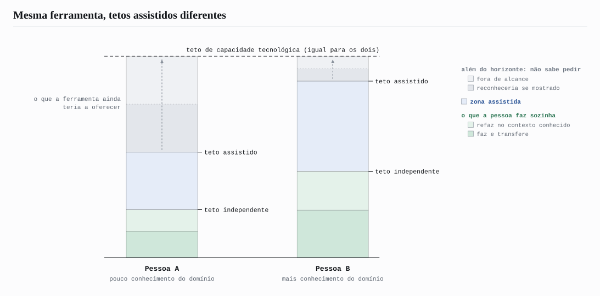
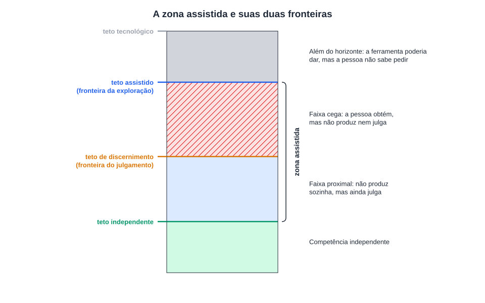
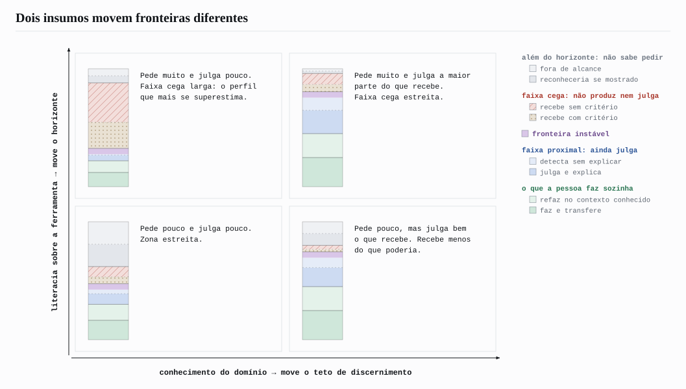
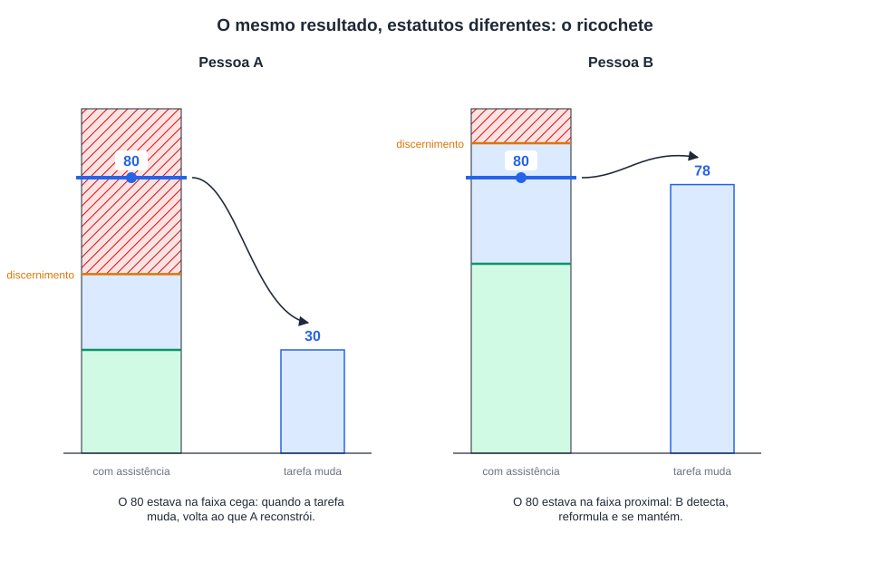
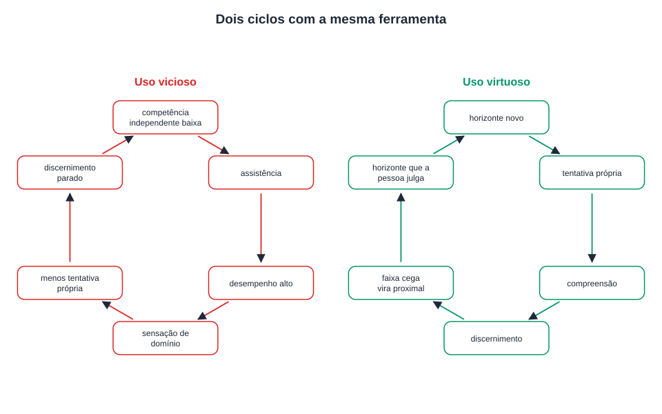
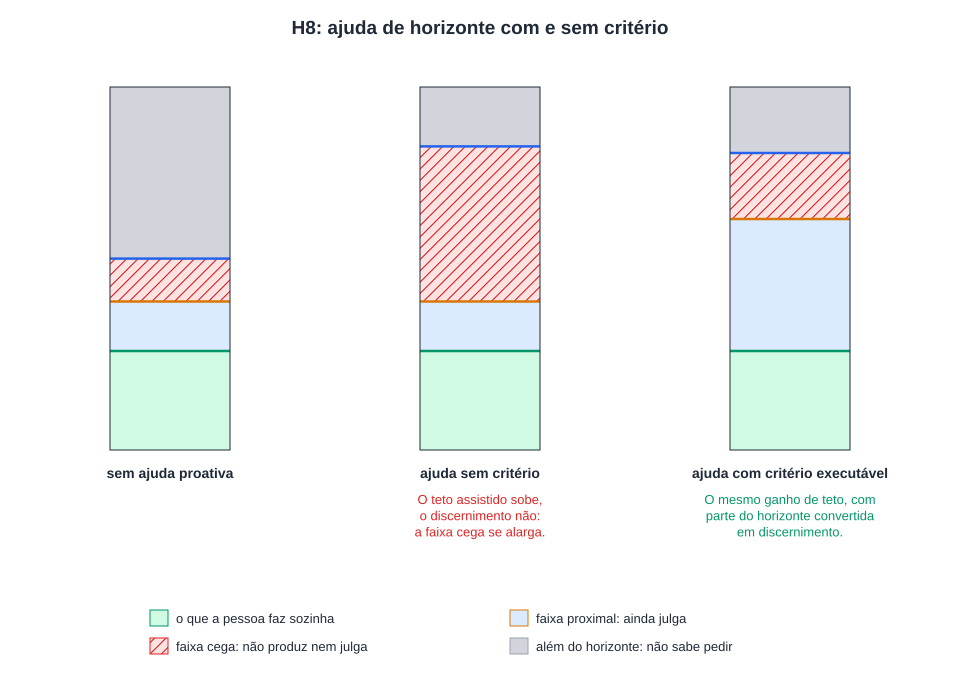
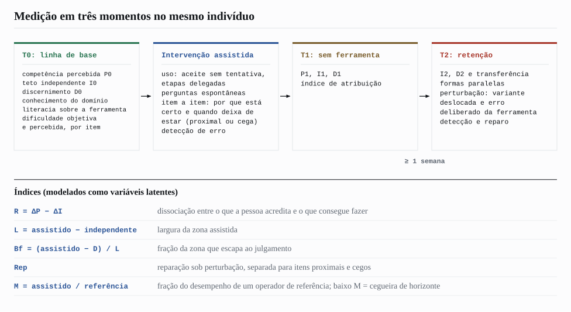
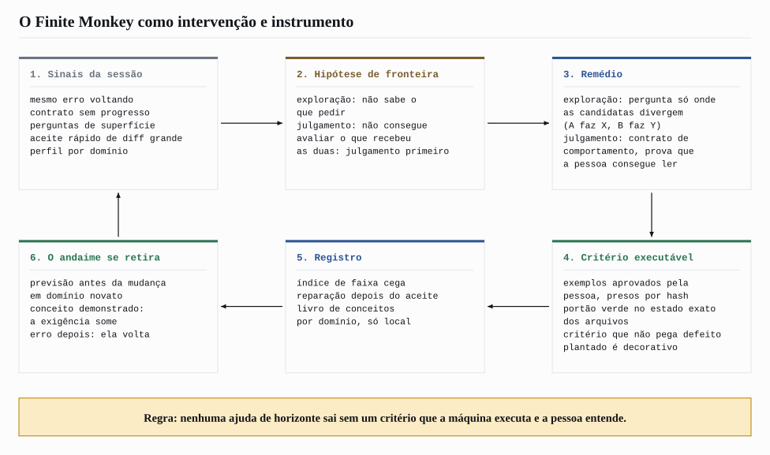

# Efeito Ricochete: o usuário como limite invisível da inteligência artificial

**Gabriel Vieira Flores**
NovusTec, São Paulo, SP, Brasil
gabrielvieira.ifsc@gmail.com · ORCID [0009-0000-2613-8284](https://orcid.org/0009-0000-2613-8284)

Versão 2, outubro de 2026. [English](ricochet.md) | Português (Brasil) | [Español](ricochet.es.md)

> Este ensaio é a base teórica do [Finite Monkey](../../README.pt-BR.md). As seções 1 a 9 apresentam o modelo e o programa de medição em termos gerais. A seção 10 mostra como o modelo vira produto: cada mecanismo do Finite Monkey é, ao mesmo tempo, uma intervenção sobre uma das fronteiras descritas aqui e um instrumento para medi-la em trabalho real de engenharia de software.

## Resumo

Resolver um problema com assistência não é o mesmo que aprender a resolvê-lo, e a literatura experimental recente já demonstra as duas metades dessa distinção: a assistência por inteligência artificial eleva o desempenho imediato e, em certas condições, reduz o desempenho independente posterior, sem que a pessoa perceba a perda. Este ensaio propõe um modelo do que existe entre os dois resultados. Distingue três tetos: o teto de capacidade tecnológica, propriedade do sistema; o teto de competência independente, o que a pessoa faz sozinha; e o teto de competência assistida, o que uma pessoa específica consegue efetivamente fazer o sistema produzir, e que varia entre usuários da mesma ferramenta. A tese central é que a zona assistida, entre o teto independente e o teto assistido, é cortada por duas fronteiras internas que não coincidem. A primeira, a cegueira de horizonte, é a fronteira da exploração: para reconhecer que existe algo além do que foi mostrado, é preciso possuir o referencial a partir do qual esse além aparece como possibilidade. A segunda, o teto de discernimento, é a fronteira do julgamento: até onde a pessoa consegue avaliar a adequação do que a ferramenta produziu, mesmo sem produzi-lo. As duas fronteiras respondem a insumos diferentes, a literacia sobre a ferramenta e o conhecimento do domínio, e por isso se deslocam de forma independente. A região acima do teto de discernimento, a faixa cega, é tratada como regime: nela o output replica sem que a contribuição da pessoa replique, a ilusão de compreensão é sustentada pela fluência e o horizonte se expande sem que o discernimento acompanhe. O Efeito Ricochete é a assinatura observável dessa arquitetura: quando a tarefa se move, a ferramenta erra ou a assistência é retirada, o que estava aquém de cada fronteira permanece e o que estava além regride. O ensaio deriva três experimentos fundadores (transplante de horizonte, incentivo à detecção de erro e reparação sob perturbação), um programa de medição em três momentos no mesmo indivíduo e uma consequência de desenho: ajuda que amplia o horizonte sem entregar um meio de julgar o resultado alarga a faixa cega. A versão 2 acrescenta evidência de 2024 a 2026 sobre engenharia de software assistida por agentes e descreve o Finite Monkey, extensão de código aberto para o Claude Code, como implementação e instrumento do modelo.

**Palavras-chave:** inteligência artificial; LLM; agentes de programação; aprendizagem com IA; offloading cognitivo; julgamento avaliativo; letramento em inteligência artificial; Zona de Desenvolvimento Proximal; desempenho assistido; engenharia de software.

## 1. O fenômeno

A inteligência artificial generativa nivela. É o achado mais replicado da literatura de produtividade: em tarefas de escrita profissional, os ganhos de qualidade concentram-se na metade inferior da distribuição inicial de habilidade, e a desigualdade de desempenho diminui (NOY; ZHANG, 2023); em atendimento ao cliente, os trabalhadores menos experientes são os que mais ganham (BRYNJOLFSSON; LI; RAYMOND, 2023); em consultoria, dentro do que a ferramenta consegue fazer, os consultores de menor desempenho inicial aproximam-se dos de maior (DELL'ACQUA et al., 2023). A pessoa com menos instrução chega, de fato, onde a pessoa com mais instrução chega.

O mesmo estudo de consultoria registra o outro lado. A capacidade da ferramenta tem uma fronteira irregular: dentro dela, a assistência melhora o desempenho de todos; fora dela, piora; e os consultores não percebem onde a fronteira passa, de modo que continuam confiando na ferramenta em tarefas nas quais ela os prejudica (DELL'ACQUA et al., 2023). O nivelamento é real, mas é medido no lugar em que as pessoas convergem, o output, e não nos lugares em que divergem. Este ensaio parte da hipótese de que existe uma segunda fronteira irregular, do lado da pessoa, tão invisível de dentro quanto a da ferramenta, e de que o desempenho assistido só é confiável na interseção das duas.

A distinção entre o que uma ferramenta permite e o que uma pessoa específica consegue perceber como possível não é nova. Norman (2013) separa a affordance real de um objeto, aquilo que ele de fato permite fazer, da affordance percebida, aquilo que o usuário reconhece como possível. Um teclado de piano tem a mesma affordance real para um pianista e para quem nunca tocou; apenas o primeiro percebe nele a possibilidade de uma fuga. A assistência cognitiva por modelos de linguagem torna essa lacuna mais consequente do que em qualquer objeto anterior, porque a affordance real do sistema é imensa e a percebida depende inteiramente do repertório de quem o opera.

Em engenharia de software o fenômeno já tem forma concreta. Agentes de programação escrevem aplicações inteiras a partir de pedidos em linguagem natural, e pessoas sem formação em programação passaram a publicar sistemas que coletam dados e cobram dinheiro. Uma auditoria de 200 aplicações publicadas, construídas majoritariamente por meio de agentes, encontrou ao menos uma vulnerabilidade em 91,0% delas, concentradas em controle de acesso, injeção e autenticação (DENG; FAN; MENG, 2026). Num levantamento com 162 participantes divididos entre não programadores, iniciantes e profissionais, todos os grupos reconheceram que código gerado traz riscos, mas apenas os não programadores relataram nunca conferir o código, e eles tendiam a pedir de novo em vez de depurar (FAWZY; TAHIR; BLINCOE, 2026). Os autores chamam isso de lacuna entre percepção e ação: o risco é conhecido, a capacidade de verificá-lo não está distribuída. O output convergiu; o que a pessoa consegue fazer com ele, não.

Para descrever essa relação, o ensaio distingue três limites.

O **teto de capacidade tecnológica** é o espaço que a combinação entre modelo, ferramentas, harness e mecanismos de busca consegue, em princípio, disponibilizar sob determinado protocolo. É uma propriedade do sistema: dada uma configuração, existe um limite superior do que ela pode produzir, e esse limite não depende de quem a opera. Ele se move quando a tecnologia muda. Buscas na web incorporam ao espaço de resposta conhecimentos que não estavam nos parâmetros do modelo; um harness que executa testes, lê erros e tenta de novo transforma o mesmo modelo num sistema mais capaz. Nenhum usuário precisa aprender coisa alguma para que esse teto suba. Ele não é diretamente observável; a seção de medição discute como aproximá-lo e o que essa aproximação mede de fato.

O **teto de competência independente** marca até onde a pessoa consegue produzir, reconstruir e corrigir sozinha, sem assistência. É um limite funcional e provisório, deslocável apenas pela aprendizagem.

O **teto de competência assistida** é uma relação entre o sistema e uma pessoa específica, sob uma tarefa e um protocolo: mede quanto do espaço tecnológico aquela pessoa consegue efetivamente mobilizar, isto é, dirigir, interrogar, avaliar e aproveitar. Ele pode ser radicalmente diferente entre duas pessoas usando exatamente o mesmo modelo, o mesmo harness e a mesma busca. Uma pessoa com pouco conhecimento prévio de um domínio pode atingir um teto assistido muito mais baixo do que uma pessoa mais avançada usando a mesma ferramenta, não porque a ferramenta responda pior para ela, mas porque, a partir de certo ponto, ela deixa de conseguir formular a próxima pergunta e de conseguir julgar a resposta anterior. A tecnologia continua tendo mais para oferecer. A pessoa é que não sabe mais o que pedir, nem se o que já obteve está certo.

*Figura 1 – Mesmo teto de capacidade tecnológica, tetos de competência assistida diferentes. Fonte: elaboração própria (2026).*

Essa é a formulação precisa do que o ensaio quer dizer quando afirma que o usuário limita a inteligência artificial. A afirmação não é sobre a frequência com que isso ocorre, que é questão empírica, mas sobre o mecanismo: a capacidade realizada da ferramenta é a projeção de sua capacidade potencial sobre o espaço de perguntas que aquela pessoa consegue formular, filtrada depois pelo que ela consegue julgar. A ferramenta não perde capacidade; ela é subutilizada. Cada usuário consulta uma fatia, e a fatia tem o tamanho do repertório.

Entre o teto independente e o teto assistido de cada pessoa forma-se a **zona assistida**, objeto central deste ensaio. Nessa região, a produção assistida ultrapassa o que a pessoa faria sozinha, e o resultado pode estar correto, parcialmente correto, incorreto, correto apenas sob determinadas condições ou correto para um problema diferente daquele que o usuário pretendia resolver. O problema não é a presença de erro, mas a possibilidade de a pessoa não dispor de meios próprios para localizá-lo. A zona é, por isso, estruturalmente indecidível para quem a ocupa: a pessoa consegue produzir algo além de seu teto independente, mas não consegue determinar, por si mesma, onde termina o que compreende e onde começa o que apenas a assistência tornou possível.

Chama-se aqui de **Efeito Ricochete** o comportamento observável dessa zona sob perturbação: a assistência desloca a pessoa para além de seu nível independente, e, quando a tarefa se move, a ferramenta erra ou a assistência é retirada, o desempenho retorna de forma diferenciada, conforme a posição que cada resultado ocupava em relação às fronteiras internas descritas a seguir. A metáfora descreve um retorno, não uma colisão. O fenômeno não é definido pela tecnologia empregada, mas pela relação entre a capacidade do usuário e a assistência que recebe; um buscador, um manual de soluções ou um tutor humano podem produzir situações análogas. A inteligência artificial generativa interessa por constituir a modalidade de assistência mais capaz de ampliar a zona, ao combinar produção, interação, adaptação ao usuário e acesso a fontes externas. Agentes que executam código acrescentam uma propriedade nova: o output deixa de ser texto que a pessoa lê e passa a ser um sistema que roda, e um sistema que roda parece certo com muito mais força do que um parágrafo bem escrito.

**Quadro 1 – Os tetos, as fronteiras e as variáveis que o modelo distingue**

| Elemento | Definição | Papel no modelo |
|---|---|---|
| Teto de capacidade tecnológica | Espaço que modelo, ferramentas, harness e busca conseguem, em princípio, disponibilizar sob um protocolo | Propriedade do sistema; limite superior de tudo o que segue; não observável diretamente |
| Teto de competência assistida | Quanto desse espaço um usuário específico consegue efetivamente dirigir, interrogar, avaliar e aproveitar | Relação pessoa × ferramenta × tarefa × protocolo; varia entre usuários da mesma ferramenta |
| Teto de competência independente | Nível que a pessoa reconstrói, aplica e transfere sem assistência | Um dos polos da zona assistida |
| Cegueira de horizonte | Fronteira da exploração: até onde a pessoa consegue perceber possibilidades e formular a pergunta seguinte | Explica por que o teto assistido varia entre usuários; sensível à literacia sobre a ferramenta |
| Teto de discernimento | Fronteira do julgamento: até onde a pessoa avalia a adequação do que recebe, mesmo sem produzi-lo sozinha | Divide a zona assistida em faixa proximal e faixa cega; sensível ao conhecimento do domínio |
| Competência percebida | Nível que a pessoa acredita possuir | Correlato subjetivo; tende a ancorar no teto assistido |

Fonte: elaboração própria (2026).

## 2. A cegueira de horizonte

Na alegoria da caverna de Platão, os indivíduos acorrentados não apenas desconhecem o mundo exterior; tomam as sombras que veem como a própria realidade. O limite de sua experiência não aparece para eles como limite, porque não dispõem, de dentro daquele horizonte, dos referenciais necessários para reconhecê-lo como tal. Falta-lhes a condição para perceber que há algo a ser conhecido além do que já conseguem perceber.

Algo semelhante ocorre na interação entre uma pessoa e uma ferramenta de assistência cognitiva. Para que a pessoa formule a próxima pergunta, ela precisa primeiro perceber que existe uma próxima pergunta a ser feita. Essa percepção depende de conhecimento prévio que permita reconhecer uma lacuna, uma contradição, uma variável omitida ou uma possibilidade ainda não explorada. Surge um paradoxo: para reconhecer que um horizonte de conhecimento não é o fim, é preciso já possuir algum conhecimento que permita enxergar o que está além dele. A assistência pode levar a pessoa a tocar conceitos muito acima de seu repertório. Mas tocar um conceito não é o mesmo que adquirir a estrutura necessária para continuar a partir dele. Sem essa estrutura, o que foi mostrado não é percebido como uma pequena parte de um território maior. Pode ser percebido como o próprio território.

É nesse sentido que se fala em **cegueira de horizonte**: a incapacidade de perceber que existe algo além do horizonte cognitivo que a própria assistência tornou acessível, porque faltam ao indivíduo os referenciais para reconhecer essa ausência como ausência. A pessoa não apenas desconhece determinado conteúdo; pode desconhecer que ele existe, que é relevante e que deveria ser procurado.

Um exemplo de software torna o mecanismo visível. Alguém pede a um agente "uma loja online para vender meus cursos". Recebe uma página com catálogo, carrinho e um botão de pagamento que funciona no ambiente de teste. Pelo que essa pessoa sabe pedir, a tarefa terminou. Ela não pergunta o que acontece quando o mesmo pagamento é notificado duas vezes, quem consegue ver o pedido de quem, como reembolsar, o que fazer quando o provedor de pagamento fica fora do ar, nem como o sistema se comporta com dois clientes comprando a última vaga ao mesmo tempo. Não pergunta porque nada no que ela viu indica que essas perguntas existem. Uma pessoa com experiência em sistemas de pagamento faria essas perguntas antes de escrever a primeira linha. A ferramenta saberia respondê-las. O teto tecnológico é o mesmo; o teto assistido, não.

Esse mecanismo tem lastro anterior à inteligência artificial. A capacidade de encontrar e formular problemas é distinta da capacidade de resolvê-los e prediz trajetórias criativas de longo prazo melhor do que esta (GETZELS; CSIKSZENTMIHALYI, 1976). A qualidade das perguntas que alguém formula sobre um sistema é um dos melhores indicadores de quanto o compreende: quem entende um dispositivo pergunta sobre seus mecanismos; quem não entende pergunta sobre suas superfícies (GRAESSER; OLDE, 2003). A cegueira de horizonte é o nome que este ensaio dá a um déficit de formulação de problemas sob assistência.

A própria ferramenta não compensa o déficit por conta própria. Num benchmark com 762 descrições de problemas de programação alteradas para ficarem ambíguas, inconsistentes ou incompletas, o ChatGPT fez uma pergunta de esclarecimento em 14,21% dos casos em que deveria tê-la feito, e mesmo com metade da descrição removida 95% das respostas geraram código (WU; FARD, 2025). O modelo responde ao que foi pedido. Se a pessoa não sabe que falta algo, o modelo raramente diz.

A cegueira de horizonte é, estruturalmente, uma assimetria entre gerar uma pergunta e reconhecê-la quando apresentada. Que reconhecer seja mais fácil do que gerar é fato geral da cognição. O que o modelo afirma é mais específico: a distância entre reconhecer e gerar a pergunta seguinte é maior sob baixo conhecimento do domínio, e é essa distância, não o conhecimento em si, que prediz até onde o teto assistido de uma pessoa chega. Daí decorre o experimento que dá conteúdo empírico ao mecanismo: fornecer à pessoa a pergunta que ela não formularia sozinha e observar se o teto assistido sobe.

Convém distinguir a cegueira de horizonte de dois mecanismos vizinhos. A sombra de competência de Siddique (2026) descreve o estreitamento do raciocínio humano induzido pela análise que a ferramenta apresenta: o que a ferramenta mostra desloca do campo de atenção o que ela não mostrou. É um estreitamento exógeno, projetado pelo perfil de competência do sistema sobre um operador competente. A cegueira de horizonte é endógena: é o repertório da pessoa que decide o que ela consegue pedir, antes de qualquer output. Os dois mecanismos coexistem; a sombra explica por que mesmo o especialista é estreitado, enquanto a cegueira explica por que o novato nem chega ao ponto em que a sombra atuaria. O ponto cego metacognitivo de Crk e Gultepe (2026) descreve outro fenômeno: estudantes reconhecem a fricção linguística de um texto, mas não sua dificuldade conceitual. É uma cegueira sobre a tarefa, não sobre o espaço de ação; o modelo a incorpora como moderador, na forma da divergência entre dificuldade percebida e objetiva.

Nem mesmo instruções destinadas a tornar a ferramenta mais crítica resolvem o problema. Pedir que a inteligência artificial não concorde com o usuário, que atue como especialista ou que procure falhas no próprio raciocínio altera a resposta produzida, mas não elimina a necessidade de alguém avaliar se a crítica devolvida é relevante, profunda ou apenas superficial. O prompt muda o que se pede à ferramenta. Não muda quem, do outro lado, precisa reconhecer o valor da resposta, e esse reconhecimento é a segunda fronteira.

A cegueira de horizonte opera na fronteira entre o teto assistido e o teto tecnológico: explica por que a pessoa não pede o que ainda não sabe que existe. O teto de discernimento opera dentro da zona assistida: explica se, para o que já foi produzido, a pessoa consegue julgar se está certo. A primeira fronteira decide o que chega a ser perguntado. A segunda decide o que se consegue avaliar depois de perguntado. E as duas não ficam necessariamente no mesmo lugar.

## 3. O teto de discernimento: faixa proximal e faixa cega

Kruger e Dunning (1999) descreveram o fardo duplo: as competências necessárias para produzir uma resposta correta em certo nível são, em grande parte, as mesmas necessárias para reconhecer que ela está correta. O efeito que leva seus nomes tem sido contestado como parcialmente artefato estatístico da combinação entre o efeito melhor-que-a-média e a regressão à média (GIGNAC; ZAJENKOWSKI, 2020), e este ensaio não herda a forma da curva, mas a premissa mais fraca e menos contestada: julgar exige parte das competências que produzir exige.

As pessoas, porém, reconhecem um bom argumento, uma boa tradução ou um bom código sem saber produzi-los. A capacidade de julgar a qualidade de um trabalho sem produzi-lo é objeto de uma tradição própria: a literatura sobre julgamento avaliativo a define como a capacidade de tomar decisões sobre a qualidade do trabalho próprio e alheio (TAI et al., 2018) e já a trata como competência central diante de saídas geradas por inteligência artificial (BEARMAN et al., 2024). A fronteira que importa, portanto, não é o teto de produção, mas um limite distinto: o **teto de discernimento**, o nível até o qual a pessoa consegue avaliar a adequação, a correção e os limites daquilo que lhe é apresentado, mesmo sem conseguir produzi-lo sozinha. O que este ensaio acrescenta àquela tradição é situar essa capacidade como fronteira mensurável no interior da zona assistida, relativa aos tetos independente e assistido do mesmo indivíduo, e acompanhá-la ao longo do tempo.

Essa fronteira divide a zona assistida em duas faixas de estatuto epistêmico oposto. Na **faixa proximal**, entre o teto independente e o de discernimento, a pessoa ainda não produz sozinha, mas ainda julga: reconhece um erro, identifica uma premissa que não se aplica, percebe que a resposta resolve outro problema. Ali a assistência funciona como ponte. Na **faixa cega**, acima do teto de discernimento, a pessoa nem produz nem julga: aceita a resposta porque é fluente e tecnicamente ornamentada, sem possuir os critérios para avaliar sua adequação ao problema concreto. É nessa faixa que a assistência deixa de ser ponte e se torna prótese, e é onde mora a terceirização de confiança: a pessoa passa a confiar a um terceiro, como se soubesse, aquilo que na verdade não domina. Uma assimetria agrava o quadro: a ferramenta não apenas executa operações que o indivíduo não consegue executar, mas pode também fornecer os critérios pelos quais ele avalia o próprio resultado, tornando a experiência de sucesso pouco informativa sobre a competência que de fato lhe pertence.

*Figura 2 – A zona assistida cortada pelas duas fronteiras: a faixa proximal, onde a pessoa ainda julga, e a faixa cega, onde não julga. Fonte: elaboração própria (2026), com base em Kruger e Dunning (1999).*

Em programação, a faixa cega tem medida direta. Num estudo com 86 programadores, os participantes julgaram corretamente 74% das asserções corretas geradas por modelos de linguagem e apenas 49% das incorretas, com confiança parecida nos dois casos; explicações ruins da ferramenta pioraram a acurácia e aumentaram a confiança (KAUFMAN et al., 2026). Ler uma asserção errada e decidir se ela está certa é, para programadores, pior do que jogar uma moeda. O resultado é mais grave porque a asserção é exatamente o artefato que deveria servir de critério: quem pede à ferramenta "escreva os testes" e aprova os testes que recebe pode estar aprovando, na faixa cega, o próprio critério de julgamento.

A forma do que se julga muda a fronteira. Num estudo de usuário com 15 programadores, um fluxo em que a pessoa aprova ou rejeita testes gerados, em vez de ler o código, deixou os participantes significativamente mais propensos a avaliar corretamente o código produzido pela IA, com carga cognitiva significativamente menor (FAKHOURY et al., 2024). Julgar comportamento ("para esta entrada, a saída é esta") está mais perto do teto de discernimento de quem conhece o problema do que julgar a implementação. O teto de discernimento não é uma constante da pessoa; depende também da representação em que o resultado lhe é apresentado. Essa observação é o ponto de apoio prático da seção 10.

A dissociação entre julgar e produzir é menos limpa do que os exemplos cotidianos sugerem, e o modelo precisa registrá-lo. O julgamento de especialistas em domínios avaliativos é notoriamente inconsistente entre ocasiões: juízes experientes de vinho premiam de forma quase aleatória entre baterias do mesmo concurso (HODGSON, 2008). O próprio teto de discernimento pode ser instável, e o desenho de medição precisa estimar essa instabilidade em vez de presumir uma fronteira nítida. A fronteira é, além disso, indexada: uma pessoa pode discernir bem em direito tributário e mal em programação, bem em interface e mal em banco de dados, bem com uma ferramenta e mal com outra. O que o modelo reivindica como invariante não são os valores dos tetos, mas a sua ordem dentro de cada contexto e a dinâmica que os liga.

### 3.1 Dois insumos, duas fronteiras

O ponto decisivo é que as duas fronteiras internas respondem a insumos diferentes. A literacia sobre a ferramenta (saber decompor, iterar, encadear, pedir análises sofisticadas, saber que um agente pode rodar testes e ler logs) desloca sobretudo a primeira. O conhecimento do domínio desloca sobretudo a segunda. Daí resultam perfis que a leitura ingênua de "mais competência, melhor uso" não distingue. Quem tem literacia alta e domínio baixo tem horizonte largo, teto assistido alto, discernimento baixo e, portanto, faixa cega larga: sabe pedir muito e julga pouco do que recebe. Quem tem domínio alto e literacia baixa tem discernimento alto e teto assistido limitado pelo acesso à ferramenta: julga bem o que recebe e recebe menos do que poderia.

*Figura 3 – Literacia sobre a ferramenta e conhecimento do domínio deslocam fronteiras diferentes, gerando quatro perfis. Fonte: elaboração própria (2026).*

O primeiro perfil é o que Fernandes et al. (2026) encontraram sem procurar: quanto maior a literacia em inteligência artificial dos participantes, pior a acurácia da autoavaliação. Sob uma fronteira única, esse achado contradiz a expectativa de que competência melhora julgamento; sob duas fronteiras, ele é uma predição. O levantamento sobre programação por agentes descrito na seção 1 mostra o mesmo desenho em campo: a capacidade de pedir se democratizou mais depressa que a capacidade de verificar (FAWZY; TAHIR; BLINCOE, 2026). A literatura sobre o efeito de reversão de expertise aponta na mesma direção, ao mostrar que o mesmo apoio instrucional que beneficia novatos pode prejudicar quem já domina o conteúdo (KALYUGA et al., 2003; NIEVELSTEIN et al., 2013). Uma meta-análise recente, com 60 estudos e 5.924 participantes, estimou o efeito em d = 0,505 a favor de mais apoio para novatos e d = −0,428 a favor de menos apoio para experientes (TETZLAFF et al., 2025): a relação entre conhecimento prévio e efeito da assistência não é monotônica, e um modelo com duas fronteiras é o mínimo necessário para acomodar isso.

### 3.2 A barreira de reconstrução

Fecha o modelo causal a **barreira de reconstrução**: quando a assistência executa no lugar do indivíduo as operações de gerar, recuperar, integrar e corrigir uma solução, ele pode concluir a tarefa sem completar o processo pelo qual essa solução se torna conhecimento próprio. A literatura sobre efeito de geração, prática de recuperação e dificuldades desejáveis já demonstra esse mecanismo fora do contexto da assistência por inteligência artificial (BJORK; BJORK, 2011; SWELLER, 2011; ROEDIGER; KARPICKE, 2006; KORNELL; HAYS; BJORK, 2009). Uma meta-análise de 86 estudos estimou o efeito de geração em cerca de 0,40 desvio-padrão (BERTSCH et al., 2007), e tentar resolver antes de receber a instrução rende ganho moderado e robusto (SINHA; KAPUR, 2021). O viés de antevisão agrava o quadro (KORIAT; BJORK, 2005, 2006): a solução visível facilita o processamento no momento, e essa facilidade raramente é descontada quando a pessoa estima sua capacidade futura. Evidência exploratória de Kosmyna et al. (2025), contestada por Stanković et al. (2026), é compatível com o mecanismo em nível neural, sem demonstrá-lo. A previsão que torna a barreira testável é temporal: se a dissociação for efeito momentâneo de familiaridade, deve diminuir com a prática sem assistência; se a assistência tiver reduzido a formação das representações necessárias, a diferença deve persistir após um intervalo de retenção.

## 4. A faixa cega como regime

A faixa cega importa aqui não como região, mas como regime: um conjunto de propriedades que governam o comportamento de quem a ocupa, independentemente de quem seja.

Considere duas pessoas utilizando exatamente a mesma ferramenta: a Pessoa A tem pouco conhecimento prévio do domínio; a Pessoa B, consideravelmente mais. Em uma tarefa simples a diferença é invisível: as duas chegam a uma resposta correta, e um observador externo concluiria que possuem a mesma capacidade. É esse observador que a literatura de nivelamento descreve. A diferença aparece quando a estrutura da tarefa excede o que cada uma consegue representar e avaliar, não porque a tarefa fique mais difícil, mas porque a dificuldade percebida, moldada pelo horizonte disponível, diverge da dificuldade objetiva.

Imagine que A e B produzam, com assistência, um resultado de qualidade 80. Para um observador interessado apenas no produto, os dois desempenhos são equivalentes. Mas A chegou a 80 por meio de uma cadeia de instruções que não consegue reconstruir e cujo resultado não consegue avaliar plenamente, enquanto B consegue reconstruir o raciocínio, reconhecer as premissas, identificar as condições de validade e corrigir a solução se uma delas mudar. Os dois produziram 80. Para A, o 80 está na faixa cega; para B, na faixa proximal. O resultado externo é o mesmo. O estatuto epistêmico do resultado é diferente.

*Figura 4 – O mesmo resultado, 80, ocupa a faixa cega de A e a faixa proximal de B. Sob perturbação, o resultado de A retorna ao seu nível reconstruível; o de B se mantém. Fonte: elaboração própria (2026).*

**Primeira propriedade: o output replica; a contribuição da pessoa, não.** Seria tentador dizer que a convergência de A com B é um acerto de ocasião que não se repete. Mas se a tarefa está dentro da fronteira confiável da ferramenta, A obterá o resultado correto reiteradas vezes, porque quem o produz é a ferramenta. O que não replica é a contribuição da pessoa, e essa diferença só aparece sob três condições: quando a ferramenta erra e a pessoa não detecta; quando a tarefa se desloca um passo e a pessoa não consegue reformular; e quando a assistência é retirada e a pessoa não consegue reconstruir. O efeito de trabalhar na faixa cega não é instabilidade sob repetição, mas fragilidade sob perturbação. A pessoa opera um sistema que funciona até o dia em que não funciona, e nesse dia é a última a saber. Em software, a perturbação tem nome: um requisito que muda, uma dependência atualizada, uma entrada que ninguém previu, um segundo usuário. As 200 aplicações auditadas por Deng, Fan e Meng (2026) funcionavam; a maioria tinha um ponto em que um usuário conseguia ler ou alterar o que pertencia a outro, e quem as publicou não tinha como saber. A fenomenologia desse estado já foi descrita fora do contexto da assistência: as pessoas acreditam compreender mecanismos que não conseguem explicar, e a ilusão é mais forte onde o ambiente fornece explicações prontas com mecanismos visíveis (ROZENBLIT; KEIL, 2002), que é a descrição exata de uma resposta fluente produzida por um modelo de linguagem.

**Segunda propriedade: o horizonte se expande sem que o discernimento acompanhe.** Tocar conceitos acima do repertório ensina que certas perguntas existem antes de ensinar a julgar as respostas. A faixa cega pode expandir o horizonte sem expandir o discernimento: a pessoa sai dela sabendo pedir mais e continuando sem poder avaliar. É a assimetria entre as duas fronteiras, agora vista como dinâmica: a exposição na faixa cega alimenta preferencialmente a fronteira da exploração, e o conhecimento do domínio, que alimenta a fronteira do julgamento, não vem de graça com a exposição.

É como alguém que, depois de conversar repetidamente com especialistas sobre determinado assunto, passa a falar sua linguagem com desenvoltura. Reconhece os termos, acompanha a discussão, reproduz exemplos e formula observações que soam sofisticadas. Para quem observa de fora, especialmente para quem também não domina o assunto, sua performance pode parecer a de alguém que compreende o campo. A diferença aparece quando a conversa deixa os caminhos já percorridos: basta alterar uma premissa, introduzir um caso-limite, questionar a relação entre duas afirmações ou pedir que uma conclusão seja reconstruída a partir de seus fundamentos.

Quem compreende o domínio não precisa conhecer a resposta para começar a trabalhar sobre a pergunta: identifica as premissas relevantes, recupera relações conhecidas, decompõe o problema e constrói, passo a passo, uma resposta possível. Quem aprendeu sobretudo por exposição às respostas reconhece termos, explicações e conclusões quando os encontra e pode reproduzi-los com grande segurança, mas não dispõe necessariamente da estrutura que permitiria reconstruí-los quando o problema muda. Há uma diferença entre possuir uma estrutura que gera respostas e possuir um repertório de respostas que gera a aparência de uma estrutura. A primeira permite operar sobre o desconhecido; a segunda depende da permanência dos caminhos já percorridos. A explicação mecanística, e não a lista de razões, é o que reduz a ilusão de profundidade explicativa (FERNBACH et al., 2013); a assistência generativa, ao fornecer sucessivamente os passos pelos quais a pessoa poderia avançar, permite habitar a superfície linguística do conhecimento antes de adquirir a estrutura necessária para reconstruí-lo.

**Terceira propriedade: o regime se autoalimenta.** No uso vicioso, a exposição na faixa cega converte-se em horizonte e para aí: a pessoa aprende progressivamente o que pedir, o teto assistido sobe, o discernimento não acompanha e a faixa cega se alarga. Cada resposta fluente reforça a sensação de domínio, embora parte crescente daquilo que a pessoa consegue mobilizar dependa de uma estrutura que continua externa a ela. O ciclo fecha-se: baixa competência independente leva à assistência; a assistência produz desempenho elevado; o desempenho elevado produz sensação de domínio; a sensação de domínio reduz a necessidade percebida de tentativa própria; e a ausência de tentativa própria limita a construção do discernimento necessário para lidar com a próxima variação do problema.

No uso virtuoso, a mesma exposição produz uma trajetória diferente: o que primeiro aparece como horizonte converte-se em tentativa própria, a tentativa em compreensão e a compreensão em discernimento. Parte da faixa cega torna-se proximal; parte da proximal torna-se independente. O que separa os dois trajetos não é a quantidade de uso da ferramenta, mas o que acontece cognitivamente com aquilo que a assistência tornou acessível.

*Figura 5 – Ciclo cumulativo sob uso vicioso e sob uso virtuoso. Fonte: elaboração própria (2026).*

### 4.1 A predição de desenho mais forte

Por isso a instrução de que a ferramenta seja crítica não resolve o problema: a crítica devolvida é mais um output, e quem a recebe na faixa cega não dispõe dos critérios para saber se ela é relevante. E por isso a predição de desenho mais forte que o modelo produz é também a mais contraintuitiva. Uma ferramenta que propõe a próxima pergunta, que faz por conta própria o transplante de horizonte, eleva o teto assistido de quem tem horizonte baixo, porque supre a formulação que faltava. Ela não eleva o discernimento, porque a pergunta proposta é tão inavaliável para essa pessoa quanto a resposta. A consequência é que **a assistência proativa nivela o output e alarga a faixa cega ao mesmo tempo**: quanto mais a ferramenta pergunta pela pessoa, mais a pessoa opera em território que não consegue julgar. Essa é a hipótese H8 da seção 8.

A predição tem uma contrapartida que a torna útil para quem projeta ferramentas. Se a ajuda de horizonte alarga a faixa cega porque chega sem meio de julgamento, a mesma ajuda, entregue junto com um critério que a pessoa consegue verificar, deveria ter o efeito oposto. O critério não pode ser mais texto, porque texto na faixa cega é tão inavaliável quanto a resposta; precisa ser algo que a pessoa consiga observar: um comportamento concreto, uma execução, um caso que passa ou falha. A regra de desenho que decorre do modelo é simples de enunciar: **nenhuma ajuda que amplia o horizonte sai sem um critério que a máquina executa e a pessoa entende.**

*Figura 6 – H8. A ajuda de horizonte sem critério eleva o teto assistido e alarga a faixa cega; a mesma ajuda com critério executável converte parte do horizonte em discernimento. Fonte: elaboração própria (2026).*

O ricochete situa-se nessa arquitetura como perturbação: o retorno ao nível reconstruível ocorre sempre que a tarefa se move, com ou sem a ferramenta presente, e a retirada da assistência é o caso-limite em que a perturbação é total. A estrutura da zona existe durante a assistência; o ricochete é o seu comportamento observável quando algo muda. A questão, portanto, não é apenas até onde a assistência consegue levar a pessoa, mas o que permanece nela quando a tarefa muda e quando a assistência é retirada.

## 5. O que já se sabe

O fenômeno tem quatro lados demonstrados por literaturas que raramente se citam: o perceptivo, o do desempenho, o do nivelamento e, mais recentemente, o da colaboração entre humanos e sistemas. Nenhum deles, isoladamente, testa o modelo completo; juntos, dão a ele um piso empírico e delimitam o que ainda não foi medido.

**Lado perceptivo.** Koriat e Bjork (2005, 2006) estabelecem o mecanismo mínimo: a presença da solução durante o estudo infla o julgamento de aprendizagem sem inflar a recordação posterior. Fisher, Goddu e Keil (2015) mostraram, em nove experimentos, que buscar explicações na internet aumenta o conhecimento autoavaliado mesmo em domínios não pesquisados. Sparrow, Liu e Wegner (2011) descreveram a adaptação da memória à disponibilidade de busca externa. Ward (2021), em oito experimentos com quase duas mil pessoas, mostrou que usuários de buscadores falham em distinguir conhecimento interno de externo. No contexto de modelos de linguagem, Fernandes et al. (2026) forneceram a medição mais direta: usuários do ChatGPT melhoraram o desempenho em raciocínio lógico, superestimaram o próprio desempenho em magnitude ainda maior, e o padrão clássico de Dunning-Kruger desapareceu na condição com inteligência artificial; a relação negativa entre literacia em IA e acurácia da autoavaliação é a predição das duas fronteiras. A maioria dos participantes enviava um único prompt por questão, comportamento compatível com a cegueira de horizonte. Kaufman et al. (2026) estendem o lado perceptivo à programação: confiança igual diante de asserções certas e erradas. Gerlich (2025), em estudo correlacional com 666 participantes, encontrou associação negativa entre uso frequente de IA e pensamento crítico, mediada por offloading cognitivo. Kim, Yu e Yi (2026) nomearam a falácia do LLM, o erro de atribuição pelo qual a pessoa credita a si competência produzida com auxílio externo; o modelo a trata como correlato da faixa cega, não como seu mecanismo.

**Lado do desempenho.** O ensaio de campo controlado e randomizado de Bastani et al. (2025), com cerca de mil estudantes, é a evidência mais forte: durante a prática assistida, o GPT superou o controle em 48% (acesso irrestrito) e 127% (versão tutora); na avaliação subsequente sem auxílio, a condição de acesso irrestrito ficou 17% abaixo do controle, prejuízo majoritariamente evitado quando a assistência forçava etapas próprias antes da solução, e os estudantes não perceberam a própria perda. Liu et al. (2026), em três experimentos randomizados com 1.222 participantes, replicam o padrão e acrescentam a redução da persistência em tarefas subsequentes sem assistência. Barcaui (2025), com 120 universitários brasileiros, oferece o complemento temporal: 45 dias depois, o grupo que usara ChatGPT recordava menos (57,5% contra 68,5%), com a ressalva de que dedicou cerca de metade do tempo de estudo. Em programação, Sankaranarayanan (2026), em estudo de 26 participantes por braço, mediu a falha numa tarefa posterior de manutenção sem IA: 77% entre os que usaram IA sem restrição, 39% entre os que só recebiam o código depois de explicar a lógica causal e 31% no grupo manual, sem diferença de desempenho funcional entre os dois braços com IA. Shen e Tamkin (2026) mostram que o efeito da assistência sobre a formação de habilidade em programação depende do padrão de uso: delegar e perguntar sobre conceitos não produzem o mesmo resultado. Fora do ambiente educacional, Budzyń et al. (2025) registraram, em estudo observacional multicêntrico, a taxa de detecção de adenomas de endoscopistas operando sem IA cair de 28,4% para 22,4% após meses de uso assistido, resultado compatível com o recuo de um teto independente, ainda que retrospectivo e debatido. Macnamara et al. (2024) já haviam perguntado se a assistência por IA acelera a deterioração de habilidade sem a consciência de quem a usa; a pergunta conta hoje com desenhos experimentais independentes apontando na mesma direção. Ferdman (2025) formula o problema como propriedade de ambientes hostis à cultivação de capacidades; o modelo aqui proposto é compatível com essa leitura e a especifica no nível do indivíduo.

**Lado do nivelamento.** Noy e Zhang (2023), Brynjolfsson, Li e Raymond (2023) e Dell'Acqua et al. (2023) documentam a compressão da diferença entre trabalhadores de menor e maior desempenho inicial, e este último registra também a fronteira irregular da ferramenta e a incapacidade dos usuários de percebê-la. Em software, o nivelamento aparece como funcionalidade: na avaliação de Zhao et al. (2026), com 186 tarefas reais, 57% das soluções de um agente de ponta estavam funcionalmente corretas e apenas 11,8% eram seguras, e incluir dicas de vulnerabilidade no pedido não resolveu. Lidos com o lado do desempenho, esses resultados descrevem o que o modelo prevê: convergência no output, divergência no que resta quando a tarefa muda.

**Lado da colaboração.** Uma meta-análise de 106 experimentos e 370 efeitos mostrou que, em média, a combinação de humano e IA rende menos que o melhor dos dois sozinho (g = −0,23), e que o sinal depende de quem julga melhor: quando o humano supera a IA, a combinação ganha (g = +0,46); quando a IA supera o humano, a combinação perde (g = −0,54) (VACCARO; ALMAATOUQ; MALONE, 2024). Pôr a pessoa para decidir onde ela está na faixa cega piora o resultado; pô-la para decidir onde só ela sabe melhora. A distribuição do julgamento entre pessoa e sistema não é neutra, e o modelo das duas fronteiras indica onde cada um deve julgar.

A camada neurocognitiva de Kosmyna et al. (2025), com 54 participantes e subamostra de 18 na sessão de troca, e crítica metodológica publicada (STANKOVIĆ et al., 2026), vale menos como prova e mais como sinalizador de que o mecanismo comportamental deixa rastro fisiológico.

A literatura converge, de forma independente, para arquiteturas que descrevem lacunas entre desempenho e compreensão sob assistência. Koch (2026) propõe o desacoplamento metacognitivo mediado por IA, com quatro variáveis (output observável, compreensão subjacente, autoavaliação e calibração); o modelo captura a dissociação dentro de uma interação, sem hierarquia de tetos e sem mecanismo para a variação do teto assistido entre usuários. Yadav (2026) formula a hipótese do teto de competência de IA como modelo de trajetória de carreira, sem fronteiras internas na tarefa nem desenho de medição. Siddique (2026) deriva, para engenharia de segurança, limites fechados de degradação sob a sombra de competência, formalismo mais rigoroso do que o deste ensaio no domínio em que se aplica e mais estreito. Crk e Gultepe (2026) operacionalizam a divergência entre dificuldade percebida e conceitual.

Na literatura examinada não foi localizado estudo que meça, no mesmo indivíduo, com linha de base e retenção, os quatro elementos ao mesmo tempo (o que a pessoa acha que sabe, o que faz sozinha, o que faz com assistência e até onde julga o que recebeu), nem modelo que trate exploração e julgamento como fronteiras independentes dentro da zona assistida e derive dessa independência predições sobre o destino dos itens sob perturbação. É a medição conjunta que este ensaio propõe como contribuição empírica, e a seção 10 propõe uma segunda via, ainda não explorada: medir as fronteiras no trabalho real, com o registro que uma ferramenta de engenharia já produz.

## 6. Desenho de medição

A observação do constructo exige, no mínimo, três momentos. Em **T0** medem-se a competência percebida (P0), o teto de competência independente (I0), o teto de discernimento (D0), o conhecimento prévio do domínio e a literacia sobre a ferramenta, separadamente, e, item a item, a dificuldade objetiva da tarefa, calibrada por especialistas ou por parâmetros de item numa amostra independente, e a dificuldade percebida pelo participante antes de qualquer tentativa. A separação entre conhecimento do domínio e literacia sobre a ferramenta é a condição para que as duas fronteiras possam ser observadas deslocando-se de forma independente.

Segue-se a **intervenção assistida**, com registro do comportamento de uso: proporção de conteúdo aceito sem tentativa própria, proporção de etapas centrais delegadas, número e qualidade das perguntas de acompanhamento formuladas espontaneamente e, para cada item, se o participante consegue indicar por que a resposta está correta e sob quais condições deixaria de estar, critério que separa, item a item, a faixa proximal da faixa cega. Esse critério exige julgar a qualidade de uma justificativa e herda as ameaças conhecidas à confiabilidade entre avaliadores: leniência, dependência da expertise de quem avalia e, sobretudo, o efeito da própria fluência, porque pessoas verbalmente fluentes articulam justificativas plausíveis sem compreensão. O desenho prevê rubrica com âncoras por domínio, dois avaliadores cegos à condição com concordância reportada, um estudo piloto de generalizabilidade antes da coleta principal e registro em escala de três pontos, colapsada a posteriori para a dicotomia. Justificação verbal não é o mesmo que discernimento: uma pessoa pode detectar consistentemente que uma resposta está errada sem verbalizar por quê, e o desenho acrescenta, por isso, uma medida comportamental de detecção de erro como segundo indicador da mesma fronteira.

Em **T1**, sem acesso à ferramenta, mede-se novamente P, I e D, além de um índice de atribuição. Em **T2**, após ao menos uma semana de retenção, medem-se I, D e transferência, com formas paralelas dos testes, e aplica-se o teste de perturbação: para itens classificados na intervenção como proximais ou cegos, pareados por dificuldade objetiva e por acerto assistido, apresentam-se variantes deslocadas da tarefa e respostas da ferramenta com um erro deliberado, registrando se o participante detecta e repara. T2 é o momento decisivo, porque distingue o que T1 confunde: se a dissociação era efeito momentâneo da percepção, ela se desfaz com o tempo; se a assistência alterou a formação da competência, o déficit persiste.

*Figura 7 – Desenho de medição em três momentos no mesmo indivíduo e os índices derivados. Fonte: elaboração própria (2026).*

Cinco índices operacionalizam o modelo.

- **R = ΔP − ΔI** descreve a dissociação imediata entre o que a pessoa acredita e o que consegue fazer. P e I nascem em escalas diferentes, e a diferença só é interpretável depois que ambas são expressas numa métrica comum definida a priori, por exemplo o percentil no mesmo banco de itens; o desenho inclui uma simulação nula que mostre qual valor de R seria esperado sem mecanismo algum, em resposta à crítica de que parte da literatura sobre miscalibração é artefato de regressão à média (GIGNAC; ZAJENKOWSKI, 2020).
- **L = teto assistido − teto independente** descreve a largura da zona. Suas assinaturas são definidas sobre trajetórias conjuntas, nunca sobre L isolado: L crescente com teto independente estagnado é a assinatura do alargamento vicioso; L estável ou decrescente com teto independente crescente é a do co-deslocamento virtuoso; L crescente com teto independente também crescente é ambíguo e só se resolve em T2.
- **Bf = (teto assistido − D) / L** é a fração da zona assistida que permanece acima do teto de discernimento. L descreve o quanto a zona se abriu; Bf descreve quanto dela a pessoa consegue avaliar. Duas pessoas podem ter L idêntico e Bf muito diferente. Bf é uma proporção e deve ser lido junto de L. Como razão entre dois escores de diferença, é indefinido quando L é nulo e instável quando L é pequeno; por isso não é calculado por indivíduo a partir de escores brutos, mas derivado como quantidade estrutural de um modelo latente, com intervalo de confiança e regra pré-registrada para valores de L abaixo de um limiar mínimo.
- **Rep**, o índice de reparação, é a proporção de itens em que o participante detecta e corrige o erro deliberado ou reformula a variante deslocada em T2, calculada separadamente para itens proximais e cegos. A predição é que Rep seja sistematicamente menor nos itens cegos, controlada a dificuldade objetiva e o acerto assistido; a manipulação da perturbação pelo experimentador, e não sua escolha pelo participante, protege o índice do problema de seleção.
- **M = teto assistido do participante / desempenho do operador de referência** descreve a fração do desempenho de referência que o participante mobiliza. O operador de referência é um painel de pessoas com alto conhecimento do domínio usando a mesma ferramenta, o mesmo harness e o mesmo tempo. É preciso ser explícito: o operador é um usuário do sistema, não o sistema, e seu desempenho é um piso do teto tecnológico, não o teto. M mede a razão entre pessoas sob protocolo fixo. O benchmark exige painel de ao menos três operadores com concordância reportada, repetições com correlação intraclasse e registro de modelo, temperatura, ferramentas e harness; enquanto sua estabilidade não for demonstrada, as hipóteses que dependem de M não são falseáveis. Valores baixos de M, com R e L estáveis, são a assinatura operacional da cegueira de horizonte: o participante não está confuso sobre o que recebeu; está deixando de pedir.

M e Bf operacionalizam as duas fronteiras: M é baixo quando a cegueira de horizonte impede que a pessoa peça mais do que já pediu; Bf é alto quando, do que foi obtido, uma fração desproporcional escapa ao julgamento. As duas variam independentemente, e é essa independência, não os valores isolados, que distingue empiricamente as fronteiras. Nenhum dos índices constitui o constructo: são indicadores para observá-lo, e um valor isolado admite explicações triviais.

Os índices herdam as limitações clássicas dos escores de diferença (CRONBACH; FURBY, 1970). A crítica não é absoluta: escores de diferença são confiáveis quando a mudança verdadeira é heterogênea entre indivíduos (THOMAS; ZUMBO, 2012), condição que o próprio fenômeno prevê. A análise preferível modela P, I e D como variáveis latentes por escore de mudança latente, que corrige a atenuação por erro de medida e testa formalmente a divergência de trajetórias entre condições (McARDLE, 2009). Isso exige invariância de mensuração forte entre formas paralelas e entre condições como pré-condição testada e reportada (KIEVIT et al., 2018), e tamanho amostral fixado por simulação, na ordem de centenas de participantes por condição.

## 7. Modelo causal, rede nomológica e constructos vizinhos

O modelo causal opera em dois estágios. No primeiro, a cegueira de horizonte determina até onde a interação consegue chegar: o teto assistido que a pessoa efetivamente atinge, relativo ao operador de referência. Nesse estágio, a cegueira afeta também como a tarefa é representada: quem não enxerga a estrutura do problema tende a percebê-lo como mais difuso do que é, e essa distorção contamina a estimativa de competência percebida medida em T0. No segundo estágio, dado o que foi atingido, o teto de discernimento determina que fração disso a pessoa consegue julgar, e a barreira de reconstrução determina quanto do que foi julgado se converte em competência independente. As fronteiras são conceitualmente distintas e, por hipótese, empiricamente independentes.

Dentro do segundo estágio, antecedentes manipuláveis (grau de terceirização, tentativa própria, verificação externa e fluência textual percebida) formam a barreira de reconstrução quando as etapas centrais são executadas externamente sem conversão em representações próprias. A fluência textual percebida, mantidos constantes conteúdo, correção e extensão, é o mecanismo proximal do lado perceptivo, de que a inflação de julgamentos de aprendizagem por pistas perceptivas irrelevantes ao conteúdo é o precedente experimental mais direto (RHODES; CASTEL, 2008). Em código, a fluência tem uma forma adicional: o programa que roda. Execução bem-sucedida é a pista de fluência mais forte que existe, e só prova que o programa faz algo, não que faz o que a pessoa queria.

A identidade teórica do constructo não se esgota em sua operacionalização (CRONBACH; MEEHL, 1955): é estabelecida pela rede de relações previstas entre antecedentes, mecanismo, moderadores, constructos correlatos e consequências.

**Quadro 2 – Rede nomológica do constructo proposto**

| Elemento da rede | Papel teórico | Predição |
|---|---|---|
| Assistência cognitiva externa | Antecedente | Aumenta a dissociação e o alargamento da zona frente a condição sem assistência |
| Terceirização das etapas centrais; ausência de tentativa própria | Antecedentes da barreira de reconstrução | Aumentam a dissociação e a largura da zona |
| Verificação externa pelo usuário | Antecedente inverso | Reduz a dissociação e favorece o co-deslocamento |
| Representação do critério (comportamento observável vs. texto ou código) | Moderador do teto de discernimento | Critério em forma de comportamento observável eleva D medido no mesmo item |
| Fluência textual percebida; execução bem-sucedida | Mecanismo proximal | Amplia a experiência de compreensão e, sob alta terceirização, a dissociação |
| Cegueira de horizonte | Fronteira da exploração; mediadora entre conhecimento prévio e teto assistido | Distância entre gerar e reconhecer a pergunta seguinte maior sob baixo domínio; prediz M |
| Teto de discernimento | Fronteira do julgamento | Divide a zona em faixas com destinos diferentes sob perturbação e retirada |
| Literacia sobre a ferramenta vs. conhecimento do domínio | Insumos diferenciais das duas fronteiras | Literacia eleva o teto assistido mais que D; domínio eleva D mais que o teto assistido |
| Dificuldade percebida vs. objetiva | Moderador do primeiro estágio | Maior divergência prediz R mais alto, controlado o conhecimento prévio |
| Fração cega da zona (Bf) | Mediador do segundo estágio | Bf alto prediz pior teto independente e pior transferência em T2, controlada L |
| Reparação sob perturbação (Rep) | Consequência do regime da faixa cega | Rep menor para itens cegos que para proximais, controlada a dificuldade |
| Assistência proativa sem critério | Manipulação da fronteira da exploração | Eleva o teto assistido e M sem elevar D; alarga Bf |
| Assistência proativa com critério executável | Manipulação conjunta das duas fronteiras | Eleva o teto assistido como a anterior e reduz Bf em relação a ela |
| Assistência por modelo de linguagem | Modalidade intensificadora (hipótese) | Dissociação e alargamento maiores que sob outras formas de assistência |
| Miscalibração; offloading; falácia do LLM; julgamento avaliativo | Constructos correlatos | Correlação positiva, sem identidade com o constructo proposto |
| Retenção e transferência em T2 | Consequências críticas | Conversão em competência independente maior para itens proximais que para cegos |

Fonte: elaboração própria (2026).

O constructo mais próximo é a Zona de Desenvolvimento Proximal de Vygotsky (1978, 2007), e a relação correta é de herança declarada, seguida de inversão. Para Vygotsky, a distância entre o que a criança faz sozinha e o que faz com ajuda é prospectiva: descreve funções em maturação, e a assistência é socialmente mediada. A metáfora do andaime, introduzida por Wood, Bruner e Ross (1976), acrescentou duas propriedades que não estão em Vygotsky: o andaime é contingente ao desempenho da criança e é retirado progressivamente conforme a competência cresce. A inversão que este ensaio propõe atinge o pressuposto de desvanecimento do andaime; a Zona de Desenvolvimento Proximal fica como herdada. A assistência generativa leva a pessoa a muitos níveis acima de sua base com uma fração do esforço que esse salto exigiria, não se retira espontaneamente e não tem intenção pedagógica. A zona deixa de ser uma previsão de desenvolvimento e pode tornar-se um endereço, um lugar onde se mora sem se desenvolver. O teto de discernimento é a fronteira interna que a teoria do andaime não precisou postular, porque o andaime que ela descrevia era, por definição, contingente e desvanecente; e a cegueira de horizonte é o que impede a pessoa de fazer, sozinha, o que o tutor humano fazia por ela: perceber qual é o próximo passo. A literatura de exemplos resolvidos mostra que o desvanecimento pode ser reconstruído deliberadamente: retirar os passos de forma adaptativa, conforme o desempenho de cada estudante, rende mais transferência tardia do que um roteiro fixo (SALDEN et al., 2009). O modelo propõe que um andaime permanente acima do teto de discernimento produz residência na zona e que, dentro da faixa proximal, pode produzir salto genuíno; a seção 10 descreve uma ferramenta que tenta devolver à assistência generativa as duas propriedades perdidas.

Quatro diferenciações merecem registro. A miscalibração metacognitiva (KORIAT, 1993) mede a distância entre julgamento e desempenho num único momento; o Ricochete compara trajetórias. O offloading cognitivo (RISKO; GILBERT, 2016) descreve quem executa o processamento e figura como antecedente da barreira, não como o fenômeno. O julgamento avaliativo (TAI et al., 2018; BEARMAN et al., 2024) é a capacidade que o teto de discernimento localiza e mede; se Bf não explicar variância além do que uma medida direta de julgamento avaliativo e de calibração já explica, o teto de discernimento não é constructo distinto, e o ensaio aceita esse desfecho. A dívida cognitiva, popularizada em torno de Kosmyna et al. (2025), e o Ricochete são a mesma metáfora vista de dois ângulos: a zona assistida é a operação a crédito; o Ricochete é a cobrança, localizada na fronteira do discernimento e medida sob perturbação.

## 8. Hipóteses e agenda empírica

O programa organiza-se em três níveis. As hipóteses nucleares testam a arquitetura: a existência das fronteiras, sua independência e o destino dos itens sob perturbação. As hipóteses de mecanismo testam os antecedentes manipuláveis da barreira de reconstrução. As hipóteses exploratórias testam correlatos e moderadores. A hipótese nula que dissolveria o constructo precede todas.

**Quadro 3 – Hipóteses do programa de validação**

| Hipótese | Pergunta | Predição |
|---|---|---|
| H0 (nula) | O fenômeno existe? | A dissociação sob assistência não excede a de condição controle equivalente. Se corroborada, o constructo perde seu objeto. |
| H1 (dissociação) | O desempenho assistido excede o independente e nivela entre pessoas? | Desempenho assistido maior que o independente; diferença entre participantes de alto e baixo conhecimento prévio menor no output assistido do que no independente. |
| H2 (fronteira de discernimento) | A dissociação é uniforme entre itens? | A classificação item a item em faixa proximal e faixa cega prediz desfechos diferentes em T2, controladas dificuldade objetiva e acerto assistido. |
| H3 (cegueira de horizonte) | A assimetria entre gerar e reconhecer perguntas depende do domínio? | A distância entre reconhecer e gerar a pergunta seguinte é maior sob baixo conhecimento do domínio e prediz M, controlada a literacia sobre a ferramenta. |
| H4 (transplante de horizonte) | Fornecer a pergunta desloca o teto assistido? | Participantes de baixo horizonte que recebem as perguntas do operador de referência elevam o teto assistido e M, sem elevar D. |
| H5 (capacidade vs. esforço) | A faixa cega é incapacidade ou desatenção? | Incentivo à detecção de erro melhora a reparação em itens proximais e não em itens cegos. |
| H6 (destino temporal) | Itens proximais e cegos têm destinos diferentes? | A conversão em competência independente em T2 é maior para itens proximais, pareados por dificuldade e acerto assistido. |
| H7 (perturbação) | O regime da faixa cega é observável durante a assistência? | Rep é menor para itens cegos que para proximais sob erro deliberado da ferramenta e sob variante deslocada, controlada a dificuldade. |
| H8 (assistência proativa) | Sugerir a pergunta ajuda ou aprofunda? | Sugestão automática de perguntas eleva o teto assistido e M de participantes de baixo horizonte sem elevar D, alargando Bf, em comparação com a mesma ferramenta sem sugestão. |
| H8b (critério executável) | O critério anula o alargamento? | A mesma sugestão acompanhada de um critério executável que a pessoa consegue observar mantém o ganho de teto assistido e reduz Bf em relação a H8. |
| H9 (perfis) | As duas fronteiras respondem a insumos diferentes? | Literacia sobre a ferramenta prediz o teto assistido mais que D; conhecimento do domínio prediz D mais que o teto assistido; a interação dos dois prediz Bf. |
| H10 (representação do critério) | O formato do que se julga move o teto de discernimento? | Para o mesmo item, julgar comportamento observável (entrada e saída) produz detecção de erro maior que julgar a implementação ou uma asserção. |
| HM1 (tentativa própria) | Tentar antes protege? | Tentativa própria antes da consulta reduz dissociação e alargamento, controlado o tempo de tarefa. |
| HM2 (terceirização) | Mais delegação, mais alargamento? | Maior proporção de etapas centrais delegadas aumenta a dissociação e a largura da zona (exige manipulação experimental). |
| HM3 (fluência) | A forma, isolada, infla a percepção? | Maior fluência textual, com conteúdo e extensão constantes, eleva a competência percebida sem elevar D. |
| HM4 (verificação) | Verificar reduz a dissociação? | Verificação externa obrigatória reduz R e Bf e favorece o co-deslocamento. |
| HM5 (especificidade) | A IA generativa intensifica? | Dissociação e alargamento maiores sob modelo de linguagem do que sob buscador, manual de soluções ou tutor humano. |
| HM6 (persistência) | O déficit persiste? | A diferença entre condições em I persiste em T2 após intervalo de retenção. |
| HM7 (desvanecimento) | Retirar o andaime conforme a demonstração protege? | Exigir previsão antes de liberar a resposta, retirando a exigência por conceito demonstrado, reduz Bf e eleva Rep em T2 sem reduzir o teto assistido de quem já domina. |
| HE1 (dificuldade percebida) | A representação da tarefa importa? | A divergência entre dificuldade percebida e objetiva prediz R além do conhecimento prévio. |
| HE2 (validade incremental) | O constructo é distinto? | R, L, Bf, M e Rep explicam variância em I, transferência e Rep em T2 além de miscalibração, atribuição, offloading e julgamento avaliativo medidos diretamente. |

Fonte: elaboração própria (2026).

Três experimentos fundadores testam as hipóteses nucleares. O **transplante de horizonte** (H3, H4): participantes de alto e baixo conhecimento do domínio, com literacia sobre a ferramenta medida e balanceada, operam a mesma ferramenta e a mesma tarefa; um braço de baixo conhecimento recebe as perguntas formuladas pelo painel de referência e apenas as executa; um segundo braço recebe perguntas candidatas, boas e ruins, para reconhecimento. Se o teto assistido do braço transplantado sobe ao nível do painel, o limite era acesso à pergunta; se não sobe, era discernimento; se o participante reconhece a boa pergunta mas não a gera, a assimetria prevista está demonstrada. O **incentivo à detecção de erro** (H5): metade dos participantes recebe recompensa por erro detectado nas respostas da ferramenta. Se a detecção melhora nos itens que a pessoa consegue justificar e não nos que não consegue, a faixa cega é incapacidade, não desatenção. A **reparação sob perturbação com retenção estratificada** (H6, H7): a classificação item a item obtida na intervenção é cruzada, em T2, com formas paralelas, variantes deslocadas e respostas com erro deliberado, e comparam-se conversão e reparação entre faixas.

A esses somam-se o experimento de assistência proativa com três braços (H8, H8b: sem sugestão, sugestão sem critério, sugestão com critério executável); o de perfis (H9); o de representação do critério (H10); o de existência (H0, H1); o de especificidade (HM5); os de mecanismo (HM1 a HM4, HM7); e o de validade discriminante e incremental (HE2). O teste decisivo é este último: se os índices forem redundantes com constructos já conhecidos, a contribuição deste ensaio se reduz, legitimamente, a uma operacionalização longitudinal de fenômenos já descritos. O ensaio declara, antecipadamente, que aceitará esse desfecho caso ele se confirme.

## 9. O que faria a tese cair

A refutação tem graus, porque nem toda refutação atinge o mesmo alvo. A do **fenômeno** ocorre se H0 for corroborada. A da **intensificação** ocorre se a dissociação sob modelos de linguagem não exceder a observada sob outras formas de assistência; o resultado não atinge a definição do constructo, mas o desloca da inteligência artificial para a psicologia geral da assistência cognitiva. A da **fronteira de discernimento** ocorre se H2, H6 e H7 falharem juntas: a zona seria homogênea, e o teto de discernimento se dissolveria numa gradação já capturada pelo teto independente. A da **cegueira de horizonte** ocorre se H3 e H4 falharem: se fornecer a pergunta não deslocar o teto assistido, a variação entre usuários da mesma ferramenta teria de ser explicada por outra via. A da **independência entre as fronteiras** ocorre se H9 falhar: o modelo colapsaria numa fronteira única. A do **regime** ocorre se H8 falhar de forma consistente, se a assistência proativa elevar o discernimento junto com o teto assistido: a faixa cega seria um estado transitório que a própria ferramenta corrige. A da **regra de desenho** ocorre se H8b falhar: se o critério executável não reduzir Bf em relação à ajuda sem critério, a seção 10 perde o seu fundamento, ainda que o modelo descritivo sobreviva.

Três modos de falha adicionais atingem o instrumento. O primeiro ocorre se a diferença de reparação entre faixas desaparecer quando os itens são pareados por dificuldade e por acerto assistido: H7 estaria sendo corroborada por seleção. O segundo ocorre se R for reproduzido por uma simulação nula sem mecanismo, o que dissolveria a dissociação em artefato de escala. O terceiro ocorre se o painel de referência não atingir estabilidade mínima, caso em que as hipóteses que dependem de M ficam suspensas. Há ainda o modo de falha que H9 protege: se a dissociação seguir apenas a literacia sobre a ferramenta, a variação do teto assistido entre usuários seria expertise instrumental, não cegueira de horizonte.

A barreira de reconstrução é extrapolação teoricamente motivada, não mecanismo demonstrado no contexto de modelos de linguagem. A cegueira de horizonte é proposta teórica sem operacionalização testada, e M depende de um benchmark cuja estabilidade precisa ser demonstrada. Nenhum estudo mede hoje as fronteiras aqui distinguidas no desenho proposto: toda a evidência reunida é compatível com o modelo, mas nenhuma o mede na forma proposta. Bf herda problemas de confiabilidade mais agudos que R e L. O critério de classificação item a item depende de justificação verbal, e o indicador comportamental que o complementa precisa ter sua convergência demonstrada. Os componentes do fenômeno estão demonstrados separadamente e vêm sendo recombinados por outros autores; o que resta de original (as duas fronteiras independentes, o regime da faixa cega, a medição conjunta sob perturbação e a regra de desenho derivada de H8) depende de que a lacuna assim delimitada seja real, o que uma revisão sistemática formal deverá confirmar.

## 10. Do modelo ao instrumento: o Finite Monkey

Um modelo de fronteiras invisíveis tem uma consequência prática imediata: se a pessoa não vê onde estão as fronteiras, a ferramenta precisa ver por ela, sem fingir que a pessoa sabe o que não sabe e sem tomar dela as decisões que só ela pode tomar. O Finite Monkey é uma extensão de código aberto para o Claude Code, agente de programação da Anthropic, construída a partir deste modelo. Ele funciona por meio de hooks (programas que o Claude Code chama antes e depois de cada ação do agente) e de comandos de linha. Esta seção descreve como cada mecanismo corresponde a uma parte do modelo, o que já está implementado e o que ainda é hipótese.

### 10.1 A divisão do julgamento

O ponto de partida é a meta-análise de Vaccaro, Almaatouq e Malone (2024): combinar humano e sistema ajuda quando quem decide é quem julga melhor, e piora quando a decisão fica com quem julga pior. Traduzido para o modelo, a pessoa deve julgar apenas o que está abaixo de seu teto de discernimento, e o que está acima precisa ser julgado por algo que não dependa dela. Em software existe um juiz desse tipo: a execução. Um teste que roda, um caso de entrada e saída que passa ou falha, um cenário em que um segundo usuário tenta ler os dados do primeiro. O Finite Monkey organiza o trabalho em torno dessa divisão:

- **A máquina julga tudo o que dá para executar.** O "portão" (gate) do Finite Monkey roda as verificações declaradas para a tarefa e registra o resultado preso ao estado exato dos arquivos (um hash da árvore do git). O agente não consegue declarar a tarefa concluída sem um portão verde naquele estado; uma edição posterior invalida a evidência. Nenhum veredito vem de outro modelo de linguagem, porque um juiz que lê texto está sujeito à mesma fluência que a faixa cega descreve.
- **A pessoa julga a intenção, que só ela conhece.** O que a tarefa deve fazer, para quem, em que casos. Esse julgamento é registrado num contrato da tarefa, aprovado pela pessoa no terminal e protegido por hash, para que o agente não altere o critério depois de aprovado.
- **O critério é apresentado na forma que a pessoa consegue julgar.** Pelos resultados de Kaufman et al. (2026) e Fakhoury et al. (2024), comportamento observável fica mais perto do teto de discernimento do que código ou asserção. O contrato passa a conter exemplos escritos como frases de produto ("um reembolso de 50 reais volta para o mesmo cartão"), e a asserção que os verifica fica com a máquina.

### 10.2 Como cada fronteira é tratada

**Quadro 4 – Correspondência entre o modelo e os mecanismos do Finite Monkey**

| Elemento do modelo | Mecanismo no Finite Monkey | Estado em outubro de 2026 |
|---|---|---|
| Voltas na zona assistida | Índice de voltas: a mesma assinatura de erro repetida, o contrato sem progresso, edições que desfazem edições; a quarta tentativa da mesma correção é barrada até que a estratégia mude | Implementado |
| Cegueira de horizonte (perguntas de superfície vs. de mecanismo) | Sinais por sessão e protocolo de exploração: parar, pesquisar com fonte e data, mostrar de três a cinco perguntas que um especialista faria, cada uma com o porquê, e o pedido reescrito com a diferença visível | Implementado |
| H8: ajuda de horizonte sem critério | Toda ajuda que amplia o horizonte precisa trazer um critério de julgamento ligado a uma verificação do contrato; sem ele, o fim da sessão é retido quando há sinal de fronteira de julgamento | Implementado |
| Transplante de horizonte (H4) gerado pela própria divergência | Antes de executar, gerar algumas leituras do pedido e implementações candidatas; se elas se comportam diferente numa entrada, a única pergunta feita é "nesta entrada, A faz X e B faz Y; qual você quer?". A pergunta já traz o critério para julgar a resposta | Em desenvolvimento ([#283](https://github.com/gabrielvieiraf/finitemonkey/issues/283)) |
| Teto de discernimento e representação do critério (H10) | Contrato de comportamento: exemplos aprovados pela pessoa entram no hash do contrato; cada critério precisa pegar ao menos um defeito plantado (mutante), senão é marcado como decorativo | Em desenvolvimento ([#282](https://github.com/gabrielvieiraf/finitemonkey/issues/282)) |
| Bf, a fração cega | Índice de faixa cega: cada ajuda de horizonte é registrada com o critério que a acompanhou; o índice é a fração aceita sem critério executável, por domínio | Em desenvolvimento ([#284](https://github.com/gabrielvieiraf/finitemonkey/issues/284)) |
| Desvanecimento do andaime (HM7) | Em domínios em que a pessoa é iniciante, prever o comportamento numa entrada antes de a mudança entrar; três previsões corretas marcam o conceito como demonstrado e a exigência some; um erro posterior a traz de volta | Em desenvolvimento ([#285](https://github.com/gabrielvieiraf/finitemonkey/issues/285)) |
| Perfis por domínio (H9) | Perfil por domínio com literacia e conhecimento do domínio separados; modos entregar, explicar e aprender; livro de conceitos com o nível demonstrado de cada um | Implementado |
| Perturbação e Rep | Ao fechar uma tarefa com sinal de julgamento: perguntas "e se" (requisito muda, entrada inválida, dado vazio, roda duas vezes, serviço externo cai) e quais o contrato cobre | Implementado |
| Faixa cega em segurança | Cenários de dois usuários executados nas rotas que tocam autenticação e dados ("o cliente B consegue ver o pedido do cliente A?"), com resultado em linguagem de produto | Em desenvolvimento ([#286](https://github.com/gabrielvieiraf/finitemonkey/issues/286)) |
| Retransmissão entre ferramentas | Texto colado de outra IA é tratado como fonte a conferir contra o código e as versões reais, não como ordem | Implementado |
| Rótulo sem lastro | Plantas de projeto com o mínimo de cada tipo (por exemplo, o que um SaaS precisa ter); o Finite Monkey não chama de "pronto" ou de "SaaS" o que não cumpre o mínimo e diz o que falta | Implementado |

Fonte: elaboração própria (2026), a partir do repositório do Finite Monkey.

*Figura 8 – O Finite Monkey como intervenção e instrumento: sinais da sessão levam a uma hipótese de fronteira, a hipótese escolhe o remédio, o remédio sempre sai com um critério executável, e o registro mede as fronteiras e retira o andaime. Fonte: elaboração própria (2026).*

### 10.3 O instrumento: medir as fronteiras no trabalho real

O desenho da seção 6 exige laboratório, avaliadores e centenas de participantes. Uma ferramenta de engenharia oferece uma segunda via, complementar: ela já registra, no curso do trabalho, quase todas as observações de que o modelo precisa. O Finite Monkey grava localmente, sem enviar nada para fora da máquina, um registro de evidências (cada verificação, com o estado dos arquivos e o resultado), os sinais de cada sessão, as decisões e o perfil por domínio. Desse registro saem aproximações dos índices:

- **Proxy de Bf:** a fração de ajudas de horizonte aceitas sem critério executável, por domínio.
- **Proxy de Rep:** defeitos que o portão, a revisão ou a perturbação encontraram depois de a pessoa ter aprovado o resultado, e a fração deles que a própria pessoa corrigiu.
- **Proxy de L em trajetória:** o crescimento do que o projeto cumpre (itens da planta, verificações verdes) comparado com o crescimento do livro de conceitos. Projeto que cresce com livro de conceitos parado é a assinatura do uso vicioso.
- **Proxy de M:** a razão entre o que a pessoa obtém e o que um operador de referência obtém nas mesmas tarefas da bancada, descrita a seguir.

Nenhuma dessas aproximações substitui a medição controlada: são observacionais, sofrem de seleção e não separam percepção de desempenho. Seu valor é outro. Permitem testar, em milhares de tarefas reais e sem custo adicional, se as relações que o modelo prevê aparecem no uso, e indicam onde o experimento controlado deve olhar.

### 10.4 A bancada: testar H8 em engenharia de software

Cada mecanismo novo entra no Finite Monkey como experimento antes de virar padrão. A configuração de cada projeto permite sortear, por tarefa, se um mecanismo fica ligado ou desligado, e o sorteio é registrado. A bancada de avaliação do projeto segue um pré-registro com análise pareada, de três a cinco execuções por tarefa e braço e um braço de Claude Code sem o Finite Monkey. Ela inclui os três braços que a seção 4.1 deriva do modelo:

1. sem detector de fronteira;
2. com ajuda de horizonte sem critério;
3. com ajuda de horizonte acompanhada de critério executável.

H8 prevê que o segundo braço termine mais tarefas e deixe passar mais erros que o primeiro. H8b prevê que o terceiro termine tanto quanto o segundo e deixe passar menos erros. A medida central de erro é o "pronto falso": a tarefa declarada concluída cujo resultado falha num oráculo escondido que o agente não vê. Como o efeito da assistência sobre a competência só aparece depois (seção 5), a bancada mede também a reparação uma semana depois, sem assistência, nas tarefas de manutenção sobre o código produzido. Peças que não mudam o resultado na bancada saem do produto.

### 10.5 O que esta seção não afirma

O Finite Monkey não mede o teto de discernimento de ninguém, e não atribui rótulos a pessoas: os registros descrevem o que aconteceu numa tarefa, nunca o que alguém é. Os sinais de sessão (proporção de perguntas de superfície, aceite rápido de um diff grande) são aproximações e ficam marcados como premissa até a bancada mostrar que predizem os erros que passam. O desvanecimento por previsão tem base em estudos com estudantes; não há ensaio controlado com profissionais em trabalho real, e as pessoas tendem a preferir a ferramenta que ensina menos. A pergunta por divergência só encontra a ambiguidade que produz comportamentos diferentes nas entradas testadas; o que as candidatas fazem igual, e errado, passa sem pergunta. Tudo isso é hipótese até ser medido, e o projeto publica os resultados que não ajudarem com o mesmo destaque dos que ajudarem.

## 11. Considerações finais

O problema não é que a inteligência artificial produza respostas melhores do que as que uma pessoa produziria sozinha; isso já é evidente, e a literatura mostra que ela produz respostas melhores sobretudo para quem menos saberia produzi-las. O problema começa quando essa diferença deixa de ser percebida, e quando o espaço que a assistência abre revela-se cortado por duas fronteiras que a pessoa não vê de dentro: a que separa o que ela sabe pedir do que a ferramenta poderia dar, e a que separa o que ela consegue julgar do que apenas recebe. O mesmo resultado externo, obtido por duas pessoas diferentes, pode ocupar posições diferentes em relação a essas fronteiras, e uma dessas posições é sustentada pela ferramenta até o momento em que a tarefa muda.

É nesse sentido, e só nesse, que o usuário limita a inteligência artificial: cada pessoa consulta dela uma fatia do tamanho do próprio repertório e julga dessa fatia apenas a parte que já quase sabia. Uma entrada pobre em referenciais produz uma investigação pobre em lacunas reconhecidas, e nenhuma instrução para que o sistema se comporte de outra forma resolve isso sozinha, porque alguém ainda precisa avaliar o que voltou.

Se o modelo estiver certo, a pergunta de desenho deixa de ser "como tornar o modelo mais capaz" e passa a ser "como fazer a capacidade que já existe chegar à pessoa sem alargar a faixa cega". A resposta proposta aqui tem três partes: transferir para a execução tudo o que pode ser julgado por execução; apresentar à pessoa o que só ela pode julgar na forma em que ela consegue julgar; e retirar o apoio à medida que ela demonstra que não precisa mais dele, devolvendo à assistência as duas propriedades que o andaime de Wood, Bruner e Ross tinha e que a assistência generativa perdeu.

O problema empírico continua sendo determinar o que a pessoa realmente ocupa dentro do espaço assistido e o que acontece quando a tarefa deixa de seguir o caminho que a assistência tornou familiar. O resultado mais forte seria encontrar fronteiras distintas, trajetórias diferentes dentro da mesma zona e uma intervenção que mova a fronteira do julgamento junto com a da exploração. O resultado mais modesto seria mostrar apenas uma dissociação já explicada por calibração, conhecimento prévio ou julgamento avaliativo. É essa diferença, entre ocupar uma região com assistência e possuir os recursos para continuar avançando quando a região muda, que o programa pretende estabelecer.

## Conflito de interesses

O autor é o criador do Finite Monkey, software de código aberto distribuído sob a licença Apache 2.0, descrito na seção 10. O projeto não tem fins comerciais na data desta versão. As seções 1 a 9 não dependem do software, e as hipóteses que ele testa são as mesmas do programa geral.

## Disponibilidade de dados de pesquisa

Este manuscrito é um ensaio teórico e não envolveu a coleta de novos dados. O código, o pré-registro da bancada e os resultados que vierem a ser produzidos ficam públicos no repositório do Finite Monkey: <https://github.com/gabrielvieiraf/finitemonkey>.

## Declaração de uso de inteligência artificial

Na primeira versão, o autor utilizou o modelo de geração de imagens GPT Image 2 (OpenAI) na produção das figuras, a partir de esquemas próprios. Nesta versão, o autor utilizou o assistente Claude (Anthropic) na revisão do texto, na busca e conferência de referências recentes, na tradução para inglês e espanhol e na produção das figuras em formato vetorial, a partir de especificações e decisões próprias. Toda referência acrescentada foi conferida na fonte primária. O conteúdo é de responsabilidade exclusiva do autor.

## Referências

BARCAUI, A. ChatGPT as a cognitive crutch: evidence from a randomized controlled trial on knowledge retention. **Social Sciences & Humanities Open**, v. 12, art. 102287, 2025. DOI: 10.1016/j.ssaho.2025.102287.

BASTANI, H.; BASTANI, O.; SUNGU, A.; GE, H.; KABAKCI, Ö.; MARIMAN, R. Generative AI without guardrails can harm learning: evidence from high school mathematics. **Proceedings of the National Academy of Sciences**, v. 122, n. 26, e2422633122, 2025.

BEARMAN, M.; TAI, J.; DAWSON, P.; BOUD, D.; AJJAWI, R. Developing evaluative judgement for a time of generative artificial intelligence. **Assessment & Evaluation in Higher Education**, v. 49, n. 6, p. 893-905, 2024.

BERTSCH, S.; PESTA, B. J.; WISCOTT, R.; McDANIEL, M. A. The generation effect: a meta-analytic review. **Memory & Cognition**, v. 35, n. 2, p. 201-210, 2007.

BJORK, E. L.; BJORK, R. A. Making things hard on yourself, but in a good way: creating desirable difficulties to enhance learning. In: GERNSBACHER, M. A. et al. (org.). **Psychology and the real world**. New York: Worth Publishers, 2011. p. 56-64.

BRYNJOLFSSON, E.; LI, D.; RAYMOND, L. R. **Generative AI at work**. Cambridge, MA: National Bureau of Economic Research, 2023. (NBER Working Paper, 31161).

BUDZYŃ, K.; ROMAŃCZYK, M.; KITALA, D. et al. Endoscopist deskilling risk after exposure to artificial intelligence in colonoscopy: a multicentre, observational study. **The Lancet Gastroenterology & Hepatology**, v. 10, n. 10, p. 896-903, 2025.

CRK, I.; GULTEPE, E. A metacognitive blind spot: student comprehension, AI reliance, and the conceptual difficulty gap. **Education Sciences**, v. 16, n. 7, art. 1102, 2026. DOI: 10.3390/educsci16071102.

CRONBACH, L. J.; FURBY, L. How we should measure "change", or should we? **Psychological Bulletin**, v. 74, n. 1, p. 68-80, 1970.

CRONBACH, L. J.; MEEHL, P. E. Construct validity in psychological tests. **Psychological Bulletin**, v. 52, n. 4, p. 281-302, 1955.

DELL'ACQUA, F.; McFOWLAND III, E.; MOLLICK, E. R.; LIFSHITZ-ASSAF, H.; KELLOGG, K. C.; RAJENDRAN, S.; KRAYER, L.; CANDELON, F.; LAKHANI, K. R. **Navigating the jagged technological frontier**: field experimental evidence of the effects of AI on knowledge worker productivity and quality. Boston: Harvard Business School, 2023. (Working Paper, 24-013).

DENG, J.; FAN, Z.; MENG, R. Understanding the (in)security of vibe-coded applications. **arXiv preprint**, arXiv:2606.23130, 2026. Preprint não revisado por pares.

FAKHOURY, S.; NAIK, A.; SAKKAS, G.; CHAKRABORTY, S.; LAHIRI, S. K. LLM-based test-driven interactive code generation: user study and empirical evaluation. **IEEE Transactions on Software Engineering**, v. 50, n. 9, 2024. arXiv:2404.10100.

FAWZY, A.; TAHIR, A.; BLINCOE, K. From prompting to verification: how experience shapes vibe coding practices. **arXiv preprint**, arXiv:2605.24521, 2026. Preprint não revisado por pares.

FERDMAN, A. AI deskilling is a structural problem. **AI & Society**, 2025. DOI: 10.1007/s00146-025-02686-z.

FERNANDES, D.; VILLA, S.; NICHOLLS, S.; HAAVISTO, O.; BUSCHEK, D.; SCHMIDT, A.; KOSCH, T.; SHEN, C.; WELSCH, R. AI makes you smarter but none the wiser: the disconnect between performance and metacognition. **Computers in Human Behavior**, v. 175, art. 108779, 2026. DOI: 10.1016/j.chb.2025.108779.

FERNBACH, P. M.; ROGERS, T.; FOX, C. R.; SLOMAN, S. A. Political extremism is supported by an illusion of understanding. **Psychological Science**, v. 24, n. 6, p. 939-946, 2013.

FISHER, M.; GODDU, M. K.; KEIL, F. C. Searching for explanations: how the Internet inflates estimates of internal knowledge. **Journal of Experimental Psychology: General**, v. 144, n. 3, p. 674-687, 2015.

GERLICH, M. AI tools in society: impacts on cognitive offloading and the future of critical thinking. **Societies**, v. 15, n. 1, art. 6, 2025.

GETZELS, J. W.; CSIKSZENTMIHALYI, M. **The creative vision**: a longitudinal study of problem finding in art. New York: Wiley, 1976.

GIGNAC, G. E.; ZAJENKOWSKI, M. The Dunning-Kruger effect is (mostly) a statistical artefact: valid approaches to testing the hypothesis with individual differences data. **Intelligence**, v. 80, art. 101449, 2020.

GRAESSER, A. C.; OLDE, B. A. How does one know whether a person understands a device? The quality of the questions the person asks when the device breaks down. **Journal of Educational Psychology**, v. 95, n. 3, p. 524-536, 2003.

HODGSON, R. T. An examination of judge reliability at a major U.S. wine competition. **Journal of Wine Economics**, v. 3, n. 2, p. 105-113, 2008.

KALYUGA, S.; AYRES, P.; CHANDLER, P.; SWELLER, J. The expertise reversal effect. **Educational Psychologist**, v. 38, n. 1, p. 23-31, 2003.

KAUFMAN, Z.; BRUN, Y.; MURALI, A.; ENDRES, M. Programmers are poor and overconfident judges of LLM-generated assertions. **arXiv preprint**, arXiv:2607.08885, 2026. Preprint não revisado por pares.

KIEVIT, R. A. et al. Developmental cognitive neuroscience using latent change score models: a tutorial and applications. **Developmental Cognitive Neuroscience**, v. 33, p. 99-117, 2018.

KIM, H.; YU, H.; YI, H. The LLM fallacy: misattribution in AI-assisted cognitive workflows. **arXiv preprint**, arXiv:2604.14807v2, 2026. Preprint não revisado por pares.

KOCH, C. Beyond the steeper curve: AI-mediated metacognitive decoupling and the limits of the Dunning-Kruger metaphor. **arXiv preprint**, arXiv:2603.29681, 2026. Preprint não revisado por pares.

KORIAT, A. How do we know that we know? The accessibility model of the feeling of knowing. **Psychological Review**, v. 100, n. 4, p. 609-639, 1993.

KORIAT, A.; BJORK, R. A. Illusions of competence in monitoring one's knowledge during study. **Journal of Experimental Psychology: Learning, Memory, and Cognition**, v. 31, n. 2, p. 187-194, 2005.

KORIAT, A.; BJORK, R. A. Illusions of competence during study can be remedied by manipulations that enhance learners' sensitivity to retrieval conditions at test. **Memory & Cognition**, v. 34, n. 5, p. 959-972, 2006.

KORNELL, N.; HAYS, M. J.; BJORK, R. A. Unsuccessful retrieval attempts enhance subsequent learning. **Journal of Experimental Psychology: Learning, Memory, and Cognition**, v. 35, n. 4, p. 989-998, 2009.

KOSMYNA, N. et al. Your brain on ChatGPT: accumulation of cognitive debt when using an AI assistant for essay writing task. **arXiv preprint**, arXiv:2506.08872, 2025. Preprint não revisado por pares.

KRUGER, J.; DUNNING, D. Unskilled and unaware of it: how difficulties in recognizing one's own incompetence lead to inflated self-assessments. **Journal of Personality and Social Psychology**, v. 77, n. 6, p. 1121-1134, 1999.

LIU, G.; CHRISTIAN, B.; DUMBALSKA, T.; BAKKER, M. A.; DUBEY, R. AI assistance reduces persistence and hurts independent performance. **arXiv preprint**, arXiv:2604.04721, 2026. Preprint não revisado por pares.

MACNAMARA, B. N. et al. Does using artificial intelligence assistance accelerate skill decay and hinder skill development without performers' awareness? **Cognitive Research: Principles and Implications**, v. 9, art. 46, 2024.

McARDLE, J. J. Latent variable modeling of differences and changes with longitudinal data. **Annual Review of Psychology**, v. 60, p. 577-605, 2009.

NIEVELSTEIN, F.; VAN GOG, T.; VAN DIJCK, G.; BOSHUIZEN, H. P. A. The worked example and expertise reversal effect in less structured tasks: learning to reason about legal cases. **Contemporary Educational Psychology**, v. 38, n. 2, p. 118-125, 2013.

NORMAN, D. A. **The design of everyday things**. Revised and expanded edition. New York: Basic Books, 2013.

NOY, S.; ZHANG, W. Experimental evidence on the productivity effects of generative artificial intelligence. **Science**, v. 381, n. 6654, p. 187-192, 2023.

RHODES, M. G.; CASTEL, A. D. Memory predictions are influenced by perceptual information: evidence for metacognitive illusions. **Journal of Experimental Psychology: General**, v. 137, n. 4, p. 615-625, 2008.

RISKO, E. F.; GILBERT, S. J. Cognitive offloading. **Trends in Cognitive Sciences**, v. 20, n. 9, p. 676-688, 2016.

ROEDIGER, H. L.; KARPICKE, J. D. Test-enhanced learning: taking memory tests improves long-term retention. **Psychological Science**, v. 17, n. 3, p. 249-255, 2006.

ROZENBLIT, L.; KEIL, F. The misunderstood limits of folk science: an illusion of explanatory depth. **Cognitive Science**, v. 26, n. 5, p. 521-562, 2002.

SALDEN, R. J. C. M.; ALEVEN, V.; RENKL, A.; SCHWONKE, R. Worked examples and tutored problem solving: redundant or synergistic forms of support? **Topics in Cognitive Science**, v. 1, n. 1, p. 203-213, 2009. DOI: 10.1111/j.1756-8765.2008.01011.x.

SANKARANARAYANAN, S. Mitigating "epistemic debt" in generative AI-scaffolded novice programming using metacognitive scripts. **arXiv preprint**, arXiv:2602.20206, 2026. Preprint não revisado por pares.

SHEN, J. H.; TAMKIN, A. How AI impacts skill formation. **arXiv preprint**, arXiv:2601.20245, 2026. Preprint não revisado por pares.

SIDDIQUE, U. The competence shadow: theory and bounds of AI assistance in safety engineering. **arXiv preprint**, arXiv:2603.25197v2, 2026. Preprint não revisado por pares.

SINHA, T.; KAPUR, M. When problem solving followed by instruction works: evidence for productive failure. **Review of Educational Research**, v. 91, n. 5, p. 761-798, 2021.

SPARROW, B.; LIU, J.; WEGNER, D. M. Google effects on memory: cognitive consequences of having information at our fingertips. **Science**, v. 333, n. 6043, p. 776-778, 2011.

STANKOVIĆ, M.; HIRCHE, E.; KOLLATZSCH, S.; DOETSCH, J. N. Comment on: Your brain on ChatGPT. **arXiv preprint**, arXiv:2601.00856, 2026. Preprint não revisado por pares.

SWELLER, J. Cognitive load theory. In: MESTRE, J. P.; ROSS, B. H. (org.). **Psychology of learning and motivation**. San Diego: Academic Press, 2011. v. 55, p. 37-76.

TAI, J.; AJJAWI, R.; BOUD, D.; DAWSON, P.; PANADERO, E. Developing evaluative judgement: enabling students to make decisions about the quality of work. **Higher Education**, v. 76, n. 3, p. 467-481, 2018.

TETZLAFF, L.; SIMONSMEIER, B.; PETERS, T.; BROD, G. A cornerstone of adaptivity: a meta-analysis of the expertise reversal effect. **Learning and Instruction**, 2025. DOI: 10.1016/j.learninstruc.2025.102142.

THOMAS, D. R.; ZUMBO, B. D. Difference scores from the point of view of reliability and repeated-measures ANOVA: in defense of difference scores for data analysis. **Educational and Psychological Measurement**, v. 72, n. 1, p. 37-43, 2012.

VACCARO, M.; ALMAATOUQ, A.; MALONE, T. When combinations of humans and AI are useful: a systematic review and meta-analysis. **Nature Human Behaviour**, v. 8, p. 2293-2303, 2024.

VYGOTSKY, L. S. **Mind in society**: the development of higher psychological processes. Cambridge, MA: Harvard University Press, 1978.

VYGOTSKY, L. S. **A formação social da mente**. 7. ed. São Paulo: Martins Fontes, 2007.

WARD, A. F. People mistake the internet's knowledge for their own. **Proceedings of the National Academy of Sciences**, v. 118, n. 43, e2105061118, 2021.

WOOD, D.; BRUNER, J. S.; ROSS, G. The role of tutoring in problem solving. **Journal of Child Psychology and Psychiatry**, v. 17, n. 2, p. 89-100, 1976.

WU, J. J.; FARD, F. H. HumanEvalComm: benchmarking the communication competence of code generation for LLMs and LLM agent. **ACM Transactions on Software Engineering and Methodology**, 2025. arXiv:2406.00215.

YADAV, P. S. The AI-competence ceiling: redefining human expertise in an AI-augmented world. In: YADAV, P. S. **The AI competency paradox**. Cham: Springer, 2026. cap. 4. DOI: 10.1007/978-3-032-11748-9_4.

ZHAO, S.; WANG, D.; ZHANG, K.; LUO, J.; LI, Z.; LI, L. Is vibe coding safe? Benchmarking vulnerability of agent-generated code in real-world tasks. In: INTERNATIONAL CONFERENCE ON MACHINE LEARNING (ICML), 2026. arXiv:2512.03262.
