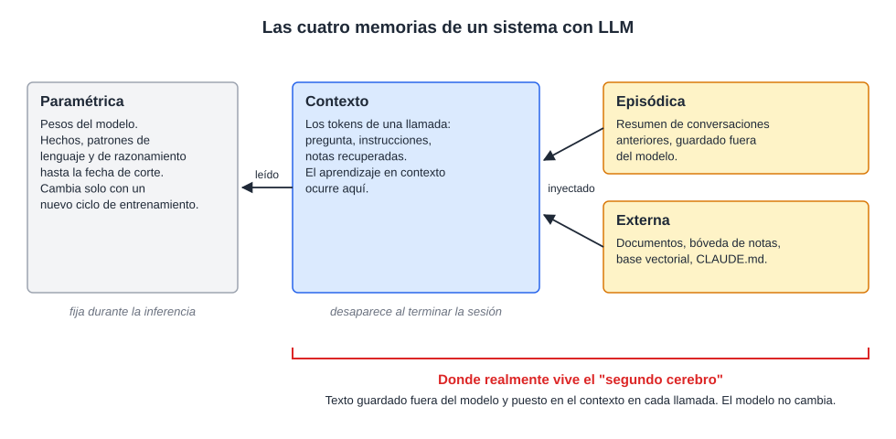
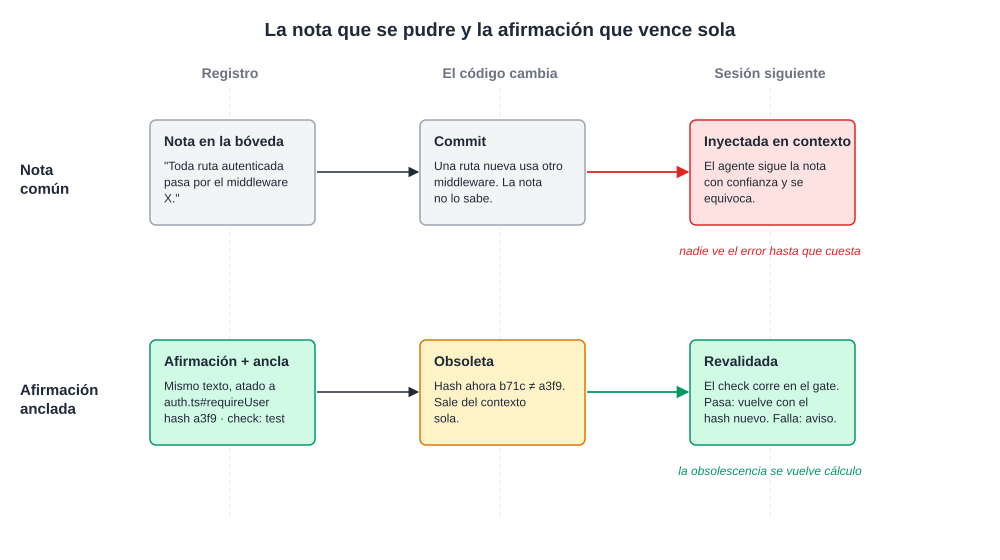
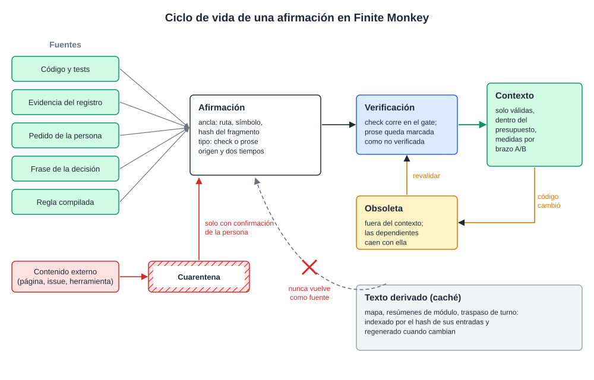
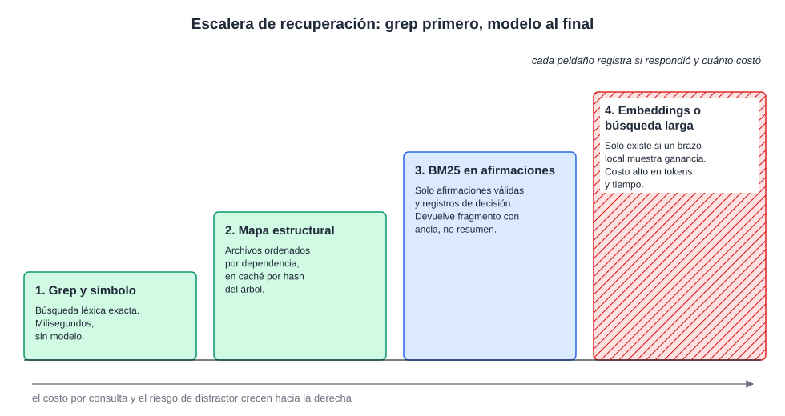
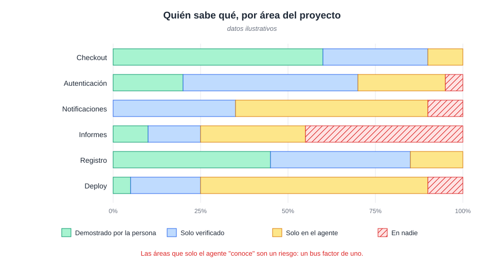

# La ilusión del segundo cerebro: un análisis crítico de los sistemas de gestión del conocimiento personal basados en LLM

**Gabriel Vieira Flores**
NovusTec, São Paulo, SP, Brasil
gabrielvieira.ifsc@gmail.com · ORCID [0009-0000-2613-8284](https://orcid.org/0009-0000-2613-8284)

Versión 2, octubre de 2026 (versión 1: abril de 2026). [English](second-brain.md) | [Português (Brasil)](second-brain.pt-BR.md) | Español

> Este ensayo es la segunda base teórica de [Finite Monkey](../../README.es.md), junto al ensayo [Efecto Rebote](../ricochet/ricochet.es.md). Las secciones 1 a 9 analizan el "segundo cerebro" personal hecho con LLM y proponen una guía de evaluación. La sección 10 reúne lo que ya se ha medido sobre la versión de proyecto y de empresa de esa idea, en la que archivos de contexto y memorias se escriben para agentes de programación. La sección 11 muestra lo que Finite Monkey hace con el conocimiento de un proyecto a partir de esa evidencia y lo que todavía es hipótesis por medir.

## Resumen

La integración entre modelos de lenguaje de gran escala (LLM) y herramientas de anotación dio origen a un mercado que vende arquitecturas de "segundo cerebro" como solución para la gestión del conocimiento. Este ensayo examina esa promesa en su genealogía: de los sistemas expertos de las décadas de 1960 a 1980, pasando por el giro estadístico y por la arquitectura transformer, hasta la popularización abrupta a partir de noviembre de 2022. El argumento central es que el ecosistema Obsidian con LLM es el episodio más reciente de un patrón de la historia de la inteligencia artificial: la promesa de que una nueva tecnología de representación del conocimiento resolverá lo que las anteriores no resolvieron, hecha por quien no estudió por qué fallaron las anteriores. El ensayo distingue la memoria paramétrica de la no paramétrica, separa el aprendizaje en contexto del cambio de pesos que el discurso popular imagina, reúne las limitaciones documentadas de la recuperación aumentada (RAG) y del fine-tuning, y propone preguntas diagnósticas para separar el uso útil de la automatización performática. A continuación, aplica el mismo examen al "segundo cerebro" de proyecto, el conjunto de archivos de contexto y memorias escritos para agentes de programación. Los estudios controlados disponibles encontraron un efecto nulo o pequeño de esos archivos en el acierto de los agentes, un costo de 19% a 23% mayor, referencias a código que ya no existe en el 23% de los repositorios y memorias persistentes envenenables por contenido externo. Lo que mostró efecto fue la orientación validada por sondas y la instrucción convertida en verificación ejecutable. A partir de ello, el ensayo propone tratar el conocimiento de un proyecto como artefacto de build: cada afirmación atada al hash del código que describe, verificada por ejecución cuando sea posible, invalidada automáticamente cuando el código cambia, medida por un brazo A/B antes de ocupar contexto, y devuelta a la persona como pregunta que ella responde, en lugar de resumen que ella lee.

**Palabras clave:** modelos de lenguaje de gran escala; sistemas expertos; gestión del conocimiento personal; generación aumentada por recuperación; agentes de programación; archivos de contexto; mantenimiento de la verdad; procedencia; efecto de generación; ingeniería de software.

## 1. Introducción: el culto de la visualización en grafo

Hacia 2023 surgió un género de contenido: el especialista en productividad que descubrió que conectar la bóveda de archivos Markdown de Obsidian a una API de modelo de lenguaje crearía un "segundo cerebro". Vinieron tutoriales en video, newsletters de pago con acceso a "sistemas" y cursos que vendían estructuras de carpetas como si la organización de directorios fuera conocimiento propietario.

El fenómeno se aceleró en abril de 2026, cuando Andrej Karpathy publicó un gist que describía un patrón personal de "LLM Wiki" (KARPATHY, 2026). Tres días después ya había repositorios que empaquetaban la idea para Obsidian con Claude Code, uno de ellos anunciado como "segundo cerebro de IA que se organiza solo" (AGRICIDANIEL, 2026), y el patrón pasó a circular en comunidades como método de epistemología personal.

Lo que ese ecosistema suele ignorar es que la cuestión central, cómo hacer que una máquina represente, recupere y razone sobre el conocimiento humano, es el problema fundacional de la inteligencia artificial. No es nuevo y no está resuelto. Cada generación que lo redescubre sin conocer los intentos anteriores tiende a reproducir los mismos modos de falla, ahora con otro vocabulario y un marketplace de plugins.

Este ensayo no rechaza la gestión del conocimiento apoyada por LLM. Exige precisión histórica y técnica. El argumento pasa por la genealogía de los sistemas expertos, por el giro estadístico, por lo que un LLM es en realidad, por el mito del aprendizaje continuo, por la literatura empírica sobre RAG, por el arco de popularización y sus costos, por la crítica al ecosistema, por el patrón de Karpathy y sus derivados, y por una guía de evaluación. Las secciones 10 y 11 llevan el análisis al conocimiento de proyectos de software, donde los agentes pasaron a leer y escribir memorias por cuenta propia.

## 2. Genealogía: el problema antiguo que los practicantes no conocen

### 2.1 Sistemas expertos: la primera gran promesa

La idea de que el conocimiento especializado puede formalizarse en reglas ejecutables por máquina tiene sesenta años de historia documentada. DENDRAL, desarrollado en Stanford a partir de 1965 por Edward Feigenbaum, Joshua Lederberg, Bruce Buchanan y Carl Djerassi, suele señalarse como el primer sistema experto: un programa que aplicaba reglas de química orgánica para inferir estructuras moleculares a partir de datos de espectrometría de masas (FEIGENBAUM; BUCHANAN, 1993). La innovación no era algorítmica; era epistemológica: la competencia de un especialista podía escribirse como reglas.

MYCIN, desarrollado por Edward Shortliffe en Stanford en la década de 1970, hizo famosa esa tesis. Era un sistema de reglas de producción para elegir la terapia antimicrobiana en infecciones bacterianas, con algunos cientos de reglas de la forma SI condición 1 Y condición 2 ENTONCES conclusión CON factor de certeza, cerca de 450 en la versión madura (SHORTLIFFE, 1976; BUCHANAN; SHORTLIFFE, 1984). En una evaluación ciega con diez casos de meningitis, ocho especialistas juzgaron aceptables las prescripciones de MYCIN con una frecuencia igual o mayor que las de docentes de Stanford (YU et al., 1979).

La década de 1980 fue la edad de oro de esos sistemas. La industria de la IA pasó de algunos millones de dólares en 1980 a algunos miles de millones en 1988 (RUSSELL; NORVIG, 2010), un optimismo que precedió al llamado invierno de la IA. La promesa era la misma que circula hoy en los servidores de Discord sobre Obsidian: capturar el conocimiento especializado, organizarlo y consultarlo de forma confiable, liberando al trabajador del conocimiento de retener y recuperar a mano lo que ya fue documentado.

### 2.2 Por qué fallaron los sistemas expertos: el cuello de botella de la adquisición de conocimiento

El problema fundamental se conoció como *knowledge acquisition bottleneck*. Extraer el conocimiento de especialistas humanos hacia reglas formales resultó mucho más difícil de lo que esperaban los fundadores: los especialistas muchas veces no saben articular las reglas que siguen, porque operan por reconocimiento de patrones e intuición acumulada, que resisten la formalización proposicional.

El segundo modo de falla era la generalización frágil. Un sistema que funcionaba bien en el dominio de entrenamiento se degradaba sin aviso fuera de él. El tercero era el mantenimiento a escala. Algunos cientos de reglas son auditables por un especialista; miles se vuelven opacas. XCON (R1), que configuraba computadoras VAX en DEC, llegó a miles de reglas y exigía un equipo dedicado a mantenerlas (McDERMOTT, 1982). Las reglas interactúan de modos no previstos: añadir una para corregir un comportamiento puede invalidar otras en silencio.

El invierno de la IA, de 1987 a inicios de los años 1990, fue en parte una reacción a esos modos de falla (CREVIER, 1993). Lo que cayó de forma abrupta fue la inversión y el mercado de máquinas Lisp; los sistemas en sí fueron absorbidos poco a poco por software corporativo común. El Cuadro 1 resume los tres modos de falla y sus paralelos en el ecosistema de gestión del conocimiento personal (PKM) con LLM.

**Cuadro 1 – Modos de falla de los sistemas expertos y sus paralelos en PKM con LLM**

| Modo de falla | Sistemas expertos (1965–1993) | PKM con LLM (2022–2026) |
|---|---|---|
| Cuello de botella de la adquisición de conocimiento | Los especialistas no logran escribir en reglas formales el conocimiento tácito que aplican por reconocimiento de patrones | El conocimiento que la persona no logra escribir en notas de calidad no se vuelve recuperable porque haya un LLM a mitad del camino |
| Generalización frágil | Bueno dentro del dominio, degradación sin aviso fuera de él, sin forma de expresar incertidumbre estructural | La recuperación ingenua se degrada del mismo modo en temas poco representados en la bóveda o en preguntas que cruzan dominios |
| Mantenimiento a escala | Cientos de reglas son auditables; miles se vuelven opacas; una regla nueva puede invalidar otras en silencio | Una bóveda de 500 notas es manejable; una de 5.000 acumula afirmaciones contradictorias, sobre todo cuando es el LLM quien compila la wiki |

Fuente: elaboración propia (2026), con base en Feigenbaum y Buchanan (1993), McDermott (1982) y Crevier (1993).

### 2.3 Representación simbólica del conocimiento

Mientras los sistemas expertos crecían y caían, una línea paralela desarrollaba los fundamentos formales de la representación del conocimiento. Las redes semánticas organizaban conceptos en jerarquías de herencia y fueron puestas a prueba como modelo de la memoria humana (COLLINS; QUILLIAN, 1969). Los *frames* de Minsky (1975) son estructuras que representan estereotipos de objetos, con campos para atributos, valores por defecto y herencia. La analogía con las notas de una bóveda de Obsidian con metadatos YAML es inmediata y no es accidental.

El grafo de Obsidian que los influencers filman como prueba de su segundo cerebro es, funcionalmente, una red semántica sin semántica en las aristas. Los enlaces sin tipo entre notas no tienen poder inferencial. Son visualizaciones de conectividad, no estructuras de conocimiento que un programa pueda explotar.

Cyc, iniciado por Doug Lenat en 1984, es el caso más revelador. Su objetivo era codificar a mano el conocimiento de sentido común necesario para razonar como un adulto (LENAT, 1995). En 2006, después de cerca de 900 personas-año de trabajo, la base tenía más de 2,2 millones de aserciones sobre más de 250 mil términos (MATUSZEK et al., 2006). El proyecto continuó durante casi cuatro décadas y no resolvió el problema. La lección para el ecosistema Obsidian con LLM es directa: si décadas de ingeniería manual a escala industrial no formalizaron el sentido común para un razonamiento computable, una bóveda de 500 notas leída por recuperación ingenua no lo hará.

### 2.4 El giro estadístico

La superación de los sistemas expertos no vino de una representación simbólica mejor. Vino del cambio de modelos basados en reglas por modelos basados en distribuciones aprendidas de los datos. Frederick Jelinek, que dirigía el grupo de reconocimiento continuo del habla de IBM, quedó asociado a la frase "cada vez que despido a un lingüista, el desempeño del reconocedor de voz mejora", dicha en algún momento entre 1985 y 1988 en versiones ligeramente diferentes, como él mismo comentó después (JELINEK, 2005).

Word2Vec mostró que las palabras podían representarse como vectores en un espacio continuo, con propiedades aritméticas sorprendentes (MIKOLOV et al., 2013). Bahdanau, Cho y Bengio (2014) introdujeron el mecanismo de atención en redes recurrentes, la pieza que Vaswani et al. (2017) generalizaron en el transformer, base de los LLM actuales.

El punto que importa aquí: el giro estadístico resolvió problemas que el simbolismo había declarado intratables no porque encontrara una representación más verdadera del conocimiento, sino porque abandonó la pretensión de representarlo de forma explícita. Un LLM no "sabe" que un antibiótico cubre cierta clase de bacterias en el sentido en que lo sabía una regla de MYCIN. Aprendió que, en contextos lingüísticos como los de su corpus de entrenamiento, ciertas continuaciones son más probables que otras. Es la distinción más importante para este ensayo y la más ignorada en el discurso sobre PKM.

## 3. Lo que un LLM es en realidad

### 3.1 Memoria paramétrica y lo que un modelo sabe

Un LLM es una red neuronal basada en transformer, entrenada para predecir el siguiente token de una secuencia con aprendizaje autosupervisado sobre grandes corpus de texto (VASWANI et al., 2017; BROWN et al., 2020). El modelo codifica conocimiento de forma implícita en los pesos, lo que la literatura llama memoria paramétrica, fijada en el entrenamiento. En los modelos comerciales usados en el modo estándar, los pesos no cambian durante la inferencia.

De ahí viene la primera incomprensión del discurso de los practicantes: un LLM no es una base de datos. Cuando alguien envía notas a un pipeline conectado a Obsidian y recibe una síntesis, el modelo no "almacenó" nada. Procesó tokens en una ventana de contexto limitada y generó una respuesta probabilística. Cuando el contexto se limpia, la adaptación que ocurrió allí dentro desaparece, salvo que un mecanismo externo la guarde y la reinyecte.

### 3.2 El efecto *lost in the middle*

Liu et al. (2024) mostraron, en experimentos controlados, que el desempeño de los modelos de lenguaje depende de la posición de la información relevante dentro del contexto:

> "el desempeño es a menudo más alto cuando la información relevante aparece al principio o al final del contexto de entrada, y se degrada significativamente cuando los modelos deben acceder a información relevante en medio de contextos largos, incluso en modelos explícitamente de contexto largo" (LIU et al., 2024, p. 157, traducción nuestra).

En el peor caso, con 20 o 30 documentos, la caída superó los 20 puntos para GPT-3.5-Turbo, que quedó por debajo de su propio desempeño sin ningún documento. La causa de la curva en U todavía se debate. Una explicación apunta al decaimiento de largo alcance de RoPE (ZHANG, Z. et al., 2024); otras apuntan a un sesgo posicional intrínseco de la atención (HSIEH et al., 2024) o a la máscara causal combinada con el decaimiento (WU, X. et al., 2025). El propio estudio de Liu et al. encontró la curva en MPT, que usa ALiBi y no RoPE. La implicación práctica no depende de la causa: quien arma una ventana de 10 mil tokens con notas de la bóveda y espera que el modelo las use de forma uniforme está operando con una idea equivocada del sistema que usa.

Trabajos posteriores endurecieron el cuadro. Cuando la pregunta y el fragmento relevante no comparten palabras, GPT-4o cae de 99,3% a 69,7% de acierto en 32 mil tokens (MODARRESSI et al., 2025). Un estudio con 18 modelos mostró que el desempeño varía con el tamaño de la entrada incluso en tareas simples y que un único distractor ya empeora el resultado (HONG; TROYNIKOV; HUBER, 2025).

### 3.3 Alucinación: reducible, no eliminable

Los modelos de lenguaje generan texto muestreando distribuciones aprendidas sobre secuencias de tokens. No recuperan verdades de un repositorio; producen continuaciones plausibles. Hay resultados teóricos de que la alucinación no puede eliminarse por completo en un modelo de uso general (XU; JAIN; KANKANHALLI, 2024), y hay trabajos que atribuyen buena parte de ella a incentivos de entrenamiento y evaluación que premian adivinar en lugar de abstenerse, lo que la vuelve reducible (KALAI et al., 2025). Las dos lecturas coinciden en lo que importa aquí: no hay garantía de que una síntesis generada sea correcta.

Cuando un LLM mantiene una wiki, leyendo notas en bruto, sintetizando páginas y creando referencias cruzadas, cada etapa es una superficie de alucinación. Una síntesis errónea en la compilación entra en la estructura de la base y después se usa como contexto para nuevas síntesis. Los comentarios al gist de Karpathy llegan a ese punto sin rodeos. Un participante observa que, cuando los archivos de origen cambian, el conocimiento compilado puede estar equivocado sin que el sistema lo sepa, y que los chequeos de salud se reducen al LLM releyendo las páginas y adivinando si algo cambió; otro recuerda que la ausencia de citas alucinadas es una aspiración, no una garantía técnica (KARPATHY, 2026, comentarios).

## 4. El mito del aprendizaje continuo

### 4.1 La ciencia ficción como modelo mental

Hay un equívoco tan difundido como consecuente: la creencia de que el modelo se vuelve más inteligente, más personal y más capaz a medida que el usuario conversa con él. El origen es la ciencia ficción. HAL 9000 aprende de la tripulación; el JARVIS de Marvel evoluciona con Tony Stark; Samantha, en *Her*, desarrolla una relación singular con Theodore. En todos los casos, la IA es un agente con memoria episódica continua y desarrollo a lo largo del tiempo.

Los LLM comerciales de 2026 no funcionan así. La diferencia entre el modelo popular y el técnico es de tipo, no de grado, y entenderla es condición para evaluar cualquier sistema de conocimiento basado en LLM.

### 4.2 Entrenamiento e inferencia

La operación de un LLM tiene dos regímenes separados. En el entrenamiento, el modelo procesa corpus enormes, hace predicciones sobre el siguiente token, calcula una función de pérdida y ajusta, por retropropagación, los miles de millones de parámetros de la red. El proceso corre en clústeres de GPU durante semanas o meses y termina en un archivo estático de pesos.

En la inferencia, ese archivo se carga con los parámetros congelados y se aplica a cada nueva entrada. No hay retropropagación ni escritura de información nueva en el modelo. Eso no quiere decir que nada se adapte: dentro de la ventana de contexto el modelo aprende de ejemplos e instrucciones, el llamado aprendizaje en contexto (BROWN et al., 2020), y hay trabajos que muestran que ese mecanismo implementa algo cercano a un paso de gradiente implícito (VON OSWALD et al., 2023). Las investigaciones con *test-time training* y con memorias entrenables actualizan pesos o estados durante la inferencia (AKYÜREK et al., 2024; BEHROUZ; ZHONG; MIRROKNI, 2024), pero no son el estándar de los productos. La formulación precisa es esta: en los LLM comerciales usados en el modo estándar, los pesos no cambian durante la inferencia; la adaptación ocurre en el contexto y desaparece con él, a menos que un sistema externo la guarde y la devuelva.

Cuando Claude "parece recordar" que el usuario prefiere respuestas cortas, no es porque haya aprendido la preferencia; es porque el sistema reinyectó un resumen de interacciones anteriores en el contexto de la nueva conversación. La propia Anthropic describe su memoria como un resumen editable y opcional, por proyecto (ANTHROPIC, 2025a). Hagoel (2025), escribiendo para quien construye esos sistemas, resume la situación: "Los LLM tal como existen hoy, incluso equipados con las mejores herramientas disponibles, no pueden hacer nada de eso. No tienen estado y están congelados en el tiempo. [...] La única forma de introducir información nueva o 'enseñar' habilidades nuevas a un LLM es proporcionarle ejemplos, instrucciones y toda la información relevante acumulada, repetidamente, en cada invocación (prompt)" (traducción nuestra).

### 4.3 Cuatro tipos de memoria

Un relevamiento reciente organiza la memoria en sistemas con LLM en cuatro categorías, con propiedades muy diferentes (ZHANG, D. et al., 2025). El discurso popular junta las cuatro en una sola, y eso impide razonar sobre fallas.

La **memoria paramétrica** es el conocimiento codificado en los pesos durante el preentrenamiento: hechos del mundo, patrones de lenguaje y de razonamiento, conocimiento de dominio hasta la fecha de corte. Es fija en la inferencia y solo cambia con un nuevo ciclo de entrenamiento.

La **memoria de contexto** es la ventana activa, el conjunto de tokens procesados en una llamada. Es efímera. Una bóveda de Obsidian inyectada como contexto existe solo en esta capa y está sujeta al efecto descrito en la sección 3.2.

La **memoria episódica** es el historial recuperable de conversaciones, guardado fuera del modelo y reinsertado en sesiones siguientes. No es memoria del modelo: es ingeniería de sistema que simula continuidad, por resumen y reinyección.

La **memoria externa**, o no paramétrica, es el conjunto de documentos recuperables por RAG, bases vectoriales u otro almacenamiento. Es infraestructura alrededor del modelo, y su calidad depende del acervo y de la estrategia de recuperación.

La confusión entre esas categorías está detrás de la mayor parte de las promesas sin fundamento en el ecosistema PKM con LLM. Quien alimenta notas en Obsidian y conecta un LLM por RAG opera solo en la memoria externa y en la de contexto. El modelo no se vuelve más inteligente ni más personal. Lo que cambia es lo que se pone en el contexto antes de cada respuesta. La Figura 1 muestra dónde vive cada capa y qué ocurre con ella cuando la sesión termina.

*Figura 1 – Las cuatro memorias de un sistema con LLM y dónde vive en realidad el "segundo cerebro". Fuente: elaboración propia (2026), con base en Zhang, D. et al. (2025).*

### 4.4 Cómo evolucionan realmente los modelos

La evolución de modelos como Claude, GPT o Gemini no ocurre durante las conversaciones. Ocurre en ciclos discretos de entrenamiento, cada uno con requisitos de cómputo y datos a escala industrial.

El preentrenamiento expone el modelo a billones de tokens: cerca de 15 billones en Llama 3 (GRATTAFIORI et al., 2024) y 36 billones en Qwen3 (YANG et al., 2025). El objetivo no es enseñar respuestas correctas, sino construir una representación estadística del lenguaje y del conocimiento codificado en él.

El ajuste fino supervisado viene a continuación: ejemplos curados de entrada y salida ajustan los pesos para seguir instrucciones y mantener el formato, transformando un modelo de completar texto en un asistente. El aprendizaje por refuerzo con retroalimentación humana (RLHF), popularizado por InstructGPT (OUYANG et al., 2022), entrena un modelo de recompensa a partir de comparaciones hechas por anotadores y optimiza el modelo principal para maximizarla. Variantes como DPO prescinden del modelo de recompensa intermedio, pero mantienen la estructura de aprendizaje por preferencia (RAFAILOV et al., 2023).

El ciclo entero, con planificación, experimentos de escala, preentrenamiento, ajuste, evaluación de seguridad y lanzamiento, lleva meses; solo la fase de alineamiento y pruebas de GPT-4 llevó cerca de seis meses (OPENAI, 2023). Esa escala de tiempo no es compatible con ninguna idea de aprendizaje en tiempo real a partir de conversaciones individuales.

### 4.5 La carrera de parámetros y el giro hacia la calidad de los datos

Durante años el progreso fue guiado por una regla simple: los modelos más grandes, con más parámetros y más datos, son mejores. Kaplan et al. (2020) formalizaron la intuición en las primeras leyes de escala, relaciones de potencia entre tamaño del modelo, volumen de datos y pérdida.

El trabajo de Chinchilla fue el primer gran cuestionamiento. Entrenando más de 400 modelos de 70 millones a 16 mil millones de parámetros, con 5 a 500 mil millones de tokens, DeepMind mostró que los modelos de la época estaban subentrenados en datos: para el mejor uso del cómputo, parámetros y tokens deberían crecer en la misma proporción. Gopher, de 280 mil millones de parámetros, fue superado por Chinchilla, de 70 mil millones, entrenado con cuatro veces más datos (HOFFMANN et al., 2022).

La ley de Chinchilla optimiza el costo de entrenamiento, no el de uso. Cuando se cuenta el costo de inferencia, conviene entrenar modelos más pequeños con más datos de los que ella recomienda (SARDANA et al., 2024). Las familias Llama 2, Llama 3 y Qwen3 siguieron ese camino. El Qwen3 de 0,6 mil millones de parámetros fue entrenado con los mismos 36 billones de tokens de la familia, lo que da cerca de 60 mil tokens por parámetro (YANG et al., 2025; THOMPSON, 2026).

El giro más relevante, sin embargo, es de la cantidad a la calidad de los datos. Subramanyam, Chen y Grossman (2025) incluyeron un parámetro de calidad en la ley de escala y mostraron que mil millones de tokens de alta calidad pueden valer bastante más que mil millones de tokens ruidosos o redundantes. Los modelos de razonamiento, como la familia o1 y DeepSeek-R1, añadieron un tercer eje: gastar cómputo en la inferencia, produciendo tokens de "pensamiento" antes de la respuesta (DEEPSEEK-AI, 2025; SNELL et al., 2024).

Quien cree que poner más notas en la bóveda vuelve al LLM "más inteligente" está confundiendo esos tres ejes con la inyección de contexto. El modelo no cambia. Lo que cambia es el contexto disponible. Son fenómenos de órdenes completamente diferentes.

### 4.6 El fine-tuning y sus límites

El ajuste fino aparece en el ecosistema como solución para las limitaciones de la memoria paramétrica: si el modelo no sabe lo que está en sus notas, entrénelo con ellas. La propuesta tropieza con problemas que el discurso popular ignora.

El primero es el olvido catastrófico. Ajustar un modelo con datos nuevos puede degradar lo que sabía antes (KIRKPATRICK et al., 2017). Luo et al. (2023) observaron, en modelos de 1 a 7 mil millones de parámetros ajustados en una secuencia de tareas, que el olvido aumentaba con el tamaño; otro estudio encontró lo opuesto, con modelos preentrenados más grandes olvidando menos (RAMASESH; LEWKOWYCZ; DYER, 2022). Lo que puede afirmarse es que un ajuste con los 5 mil artículos de la bóveda puede producir un modelo que responde mejor sobre ese acervo y razona peor sobre el resto, y que el tamaño del efecto no es previsible de antemano.

El segundo es el costo del alineamiento. InstructGPT registró regresiones en algunos benchmarks públicos después del RLHF, lo que los autores llamaron *alignment tax*, y mostró que una variante del método las reducía (OUYANG et al., 2022). Kirk et al. (2024) mostraron que el RLHF reduce bastante la diversidad de las salidas en relación con el ajuste supervisado. En PKM, un modelo ajustado para responder de forma consistente sobre un dominio puede volverse menos capaz justamente de producir conexiones inesperadas, el tipo de *insight* que los practicantes dicen querer.

El tercero es la calidad de los datos. En más de mil modelos ajustados bajo condiciones controladas, la perplejidad del modelo sobre los datos de entrenamiento muchas veces predijo mejor el efecto del ajuste que la semejanza superficial entre los datos y el benchmark (HARADA et al., 2025). Extrapolando al caso aquí discutido: ajustar un modelo con notas fragmentadas e inconsistentes tiende a producir un modelo especializado en responder de forma fragmentada e inconsistente sobre ese acervo.

LoRA y variantes como QLoRA y AdaLoRA reducen el costo del ajuste entrenando matrices de bajo rango acopladas a las capas del transformer (HU et al., 2021; DETTMERS et al., 2023; ZHANG, Q. et al., 2023). Atenúan el olvido y el costo, sin eliminarlos, y exigen una infraestructura de evaluación que no existe en las implementaciones populares de bóveda de Obsidian.

La conclusión honesta: el ajuste fino es una herramienta válida de adaptación de dominio cuando hay datos de calidad, evaluación rigurosa y conciencia de las pérdidas. Para el caso promedio de PKM, un acervo de 500 a 5 mil notas de calidad desigual mantenido por una persona sin infraestructura de evaluación, probablemente crea más problemas de los que resuelve.

### 4.7 El contexto como falsa memoria

La personalización que los usuarios perciben en Claude, ChatGPT o Gemini no es producto de aprendizaje; es producto de ingeniería de contexto. Al iniciar una conversación, el sistema recupera fragmentos de interacciones anteriores, los resume y los inyecta al comienzo del contexto. El modelo procesa ese texto como cualquier otra entrada. La sensación de que el asistente "recuerda" es la de leer un documento sobre uno mismo, no la de ser reconocido.

Una bóveda de Obsidian conectada a un LLM por RAG ofrece exactamente el mismo tipo de "memoria": documentos recuperados e inyectados. El modelo no formó una representación interna del usuario, de sus preferencias ni de su estilo de pensar. En cada nueva consulta, empieza de nuevo con el contexto proporcionado, y la calidad de la respuesta depende de la calidad de lo que se recuperó.

La comparación con el aprendizaje automático clásico es reveladora. En los sistemas de recomendación, el perfil del usuario es un vector de parámetros que el sistema reestima periódicamente a partir del comportamiento (KOREN; BELL; VOLINSKY, 2009). Un LLM no tiene ese mecanismo entre llamadas. Los trabajos que intentan acoplar memoria persistente entrenada a modelos congelados parten de la misma constatación; para modelos codificador-decodificador congelados, "la representación latente se descarta después de cada pasada hacia adelante, por lo que ninguna información persiste entre sesiones" (JEONG, 2026, traducción nuestra). La investigación de Databricks sobre memoria de agentes a escala registra avances, pero en la infraestructura externa al modelo, y enumera como trabajo pendiente mantener la memoria correcta, actual y accesible a medida que crece (DATABRICKS, 2026).

### 4.8 LLM y aprendizaje automático clásico

En el aprendizaje automático clásico, como la regresión logística, los árboles con *boosting* y las redes poco profundas, el modelo suele ser el propio vehículo del conocimiento de dominio y puede reentrenarse periódicamente: un filtro de spam se reentrena con spam nuevo y sus pesos cambian en cada ciclo. En un LLM, el modelo es un *prior* estadístico enorme sobre el lenguaje, y el conocimiento de dominio entra por contexto, por ajuste fino en ciclos discretos o por RAG, nunca por interacción en tiempo real.

Esto tiene una consecuencia directa para la metáfora. Un segundo cerebro de verdad necesitaría adquirir conocimiento de forma continua, olvidar selectivamente lo que quedó obsoleto, integrar lo nuevo a lo que ya existe y mantener una representación persistente del historial del usuario. Ninguna de esas propiedades existe en un LLM en inferencia estándar. La metáfora describe el sistema que a los practicantes les gustaría tener.

Lo que ofrecen los LLM es impresionante, pero es otra cosa: procesar y sintetizar grandes volúmenes de texto dentro de una ventana, generar lenguaje fluido condicionado a documentos proporcionados, medir semejanza semántica por embeddings y transformar texto con calidad razonable. Eso tiene valor. Pero no es un cerebro, y no aprende entre una conversación y otra.

## 5. La literatura sobre RAG: lo que dice la evidencia

### 5.1 Arquitectura y promesas

La generación aumentada por recuperación fue formalizada por Lewis et al. (2020) como forma de complementar la memoria paramétrica del modelo con documentos externos recuperables. La promesa común es que el RAG mitiga dos fallas de los LLM: el conocimiento desactualizado y la alucinación. La literatura empírica es menos optimista que el discurso de los practicantes.

### 5.2 Limitaciones documentadas

**Más documentos no siempre es mejor.** Los modelos se distraen con contexto irrelevante (SHI, F. et al., 2023). El efecto depende del tipo de ruido: los documentos irrelevantes pero parecidos a la pregunta perjudican, mientras que los documentos aleatorios pueden incluso ayudar (CUCONASU et al., 2024). Para quien cree que una bóveda más grande siempre es mejor, el mensaje es que el tamaño importa menos que lo que se recupera.

**La coherencia se rompe bajo recuperación frecuente.** Recuperar a intervalos cortos durante la generación reduce las métricas de coherencia, porque los cambios constantes interrumpen la continuidad del contexto (LI et al., 2025).

**El RAG no elimina la alucinación.** Una revisión sistemática en el área de la salud concluyó que la calidad de la recuperación sigue siendo un desafío y que los fragmentos irrelevantes recuperados obligan al modelo a razonar en torno a material que confunde (AMUGONGO et al., 2025).

**La posición en la ventana impone un techo.** Como se vio en la sección 3.2, la caída puede superar los 20 puntos cuando la información relevante sale de los extremos y va al medio del contexto (LIU et al., 2024).

**La segmentación destruye estructura.** Las implementaciones ingenuas cortan los documentos en trozos de tamaño fijo y pierden párrafos, jerarquía de secciones y referencias cruzadas (GAO et al., 2023). Y dos fragmentos pueden estar ligados lógicamente sin compartir vocabulario; es exactamente el caso en que la búsqueda por semejanza falla, como muestra la caída de 99,3% a 69,7% cuando la pregunta y el fragmento no tienen palabras en común (MODARRESSI et al., 2025).

Los enfoques jerárquicos como RAPTOR (SARTHI et al., 2024) y basados en grafos como GraphRAG (EDGE et al., 2024) atacan el problema de la segmentación con abstracciones en varios niveles. Son sistemas de investigación, con ganancias en preguntas globales sobre acervos grandes, y están a otra distancia de arrastrar archivos Markdown a una carpeta. Para evaluar un pipeline de RAG existen métricas y corpus propios, como RAGAS (ES et al., 2024) y RAGTruth (NIU et al., 2024), que casi ningún practicante usa.

## 6. El arco de la popularización y sus costos epistémicos

### 6.1 De la sala de máquinas al servidor de Discord

Hay una trayectoria sociológica que une *Attention Is All You Need* (VASWANI et al., 2017) con la proliferación de bóvedas de Obsidian. En 2017, los transformers eran asunto de investigadores con formación en aprendizaje automático y acceso a clústeres de GPU. ChatGPT, lanzado el 30 de noviembre de 2022, fue el punto de inflexión: superó el millón de usuarios en cinco días, según el propio Sam Altman (ALTMAN, 2022), y una estimación de analistas le atribuyó 100 millones de usuarios activos en enero de 2023 (HU, K., 2023).

**Cuadro 2 – El arco de la popularización y la transformación del discurso**

| Período | Evento | Perfil de quien practica | Estado del discurso |
|---|---|---|---|
| 2017 | Vaswani et al., *Attention Is All You Need* | Investigadores con formación en aprendizaje automático | Modos de falla descritos técnicamente en la literatura primaria |
| 2020 | API de GPT-3 en beta (OpenAI) | Ingenieros de software interesados en lenguaje natural | Ecosistema técnico; expectativas calibradas |
| Nov. 2022 | Lanzamiento de ChatGPT | Un millón de usuarios en cinco días; interfaz de chat | Comienza la degradación semántica del vocabulario técnico |
| 2023–2026 | Ecosistema Obsidian con LLM, patrón de Karpathy, Smart Connections con más de 1,25 millones de descargas | Influencers de productividad sin formación en aprendizaje automático | Ritual elaborado, ausencia de benchmarks |

Fuente: elaboración propia (2026), con base en Vaswani et al. (2017), Altman (2022), Hu, K. (2023) y Obsidian (2026).

### 6.2 La degradación semántica del vocabulario técnico

Cada concepto que migra de un artículo revisado por pares a un tutorial en video pierde precisión. *Memoria* es el caso de mayores consecuencias. En la literatura de LLM tiene definiciones técnicas (paramétrica, de contexto, episódica, externa); en el discurso de los practicantes, se volvió cualquier cosa que "el sistema guarda". Esa promiscuidad terminológica impide razonar sobre fallas.

*Conocimiento* sufrió la misma degradación. En la IA simbólica, tenía representación formal con semántica explícita; en los LLM, es implícito y estadístico; en el discurso de los practicantes, se volvió cualquier texto en cualquier archivo.

*Aprendizaje* tal vez haya sufrido la degradación más grave. En aprendizaje automático, denota ajuste de parámetros por gradiente; en los LLM, denota preentrenamiento a escala industrial o ajuste fino con datos curados, además del aprendizaje en contexto que desaparece con la ventana. En el discurso popular, pasó a significar cualquier apariencia de adaptación, incluida la simple recuperación de contexto inyectado. Esa confusión es el sustrato del mito del segundo cerebro que aprende.

El mismo fenómeno aparece en el plano individual. El ensayo sobre el Efecto Rebote describe la mimetización del vocabulario técnico: la persona adquiere las palabras de un dominio antes que la estructura que las une, y pasa a pedir y a evaluar con términos cuyo significado operativo no domina (FLORES, 2026). Un ecosistema entero en el que "memoria", "conocimiento" y "aprendizaje" circulan sin definición operativa es la versión colectiva de esa mimetización.

### 6.3 Autoconfianza sin metacognición a escala de ecosistema

Kruger y Dunning (1999) argumentaron que la incompetencia en un dominio perjudica la metacognición necesaria para reconocerla. El efecto es debatido: parte de él puede ser regresión a la media y artefacto de medición (NUHFER et al., 2016; GIGNAC; ZAJENKOWSKI, 2020), aunque hay defensas de que un componente metacognitivo permanece (JANSEN; RAFFERTY; GRIFFITHS, 2021). La curva con un "pico" de confianza que circula en redes sociales no está en el artículo original.

Aun sin apoyar el argumento en el efecto, hay una asimetría de incentivos que prescinde de la psicología individual. Quien domina la herramienta lo suficiente para operarla, pero no lo suficiente para conocer sus límites, puede prometer más con menos salvedades, y las promesas simples rinden más alcance que las salvedades precisas. El resultado es un ecosistema que produce más contenido de baja confiabilidad porque el incentivo económico premia la simplicidad de la promesa, no la precisión técnica.

### 6.4 El culto cargo como estructura recurrente

Richard Feynman llamó *cargo cult science* a la forma externa de la investigación científica sin su contenido (FEYNMAN, 1974). El ecosistema Obsidian con LLM tiene esa estructura. Los practicantes notaron que los pipelines con LLM a veces producen algo parecido a lo que produciría un sistema de conocimiento inteligente y replicaron la forma (bóveda estructurada, CLAUDE.md, metadatos YAML, scripts de ingesta, grafo) sin entender por qué el sistema funciona cuando funciona ni por qué falla cuando falla.

Los sistemas expertos tuvieron su culto cargo: empresas que compraban *shells* de sistemas expertos sin tener especialistas para alimentar las reglas con contenido de calidad. La diferencia ahora es la escala y la velocidad de difusión, ampliadas por plataformas que remuneran promesas no verificables con alcance orgánico.

## 7. Crítica al ecosistema Obsidian con LLM

### 7.1 Lagunas técnicas sistémicas

Lo que une las capas del ecosistema, de los plugins de semejanza semántica a las wikis compiladas por LLM, es la ausencia frecuente de los controles que la literatura señala como necesarios. La mayoría de las implementaciones populares no usa reordenamiento por *cross-encoder* para atenuar el efecto de posición, no combina búsqueda léxica BM25 con embeddings, no rastrea la procedencia de cada afirmación y no se evalúa con corpus como RAGAS o RAGTruth. Las excepciones existen y confirman la regla: el propio gist de Karpathy recomienda, cuando la wiki crece, una herramienta de búsqueda híbrida BM25 y vectorial con reordenamiento por LLM (KARPATHY, 2026), recomendación que buena parte de los derivados no siguió.

### 7.2 El presupuesto de tokens y la economía de la complejidad

Una bóveda de 500 notas de 300 palabras tiene cerca de 150 mil palabras, algo en torno a 200 mil tokens en inglés y más en portugués. Enviar todo eso en una consulta cuesta, a precios de 2026, de veinte centavos a cerca de un dólar, procesa sobre todo texto irrelevante y, por lo que se vio en la sección 3.2, empeora la precisión para lo que esté en el medio de la ventana. Un índice BM25 o un grep devolvería la nota relevante en milisegundos y a un costo marginal casi nulo.

### 7.3 El problema mal identificado

La falla central del discurso es identificar mal el problema. La literatura sobre gestión de información personal documenta que las personas guardan mucho más de lo que recuperan, que el esfuerzo de organizar de antemano rinde poco y que la recuperación depende sobre todo de recordar dónde y por qué algo fue guardado (WHITTAKER, 2011; BERGMAN; WHITTAKER, 2016). Los propios defensores del método del segundo cerebro sitúan la falla en la disciplina de captura y de síntesis, no en la herramienta (FORTE, 2022), aunque como opinión y no como investigación. Ninguna de las dos lecturas sugiere que el cuello de botella sea la ausencia de un LLM.

Si la bóveda es un depósito de notas a medias, etiquetas inconsistentes y artículos capturados hace meses y nunca leídos, poner un modelo de lenguaje encima no transforma una entrada de baja calidad en una síntesis de alta calidad. *Garbage in, garbage out* es una de las observaciones más antiguas y duraderas de la computación.

### 7.4 El problema epistemológico de la síntesis delegada

La investigación en ciencia cognitiva muestra que los procesos elaborativos de la adquisición de conocimiento (releer, resumir con las propias palabras, crear conexiones, explicar) no son accesorios de la formación del conocimiento; son la formación del conocimiento. Lo que se procesa con más profundidad se recuerda mejor (CRAIK; LOCKHART, 1972). Lo que la persona genera se recuerda mejor que lo que solo lee (SLAMECKA; GRAF, 1978). Las actividades constructivas e interactivas producen más aprendizaje que las actividades pasivas (CHI; WYLIE, 2014). La práctica de Luhmann con el fichero, descrita por él mismo como una conversación con un interlocutor que sorprende, dependía de escribir cada ficha a mano y de enlazarla a propósito con las demás (LUHMANN, 1981).

Delegar esas operaciones por completo a un LLM no es ampliación cognitiva; es transferencia del trabajo cognitivo hacia afuera, con costos conocidos (RISKO; GILBERT, 2016). Los datos recientes con IA van en la misma dirección: en un experimento controlado, quienes aprendieron una biblioteca nueva con ayuda de IA tuvieron peor comprensión conceptual, lectura de código y depuración, sin ganancia media de tiempo; solo los patrones de uso con compromiso cognitivo preservaron el aprendizaje (SHEN; TAMKIN, 2026). La promesa de "cero fricción" del marketing no automatiza el conocimiento. Automatiza su apariencia.

## 8. Distinguir los patrones legítimos de los derivados de culto cargo

### 8.1 Lo que propone el patrón de Karpathy

Leído con cuidado, el gist de Karpathy es una propuesta específica y modesta. La innovación central es la diferencia entre el RAG de consulta única, en el que el LLM "redescubre el conocimiento desde cero en cada pregunta", y una wiki persistente que acumula y mejora a medida que llegan nuevas fuentes (KARPATHY, 2026). Describe tres capas (fuentes en bruto inmutables, la wiki y un esquema) y tres operaciones (ingerir, consultar y revisar), esta última en busca de contradicciones, afirmaciones superadas y páginas huérfanas.

Karpathy delimita la escala: el patrón "funciona sorprendentemente bien a escala moderada (~100 fuentes, ~cientos de páginas)" y, a medida que la wiki crece, requiere una búsqueda adecuada, con indexación híbrida y reordenamiento. Enumera usos personales y también una wiki interna de equipo o empresa, y advierte que el texto describe una idea, no una implementación (KARPATHY, 2026). Lo que no existe en el gist es un mecanismo de verificación: los chequeos son el propio modelo releyendo las páginas. La diferencia entre el gist y sus derivados reproduce la diferencia entre MYCIN y las *shells* que vinieron después: los derivados vendieron la forma sin las salvedades.

### 8.2 Cuándo tiene valor el PKM con LLM

El argumento de este ensayo no es que los LLM nunca sirvan en bases personales de conocimiento. Es que la mayor parte de los usos vendidos no califica. Los siguientes usos son defendibles:

**Síntesis sobre acervos heterogéneos a escala manejable:** cuando un investigador reunió de 50 a 200 documentos bien anotados sobre un tema, una pasada de compilación puede ahorrar tiempo, siempre que el resultado se trate como borrador por verificar.

**Tareas estructurales repetitivas:** generar enlaces, normalizar etiquetas, encontrar notas vacías y dar formato a citas son operaciones de baja carga semántica, cuyo valor está en ejecutarlas, no en pensar.

**Consulta sobre un acervo autorizado y verificado:** cuando el acervo tiene autoridad, como una colección curada de artículos revisados, el RAG puede tener valor, siempre que incluya citas, rastreo de procedencia y revisión humana.

## 9. Guía de evaluación

### 9.1 Cinco preguntas diagnósticas

Cualquier persona que ponga un LLM junto a una base de conocimiento debería responder cinco preguntas antes de afirmar que el sistema aporta un beneficio cognitivo:

1. **¿Cuál es el mecanismo real?** ¿El sistema hace inyección de contexto, recuperación semántica o consulta a una wiki compilada? Quien no sabe responder no logra razonar sobre fallas.
2. **¿Cuál es el presupuesto de tokens?** ¿Cuántos tokens consume cada consulta, a qué costo y con qué latencia? ¿Ese costo es proporcional al valor entregado, comparado con una recuperación determinista?
3. **¿Cuál es la estrategia contra la alucinación?** ¿Cómo se verifican las afirmaciones generadas? ¿Hay rastreo de procedencia? ¿Las salidas se tratan como borrador o como verdad?
4. **¿Cuál es la calidad de la entrada?** ¿La bóveda tiene anotaciones curadas o es un depósito de recortes de la web nunca sintetizados? El LLM no mejora retroactivamente la entrada.
5. **¿Cuál es el contrafactual?** ¿Cuánto costaría la misma tarea con una herramienta más simple: búsqueda textual, grep, un índice bien mantenido? Si el LLM no supera de forma demostrable al contrafactual, la complejidad no se justifica.

### 9.2 Preguntas sobre aprendizaje y memoria

Dada la confusión documentada en la sección 4, tres preguntas más:

1. **¿El sistema está confundiendo contexto con memoria?** Toda apariencia de "el LLM recuerda mi trabajo" debe atribuirse a la inyección de contexto. Si se elimina el contexto, el "conocimiento" desaparece.
2. **¿Se está considerando el ajuste fino?** Si es así: ¿cuál es la calidad de los datos, cómo se evaluará después, cómo se medirá el olvido, se consideró el costo del alineamiento? Sin respuestas técnicas, no debería hacerse.
3. **¿El modelo se está tratando como agente con objetivos o como herramienta estocástica?** Los sistemas que dependen de que el modelo "entienda" el dominio del usuario a lo largo del tiempo, sin mecanismos explícitos de persistencia y verificación, parten de una premisa equivocada.

### 9.3 Matriz de casos de uso

**Cuadro 3 – Matriz de evaluación de casos de uso de PKM con LLM**

| Caso de uso | Enfoque recomendado | Papel del LLM | Riesgo principal |
|---|---|---|---|
| Acervo de investigación curado (menos de 200 documentos) | Wiki según el patrón de Karpathy | Compilación y mantenimiento | Alucinación en referencias cruzadas; salidas tratadas como borrador |
| Gran repositorio corporativo | GraphRAG o RAPTOR con evaluación | Indexación jerárquica y RAG | Ruido de recuperación, latencia, alucinación a escala |
| Captura y recuperación de notas personales | Zettelkasten y búsqueda textual BM25 | Ninguno | Costo de oportunidad de un LLM innecesario |
| Respuestas sobre un acervo con autoridad | RAG con procedencia y reordenamiento | Generación condicionada a documentos recuperados | Citas fabricadas; exige verificación sistemática |
| Conexiones semánticas entre notas existentes | Embeddings locales, sin API | Semejanza por embeddings | La segmentación fija pierde el contexto entre fragmentos |
| Estética de grafo y señalización social | Obsidian sin LLM | Ninguno | Tokens desperdiciados, falsa confianza, síntesis sin validación |

Fuente: elaboración propia (2026).

## 10. El segundo cerebro de proyecto: lo que se ha medido

### 10.1 De la nota personal al archivo de contexto

La misma promesa cambió de escala. Hoy se vende el "segundo cerebro de la empresa" y el "segundo cerebro del proyecto": una bóveda de Obsidian o un espacio en Notion con la historia, las decisiones y las convenciones de un equipo, leído por agentes. En el desarrollo de software la idea ya tiene una forma estandarizada. Claude Code carga en cada sesión un archivo CLAUDE.md y una memoria automática que el propio agente escribe; otros agentes leen un AGENTS.md; los equipos mantienen carpetas de reglas y de *skills*. La documentación de Claude Code es franca sobre el estatus de ese texto: el agente lo trata como contexto, no como configuración impuesta; para bloquear algo de verdad, hace falta un *hook*. Recomienda menos de 200 líneas por archivo, porque los archivos más grandes consumen contexto y reducen la adherencia, y advierte que, si dos instrucciones se contradicen, el modelo puede elegir una de forma arbitraria (ANTHROPIC, 2026a).

A diferencia de la bóveda personal, este caso ya tiene estudios controlados. Permiten aplicar al segundo cerebro de proyecto las preguntas de la sección 9 con números.

### 10.2 Los archivos de contexto casi no ayudan y cuestan caro

Gloaguen et al. (2026) evaluaron archivos de contexto con agentes de programación en dos conjuntos: 300 tareas de SWE-bench Lite y 138 tareas de 12 repositorios que ya tenían archivos escritos por los propios desarrolladores. Los archivos generados por LLM cambiaron el éxito en −0,5 y −2 puntos, sin significancia, y aumentaron el costo en 20% y 23%, con más pasos por tarea. Los archivos escritos por desarrolladores dieron +2,4 puntos, también sin significancia, con un costo hasta 19% mayor. Las visiones generales del repositorio, aunque populares y recomendadas por los proveedores, no ayudaron. Las instrucciones se siguieron; solo que no hacían diferencia.

Khatri (2026) hizo una ablación con 288 ejecuciones de Claude Code y Codex en 17 tareas reales. La estrategia de contexto no movió la corrección de forma medible, con un efecto limitado a lo sumo a 10 a 15 puntos por prueba de equivalencia. Los agentes fallaron en el diseño de funcionalidades, la elección de patrones y la integración, y no por falta de un conocimiento del repositorio que un archivo de contexto pudiera dar.

Los archivos que existen también tienen defectos medidos. En 100 repositorios populares, el 62% de los AGENTS.md escribía como prosa reglas que cabrían en un linter, el 42% tenía contexto inflado y el 35% incrustaba procedimientos que deberían ser *skills* (SANTOS et al., 2026). En 2.303 archivos de 1.925 repositorios, esos textos evolucionaron como código de configuración, por pequeñas adiciones, y casi nunca hablaban de seguridad o desempeño (CHATLATANAGULCHAI et al., 2025).

### 10.3 Lo que mostró efecto

Dos tipos de orientación tuvieron un efecto significativo. El primero es la orientación **validada por sondas**: ajustar la guía del repositorio con bugs sintéticos plantados elevó el éxito a 33,0%, contra 28,3% con una guía estática y 25,5% sin guía (p < 0,001); la ganancia vino de que el agente encontrara los archivos correctos (SHEPARD; ALBRECHT, 2026). El segundo es la instrucción **convertida en verificación ejecutable**: transformar las reglas de un AGENTS.md en consultas al árbol sintáctico, *shims* de shell y validadores de arquitectura llevó el cumplimiento a 88,3%, contra 67,0% con la regla solo en el prompt y 50,3% con autocrítica del modelo, sin perder corrección funcional (SHARMA, 2026).

Las dos formas tienen algo en común: el conocimiento deja de ser texto que el modelo puede seguir o no y pasa a ser algo que se ejecuta y que falla de forma visible.

### 10.4 El conocimiento escrito se pudre

Treude y Baltes (2026) aplicaron un verificador de consistencia de documentación a archivos de contexto de agentes y encontraron referencias a elementos de código que ya no existen en el 23,0% de 356 repositorios. Fuera de los agentes, los cambios de código hechos sin actualizar el comentario correspondiente tienen cerca de 1,5 veces más probabilidad de introducir un bug (RADMANESH et al., 2024). Los practicantes relatan lo mismo. Un desarrollador describe al agente escribiendo para PostgreSQL con toda confianza meses después de que el proyecto migrara a MySQL, porque la memoria decía PostgreSQL; la herramienta que construyó en respuesta guarda, en cada memoria, el hash de los archivos de los que depende y la marca como obsoleta cuando estos cambian (CHUGH, 2026). La documentación acoplada al código ya hace algo parecido en productos comerciales, usando el historial de git para decidir si un cambio fue solo de lugar o requiere revisión (SWIMM, 2025). Ninguno de los dos publica una evaluación.

### 10.5 La memoria persistente es superficie de ataque

Cuando el agente escribe su propia memoria, lo que entra en ella pasa a valer en todas las sesiones siguientes. Huang, Zhang y Jia (2026) mostraron que instrucciones maliciosas provenientes de fuentes externas, como una página o una issue, entraron en la memoria persistente de Claude Code en el 66,9% de los casos y fueron ejecutadas en una sesión posterior en el 81,7%, y que las defensas en el prompt dan una protección limitada después de que la memoria fue envenenada. Un segundo cerebro que acepta cualquier cosa que el agente leyó es, desde el punto de vista de la seguridad, una puerta abierta que recuerda quedarse abierta.

### 10.6 Recuperación en código: primero lo léxico, sin dogma

El equipo de Claude Code afirmó que, en sus pruebas, la búsqueda agéntica superó al RAG para el tipo de trabajo que se hace con la herramienta (CHERNY, 2025), sin publicar números. Un estudio con varios *harnesses* encontró que grep acertaba más que la recuperación vectorial en la mayoría de ellos, con un resultado muy dependiente del *harness* (SEN et al., 2026). Del otro lado, un proveedor midió un 12,5% más de acierto al sumar búsqueda semántica a grep en bases grandes (CURSOR, 2025), y un índice estructural de símbolos dentro del agente mejoró la localización y la resolución sin costo extra (BHOLA et al., 2026). En un banco de 427 muestras, ninguna familia de recuperación dominó, y un mapa estructural del repositorio rindió más contexto útil por presupuesto de tokens (QIN; XIE, 2026). La lectura conjunta es que la búsqueda léxica es el punto de partida barato y casi siempre suficiente para localizar, que la estructura ayuda en cambios que atraviesan varios archivos, y que los embeddings son un escalón que hay que justificar caso por caso.

### 10.7 Memoria de agente: arquitectura sofisticada sin ventaja demostrada

Los sistemas de memoria para agentes se multiplicaron: memoria paginada como en un sistema operativo, grafos de conocimiento con tiempo, capas de extracción de hechos. Los números publicados son disputados entre los propios proveedores, y un agente que solo usaba herramientas de archivo obtuvo 74,0% en LoCoMo, por encima de un competidor basado en grafo (LETTA, 2025). LongMemEval separa las habilidades que importan y muestra asistentes comerciales que pierden un 30% de acierto en interacciones largas, con dos destacadas: actualizar un hecho que cambió y saber abstenerse cuando no sabe (WU, D. et al., 2025). Ninguno de esos benchmarks tiene código cambiando debajo de la memoria, que es el caso de un proyecto de software. Lo que acierta el grafo temporal de Zep, y que vale la pena llevarse, es el modelo de dos tiempos: cuándo un hecho valía en el mundo y cuándo el sistema supo de él (RASMUSSEN et al., 2025).

### 10.8 La teoría del programa está en la persona

Hay, por último, un argumento más antiguo. Naur (1985) sostuvo que programar es construir una teoría: lo que importa en un programa es el entendimiento de quien lo construyó, que no se transfiere solo mediante documentación. Wegner (1987) describió la memoria transactiva: los grupos recuerdan distribuyendo quién sabe qué, y lo que necesita estar en la cabeza de cada uno es el directorio, no el contenido. Storey (2026) propuso los términos deuda cognitiva, la erosión del entendimiento compartido, y deuda de intención, la falta de razones y restricciones registradas. Mehra et al. (2026) llamaron deuda de conocimiento a los cambios hechos por agentes que el desarrollador no entiende. Una wiki del proyecto no es la teoría del programa. La persona que entiende lo es.

**Cuadro 4 – Lo que dice la evidencia sobre el segundo cerebro de proyecto**

| Práctica | Efecto medido | Fuente |
|---|---|---|
| Archivo de contexto generado por LLM, con visión general del repositorio | Éxito −0,5 a −2 puntos (sin significancia); costo +20% a +23% | Gloaguen et al. (2026) |
| Archivo de contexto escrito por desarrolladores | +2,4 puntos (sin significancia); costo hasta +19% | Gloaguen et al. (2026) |
| Estrategias de contexto en tareas reales con Claude Code y Codex | Sin efecto medible en la corrección (límite de 10 a 15 puntos) | Khatri (2026) |
| Guía ajustada por sondas de bug | 33,0% contra 28,3% (guía estática), p < 0,001 | Shepard y Albrecht (2026) |
| Reglas convertidas en verificaciones ejecutables | 88,3% de cumplimiento contra 67,0% (solo prompt) | Sharma (2026) |
| Referencias a código inexistente en archivos de contexto | 23,0% de 356 repositorios | Treude y Baltes (2026) |
| Memoria persistente expuesta a contenido externo | Inyección en 66,9%; ejecución en la sesión siguiente en 81,7% | Huang, Zhang y Jia (2026) |
| Grep contra recuperación vectorial | Grep adelante en la mayoría de los *harnesses*; el resultado depende del *harness* | Sen et al. (2026) |

Fuente: elaboración propia (2026), con base en los estudios citados.

## 11. Del diagnóstico al instrumento: el conocimiento del proyecto en Finite Monkey

### 11.1 El principio: el conocimiento como artefacto de build

Las secciones anteriores señalan tres razones por las que el segundo cerebro falla, tanto el personal como el de proyecto. El conocimiento escrito **envejece sin que nadie lo sepa**, porque nada une la nota con lo que describe. **No se sabe de dónde vino** cada afirmación, y el modelo, al compilar síntesis de síntesis, mezcla la fuente con lo derivado. Y la persona **terceriza el entendimiento**, leyendo un resumen bien escrito que alimenta la ilusión de que entendió (ROZENBLIT; KEIL, 2002).

Finite Monkey ya resuelve un problema con la misma forma. Su *gate* no acepta la palabra del agente de que las pruebas pasaron: guarda en un libro de evidencias la salida de los comandos que corrieron, atada al hash del árbol de git en el que corrieron, e invalida la evidencia cuando un archivo cambia. La propuesta de esta sección es extender ese diseño al conocimiento del proyecto. El principio se toma de los sistemas de build: una afirmación sobre el código es una tarea de build cuya salida es "¿sigue siendo verdad?", y cuyas entradas son el contenido de los fragmentos que describe. Los sistemas de build con *traces* verificados guardan el hash de las entradas de cada tarea y solo la rehacen cuando este cambia (MOKHOV; MITCHELL; PEYTON JONES, 2018). Aplicado al conocimiento, esto transforma la obsolescencia, de opinión del modelo, en cómputo.

De ahí se siguen cuatro reglas de diseño. La máquina guarda, invalida y verifica. La persona entiende y decide. El modelo entra solo donde lo determinista no alcanza. Y ningún fragmento de memoria ocupa el contexto sin probar, mediante medición, que ayuda. La Figura 2 contrasta el ciclo de una nota común con el de una afirmación anclada.

*Figura 2 – La nota que se pudre en silencio y la afirmación anclada que caduca sola cuando el código cambia. Fuente: elaboración propia (2026), con base en Treude y Baltes (2026) y Mokhov, Mitchell y Peyton Jones (2018).*

### 11.2 Afirmaciones ancladas, ejecutables y con procedencia

**Ancla por hash.** Cada afirmación sobre el proyecto ("el checkout redondea en centavos en `totals.ts`", "toda ruta autenticada pasa por el middleware X") guarda anclas: ruta, símbolo y el hash del contenido normalizado del fragmento, de preferencia el cuerpo de la función, no el archivo entero. En cada cambio del árbol, Finite Monkey recalcula los hashes de las anclas y marca como obsoleta toda afirmación cuya entrada cambió. La afirmación obsoleta sale del contexto hasta ser revalidada. El riesgo es de calibración: un ancla demasiado amplia caduca en cada edición; una demasiado estrecha deja pasar el cambio relevante en otro archivo. Por eso el ancla es por símbolo, una refactorización que solo mueve código no invalida nada, y la precisión de la invalidación se mide por muestreo.

**Afirmación ejecutable.** Cada afirmación tiene un tipo. Las de tipo *check* llevan un comando, una prueba, una consulta al árbol sintáctico o un ejemplo de entrada y salida, que el *gate* corre como cualquier criterio; cuando pasan, la afirmación se renueva en el hash actual. Las de tipo *prose* aparecen marcadas como no verificadas. Finite Monkey sugiere convertir prosa en *check* cuando reconoce el patrón: regla de lint, comando prohibido, frontera de import. Es la conversión que mostró efecto en la sección 10.3 (SHARMA, 2026). Un *check* que nunca falla es decorativo; Finite Monkey ya mide la fuerza de los ejemplos de comportamiento contra mutantes del código modificado, y lo mismo vale aquí.

**Justificación y retracción.** Una afirmación puede depender de otras y de evidencias. Cuando una premisa cae, todo lo que dependía de ella queda fuera, con el motivo encadenado, como en los sistemas de mantenimiento de la verdad (DOYLE, 1979). Cada conclusión puede llevar el conjunto de premisas bajo el cual vale, lo que permite ver qué cae si una premisa es refutada (DE KLEER, 1986). Es la respuesta al modo de falla de la sección 2.2, en el que una regla nueva invalidaba otras en silencio. El grafo se mantiene poco profundo a propósito: solo entran dependencias que el propio Finite Monkey registró, como una decisión que cita una evidencia, nunca dependencias inferidas por un modelo.

**Procedencia y dos tiempos.** Cada afirmación dice de dónde vino (la evidencia, el commit, el pedido de la persona, la sesión), quién la hizo (la persona, el agente, un subagente, una herramienta) y dos tiempos: el intervalo de commits en el que valía y el momento en que el sistema supo de ella. El vocabulario es el de W3C PROV (W3C, 2013), y el modelo de tiempo es el bitemporal (RASMUSSEN et al., 2025). Las afirmaciones no se borran; se cierran. Así, "¿de dónde vino esto?" y "¿qué pensaba el proyecto en marzo?" tienen respuesta.

**El texto generado es caché, nunca fuente.** Cualquier texto que Finite Monkey o el agente generen sobre el proyecto (mapa, resumen de módulo, traspaso de turno) es salida de build: indexado por el hash de las entradas, regenerado cuando estas cambian y nunca usado como entrada de otro texto. Son fuente solo el código, las pruebas, las evidencias del libro, los registros de decisión con la frase de la persona y las afirmaciones verificadas. Esto corta la cadena de síntesis de síntesis descrita en la sección 3.3. Cuando la persona quiere corregir una página generada, la corrección se convierte en una afirmación nueva con origen "persona", no en una edición del caché.

La Figura 3 muestra el ciclo de vida completo: lo que es fuente, lo que es derivado, lo que queda en cuarentena y lo que llega al contexto.

*Figura 3 – Ciclo de vida de una afirmación en Finite Monkey: fuentes, cuarentena, verificación, invalidación y lo que llega al contexto. Fuente: elaboración propia (2026).*

### 11.3 Recuperar con lo mínimo y medir el resto

**Grep primero, modelo al final.** Las preguntas sobre el proyecto pasan por una escalera fija, con presupuesto de tokens por peldaño y registro de qué peldaño respondió: símbolo exacto y grep; mapa estructural del repositorio ordenado por dependencia, al estilo del mapa de Aider; búsqueda BM25 en las afirmaciones válidas y en los registros de decisión; y embeddings o búsqueda agéntica larga solo si un brazo local muestra ganancia. Las afirmaciones obsoletas nunca entran. Lo que vuelve es un fragmento con ancla, no un resumen. Es la recomendación de la conclusión de este ensayo convertida en procedimiento, y es compatible con la evidencia mixta de la sección 10.6.

**Contexto mínimo, compilado a partir de lo verificado.** La parte del AGENTS.md que gestiona Finite Monkey contiene solo comandos que corrieron con éxito en el hash actual, convenciones del proyecto que existen como *check* e indicaciones de dónde buscar, sin visión general del repositorio, con un tamaño máximo contado. La persona sigue libre de escribir fuera de ese bloque. Es la lectura directa de la sección 10.2: la visión general generada no ayuda y cuesta.

**Contradicciones.** El *doctor* de Finite Monkey señala referencias a rutas, comandos o símbolos que no existen, reglas contradichas por el propio repositorio (la instrucción dice `pnpm` y el *lockfile* es de npm), dos instrucciones cargadas que se contradicen, cada una con su archivo, y reglas que aparecen con frecuencia en el registro de violaciones, señal de que el texto no está funcionando y debe convertirse en *check* o salir. Solo el tercer chequeo usa un modelo, y solo para proponer.

**Cuarentena.** Ninguna memoria nueva entra directamente en el contexto. Toda entrada nace en cuarentena con su origen. El contenido venido de afuera (página, issue, salida de herramienta) nunca se promueve sin confirmación de la persona, y el texto con forma de instrucción proveniente de una fuente externa se rechaza. La promoción ocurre después de que la entrada se usó en una tarea que terminó en verde. Es la respuesta a la sección 10.5, y la eficacia de la cuarentena puede ponerse a prueba con el propio ataque: una página con una instrucción plantada, corrida en el CI de Finite Monkey.

**Todo artefacto de memoria es un brazo.** Cada fuente de conocimiento inyectada (el bloque del AGENTS.md, el CLAUDE.md, la memoria automática, las afirmaciones) es un factor que Finite Monkey puede desactivar por tarea, en sombra o por sorteo, como ya hace con sus propias reglas. El resultado se mide con el libro de evidencias: "listo" falso, intentos hasta el verde, tokens y si el archivo leído antes de la edición era el correcto. La entrada que no mueve nada después de N tareas se degrada. Es la pregunta 5 de la sección 9.1, "¿cuál es el contrafactual?", ejecutada en lugar de formulada. Es también lo que separa este diseño de quien vende segundos cerebros: cada fragmento de memoria necesita probar su efecto. Con pocas tareas por persona, el poder estadístico es bajo, y "sin efecto detectable" se acepta como motivo para cortar.

La Figura 4 muestra la escalera de recuperación con el costo de cada peldaño.

*Figura 4 – La escalera de recuperación: cada peldaño solo se usa cuando el anterior no respondió, y el último solo existe si un brazo local muestra ganancia. Fuente: elaboración propia (2026), con base en Sen et al. (2026), Qin y Xie (2026) y Bhola et al. (2026).*

### 11.4 La persona, no el resumen

Nada de lo dicho hasta aquí hace que la persona entienda el proyecto. Hace que el agente se equivoque menos. La sección 7.4 y el ensayo sobre el Efecto Rebote apuntan en la misma dirección: la persona solo juzga lo que logra juzgar, y lo que lee sin generar no se convierte en entendimiento (FLORES, 2026). Tres mecanismos se ocupan de esto. Los tres son hipótesis y solo entran como brazo, con consentimiento.

**La frase de la decisión.** Cuando una tarea se cierra con un cambio de dependencia, de proveedor o de arquitectura, Finite Monkey arma el registro de decisión sin modelo, a partir del libro de evidencias: el contrato y su hash, las alternativas consideradas, los criterios escritos antes de los candidatos, las evidencias en verde y el costo medido. Después completa el resultado: si hubo reversión en siete días, incidentes, regresiones. La única parte que escribe la persona es una frase: por qué eligió. Sin ella, el registro aparece como "sin razón", y la razón no se inventa. El formato sigue el registro de decisión de arquitectura (NYGARD, 2011); la frase escrita por la persona usa el efecto de generación en lugar de una razón escrita por el modelo y leída por ella (SLAMECKA; GRAF, 1978), y ataca directamente la deuda de intención (STOREY, 2026).

**Explicar en la franja proximal y verificar con teach-back.** Cuando la tarea toca un dominio en el que el perfil de la persona la sitúa en el borde, donde sabe pedir pero no sabe juzgar, Finite Monkey no genera un resumen. Muestra la afirmación anclada y el fragmento de código, pide que la persona prediga el comportamiento ante una entrada concreta o lo explique en una frase, contrasta la respuesta con la respuesta de referencia ejecutable y solo después muestra la diferencia. El acierto cuenta como demostración en el libro de conceptos, y el pedido desaparece allí; es el andamiaje que se retira. La base es la práctica de recuperación (ROEDIGER; KARPICKE, 2006), la autoexplicación (CHI et al., 1994) y la ilusión de profundidad explicativa, que un resumen bien escrito alimenta (ROZENBLIT; KEIL, 2002). El riesgo principal es el falso positivo de "no entiende", tratado con el mismo cuidado que el ensayo sobre el Efecto Rebote dedica a la mimetización: ninguna etiqueta en la interfaz, pocas preguntas por semana, y el pedido desaparece rápido.

**Quién sabe qué.** Para cada área del código, Finite Monkey registra dónde está el conocimiento: demostrado por la persona, solo en afirmaciones verificadas, solo en el agente o en nadie. Cuando una afirmación en un área que la persona dominaba se revalida con contenido diferente, se agenda una pregunta breve de recuperación para una sesión siguiente, espaciada, no inmediata. Las áreas que solo el agente "conoce" aparecen como riesgo, como un *bus factor* de uno. Es la memoria transactiva de Wegner (1987) aplicada a un equipo de una persona y un agente: el directorio necesita estar en la persona.

**Cuadro 5 – De las preguntas diagnósticas a los mecanismos de Finite Monkey**

| Pregunta (sección 9) | Mecanismo | Base en Finite Monkey | Situación |
|---|---|---|---|
| ¿Cuál es el mecanismo real? | Afirmaciones con tipo (*check* o *prose*) y origen declarado | Contratos, *gate*, libro de evidencias | Propuesta; evidencia fuerte para el tipo *check* |
| ¿Cuál es el presupuesto de tokens? | Escalera de recuperación con presupuesto por peldaño; contexto mínimo | Mapa del repositorio en caché por hash, *onboard* | Propuesta; orden de la escalera con evidencia mixta |
| ¿Cuál es la estrategia contra la alucinación? | Ancla por hash, retracción encadenada, texto generado como caché | Libro de evidencias atado al hash del árbol | Propuesta; necesidad con evidencia, calibración por medir |
| ¿Cuál es la calidad de la entrada? | Cuarentena por origen; detector de contradicciones | *doctor*, registro de instrucciones y de violaciones | Propuesta; amenaza con evidencia |
| ¿Cuál es el contrafactual? | Cada artefacto de memoria como brazo A/B | Brazos de experimento, reglas en sombra | Propuesta; poder estadístico local por confirmar |
| ¿El sistema confunde contexto con memoria? | Frase de la decisión, *teach-back*, mapa de quién sabe qué | Perfil, libro de conceptos, sondas | Hipótesis; solo en brazo, con consentimiento |

Fuente: elaboración propia (2026).

La Figura 5 muestra el mapa de quién sabe qué tal como aparece en el panel.

*Figura 5 – Mapa de quién sabe qué por área del proyecto: dónde el conocimiento está demostrado por la persona, solo verificado, solo en el agente o en nadie. Datos ilustrativos. Fuente: elaboración propia (2026), con base en Wegner (1987).*

### 11.5 Lo que no hay que hacer, y lo que haría caer la propuesta

De la evidencia reunida se siguen algunos rechazos: no generar una visión general del repositorio para el archivo de contexto; no usar una wiki compilada por LLM como fuente ni como entrada de nuevas síntesis; no dejar que un juez LLM decida si una afirmación todavía vale, ya que el modelo solo propone y el ancla y el *check* deciden; no exigir una base vectorial; no grabar memoria a partir de contenido externo sin cuarentena; no entregar un resumen para que la persona lo lea en lugar de entender; y no prometer que el sistema aprende. Guarda, invalida y verifica. Quien aprende es la persona.

La propuesta cae si la invalidación por hash tiene una precisión tan baja que la persona pasa a ignorarla, como se ignora una alarma que suena siempre; si las afirmaciones ejecutables no reducen el "listo" falso ni las violaciones de reglas en relación con las mismas reglas en prosa; si el brazo A/B muestra que, para los agentes actuales, ningún artefacto de memoria tiene un efecto detectable, caso en el que lo correcto es cargar menos y no más; o si el *teach-back* no mejora la reparación sin ayuda semanas después, en el mismo dominio. Las dos primeras condiciones pueden ponerse a prueba en el banco de pruebas del propio Finite Monkey. Ningún benchmark de memoria existente tiene código cambiando debajo de la memoria, así que el banco de pruebas necesita tareas en las que un hecho del proyecto cambie entre sesiones. Las otras requieren uso real y tiempo.

## 12. Conclusión

Poner modelos de lenguaje junto a herramientas de gestión del conocimiento no es un error en sí. En condiciones específicas y con controles de ingeniería adecuados, puede aportar un beneficio cognitivo y operativo. El ecosistema en torno a Obsidian, sin embargo, separó en gran parte esa práctica de la literatura técnica que permitiría a sus practicantes entender lo que hacen, por qué podría funcionar y cómo darse cuenta cuando no funciona.

El mito del aprendizaje continuo es el equívoco de mayores consecuencias de ese ecosistema. Los LLM comerciales no cambian sus pesos con el uso. No se vuelven más inteligentes a medida que la bóveda crece. No forman una representación persistente del modo de pensar del usuario. Se adaptan dentro del contexto de cada llamada y generan continuaciones probables. Eso es poderoso, y es de otra naturaleza que aquello que la mayoría cree estar construyendo.

La versión de proyecto de la misma idea heredó el mismo error y ya tiene números en su contra: archivos de contexto que cuestan más y no ayudan, referencias a código que no existe, memorias que un texto de afuera logra envenenar. Los mismos estudios muestran el camino. El conocimiento que ayuda es poco, específico y ejecutable, y se mide antes de ocupar el contexto. El entendimiento que importa sigue siendo el de la persona, y ese no se terceriza.

La historia de la IA muestra el arco que suelen recorrer las tecnologías de representación del conocimiento: una promesa inicial apoyada en resultados impresionantes en dominios controlados, una comercialización que sobrepasa lo posible, el choque con los límites del dominio y la sustitución por otro paradigma. Los sistemas expertos, la Web Semántica (BERNERS-LEE; HENDLER; LASSILA, 2001) y ahora el PKM con LLM tienen esa estructura.

La recomendación práctica sigue siendo simple: antes de poner un LLM sobre una base de conocimiento, pregúntese cuál es la herramienta más simple que respondería la pregunta. Si es un buscador, use un buscador. Si es grep, use grep. Reserve el modelo para lo que exige generar lenguaje, sintetizar sobre fuentes verificadas o razonar bajo una complejidad que los sistemas deterministas no alcanzan. El resto no es un segundo cerebro. Es la reinvención de un problema de sesenta años, esta vez con interfaz de chat y una bóveda en Markdown. El problema no se volvió más fácil. Lo que se volvió más fácil fue no darse cuenta, y confundir el contexto inyectado con aprendizaje, el archivo estático con inteligencia y la ilusión de continuidad con memoria.

## Conflicto de intereses

El autor es el creador de Finite Monkey, software de código abierto distribuido bajo la licencia Apache 2.0, descrito en la sección 11. El proyecto no tiene fines comerciales a la fecha de esta versión. Las secciones 1 a 10 no dependen del software. Los mecanismos de la sección 11 son propuestas e hipótesis, no resultados.

## Disponibilidad de datos de investigación

Este manuscrito es un ensayo y no implicó la recolección de datos nuevos. El código, el prerregistro del banco de pruebas y los resultados que se produzcan quedan públicos en el repositorio de Finite Monkey: <https://github.com/gabrielvieiraf/finitemonkey>.

## Declaración de uso de inteligencia artificial

En esta versión, el autor utilizó el asistente Claude (Anthropic) en la verificación de las referencias, en la búsqueda de la literatura sobre archivos de contexto y memoria de agentes, en la revisión del texto, en la traducción al inglés y al español y en la producción de las figuras en formato vectorial, a partir de especificaciones y decisiones propias. Toda referencia fue verificada en la fuente; las citas que no pudieron localizarse en la fuente primaria fueron retiradas de la versión 1. El contenido es de responsabilidad exclusiva del autor.

## Referencias

AGRICIDANIEL. **claude-obsidian**. GitHub, 2026. Repositorio. Disponible en: https://github.com/AgriciDaniel/claude-obsidian. Consultado el: 29 oct. 2026.

AKYÜREK, E. et al. The surprising effectiveness of test-time training for few-shot learning. **arXiv**, 2411.07279, 2024. Disponible en: https://arxiv.org/abs/2411.07279.

ALTMAN, S. ChatGPT launched on wednesday. today it crossed 1 million users! **X (Twitter)**, 5 dic. 2022. Disponible en: https://x.com/sama/status/1599668808285028353.

AMUGONGO, L. M. et al. Retrieval augmented generation for large language models in healthcare: a systematic review. **PLOS Digital Health**, v. 4, n. 6, e0000877, 2025. DOI: 10.1371/journal.pdig.0000877.

ANTHROPIC. Bringing memory to Claude. **Claude Blog**, 2025a. Disponible en: https://claude.com/blog/memory. Consultado el: 29 oct. 2026.

ANTHROPIC. Manage Claude's memory. **Claude Code Docs**, 2026a. Disponible en: https://code.claude.com/docs/en/memory. Consultado el: 29 oct. 2026.

BAHDANAU, D.; CHO, K.; BENGIO, Y. Neural machine translation by jointly learning to align and translate. **arXiv**, 1409.0473, 2014. Publicado en ICLR 2015.

BEHROUZ, A.; ZHONG, P.; MIRROKNI, V. Titans: learning to memorize at test time. **arXiv**, 2501.00663, 2024.

BERGMAN, O.; WHITTAKER, S. **The science of managing our digital stuff**. Cambridge, MA: MIT Press, 2016.

BERNERS-LEE, T.; HENDLER, J.; LASSILA, O. The Semantic Web. **Scientific American**, v. 284, n. 5, p. 34-43, 2001. DOI: 10.1038/scientificamerican0501-34.

BHOLA, I. et al. Code isn't memory: a structural codebase index inside a coding agent. **arXiv**, 2606.22417, 2026.

BROWN, T. et al. Language models are few-shot learners. In: ADVANCES IN NEURAL INFORMATION PROCESSING SYSTEMS (NeurIPS), 33., 2020. arXiv: 2005.14165.

BUCHANAN, B. G.; SHORTLIFFE, E. H. (ed.). **Rule-based expert systems**: the MYCIN experiments of the Stanford Heuristic Programming Project. Reading, MA: Addison-Wesley, 1984.

CHATLATANAGULCHAI, W. et al. Agent READMEs: an empirical study of context files for agentic coding. **arXiv**, 2511.12884, 2025.

CHERNY, B. [Comentario sobre que Claude Code no usa RAG]. **Hacker News**, 24 feb. 2025. Disponible en: https://news.ycombinator.com/item?id=43164253.

CHI, M. T. H. et al. Eliciting self-explanations improves understanding. **Cognitive Science**, v. 18, n. 3, p. 439-477, 1994. DOI: 10.1207/s15516709cog1803_3.

CHI, M. T. H.; WYLIE, R. The ICAP framework: linking cognitive engagement to active learning outcomes. **Educational Psychologist**, v. 49, n. 4, p. 219-243, 2014. DOI: 10.1080/00461520.2014.965823.

CHUGH, A. **Mnemolith**. GitHub, 2026. Repositorio y presentación en Hacker News (Show HN, 22 oct. 2026). Disponible en: https://github.com/anishchugh05/mnemolith y https://news.ycombinator.com/item?id=50199581.

COLLINS, A. M.; QUILLIAN, M. R. Retrieval time from semantic memory. **Journal of Verbal Learning and Verbal Behavior**, v. 8, n. 2, p. 240-247, 1969. DOI: 10.1016/S0022-5371(69)80069-1.

CRAIK, F. I. M.; LOCKHART, R. S. Levels of processing: a framework for memory research. **Journal of Verbal Learning and Verbal Behavior**, v. 11, n. 6, p. 671-684, 1972. DOI: 10.1016/S0022-5371(72)80001-X.

CREVIER, D. **AI**: the tumultuous history of the search for artificial intelligence. New York: Basic Books, 1993.

CUCONASU, F. et al. The power of noise: redefining retrieval for RAG systems. In: ACM SIGIR CONFERENCE, 47., 2024. arXiv: 2401.14887.

CURSOR. Improving agent with semantic search. **Cursor Blog**, 6 nov. 2025. Disponible en: https://cursor.com/blog/semsearch.

DATABRICKS. Memory scaling for AI agents. **Databricks Blog**, 10 abr. 2026. Disponible en: https://www.databricks.com/blog/memory-scaling-ai-agents.

DE KLEER, J. An assumption-based TMS. **Artificial Intelligence**, v. 28, n. 2, p. 127-162, 1986. DOI: 10.1016/0004-3702(86)90080-9.

DEEPSEEK-AI. DeepSeek-R1: incentivizing reasoning capability in LLMs via reinforcement learning. **arXiv**, 2501.12948, 2025.

DETTMERS, T. et al. QLoRA: efficient finetuning of quantized LLMs. In: ADVANCES IN NEURAL INFORMATION PROCESSING SYSTEMS (NeurIPS), 36., 2023. arXiv: 2305.14314.

DOYLE, J. A truth maintenance system. **Artificial Intelligence**, v. 12, n. 3, p. 231-272, 1979. DOI: 10.1016/0004-3702(79)90008-0.

EDGE, D. et al. From local to global: a graph RAG approach to query-focused summarization. **arXiv**, 2404.16130, 2024.

ES, S. et al. RAGAS: automated evaluation of retrieval augmented generation. In: CONFERENCE OF THE EUROPEAN CHAPTER OF THE ACL (EACL): system demonstrations, 2024. arXiv: 2309.15217.

FEIGENBAUM, E. A.; BUCHANAN, B. G. DENDRAL and Meta-DENDRAL: roots of knowledge systems and expert system applications. **Artificial Intelligence**, v. 59, n. 1-2, p. 233-240, 1993. DOI: 10.1016/0004-3702(93)90191-D.

FEYNMAN, R. P. Cargo cult science. **Engineering and Science**, v. 37, n. 7, p. 10-13, 1974.

FLORES, G. V. **Efeito Ricochete**: o usuário como limite invisível da inteligência artificial. Versión 2. São Paulo, 2026. Disponible en: https://github.com/gabrielvieiraf/finitemonkey/blob/main/docs/ricochet/ricochet.pt-BR.md.

FORTE, T. **Building a second brain**. New York: Atria Books, 2022.

GAO, Y. et al. Retrieval-augmented generation for large language models: a survey. **arXiv**, 2312.10997, 2023.

GIGNAC, G. E.; ZAJENKOWSKI, M. The Dunning-Kruger effect is (mostly) a statistical artefact. **Intelligence**, v. 80, 101449, 2020. DOI: 10.1016/j.intell.2020.101449.

GLOAGUEN, T. et al. Evaluating AGENTS.md: are repository-level context files helpful for coding agents? **arXiv**, 2602.11988, 2026.

GRATTAFIORI, A. et al. The Llama 3 herd of models. **arXiv**, 2407.21783, 2024.

HAGOEL, I. Why LLM memory still fails: a field guide for builders. **DEV Community**, 29 jul. 2025. Disponible en: https://dev.to/isaachagoel/why-llm-memory-still-fails-a-field-guide-for-builders-3d78.

HARADA, Y. et al. Massive supervised fine-tuning experiments reveal how data, layer, and training factors shape LLM alignment quality. In: CONFERENCE ON EMPIRICAL METHODS IN NATURAL LANGUAGE PROCESSING (EMNLP), 2025. arXiv: 2506.14681.

HOFFMANN, J. et al. Training compute-optimal large language models. In: ADVANCES IN NEURAL INFORMATION PROCESSING SYSTEMS (NeurIPS), 35., 2022. arXiv: 2203.15556.

HONG, K.; TROYNIKOV, A.; HUBER, J. Context rot: how increasing input tokens impacts LLM performance. **Chroma Research**, 14 jul. 2025. Disponible en: https://www.trychroma.com/research/context-rot.

HSIEH, C.-Y. et al. Found in the middle: calibrating positional attention bias improves long context utilization. In: FINDINGS OF THE ACL, 2024. arXiv: 2406.16008.

HU, E. et al. LoRA: low-rank adaptation of large language models. **arXiv**, 2106.09685, 2021. Publicado en ICLR 2022.

HU, K. ChatGPT sets record for fastest-growing user base: analyst note. **Reuters**, 1 feb. 2023. Disponible en: https://www.reuters.com/technology/chatgpt-sets-record-fastest-growing-user-base-analyst-note-2023-02-01/.

HUANG, S.; ZHANG, J.; JIA, H. When malicious instructions persist: persistent memory poisoning attack on harness-based agents. **arXiv**, 2609.13889, 2026.

JANSEN, R. A.; RAFFERTY, A. N.; GRIFFITHS, T. L. A rational model of the Dunning-Kruger effect supports insensitivity to evidence in low performers. **Nature Human Behaviour**, v. 5, p. 756-763, 2021. DOI: 10.1038/s41562-021-01057-0.

JELINEK, F. Some of my best friends are linguists. **Language Resources and Evaluation**, v. 39, n. 1, p. 25-34, 2005. DOI: 10.1007/s10579-005-2693-4.

JEONG, H. Trained persistent memory for frozen encoder-decoder LLMs: six architectural methods. **arXiv**, 2603.16413, 2026.

KALAI, A. T. et al. Why language models hallucinate. **arXiv**, 2509.04664, 2025.

KAPLAN, J. et al. Scaling laws for neural language models. **arXiv**, 2001.08361, 2020.

KARPATHY, A. LLM Wiki: a pattern for building personal knowledge bases using LLMs. **GitHub Gist**, 4 abr. 2026. Disponible en: https://gist.github.com/karpathy/442a6bf555914893e9891c11519de94f. Consultado el: 29 oct. 2026.

KHATRI, P. Do context files help coding agents? A two-agent ablation study on real repositories. **arXiv**, 2607.27250, 2026.

KIRK, R. et al. Understanding the effects of RLHF on LLM generalisation and diversity. In: INTERNATIONAL CONFERENCE ON LEARNING REPRESENTATIONS (ICLR), 2024. arXiv: 2310.06452.

KIRKPATRICK, J. et al. Overcoming catastrophic forgetting in neural networks. **Proceedings of the National Academy of Sciences**, v. 114, n. 13, p. 3521-3526, 2017. DOI: 10.1073/pnas.1611835114.

KOREN, Y.; BELL, R.; VOLINSKY, C. Matrix factorization techniques for recommender systems. **Computer**, v. 42, n. 8, p. 30-37, 2009. DOI: 10.1109/MC.2009.263.

KRUGER, J.; DUNNING, D. Unskilled and unaware of it: how difficulties in recognizing one's own incompetence lead to inflated self-assessments. **Journal of Personality and Social Psychology**, v. 77, n. 6, p. 1121-1134, 1999. DOI: 10.1037/0022-3514.77.6.1121.

LENAT, D. B. CYC: a large-scale investment in knowledge infrastructure. **Communications of the ACM**, v. 38, n. 11, p. 33-38, 1995. DOI: 10.1145/219717.219745.

LETTA. Benchmarking AI agent memory: is a filesystem all you need? **Letta Blog**, 12 ago. 2025. Disponible en: https://www.letta.com/blog/benchmarking-ai-agent-memory.

LEWIS, P. et al. Retrieval-augmented generation for knowledge-intensive NLP tasks. In: ADVANCES IN NEURAL INFORMATION PROCESSING SYSTEMS (NeurIPS), 33., 2020. arXiv: 2005.11401.

LI, S. et al. Enhancing retrieval-augmented generation: a study of best practices. In: INTERNATIONAL CONFERENCE ON COMPUTATIONAL LINGUISTICS (COLING), 2025. arXiv: 2501.07391.

LIU, N. F. et al. Lost in the middle: how language models use long contexts. **Transactions of the Association for Computational Linguistics**, v. 12, p. 157-173, 2024. DOI: 10.1162/tacl_a_00638.

LUHMANN, N. Kommunikation mit Zettelkästen: ein Erfahrungsbericht. In: BAIER, H.; KEPPLINGER, H. M.; REUMANN, K. (ed.). **Öffentliche Meinung und sozialer Wandel**. Opladen: Westdeutscher Verlag, 1981. p. 222-228.

LUO, Y. et al. An empirical study of catastrophic forgetting in large language models during continual fine-tuning. **arXiv**, 2308.08747, 2023.

MATUSZEK, C. et al. An introduction to the syntax and content of Cyc. In: AAAI SPRING SYMPOSIUM: formalizing and compiling background knowledge and its applications to knowledge representation and question answering, 2006. Technical Report SS-06-05, p. 44-49.

McDERMOTT, J. R1: a rule-based configurer of computer systems. **Artificial Intelligence**, v. 19, n. 1, p. 39-88, 1982. DOI: 10.1016/0004-3702(82)90021-2.

MEHRA, R. et al. Agents that teach: towards designing incidental learning back into AI-assisted software development. **arXiv**, 2607.06101, 2026.

MIKOLOV, T. et al. Efficient estimation of word representations in vector space. **arXiv**, 1301.3781, 2013.

MINSKY, M. A framework for representing knowledge. In: WINSTON, P. H. (ed.). **The psychology of computer vision**. New York: McGraw-Hill, 1975. p. 211-277.

MODARRESSI, A. et al. NoLiMa: long-context evaluation beyond literal matching. **arXiv**, 2502.05167, 2025.

MOKHOV, A.; MITCHELL, N.; PEYTON JONES, S. Build systems à la carte. **Proceedings of the ACM on Programming Languages**, v. 2, n. ICFP, art. 79, 2018. DOI: 10.1145/3236774.

NAUR, P. Programming as theory building. **Microprocessing and Microprogramming**, v. 15, n. 5, p. 253-261, 1985. DOI: 10.1016/0165-6074(85)90032-8.

NIU, C. et al. RAGTruth: a hallucination corpus for developing trustworthy retrieval-augmented language models. In: ANNUAL MEETING OF THE ACL, 62., 2024. arXiv: 2401.00396.

NUHFER, E. et al. Random number simulations reveal how random noise affects the measurements and graphical portrayals of self-assessed competency. **Numeracy**, v. 9, n. 1, art. 4, 2016. DOI: 10.5038/1936-4660.9.1.4.

NYGARD, M. Documenting architecture decisions. **Cognitect Blog**, 15 nov. 2011. Disponible en: https://cognitect.com/blog/2011/11/15/documenting-architecture-decisions.

OBSIDIAN. **community-plugin-stats.json**. GitHub, obsidianmd/obsidian-releases, 2026. Conteo de descargas del plugin Smart Connections consultado el 29 oct. 2026.

OPENAI. GPT-4 technical report. **arXiv**, 2303.08774, 2023.

OUYANG, L. et al. Training language models to follow instructions with human feedback. In: ADVANCES IN NEURAL INFORMATION PROCESSING SYSTEMS (NeurIPS), 35., 2022. arXiv: 2203.02155.

QIN, B.; XIE, Y. Agent Retrieval Bench: evaluating repository context retrieval for coding agents. **arXiv**, 2607.24882, 2026.

RADMANESH, S. et al. Investigating the impact of code comment inconsistency on bug introducing. **arXiv**, 2409.10781, 2024.

RAFAILOV, R. et al. Direct preference optimization: your language model is secretly a reward model. In: ADVANCES IN NEURAL INFORMATION PROCESSING SYSTEMS (NeurIPS), 36., 2023. arXiv: 2305.18290.

RAMASESH, V. V.; LEWKOWYCZ, A.; DYER, E. Effect of scale on catastrophic forgetting in neural networks. In: INTERNATIONAL CONFERENCE ON LEARNING REPRESENTATIONS (ICLR), 2022.

RASMUSSEN, P. et al. Zep: a temporal knowledge graph architecture for agent memory. **arXiv**, 2501.13956, 2025.

RISKO, E. F.; GILBERT, S. J. Cognitive offloading. **Trends in Cognitive Sciences**, v. 20, n. 9, p. 676-688, 2016. DOI: 10.1016/j.tics.2016.07.002.

ROEDIGER, H. L.; KARPICKE, J. D. Test-enhanced learning: taking memory tests improves long-term retention. **Psychological Science**, v. 17, n. 3, p. 249-255, 2006. DOI: 10.1111/j.1467-9280.2006.01693.x.

ROZENBLIT, L.; KEIL, F. The misunderstood limits of folk science: an illusion of explanatory depth. **Cognitive Science**, v. 26, n. 5, p. 521-562, 2002. DOI: 10.1207/s15516709cog2605_1.

RUSSELL, S.; NORVIG, P. **Artificial intelligence**: a modern approach. 3. ed. Upper Saddle River: Prentice Hall, 2010.

SANTOS, H. V. F. dos et al. Configuration smells in AGENTS.md files: common mistakes in configuring coding agents. **arXiv**, 2606.15828, 2026.

SARDANA, N. et al. Beyond Chinchilla-optimal: accounting for inference in language model scaling laws. In: INTERNATIONAL CONFERENCE ON MACHINE LEARNING (ICML), 2024. arXiv: 2401.00448.

SARTHI, P. et al. RAPTOR: recursive abstractive processing for tree-organized retrieval. In: INTERNATIONAL CONFERENCE ON LEARNING REPRESENTATIONS (ICLR), 2024. arXiv: 2401.18059.

SEN, S. et al. Is grep all you need? How agent harnesses reshape agentic search. **arXiv**, 2605.15184, 2026.

SHARMA, R. K. ContextCov: deriving and enforcing executable constraints from agent instruction files. **arXiv**, 2603.00822, 2026.

SHEN, J. H.; TAMKIN, A. How AI impacts skill formation. **arXiv**, 2601.20245, 2026.

SHEPARD, A.; ALBRECHT, J. Probe-and-refine tuning of repository guidance for coding agents. **arXiv**, 2606.20512, 2026.

SHI, F. et al. Large language models can be easily distracted by irrelevant context. In: INTERNATIONAL CONFERENCE ON MACHINE LEARNING (ICML), 2023. arXiv: 2302.00093.

SHORTLIFFE, E. H. **Computer-based medical consultations**: MYCIN. New York: American Elsevier, 1976.

SLAMECKA, N. J.; GRAF, P. The generation effect: delineation of a phenomenon. **Journal of Experimental Psychology: Human Learning and Memory**, v. 4, n. 6, p. 592-604, 1978. DOI: 10.1037/0278-7393.4.6.592.

SNELL, C. et al. Scaling LLM test-time compute optimally can be more effective than scaling model parameters. **arXiv**, 2408.03314, 2024.

STOREY, M.-A. From technical debt to cognitive and intent debt: rethinking software health in the age of AI. **arXiv**, 2603.22106, 2026.

SUBRAMANYAM, A.; CHEN, Y.; GROSSMAN, R. L. Scaling laws revisited: modeling the role of data quality in language model pretraining. **arXiv**, 2510.03313, 2025.

SWIMM. How does Swimm's Auto-sync feature work? **Swimm Blog**, 2025. Disponible en: https://swimm.io/blog/how-does-swimm-s-auto-sync-feature-work. Consultado el: 29 oct. 2026.

THOMPSON, A. D. Chinchilla data-optimal scaling laws: in plain English. **LifeArchitect.ai**, 2026. Disponible en: https://lifearchitect.ai/chinchilla/. Consultado el: 29 oct. 2026.

TREUDE, C.; BALTES, S. Context rot in AI-assisted software development: repurposing documentation consistency for AI configuration artifacts. **arXiv**, 2606.09090, 2026.

VASWANI, A. et al. Attention is all you need. In: ADVANCES IN NEURAL INFORMATION PROCESSING SYSTEMS (NeurIPS), 30., 2017. arXiv: 1706.03762.

VON OSWALD, J. et al. Transformers learn in-context by gradient descent. In: INTERNATIONAL CONFERENCE ON MACHINE LEARNING (ICML), 2023. arXiv: 2212.07677.

W3C. **PROV-Overview**: an overview of the PROV family of documents. W3C Working Group Note, 30 abr. 2013. Disponible en: https://www.w3.org/TR/prov-overview/.

WEGNER, D. M. Transactive memory: a contemporary analysis of the group mind. In: MULLEN, B.; GOETHALS, G. R. (ed.). **Theories of group behavior**. New York: Springer, 1987. p. 185-208. DOI: 10.1007/978-1-4612-4634-3_9.

WHITTAKER, S. Personal information management: from information consumption to curation. **Annual Review of Information Science and Technology**, v. 45, n. 1, p. 1-62, 2011. DOI: 10.1002/aris.2011.1440450108.

WU, D. et al. LongMemEval: benchmarking chat assistants on long-term interactive memory. In: INTERNATIONAL CONFERENCE ON LEARNING REPRESENTATIONS (ICLR), 2025. arXiv: 2410.10813.

WU, X. et al. On the emergence of position bias in transformers. In: INTERNATIONAL CONFERENCE ON MACHINE LEARNING (ICML), 2025. arXiv: 2502.01951.

XU, Z.; JAIN, S.; KANKANHALLI, M. Hallucination is inevitable: an innate limitation of large language models. **arXiv**, 2401.11817, 2024.

YANG, A. et al. Qwen3 technical report. **arXiv**, 2505.09388, 2025.

YU, V. L. et al. Antimicrobial selection by a computer: a blinded evaluation by infectious diseases experts. **JAMA**, v. 242, n. 12, p. 1279-1282, 1979. DOI: 10.1001/jama.1979.03300120033020.

ZHANG, D. et al. Memory in large language models: mechanisms, evaluation and evolution. **arXiv**, 2509.18868, 2025.

ZHANG, Q. et al. AdaLoRA: adaptive budget allocation for parameter-efficient fine-tuning. In: INTERNATIONAL CONFERENCE ON LEARNING REPRESENTATIONS (ICLR), 2023. arXiv: 2303.10512.

ZHANG, Z. et al. Found in the middle: how language models use long contexts better via plug-and-play positional encoding. **arXiv**, 2403.04797, 2024.
