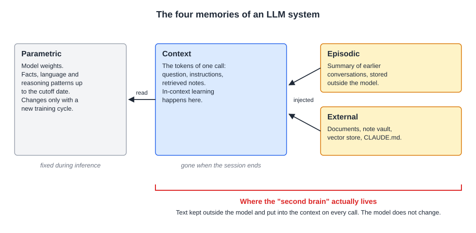
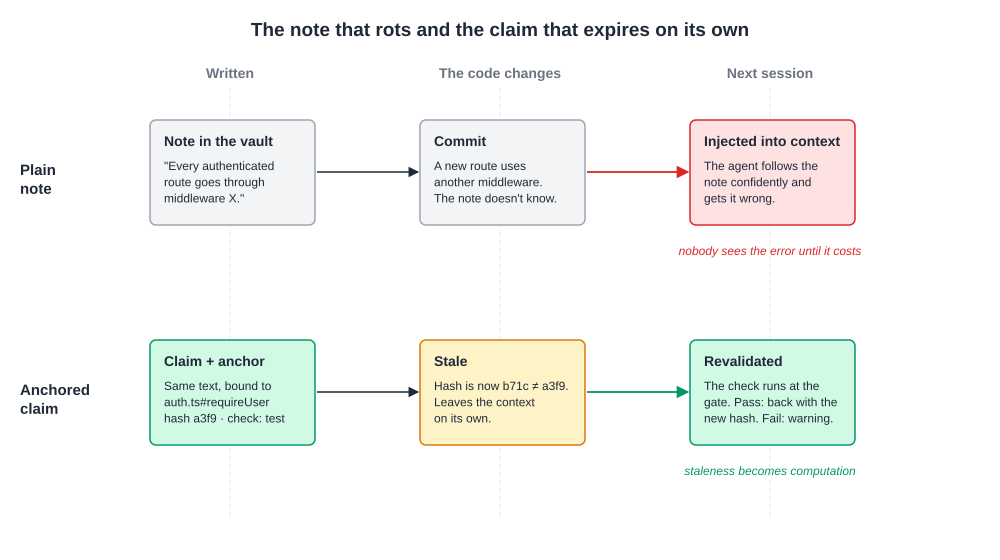
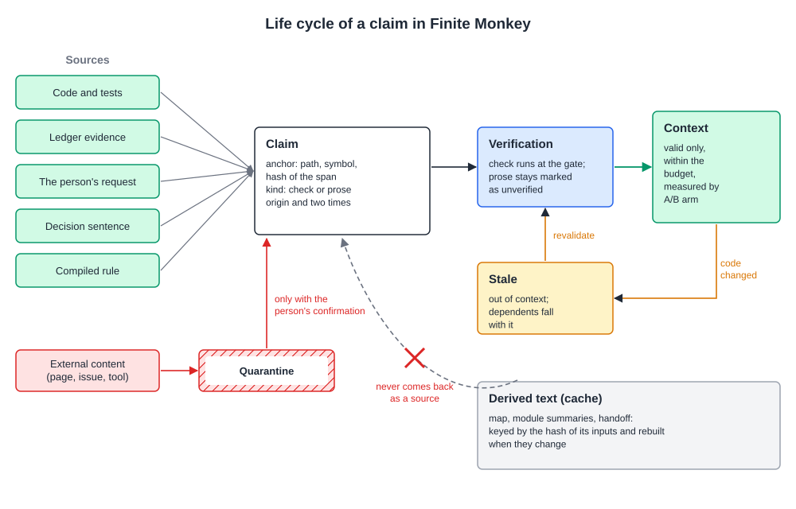
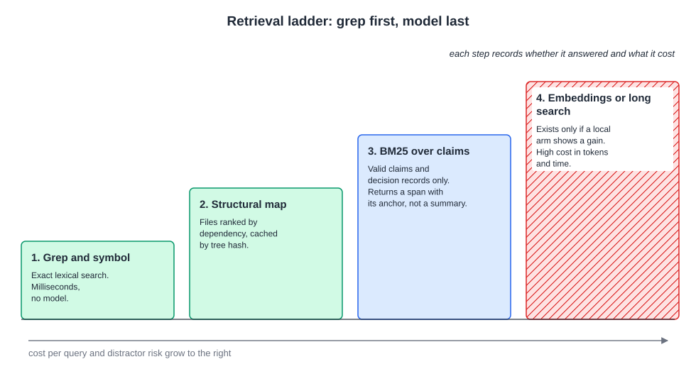
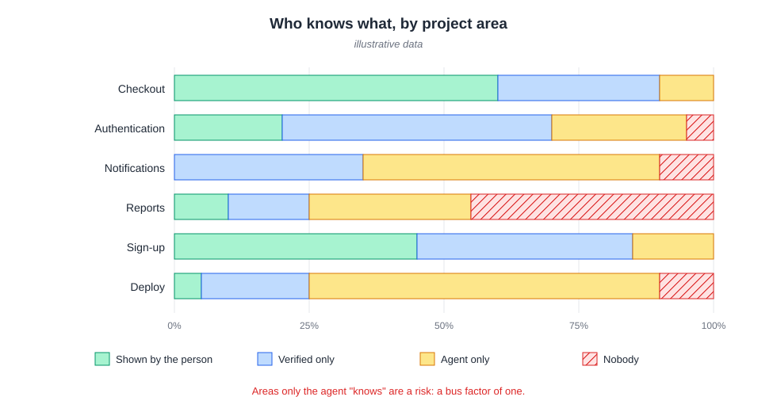

# The second brain illusion: a critical analysis of LLM-based personal knowledge management systems

**Gabriel Vieira Flores**
NovusTec, São Paulo, SP, Brazil
gabrielvieira.ifsc@gmail.com · ORCID [0009-0000-2613-8284](https://orcid.org/0009-0000-2613-8284)

Version 2, October 2026 (version 1: April 2026). English | [Português (Brasil)](second-brain.pt-BR.md) | [Español](second-brain.es.md)

> This essay is the second theoretical basis of [Finite Monkey](../../README.md), alongside the essay [Ricochet Effect](../ricochet/ricochet.md). Sections 1 to 9 analyze the personal "second brain" built with LLMs and propose an evaluation framework. Section 10 gathers what has already been measured about the project and company version of this idea, in which context files and memories are written for coding agents. Section 11 shows what Finite Monkey does with a project's knowledge based on this evidence and what is still a hypothesis to be measured.

## Abstract

The integration of large language models (LLMs) with note-taking tools has given rise to a market that sells "second brain" architectures as a solution for knowledge management. This essay examines that promise through its genealogy: from the expert systems of the 1960s to 1980s, through the statistical turn and the transformer architecture, to the abrupt popularization that began in November 2022. The central argument is that the Obsidian-plus-LLM ecosystem is the most recent episode of a pattern in the history of artificial intelligence: the promise that a new knowledge representation technology will solve what the previous ones did not, made by people who have not studied why the previous ones failed. The essay distinguishes parametric from non-parametric memory, separates in-context learning from the weight change that popular discourse imagines, gathers the documented limitations of retrieval-augmented generation (RAG) and of fine-tuning, and proposes diagnostic questions to separate useful use from performative automation. It then applies the same examination to the project "second brain", the set of context files and memories written for coding agents. The available controlled studies found a null or small effect of these files on agent success, a cost 19% to 23% higher, references to code that no longer exists in 23% of repositories, and persistent memories that can be poisoned by external content. What showed an effect was guidance validated by probes and instruction converted into executable verification. Based on this, the essay proposes treating a project's knowledge as a build artifact: each claim tied to the hash of the code it describes, verified by execution when possible, invalidated automatically when the code changes, measured by an A/B arm before it occupies context, and returned to the person as a question they answer, instead of a summary they read.

**Keywords:** large language models; expert systems; personal knowledge management; retrieval-augmented generation; coding agents; context files; truth maintenance; provenance; generation effect; software engineering.

## 1. Introduction: the cult of the graph view

Around 2023 a genre of content emerged: the productivity expert who discovered that connecting an Obsidian vault of Markdown files to a language model API would create a "second brain". Video tutorials followed, along with paid newsletters with access to "systems" and courses that sold folder structures as if directory organization were proprietary knowledge.

The phenomenon accelerated in April 2026, when Andrej Karpathy published a gist describing a personal "LLM Wiki" pattern (KARPATHY, 2026). Three days later there were already repositories packaging the idea for Obsidian with Claude Code, one of them announced as a "self-organizing AI second brain" (AGRICIDANIEL, 2026), and the pattern began to circulate in communities as a method of personal epistemology.

What this ecosystem tends to ignore is that the central question, how to make a machine represent, retrieve and reason about human knowledge, is the founding problem of artificial intelligence. It is not new and it is not solved. Each generation that rediscovers it without knowing the previous attempts tends to reproduce the same failure modes, now with a different vocabulary and a plugin marketplace.

This essay does not reject LLM-supported knowledge management. It demands historical and technical precision. The argument goes through the genealogy of expert systems, the statistical turn, what an LLM actually is, the myth of continuous learning, the empirical literature on RAG, the arc of popularization and its costs, the critique of the ecosystem, Karpathy's pattern and its derivatives, and an evaluation framework. Sections 10 and 11 take the analysis to the knowledge of software projects, where agents have begun to read and write memories on their own.

## 2. Genealogy: the old problem practitioners do not know

### 2.1 Expert systems: the first great promise

The idea that specialized knowledge can be formalized into machine-executable rules has sixty years of documented history. DENDRAL, developed at Stanford from 1965 by Edward Feigenbaum, Joshua Lederberg, Bruce Buchanan and Carl Djerassi, is generally cited as the first expert system: a program that applied rules of organic chemistry to infer molecular structures from mass spectrometry data (FEIGENBAUM; BUCHANAN, 1993). The innovation was not algorithmic; it was epistemological: an expert's competence could be written as rules.

MYCIN, developed by Edward Shortliffe at Stanford in the 1970s, made this thesis famous. It was a production rule system for choosing antimicrobial therapy in bacterial infections, with a few hundred rules in the form IF condition 1 AND condition 2 THEN conclusion WITH certainty factor, about 450 in the mature version (SHORTLIFFE, 1976; BUCHANAN; SHORTLIFFE, 1984). In a blinded evaluation with ten meningitis cases, eight experts judged MYCIN's prescriptions acceptable as often as or more often than those of Stanford faculty (YU et al., 1979).

The 1980s were the golden age of these systems. The AI industry went from a few million dollars in 1980 to a few billion in 1988 (RUSSELL; NORVIG, 2010), an optimism that preceded the so-called AI winter. The promise was the same one that circulates today on Obsidian Discord servers: capture specialized knowledge, organize it and query it reliably, freeing the knowledge worker from retaining and retrieving by hand what has already been documented.

### 2.2 Why expert systems failed: the knowledge acquisition bottleneck

The fundamental problem became known as the *knowledge acquisition bottleneck*. Extracting knowledge from human experts into formal rules proved much harder than the founders expected: experts often cannot articulate the rules they follow, because they operate by pattern recognition and accumulated intuition, which resist propositional formalization.

The second failure mode was brittle generalization. A system that worked well in its training domain degraded without warning outside it. The third was maintenance at scale. A few hundred rules can be audited by an expert; thousands become opaque. XCON (R1), which configured VAX computers at DEC, reached thousands of rules and required a dedicated team to maintain them (McDERMOTT, 1982). Rules interact in unforeseen ways: adding one to correct a behavior can silently invalidate others.

The AI winter, from 1987 to the early 1990s, was partly a reaction to these failure modes (CREVIER, 1993). What fell abruptly was investment and the Lisp machine market; the systems themselves were gradually absorbed into ordinary enterprise software. Table 1 summarizes the three failure modes and their parallels in the LLM-based personal knowledge management (PKM) ecosystem.

**Table 1 – Failure modes of expert systems and their parallels in LLM-based PKM**

| Failure mode | Expert systems (1965–1993) | LLM-based PKM (2022–2026) |
|---|---|---|
| Knowledge acquisition bottleneck | Experts cannot write as formal rules the tacit knowledge they apply by pattern recognition | Knowledge the person cannot write into good-quality notes does not become retrievable because there is an LLM in the way |
| Brittle generalization | Good within the domain, degradation without warning outside it, no way of expressing structural uncertainty | Naive retrieval degrades in the same way on topics poorly represented in the vault or on questions that cross domains |
| Maintenance at scale | Hundreds of rules are auditable; thousands become opaque; a new rule can silently invalidate others | A vault of 500 notes is manageable; one of 5,000 accumulates conflicting claims, especially when the LLM is the one compiling the wiki |

Source: author's own elaboration (2026), based on Feigenbaum and Buchanan (1993), McDermott (1982) and Crevier (1993).

### 2.3 Symbolic knowledge representation

While expert systems rose and fell, a parallel line developed the formal foundations of knowledge representation. Semantic networks organized concepts into inheritance hierarchies and were tested as a model of human memory (COLLINS; QUILLIAN, 1969). Minsky's (1975) *frames* are structures that represent stereotypes of objects, with slots for attributes, default values and inheritance. The analogy with the notes of an Obsidian vault with YAML metadata is immediate and not accidental.

The Obsidian graph that influencers film as proof of their second brain is, functionally, a semantic network without semantics on the edges. Untyped links between notes have no inferential power. They are visualizations of connectivity, not knowledge structures that a program can exploit.

Cyc, started by Doug Lenat in 1984, is the most revealing case. Its goal was to hand-code the commonsense knowledge needed to reason like an adult (LENAT, 1995). In 2006, after about 900 person-years of work, the knowledge base had more than 2.2 million assertions about more than 250,000 terms (MATUSZEK et al., 2006). The project continued for almost four decades and did not solve the problem. The lesson for the Obsidian-plus-LLM ecosystem is direct: if decades of manual engineering at industrial scale did not formalize common sense for computable reasoning, a vault of 500 notes read by naive retrieval will not do it.

### 2.4 The statistical turn

Expert systems were not overcome by a better symbolic representation. They were overcome by the replacement of rule-based models with models based on distributions learned from data. Frederick Jelinek, who led IBM's continuous speech recognition group, became associated with the phrase "Every time I fire a linguist, the performance of the speech recognizer goes up", said at some point between 1985 and 1988 in slightly different versions, as he himself later commented (JELINEK, 2005).

Word2Vec showed that words could be represented as vectors in a continuous space, with surprising arithmetic properties (MIKOLOV et al., 2013). Bahdanau, Cho and Bengio (2014) introduced the attention mechanism in recurrent networks, the piece that Vaswani et al. (2017) generalized in the transformer, the basis of current LLMs.

The point that matters here: the statistical turn solved problems that symbolism had declared intractable not because it found a truer representation of knowledge, but because it abandoned the pretension of representing it explicitly. An LLM does not "know" that an antibiotic covers a certain class of bacteria in the sense in which a MYCIN rule knew it. It learned that, in linguistic contexts like those of its training corpus, certain continuations are more probable than others. This is the most important distinction for this essay and the most ignored in the discourse about PKM.

## 3. What an LLM actually is

### 3.1 Parametric memory and what a model knows

An LLM is a transformer-based neural network, trained to predict the next token in a sequence through self-supervised learning on large text corpora (VASWANI et al., 2017; BROWN et al., 2020). The model encodes knowledge implicitly in its weights, what the literature calls parametric memory, fixed during training. In commercial models used in standard mode, the weights do not change during inference.

From this comes the first misunderstanding in practitioners' discourse: an LLM is not a database. When someone sends notes to a pipeline connected to Obsidian and receives a synthesis, the model has not "stored" anything. It processed tokens in a limited context window and generated a probabilistic response. When the context is cleared, the adaptation that happened inside it disappears, unless an external mechanism saves it and reinjects it.

### 3.2 The *lost in the middle* effect

Liu et al. (2024) showed, in controlled experiments, that the performance of language models depends on the position of the relevant information within the context:

> "performance is often highest when relevant information occurs at the beginning or end of the input context, and significantly degrades when models must access relevant information in the middle of long contexts, even for explicitly long-context models" (LIU et al., 2024, p. 157).

In the worst case, with 20 or 30 documents, the drop exceeded 20 points for GPT-3.5-Turbo, which fell below its own performance with no documents at all. The cause of the U-shaped curve is still debated. One explanation points to the long-range decay of RoPE (ZHANG, Z. et al., 2024); others point to an intrinsic positional bias of attention (HSIEH et al., 2024) or to the causal mask combined with decay (WU, X. et al., 2025). Liu et al.'s own study found the curve in MPT, which uses ALiBi and not RoPE. The practical implication does not depend on the cause: whoever assembles a 10,000-token window with notes from the vault and expects the model to use them uniformly is operating with a wrong idea of the system they use.

Later work made the picture harsher. When the question and the relevant passage share no words, GPT-4o drops from 99.3% to 69.7% accuracy at 32,000 tokens (MODARRESSI et al., 2025). A study with 18 models showed that performance varies with input length even on simple tasks and that a single distractor already worsens the result (HONG; TROYNIKOV; HUBER, 2025).

### 3.3 Hallucination: reducible, not eliminable

Language models generate text by sampling learned distributions over token sequences. They do not retrieve truths from a repository; they produce plausible continuations. There are theoretical results that hallucination cannot be completely eliminated in a general-purpose model (XU; JAIN; KANKANHALLI, 2024), and there is work that attributes much of it to training and evaluation incentives that reward guessing instead of abstention, which makes it reducible (KALAI et al., 2025). The two readings agree on what matters here: there is no guarantee that a generated synthesis is correct.

When an LLM maintains a wiki, reading raw notes, synthesizing pages and creating cross-references, each step is a hallucination surface. A wrong synthesis at compilation enters the structure of the knowledge base and is then used as context for new syntheses. The comments on Karpathy's gist reach this point bluntly. One participant observes that, when the source files change, the compiled knowledge may be wrong without the system knowing, and that the health checks come down to the LLM rereading the pages and guessing whether something changed; another recalls that the absence of hallucinated citations is an aspiration, not a technical guarantee (KARPATHY, 2026, comments).

## 4. The myth of continuous learning

### 4.1 Science fiction as a mental model

There is a misconception as widespread as it is consequential: the belief that the model becomes more intelligent, more personal and more capable as the user talks to it. Its origin is science fiction. HAL 9000 learns from the crew; Marvel's JARVIS evolves with Tony Stark; Samantha, in *Her*, develops a singular relationship with Theodore. In all cases, the AI is an agent with continuous episodic memory and development over time.

The commercial LLMs of 2026 do not work this way. The difference between the popular model and the technical one is one of kind, not degree, and understanding it is a condition for evaluating any LLM-based knowledge system.

### 4.2 Training and inference

The operation of an LLM has two separate regimes. In training, the model processes enormous corpora, makes predictions about the next token, computes a loss function and adjusts, through backpropagation, the billions of parameters of the network. The process runs on GPU clusters for weeks or months and ends in a static file of weights.

In inference, this file is loaded with frozen parameters and applied to each new input. There is no backpropagation and no writing of new information into the model. This does not mean that nothing adapts: within the context window the model learns from examples and instructions, so-called in-context learning (BROWN et al., 2020), and there is work showing that this mechanism implements something close to an implicit gradient step (VON OSWALD et al., 2023). Research on *test-time training* and on trainable memories updates weights or states during inference (AKYÜREK et al., 2024; BEHROUZ; ZHONG; MIRROKNI, 2024), but these are not the standard in products. The precise formulation is this: in commercial LLMs used in standard mode, the weights do not change during inference; adaptation happens in the context and disappears with it, unless an external system saves it and returns it.

When Claude "seems to remember" that the user prefers short answers, it is not because it learned the preference; it is because the system reinjected a summary of previous interactions into the context of the new conversation. Anthropic itself describes its memory as an editable and optional summary, per project (ANTHROPIC, 2025a). Hagoel (2025), writing for those who build these systems, summarizes the situation: "LLMs as they exist today, even when equipped with the best available tools, can't do any of that. They are stateless and frozen in time. [...] The only way to introduce new information or 'teach' an LLM new skills is by providing it with examples, instructions, and all the accumulated relevant information repeatedly with every invocation (prompt)."

### 4.3 Four types of memory

A recent survey organizes memory in LLM-based systems into four categories, with very different properties (ZHANG, D. et al., 2025). Popular discourse lumps the four into one, and this prevents reasoning about failures.

**Parametric memory** is the knowledge encoded in the weights during pretraining: facts about the world, patterns of language and reasoning, domain knowledge up to the cutoff date. It is fixed at inference and only changes with a new training cycle.

**Context memory** is the active window, the set of tokens processed in one call. It is ephemeral. An Obsidian vault injected as context exists only in this layer and is subject to the effect described in section 3.2.

**Episodic memory** is the retrievable history of conversations, stored outside the model and reinserted in later sessions. It is not memory of the model: it is systems engineering that simulates continuity, through summarization and reinjection.

**External memory**, or non-parametric memory, is the set of documents retrievable by RAG, vector databases or other storage. It is infrastructure around the model, and its quality depends on the collection and on the retrieval strategy.

The confusion between these categories lies behind most of the unfounded promises in the LLM-based PKM ecosystem. Whoever feeds notes into Obsidian and connects an LLM through RAG operates only on external memory and context memory. The model does not become more intelligent or more personal. What changes is what is placed in the context before each response. Figure 1 shows where each layer lives and what happens to it when the session ends.

*Figure 1 – The four memories of an LLM-based system and where the "second brain" actually lives. Source: author's own elaboration (2026), based on Zhang, D. et al. (2025).*

### 4.4 How models actually evolve

The evolution of models such as Claude, GPT or Gemini does not happen during conversations. It happens in discrete training cycles, each with computation and data requirements at industrial scale.

Pretraining exposes the model to trillions of tokens: about 15 trillion in Llama 3 (GRATTAFIORI et al., 2024) and 36 trillion in Qwen3 (YANG et al., 2025). The goal is not to teach correct answers, but to build a statistical representation of language and of the knowledge encoded in it.

Supervised fine-tuning comes next: curated input and output examples adjust the weights to follow instructions and keep a format, turning a text-completion model into an assistant. Reinforcement learning from human feedback (RLHF), popularized by InstructGPT (OUYANG et al., 2022), trains a reward model from comparisons made by annotators and optimizes the main model to maximize it. Variants such as DPO dispense with the intermediate reward model but keep the structure of preference learning (RAFAILOV et al., 2023).

The whole cycle, with planning, scaling experiments, pretraining, fine-tuning, safety evaluation and release, takes months; the alignment and testing phase of GPT-4 alone took about six months (OPENAI, 2023). This time scale is not compatible with any idea of real-time learning from individual conversations.

### 4.5 The parameter race and the turn to data quality

For years, progress was guided by a simple rule: larger models, with more parameters and more data, are better. Kaplan et al. (2020) formalized this intuition in the first scaling laws, power-law relationships between model size, data volume and loss.

The Chinchilla work was the first major challenge. Training more than 400 models from 70 million to 16 billion parameters, with 5 to 500 billion tokens, DeepMind showed that the models of the time were undertrained on data: for the best use of compute, parameters and tokens should grow in the same proportion. Gopher, with 280 billion parameters, was outperformed by Chinchilla, with 70 billion trained on four times more data (HOFFMANN et al., 2022).

The Chinchilla law optimizes training cost, not usage cost. When inference cost is counted, it pays to train smaller models on more data than it recommends (SARDANA et al., 2024). The Llama 2, Llama 3 and Qwen3 families followed this path. The 0.6-billion-parameter Qwen3 was trained on the same 36 trillion tokens as the family, which gives about 60,000 tokens per parameter (YANG et al., 2025; THOMPSON, 2026).

The most relevant turn, however, is from quantity to quality of data. Subramanyam, Chen and Grossman (2025) included a quality parameter in the scaling law and showed that one billion high-quality tokens can be worth much more than one billion noisy or redundant tokens. Reasoning models, such as the o1 family and DeepSeek-R1, added a third axis: spending compute at inference, producing "thinking" tokens before the answer (DEEPSEEK-AI, 2025; SNELL et al., 2024).

Whoever believes that putting more notes in the vault makes the LLM "more intelligent" is confusing these three axes with context injection. The model does not change. What changes is the available context. These are phenomena of completely different orders.

### 4.6 Fine-tuning and its limits

Fine-tuning appears in the ecosystem as a solution to the limitations of parametric memory: if the model does not know what is in your notes, train it on them. The proposal runs into problems that popular discourse ignores.

The first is catastrophic forgetting. Fine-tuning a model on new data can degrade what it knew before (KIRKPATRICK et al., 2017). Luo et al. (2023) observed, in models from 1 to 7 billion parameters fine-tuned on a sequence of tasks, that forgetting increased with size; another study found the opposite, with larger pretrained models forgetting less (RAMASESH; LEWKOWYCZ; DYER, 2022). What can be stated is that fine-tuning on the vault's 5,000 articles can produce a model that answers better about that collection and reasons worse about everything else, and that the size of the effect is not predictable in advance.

The second is the cost of alignment. InstructGPT recorded regressions on some public benchmarks after RLHF, which the authors called the *alignment tax*, and showed that a variant of the method reduced them (OUYANG et al., 2022). Kirk et al. (2024) showed that RLHF considerably reduces output diversity compared with supervised fine-tuning. In PKM, a model fine-tuned to answer consistently about a domain may become less capable precisely of producing unexpected connections, the kind of *insight* that practitioners say they want.

The third is data quality. In more than a thousand models fine-tuned under controlled conditions, the model's perplexity on the training data often predicted the effect of fine-tuning better than the superficial similarity between the data and the benchmark (HARADA et al., 2025). Extrapolating to the case discussed here: fine-tuning a model on fragmented and inconsistent notes tends to produce a model specialized in answering in a fragmented and inconsistent way about that collection.

LoRA and variants such as QLoRA and AdaLoRA reduce the cost of fine-tuning by training low-rank matrices attached to the transformer layers (HU et al., 2021; DETTMERS et al., 2023; ZHANG, Q. et al., 2023). They mitigate forgetting and cost, without eliminating them, and require an evaluation infrastructure that does not exist in popular Obsidian vault implementations.

The honest conclusion: fine-tuning is a valid domain adaptation tool when there is quality data, rigorous evaluation and awareness of the losses. For the average PKM case, a collection of 500 to 5,000 notes of uneven quality maintained by one person without evaluation infrastructure, it probably creates more problems than it solves.

### 4.7 Context as false memory

The personalization users perceive in Claude, ChatGPT or Gemini is not a product of learning; it is a product of context engineering. When a conversation starts, the system retrieves fragments of previous interactions, summarizes them and injects them at the beginning of the context. The model processes this text like any other input. The feeling that the assistant "remembers" is that of reading a document about oneself, not that of being recognized.

An Obsidian vault connected to an LLM through RAG offers exactly the same kind of "memory": retrieved and injected documents. The model has formed no internal representation of the user, their preferences or their way of thinking. With each new query, it starts over with the context provided, and the quality of the answer depends on the quality of what was retrieved.

The comparison with classical machine learning is revealing. In recommender systems, the user profile is a vector of parameters that the system re-estimates periodically from behavior (KOREN; BELL; VOLINSKY, 2009). An LLM has no such mechanism between calls. Work that attempts to attach trained persistent memory to frozen models starts from the same observation: "frozen encoder-decoder language models are stateless: the latent representation is discarded after every forward pass, so no information persists across sessions" (JEONG, 2026). Databricks' research on agent memory at scale records progress, but in the infrastructure external to the model, and lists as pending work keeping memory correct, current and accessible as it grows (DATABRICKS, 2026).

### 4.8 LLMs and classical machine learning

In classical machine learning, such as logistic regression, *boosted* trees and shallow networks, the model is usually the vehicle of domain knowledge itself and can be retrained periodically: a spam filter is retrained on new spam and its weights change with each cycle. In an LLM, the model is an enormous statistical *prior* over language, and domain knowledge enters through context, through fine-tuning in discrete cycles or through RAG, never through real-time interaction.

This has a direct consequence for the metaphor. A real second brain would need to acquire knowledge continuously, selectively forget what has become obsolete, integrate the new with what already exists and maintain a persistent representation of the user's history. None of these properties exists in an LLM under standard inference. The metaphor describes the system practitioners would like to have.

What LLMs offer is impressive, but it is something else: processing and synthesizing large volumes of text within a window, generating fluent language conditioned on provided documents, measuring semantic similarity through embeddings and transforming text with reasonable quality. This has value. But it is not a brain, and it does not learn from one conversation to the next.

## 5. The literature on RAG: what the evidence says

### 5.1 Architecture and promises

Retrieval-augmented generation was formalized by Lewis et al. (2020) as a way of complementing the model's parametric memory with retrievable external documents. The common promise is that RAG mitigates two failures of LLMs: outdated knowledge and hallucination. The empirical literature is less optimistic than practitioners' discourse.

### 5.2 Documented limitations

**More documents are not always better.** Models are distracted by irrelevant context (SHI, F. et al., 2023). The effect depends on the type of noise: documents that are irrelevant but similar to the question hurt, while random documents may even help (CUCONASU et al., 2024). For those who believe a larger vault is always better, the message is that size matters less than what is retrieved.

**Coherence breaks under frequent retrieval.** Retrieving at short intervals during generation reduces coherence metrics, because the constant switches interrupt the continuity of the context (LI et al., 2025).

**RAG does not eliminate hallucination.** A systematic review in healthcare concluded that retrieval quality remains a challenge and that irrelevant retrieved passages force the model to reason around confusing material (AMUGONGO et al., 2025).

**Position in the window imposes a ceiling.** As seen in section 3.2, the drop can exceed 20 points when the relevant information moves from the ends to the middle of the context (LIU et al., 2024).

**Chunking destroys structure.** Naive implementations cut documents into fixed-size pieces and lose paragraphs, section hierarchy and cross-references (GAO et al., 2023). And two passages can be logically linked without sharing vocabulary; this is exactly the case in which similarity search fails, as shown by the drop from 99.3% to 69.7% when question and passage have no words in common (MODARRESSI et al., 2025).

Hierarchical approaches such as RAPTOR (SARTHI et al., 2024) and graph-based ones such as GraphRAG (EDGE et al., 2024) attack the chunking problem with abstractions at several levels. They are research systems, with gains on global questions over large collections, and are a long way from dragging Markdown files into a folder. To evaluate a RAG pipeline there are dedicated metrics and corpora, such as RAGAS (ES et al., 2024) and RAGTruth (NIU et al., 2024), which almost no practitioner uses.

## 6. The arc of popularization and its epistemic costs

### 6.1 From the engine room to the Discord server

There is a sociological trajectory that links *Attention Is All You Need* (VASWANI et al., 2017) to the proliferation of Obsidian vaults. In 2017, transformers were a matter for researchers trained in machine learning with access to GPU clusters. ChatGPT, launched on 30 November 2022, was the inflection point: it passed one million users in five days, according to Sam Altman himself (ALTMAN, 2022), and an analyst estimate attributed 100 million active users to it in January 2023 (HU, K., 2023).

**Table 2 – The arc of popularization and the transformation of discourse**

| Period | Event | Practitioner profile | State of discourse |
|---|---|---|---|
| 2017 | Vaswani et al., *Attention Is All You Need* | Researchers trained in machine learning | Failure modes described technically in the primary literature |
| 2020 | GPT-3 API in beta (OpenAI) | Software engineers interested in natural language | Technical ecosystem; calibrated expectations |
| Nov. 2022 | Launch of ChatGPT | One million users in five days; chat interface | Semantic degradation of technical vocabulary begins |
| 2023–2026 | Obsidian-plus-LLM ecosystem, Karpathy's pattern, Smart Connections with more than 1.25 million downloads | Productivity influencers without machine learning training | Elaborate ritual, absence of benchmarks |

Source: author's own elaboration (2026), based on Vaswani et al. (2017), Altman (2022), Hu, K. (2023) and Obsidian (2026).

### 6.2 The semantic degradation of technical vocabulary

Every concept that migrates from a peer-reviewed article to a video tutorial loses precision. *Memory* is the most consequential case. In the LLM literature it has technical definitions (parametric, context, episodic, external); in practitioners' discourse, it has become anything "the system keeps". This terminological promiscuity prevents reasoning about failures.

*Knowledge* has suffered the same degradation. In symbolic AI, it had a formal representation with explicit semantics; in LLMs, it is implicit and statistical; in practitioners' discourse, it has become any text in any file.

*Learning* has perhaps suffered the most serious degradation. In machine learning, it denotes parameter adjustment by gradient; in LLMs, it denotes pretraining at industrial scale or fine-tuning with curated data, in addition to in-context learning that disappears with the window. In popular discourse, it has come to mean any appearance of adaptation, including the simple retrieval of injected context. This confusion is the substrate of the myth of the second brain that learns.

The same phenomenon appears at the individual level. The essay on the Ricochet Effect describes the mimicry of technical vocabulary: the person acquires the words of a domain before the structure that links them, and begins to ask and to evaluate with terms whose operational meaning they do not master (FLORES, 2026). An entire ecosystem in which "memory", "knowledge" and "learning" circulate without an operational definition is the collective version of this mimicry.

### 6.3 Self-confidence without metacognition at ecosystem scale

Kruger and Dunning (1999) argued that incompetence in a domain impairs the metacognition needed to recognize it. The effect is debated: part of it may be regression to the mean and a measurement artifact (NUHFER et al., 2016; GIGNAC; ZAJENKOWSKI, 2020), although there are defenses that a metacognitive component remains (JANSEN; RAFFERTY; GRIFFITHS, 2021). The curve with a confidence "peak" that circulates on social media is not in the original article.

Even without resting the argument on the effect, there is an asymmetry of incentive that does not require individual psychology. Whoever masters the tool well enough to operate it, but not well enough to know its limits, can promise more with fewer caveats, and simple promises earn more reach than precise caveats. The result is an ecosystem that produces more low-reliability content because the economic incentive rewards the simplicity of the promise, not technical precision.

### 6.4 Cargo cult as a recurring structure

Richard Feynman called *cargo cult science* the external form of scientific inquiry without its content (FEYNMAN, 1974). The Obsidian-plus-LLM ecosystem has this structure. Practitioners noticed that LLM pipelines sometimes produce something similar to what an intelligent knowledge system would produce and replicated the form (structured vault, CLAUDE.md, YAML metadata, ingestion scripts, graph) without understanding why the system works when it works or why it fails when it fails.

Expert systems had their own cargo cult: companies buying expert system *shells* without having experts to feed the rules with quality content. The difference now is the scale and speed of diffusion, amplified by platforms that reward unverifiable promises with organic reach.

## 7. Critique of the Obsidian-plus-LLM ecosystem

### 7.1 Systemic technical gaps

What unites the layers of the ecosystem, from semantic similarity plugins to LLM-compiled wikis, is the frequent absence of the controls the literature identifies as necessary. Most popular implementations do not use *cross-encoder* reranking to mitigate the position effect, do not combine BM25 lexical search with embeddings, do not track the provenance of each claim and are not evaluated with corpora such as RAGAS or RAGTruth. The exceptions exist and confirm the rule: Karpathy's gist itself recommends, as the wiki grows, a hybrid BM25 and vector search tool with LLM reranking (KARPATHY, 2026), a recommendation that many of the derivatives did not follow.

### 7.2 The token budget and the economics of complexity

A vault of 500 notes of 300 words has about 150,000 words, something around 200,000 tokens in English and more in Portuguese. Sending all of it in one query costs, at 2026 prices, from twenty cents to about one dollar, processes mostly irrelevant text and, from what was seen in section 3.2, worsens accuracy for whatever is in the middle of the window. A BM25 index or a grep would return the relevant note in milliseconds and at almost zero marginal cost.

### 7.3 The misidentified problem

The central failure of the discourse is that it misidentifies the problem. The literature on personal information management documents that people keep much more than they retrieve, that the effort of organizing in advance yields little and that retrieval depends above all on remembering where and why something was kept (WHITTAKER, 2011; BERGMAN; WHITTAKER, 2016). The advocates of the second brain method themselves place the failure in the discipline of capture and synthesis, not in the tool (FORTE, 2022), although as opinion and not as research. Neither reading suggests that the bottleneck is the absence of an LLM.

If the vault is a deposit of half-finished notes, inconsistent tags and articles captured months ago and never read, putting a language model on top of it does not turn low-quality input into high-quality synthesis. *Garbage in, garbage out* is one of the oldest and most durable observations in computing.

### 7.4 The epistemological problem of delegated synthesis

Research in cognitive science shows that the elaborative processes of knowledge acquisition (rereading, summarizing in one's own words, creating connections, explaining) are not accessories to the formation of knowledge; they are the formation of knowledge. What is processed more deeply is remembered better (CRAIK; LOCKHART, 1972). What the person generates is remembered better than what they only read (SLAMECKA; GRAF, 1978). Constructive and interactive activities produce more learning than passive activities (CHI; WYLIE, 2014). Luhmann's practice with his card index, described by himself as a conversation with a partner that surprises, depended on writing each card by hand and linking it deliberately to the others (LUHMANN, 1981).

Delegating these operations entirely to an LLM is not cognitive amplification; it is the transfer of cognitive work outward, with known costs (RISKO; GILBERT, 2016). Recent data with AI point in the same direction: in a controlled experiment, those who learned a new library with AI help had worse conceptual understanding, code reading and debugging, with no average time gain; only usage patterns with cognitive engagement preserved learning (SHEN; TAMKIN, 2026). The marketing promise of "zero friction" does not automate knowledge. It automates the appearance of it.

## 8. Distinguishing legitimate patterns from cargo cult derivatives

### 8.1 What Karpathy's pattern proposes

Read carefully, Karpathy's gist is a specific and modest proposal. The central innovation is the difference between single-query RAG, in which the LLM is "rediscovering knowledge from scratch on every question", and a persistent wiki that accumulates and improves as new sources arrive (KARPATHY, 2026). He describes three layers (immutable raw sources, the wiki and a schema) and three operations (ingest, query and lint), the last of which looks for contradictions, superseded claims and orphan pages.

Karpathy delimits the scale: the pattern "works surprisingly well at moderate scale (~100 sources, ~hundreds of pages)" and, as the wiki grows, calls for proper search, with hybrid indexing and reranking. He lists personal uses and also an internal team or company wiki, and warns that the text describes an idea, not an implementation (KARPATHY, 2026). What does not exist in the gist is a verification mechanism: the checks are the model itself rereading the pages. The difference between the gist and its derivatives reproduces the difference between MYCIN and the *shells* that came afterward: the derivatives sold the form without the caveats.

### 8.2 When LLM-based PKM has value

The argument of this essay is not that LLMs never serve personal knowledge bases. It is that most of the uses being sold do not qualify. The following uses are defensible:

**Synthesis over heterogeneous collections at a manageable scale:** when a researcher has gathered 50 to 200 well-annotated documents on a topic, a compilation pass can save time, provided the result is treated as a draft to be verified.

**Repetitive structural tasks:** generating links, normalizing tags, finding empty notes and formatting citations are operations with low semantic load, whose value lies in executing them, not in thinking.

**Querying an authoritative and verified collection:** when the collection has authority, such as a curated collection of peer-reviewed articles, RAG can have value, provided it includes citation, provenance tracking and human review.

## 9. Evaluation framework

### 9.1 Five diagnostic questions

Anyone who puts an LLM next to a knowledge base should answer five questions before claiming that the system brings cognitive benefit:

1. **What is the real mechanism?** Does the system do context injection, semantic retrieval or querying of a compiled wiki? Whoever cannot answer cannot reason about failures.
2. **What is the token budget?** How many tokens does each query consume, at what cost and latency? Is this cost proportional to the value delivered, compared with deterministic retrieval?
3. **What is the strategy against hallucination?** How are generated claims verified? Is there provenance tracking? Are outputs treated as drafts or as truth?
4. **What is the quality of the input?** Does the vault have curated notes or is it a deposit of web clippings never synthesized? The LLM does not retroactively improve the input.
5. **What is the counterfactual?** How much would the same task cost with a simpler tool: text search, grep, a well-maintained index? If the LLM does not demonstrably outperform the counterfactual, the complexity is not justified.

### 9.2 Questions about learning and memory

Given the confusion documented in section 4, three more questions:

1. **Is the system confusing context with memory?** Every appearance of "the LLM remembers my work" should be attributed to context injection. If the context is removed, the "knowledge" disappears.
2. **Is fine-tuning being considered?** If so: what is the quality of the data, how will it be evaluated afterward, how will forgetting be measured, has the cost of alignment been considered? Without technical answers, it should not be done.
3. **Is the model being treated as an agent with goals or as a stochastic tool?** Systems that depend on the model "understanding" the user's domain over time, without explicit persistence and verification mechanisms, start from a wrong premise.

### 9.3 Use case matrix

**Table 3 – Evaluation matrix of LLM-based PKM use cases**

| Use case | Recommended approach | Role of the LLM | Main risk |
|---|---|---|---|
| Curated research collection (fewer than 200 documents) | Wiki following Karpathy's pattern | Compilation and maintenance | Hallucination in cross-references; outputs treated as drafts |
| Large corporate repository | GraphRAG or RAPTOR with evaluation | Hierarchical indexing and RAG | Retrieval noise, latency, hallucination at scale |
| Capture and retrieval of personal notes | Zettelkasten and BM25 text search | None | Opportunity cost of an unnecessary LLM |
| Answers over an authoritative collection | RAG with provenance and reranking | Generation conditioned on retrieved documents | Fabricated citations; requires systematic verification |
| Semantic connections between existing notes | Local embeddings, no API | Embedding similarity | Fixed chunking loses the context between passages |
| Graph aesthetics and social signaling | Obsidian without an LLM | None | Wasted tokens, false confidence, synthesis without validation |

Source: author's own elaboration (2026).

## 10. The project second brain: what has been measured

### 10.1 From the personal note to the context file

The same promise has changed scale. Today what is sold is the "company second brain" and the "project second brain": an Obsidian vault or a Notion space with a team's history, decisions and conventions, read by agents. In software development the idea already has a standardized form. Claude Code loads in every session a CLAUDE.md file and an automatic memory that the agent itself writes; other agents read an AGENTS.md; teams maintain folders of rules and *skills*. The Claude Code documentation is frank about the status of this text: the agent treats it as context, not as enforced configuration; to really block something, a *hook* is needed. It recommends fewer than 200 lines per file, because larger files consume context and reduce adherence, and warns that, if two instructions contradict each other, the model may pick one arbitrarily (ANTHROPIC, 2026a).

Unlike the personal vault, this case already has controlled studies. They make it possible to apply the questions of section 9 to the project second brain with numbers.

### 10.2 Context files barely help and cost a lot

Gloaguen et al. (2026) evaluated context files with coding agents on two sets: 300 SWE-bench Lite tasks and 138 tasks from 12 repositories that already had files written by their own developers. LLM-generated files changed success by −0.5 and −2 points, without significance, and increased cost by 20% and 23%, with more steps per task. Developer-written files gave +2.4 points, also without significance, with cost up to 19% higher. Repository overviews, although popular and recommended by vendors, did not help. The instructions were followed; they simply made no difference.

Khatri (2026) ran an ablation with 288 runs of Claude Code and Codex on 17 real tasks. The context strategy did not measurably move correctness, with the effect bounded to at most 10 to 15 points by an equivalence test. The agents failed at feature design, pattern choice and integration, and not for lack of repository knowledge that a context file could provide.

The files that exist also have measured defects. In 100 popular repositories, 62% of AGENTS.md files wrote as prose rules that would fit in a linter, 42% had bloated context and 35% embedded procedures that should be *skills* (SANTOS et al., 2026). In 2,303 files from 1,925 repositories, these texts evolved like configuration code, through small additions, and almost never addressed security or performance (CHATLATANAGULCHAI et al., 2025).

### 10.3 What showed an effect

Two kinds of guidance had a significant effect. The first is guidance **validated by probes**: tuning the repository guide with planted synthetic bugs raised success to 33.0%, against 28.3% with a static guide and 25.5% with no guide (p < 0.001); the gain came from the agent finding the right files (SHEPARD; ALBRECHT, 2026). The second is instruction **converted into executable verification**: turning the rules of an AGENTS.md into syntax tree queries, shell *shims* and architecture validators brought compliance to 88.3%, against 67.0% with the rule only in the prompt and 50.3% with model self-critique, without losing functional correctness (SHARMA, 2026).

The two forms have something in common: knowledge stops being text that the model may or may not follow and becomes something that is executed and that fails visibly.

### 10.4 Written knowledge rots

Treude and Baltes (2026) applied a documentation consistency checker to agent context files and found references to code elements that no longer exist in 23.0% of 356 repositories. Outside agents, code changes made without updating the corresponding comment are about 1.5 times more likely to introduce a bug (RADMANESH et al., 2024). Practitioners report the same. One developer describes the agent writing for PostgreSQL with full confidence months after the project had migrated to MySQL, because the memory said PostgreSQL; the tool he built in response stores, in each memory, the hash of the files it depends on and marks it as stale when they change (CHUGH, 2026). Documentation coupled to code already does something similar in commercial products, using the git history to decide whether a change was only a move or calls for review (SWIMM, 2025). Neither publishes an evaluation.

### 10.5 Persistent memory is an attack surface

When the agent writes its own memory, what enters it becomes valid in every following session. Huang, Zhang and Jia (2026) showed that malicious instructions coming from external sources, such as a web page or an issue, entered Claude Code's persistent memory in 66.9% of cases and were executed in a later session in 81.7%, and that prompt-level defenses give limited protection once the memory has been poisoned. A second brain that accepts anything the agent has read is, from a security standpoint, an open door that remembers to stay open.

### 10.6 Retrieval in code: lexical first, without dogma

The Claude Code team stated that, in its tests, agentic search outperformed RAG for the kind of work done with the tool (CHERNY, 2025), without publishing numbers. A study with several *harnesses* found grep with higher accuracy than vector retrieval in most of them, with results highly dependent on the *harness* (SEN et al., 2026). On the other side, a vendor measured 12.5% higher accuracy when adding semantic search to grep on large codebases (CURSOR, 2025), and a structural symbol index inside the agent improved localization and resolution at no extra cost (BHOLA et al., 2026). On a benchmark of 427 samples, no retrieval family dominated, and a structural map of the repository yielded more useful context per token budget (QIN; XIE, 2026). The joint reading is that lexical search is the cheap starting point and almost always sufficient for localization, that structure helps in changes that cross several files, and that embeddings are a step to be justified case by case.

### 10.7 Agent memory: sophisticated architecture without demonstrated advantage

Memory systems for agents have multiplied: paged memory as in an operating system, knowledge graphs with time, fact extraction layers. The published numbers are disputed among the vendors themselves, and an agent that used only file tools scored 74.0% on LoCoMo, above a graph-based competitor (LETTA, 2025). LongMemEval separates the abilities that matter and shows commercial assistants losing 30% accuracy in long interactions, with two standing out: updating a fact that has changed and knowing to abstain when it does not know (WU, D. et al., 2025). None of these benchmarks has code changing underneath the memory, which is the case of a software project. What Zep's temporal graph gets right, and is worth taking, is the two-time model: when a fact was valid in the world and when the system learned of it (RASMUSSEN et al., 2025).

### 10.8 The theory of the program is in the person

There is, finally, an older argument. Naur (1985) held that programming is building a theory: what matters in a program is the understanding of whoever built it, which is not transferred by documentation alone. Wegner (1987) described transactive memory: groups remember by distributing who knows what, and what needs to be in each person's head is the directory, not the content. Storey (2026) proposed the terms cognitive debt, the erosion of shared understanding, and intent debt, the lack of recorded reasons and constraints. Mehra et al. (2026) called knowledge debt the changes made by agents that the developer does not understand. A project wiki is not the theory of the program. The person who understands is.

**Table 4 – What the evidence says about the project second brain**

| Practice | Measured effect | Source |
|---|---|---|
| LLM-generated context file, with repository overview | Success −0.5 to −2 points (not significant); cost +20% to +23% | Gloaguen et al. (2026) |
| Developer-written context file | +2.4 points (not significant); cost up to +19% | Gloaguen et al. (2026) |
| Context strategies on real tasks with Claude Code and Codex | No measurable effect on correctness (bound of 10 to 15 points) | Khatri (2026) |
| Guide tuned by bug probes | 33.0% against 28.3% (static guide), p < 0.001 | Shepard and Albrecht (2026) |
| Rules converted into executable checks | 88.3% compliance against 67.0% (prompt only) | Sharma (2026) |
| References to nonexistent code in context files | 23.0% of 356 repositories | Treude and Baltes (2026) |
| Persistent memory exposed to external content | Injection in 66.9%; execution in a later session in 81.7% | Huang, Zhang and Jia (2026) |
| Grep versus vector retrieval | Grep ahead in most *harnesses*; result depends on the *harness* | Sen et al. (2026) |

Source: author's own elaboration (2026), based on the studies cited.

## 11. From diagnosis to instrument: project knowledge in Finite Monkey

### 11.1 The principle: knowledge as a build artifact

The previous sections point to three reasons why the second brain fails, both the personal and the project one. Written knowledge **ages without anyone knowing**, because nothing links the note to what it describes. **No one knows where** each claim **came from**, and the model, when compiling syntheses of syntheses, mixes source with derivative. And the person **outsources understanding**, reading a well-written summary that feeds the illusion that they understood (ROZENBLIT; KEIL, 2002).

Finite Monkey already solves a problem with the same shape. Its *gate* does not accept the agent's word that the tests passed: it stores in an evidence ledger the output of the commands that ran, tied to the hash of the git tree on which they ran, and invalidates the evidence when a file changes. The proposal of this section is to extend this design to the project's knowledge. The principle is taken from build systems: a claim about the code is a build task whose output is "is it still true?", and whose inputs are the content of the passages it describes. Build systems with verifying *traces* store the hash of each task's inputs and only redo it when the hash changes (MOKHOV; MITCHELL; PEYTON JONES, 2018). Applied to knowledge, this turns staleness from the model's opinion into computation.

Four design rules follow. The machine stores, invalidates and verifies. The person understands and decides. The model comes in only where the deterministic is not enough. And no piece of memory occupies the context without proving, by measurement, that it helps. Figure 2 contrasts the cycle of an ordinary note with that of an anchored claim.

*Figure 2 – The note that rots silently and the anchored claim that expires on its own when the code changes. Source: author's own elaboration (2026), based on Treude and Baltes (2026) and Mokhov, Mitchell and Peyton Jones (2018).*

### 11.2 Anchored, executable claims with provenance

**Hash anchor.** Each claim about the project ("checkout rounds to cents in `totals.ts`", "every authenticated route goes through middleware X") stores anchors: path, symbol and the hash of the normalized content of the passage, preferably the function body, not the whole file. With each change to the tree, Finite Monkey recomputes the anchor hashes and marks as stale every claim whose input has changed. A stale claim leaves the context until it is revalidated. The risk is one of calibration: an anchor that is too broad expires with every edit; one that is too narrow lets a relevant change in another file slip by. That is why the anchor is per symbol, a refactoring that only moves code invalidates nothing, and the precision of invalidation is measured by sampling.

**Executable claim.** Each claim has a type. Those of type *check* carry a command, a test, a syntax tree query or an input-output example, which the *gate* runs like any criterion; when they pass, the claim is renewed at the current hash. Those of type *prose* appear marked as unverified. Finite Monkey suggests converting prose into a *check* when it recognizes the pattern: lint rule, forbidden command, import boundary. This is the conversion that showed an effect in section 10.3 (SHARMA, 2026). A *check* that never fails is decorative; Finite Monkey already measures the strength of behavior examples against mutants of the changed code, and the same applies here.

**Justification and retraction.** A claim can depend on other claims and on evidence. When a premise falls, everything that depended on it goes out, with the chained reason, as in truth maintenance systems (DOYLE, 1979). Each conclusion can carry the set of premises under which it holds, which makes it possible to see what falls if a premise is refuted (DE KLEER, 1986). This is the answer to the failure mode of section 2.2, in which a new rule silently invalidated others. The graph is kept shallow on purpose: only dependencies that Finite Monkey itself recorded enter it, such as a decision that cites a piece of evidence, never dependencies inferred by a model.

**Provenance and two times.** Each claim says where it came from (the evidence, the commit, the person's request, the session), who made it (the person, the agent, a subagent, a tool) and two times: the range of commits in which it was valid and the moment the system learned of it. The vocabulary is that of W3C PROV (W3C, 2013), and the time model is bitemporal (RASMUSSEN et al., 2025). Claims are not deleted; they are closed. Thus "where did this come from?" and "what did the project think in March?" have answers.

**Generated text is cache, never source.** Any text that Finite Monkey or the agent generates about the project (map, module summary, handoff) is build output: keyed by the hash of its inputs, regenerated when they change and never used as input to another text. Only the code, the tests, the ledger's evidence, the decision records with the person's sentence and the verified claims are sources. This cuts the chain of synthesis of synthesis described in section 3.3. When the person wants to correct a generated page, the correction becomes a new claim with origin "person", not an edit of the cache.

Figure 3 shows the complete life cycle: what is source, what is derivative, what stays in quarantine and what reaches the context.

*Figure 3 – Life cycle of a claim in Finite Monkey: sources, quarantine, verification, invalidation and what reaches the context. Source: author's own elaboration (2026).*

### 11.3 Retrieve with the minimum and measure the rest

**Grep first, model last.** Questions about the project go through a fixed ladder, with a token budget per rung and a record of which rung answered: exact symbol and grep; a structural map of the repository ranked by dependency, in the style of Aider's repo map; BM25 search over the valid claims and the decision records; and embeddings or long agentic search only if a local arm shows a gain. Stale claims never enter. What comes back is an anchored passage, not a summary. This is the recommendation of this essay's conclusion turned into a procedure, and it is compatible with the mixed evidence of section 10.6.

**Minimal context, compiled from what has been verified.** The part of AGENTS.md that Finite Monkey manages contains only commands that ran successfully at the current hash, project conventions that exist as a *check* and pointers to where to look, with no repository overview, with a counted maximum size. The person remains free to write outside this block. This is the direct reading of section 10.2: a generated overview does not help and costs.

**Contradictions.** Finite Monkey's *doctor* flags a reference to a path, command or symbol that does not exist; a rule contradicted by the repository itself (the instruction says `pnpm` and the *lockfile* is npm's); two loaded instructions that contradict each other, each with its file; and a rule that appears frequently in the violation log, a sign that the text is not working and should become a *check* or be removed. Only the third check uses a model, and only to propose.

**Quarantine.** No new memory enters the context directly. Every entry is born in quarantine with its origin. Content coming from outside (web page, issue, tool output) is never promoted without the person's confirmation, and instruction-shaped text coming from an external source is refused. Promotion happens after the entry has been used in a task that ended green. This is the answer to section 10.5, and the effectiveness of the quarantine can be tested with the attack itself: a page with a planted instruction, run in Finite Monkey's CI.

**Every memory artifact is an arm.** Each injected knowledge source (the AGENTS.md block, CLAUDE.md, the automatic memory, the claims) is a factor that Finite Monkey can switch off per task, in shadow or at random, as it already does with its own rules. The result is measured by the evidence ledger: false "done", attempts until green, tokens and whether the file read before the edit was the right one. The entry that moves nothing after N tasks is demoted. This is question 5 of section 9.1, "what is the counterfactual?", executed instead of asked. It is also what separates this design from those who sell a second brain: each piece of memory needs to prove an effect. With few tasks per person the statistical power is low, and "no detectable effect" is accepted as a reason to cut.

Figure 4 shows the retrieval ladder with the cost of each rung.

*Figure 4 – The retrieval ladder: each rung is only used when the previous one did not answer, and the last one only exists if a local arm shows a gain. Source: author's own elaboration (2026), based on Sen et al. (2026), Qin and Xie (2026) and Bhola et al. (2026).*

### 11.4 The person, not the summary

Nothing said so far makes the person understand the project. It makes the agent err less. Section 7.4 and the essay on the Ricochet Effect point in the same direction: the person only judges what they are able to judge, and what they read without generating does not become understanding (FLORES, 2026). Three mechanisms deal with this. All three are hypotheses and only enter as an arm, with consent.

**The decision sentence.** When a task closes with a change of dependency, vendor or architecture, Finite Monkey assembles the decision record without a model, from the evidence ledger: the contract and its hash, the alternatives considered, the criteria written before the candidates, the green evidence and the measured cost. Afterward it fills in the outcome: whether there was a reversal within seven days, incidents, regressions. The only part the person writes is one sentence: why they chose. Without it, the record appears as "no reason", and the reason is not invented. The format follows the architecture decision record (NYGARD, 2011); the sentence written by the person uses the generation effect in place of a reason written by the model and read by them (SLAMECKA; GRAF, 1978), and directly addresses intent debt (STOREY, 2026).

**Explaining in the proximal band and checking with teach-back.** When the task touches a domain in which the person's profile places them at the edge, where they know how to ask but not how to judge, Finite Monkey does not generate a summary. It shows the anchored claim and the code passage, asks the person to predict the behavior on a concrete input or to explain it in one sentence, checks the answer against the executable answer key and only then shows the difference. A correct answer counts as a demonstration in the concept ledger, and the request disappears there; it is the scaffold that goes away. The basis is retrieval practice (ROEDIGER; KARPICKE, 2006), self-explanation (CHI et al., 1994) and the illusion of explanatory depth, which a well-written summary feeds (ROZENBLIT; KEIL, 2002). The main risk is the false positive of "does not understand", handled with the same care that the essay on the Ricochet Effect devotes to mimicry: no label in the interface, few questions per week, and the request disappears quickly.

**Who knows what.** For each area of the code, Finite Monkey records where the knowledge is: demonstrated by the person, only in verified claims, only in the agent, or in no one. When a claim in an area the person mastered is revalidated with different content, a short retrieval question is scheduled for a later session, spaced, not immediate. Areas that only the agent "knows" appear as a risk, like a *bus factor* of one. This is Wegner's (1987) transactive memory applied to a team of one person and one agent: the directory needs to be in the person.

**Table 5 – From the diagnostic questions to Finite Monkey's mechanisms**

| Question (section 9) | Mechanism | Basis in Finite Monkey | Status |
|---|---|---|---|
| What is the real mechanism? | Typed claims (*check* or *prose*) with declared origin | Contracts, *gate*, evidence ledger | Proposal; strong evidence for the *check* type |
| What is the token budget? | Retrieval ladder with budget per rung; minimal context | Repository map cached by hash, *onboard* | Proposal; ladder order with mixed evidence |
| What is the strategy against hallucination? | Hash anchor, chained retraction, generated text as cache | Evidence ledger tied to the tree hash | Proposal; need supported by evidence, calibration to be measured |
| What is the quality of the input? | Quarantine by origin; contradiction detector | *doctor*, instruction and violation logs | Proposal; threat supported by evidence |
| What is the counterfactual? | Each memory artifact as an A/B arm | Experiment arms, shadow rules | Proposal; local statistical power to be confirmed |
| Is the system confusing context with memory? | Decision sentence, *teach-back*, who-knows-what map | Profile, concept ledger, probes | Hypothesis; only in an arm, with consent |

Source: author's own elaboration (2026).

Figure 5 shows the who-knows-what map as it appears in the dashboard.

*Figure 5 – Who-knows-what map by project area: where knowledge is demonstrated by the person, only verified, only in the agent, or in no one. Illustrative data. Source: author's own elaboration (2026), based on Wegner (1987).*

### 11.5 What not to do, and what would bring the proposal down

From the evidence gathered follow some refusals: do not generate a repository overview for the context file; do not use an LLM-compiled wiki as a source or as input for new syntheses; do not let an LLM judge decide whether a claim still holds, since the model only proposes and the anchor and the *check* decide; do not require a vector database; do not write memory from external content without quarantine; do not deliver a summary for the person to read in place of understanding; and do not promise that the system learns. It stores, invalidates and verifies. The one who learns is the person.

The proposal falls if hash invalidation has such low precision that the person starts to ignore it, as one ignores an alarm that always goes off; if executable claims do not reduce false "done" or rule violations compared with the same rules in prose; if the A/B arm shows that, for current agents, no memory artifact has a detectable effect, in which case the right thing is to load less and not more; or if *teach-back* does not improve unassisted repair weeks later, in the same domain. The first two conditions are testable on Finite Monkey's own bench. No existing memory benchmark has code changing underneath the memory, so the bench needs tasks in which a project fact changes between sessions. The others require real use and time.

## 12. Conclusion

Putting language models next to knowledge management tools is not a mistake in itself. Under specific conditions and with adequate engineering controls, it can bring cognitive and operational benefit. The ecosystem around Obsidian, however, has largely separated this practice from the technical literature that would allow its practitioners to understand what they do, why it could work and how to notice when it does not.

The myth of continuous learning is the most consequential misconception of this ecosystem. Commercial LLMs do not change their weights with use. They do not become more intelligent as the vault grows. They do not form a persistent representation of the user's way of thinking. They adapt within the context of each call and generate probable continuations. This is powerful, and it is of a different nature from what most people believe they are building.

The project version of the same idea inherited the same error and already has numbers against it: context files that cost more and do not help, references to code that does not exist, memories that an outside text can poison. The same studies show the way. The knowledge that helps is small, specific and executable, and it is measured before it occupies the context. The understanding that matters is still the person's, and it cannot be outsourced.

The history of AI shows the arc that knowledge representation technologies tend to follow: an initial promise supported by impressive results in controlled domains, commercialization that outruns what is possible, collision with the limits of the domain and replacement by another paradigm. Expert systems, the Semantic Web (BERNERS-LEE; HENDLER; LASSILA, 2001) and now LLM-based PKM have this structure.

The practical recommendation remains simple: before putting an LLM on top of a knowledge base, ask what the simplest tool is that would answer the question. If it is a search engine, use a search engine. If it is grep, use grep. Reserve the model for what requires generating language, synthesizing over verified sources or reasoning under a complexity that deterministic systems cannot reach. The rest is not a second brain. It is the reinvention of a sixty-year-old problem, this time with a chat interface and a vault in Markdown. The problem did not become easier. What became easier was not noticing it, and confusing injected context with learning, the static file with intelligence and the illusion of continuity with memory.

## Conflict of interest

The author is the creator of Finite Monkey, open-source software distributed under the Apache 2.0 license, described in section 11. The project has no commercial purpose as of the date of this version. Sections 1 to 10 do not depend on the software. The mechanisms of section 11 are proposals and hypotheses, not results.

## Research data availability

This manuscript is an essay and did not involve the collection of new data. The code, the bench preregistration and any results produced will be made public in the Finite Monkey repository: <https://github.com/gabrielvieiraf/finitemonkey>.

## Statement on the use of artificial intelligence

In this version, the author used the Claude assistant (Anthropic) for checking the references, for searching the literature on context files and agent memory, for text revision, for translation into English and Spanish and for producing the figures in vector format, based on the author's own specifications and decisions. Every reference was checked against the source; citations that could not be located in the primary source were removed from version 1. The content is the sole responsibility of the author.

## References

AGRICIDANIEL. **claude-obsidian**. GitHub, 2026. Repository. Available at: https://github.com/AgriciDaniel/claude-obsidian. Accessed: 29 Oct. 2026.

AKYÜREK, E. et al. The surprising effectiveness of test-time training for few-shot learning. **arXiv**, 2411.07279, 2024. Available at: https://arxiv.org/abs/2411.07279.

ALTMAN, S. ChatGPT launched on wednesday. today it crossed 1 million users! **X (Twitter)**, 5 Dec. 2022. Available at: https://x.com/sama/status/1599668808285028353.

AMUGONGO, L. M. et al. Retrieval augmented generation for large language models in healthcare: a systematic review. **PLOS Digital Health**, v. 4, n. 6, e0000877, 2025. DOI: 10.1371/journal.pdig.0000877.

ANTHROPIC. Bringing memory to Claude. **Claude Blog**, 2025a. Available at: https://claude.com/blog/memory. Accessed: 29 Oct. 2026.

ANTHROPIC. Manage Claude's memory. **Claude Code Docs**, 2026a. Available at: https://code.claude.com/docs/en/memory. Accessed: 29 Oct. 2026.

BAHDANAU, D.; CHO, K.; BENGIO, Y. Neural machine translation by jointly learning to align and translate. **arXiv**, 1409.0473, 2014. Published at ICLR 2015.

BEHROUZ, A.; ZHONG, P.; MIRROKNI, V. Titans: learning to memorize at test time. **arXiv**, 2501.00663, 2024.

BERGMAN, O.; WHITTAKER, S. **The science of managing our digital stuff**. Cambridge, MA: MIT Press, 2016.

BERNERS-LEE, T.; HENDLER, J.; LASSILA, O. The Semantic Web. **Scientific American**, v. 284, n. 5, p. 34-43, 2001. DOI: 10.1038/scientificamerican0501-34.

BHOLA, I. et al. Code isn't memory: a structural codebase index inside a coding agent. **arXiv**, 2606.22417, 2026.

BROWN, T. et al. Language models are few-shot learners. In: ADVANCES IN NEURAL INFORMATION PROCESSING SYSTEMS (NeurIPS), 33., 2020. arXiv: 2005.14165.

BUCHANAN, B. G.; SHORTLIFFE, E. H. (ed.). **Rule-based expert systems**: the MYCIN experiments of the Stanford Heuristic Programming Project. Reading, MA: Addison-Wesley, 1984.

CHATLATANAGULCHAI, W. et al. Agent READMEs: an empirical study of context files for agentic coding. **arXiv**, 2511.12884, 2025.

CHERNY, B. [Comment on Claude Code not using RAG]. **Hacker News**, 24 Feb. 2025. Available at: https://news.ycombinator.com/item?id=43164253.

CHI, M. T. H. et al. Eliciting self-explanations improves understanding. **Cognitive Science**, v. 18, n. 3, p. 439-477, 1994. DOI: 10.1207/s15516709cog1803_3.

CHI, M. T. H.; WYLIE, R. The ICAP framework: linking cognitive engagement to active learning outcomes. **Educational Psychologist**, v. 49, n. 4, p. 219-243, 2014. DOI: 10.1080/00461520.2014.965823.

CHUGH, A. **Mnemolith**. GitHub, 2026. Repository and presentation on Hacker News (Show HN, 22 Oct. 2026). Available at: https://github.com/anishchugh05/mnemolith and https://news.ycombinator.com/item?id=50199581.

COLLINS, A. M.; QUILLIAN, M. R. Retrieval time from semantic memory. **Journal of Verbal Learning and Verbal Behavior**, v. 8, n. 2, p. 240-247, 1969. DOI: 10.1016/S0022-5371(69)80069-1.

CRAIK, F. I. M.; LOCKHART, R. S. Levels of processing: a framework for memory research. **Journal of Verbal Learning and Verbal Behavior**, v. 11, n. 6, p. 671-684, 1972. DOI: 10.1016/S0022-5371(72)80001-X.

CREVIER, D. **AI**: the tumultuous history of the search for artificial intelligence. New York: Basic Books, 1993.

CUCONASU, F. et al. The power of noise: redefining retrieval for RAG systems. In: ACM SIGIR CONFERENCE, 47., 2024. arXiv: 2401.14887.

CURSOR. Improving agent with semantic search. **Cursor Blog**, 6 Nov. 2025. Available at: https://cursor.com/blog/semsearch.

DATABRICKS. Memory scaling for AI agents. **Databricks Blog**, 10 Apr. 2026. Available at: https://www.databricks.com/blog/memory-scaling-ai-agents.

DE KLEER, J. An assumption-based TMS. **Artificial Intelligence**, v. 28, n. 2, p. 127-162, 1986. DOI: 10.1016/0004-3702(86)90080-9.

DEEPSEEK-AI. DeepSeek-R1: incentivizing reasoning capability in LLMs via reinforcement learning. **arXiv**, 2501.12948, 2025.

DETTMERS, T. et al. QLoRA: efficient finetuning of quantized LLMs. In: ADVANCES IN NEURAL INFORMATION PROCESSING SYSTEMS (NeurIPS), 36., 2023. arXiv: 2305.14314.

DOYLE, J. A truth maintenance system. **Artificial Intelligence**, v. 12, n. 3, p. 231-272, 1979. DOI: 10.1016/0004-3702(79)90008-0.

EDGE, D. et al. From local to global: a graph RAG approach to query-focused summarization. **arXiv**, 2404.16130, 2024.

ES, S. et al. RAGAS: automated evaluation of retrieval augmented generation. In: CONFERENCE OF THE EUROPEAN CHAPTER OF THE ACL (EACL): system demonstrations, 2024. arXiv: 2309.15217.

FEIGENBAUM, E. A.; BUCHANAN, B. G. DENDRAL and Meta-DENDRAL: roots of knowledge systems and expert system applications. **Artificial Intelligence**, v. 59, n. 1-2, p. 233-240, 1993. DOI: 10.1016/0004-3702(93)90191-D.

FEYNMAN, R. P. Cargo cult science. **Engineering and Science**, v. 37, n. 7, p. 10-13, 1974.

FLORES, G. V. **Ricochet Effect**: the user as the invisible limit of artificial intelligence. Version 2. São Paulo, 2026. Available at: https://github.com/gabrielvieiraf/finitemonkey/blob/main/docs/ricochet/ricochet.md.

FORTE, T. **Building a second brain**. New York: Atria Books, 2022.

GAO, Y. et al. Retrieval-augmented generation for large language models: a survey. **arXiv**, 2312.10997, 2023.

GIGNAC, G. E.; ZAJENKOWSKI, M. The Dunning-Kruger effect is (mostly) a statistical artefact. **Intelligence**, v. 80, 101449, 2020. DOI: 10.1016/j.intell.2020.101449.

GLOAGUEN, T. et al. Evaluating AGENTS.md: are repository-level context files helpful for coding agents? **arXiv**, 2602.11988, 2026.

GRATTAFIORI, A. et al. The Llama 3 herd of models. **arXiv**, 2407.21783, 2024.

HAGOEL, I. Why LLM memory still fails: a field guide for builders. **DEV Community**, 29 Jul. 2025. Available at: https://dev.to/isaachagoel/why-llm-memory-still-fails-a-field-guide-for-builders-3d78.

HARADA, Y. et al. Massive supervised fine-tuning experiments reveal how data, layer, and training factors shape LLM alignment quality. In: CONFERENCE ON EMPIRICAL METHODS IN NATURAL LANGUAGE PROCESSING (EMNLP), 2025. arXiv: 2506.14681.

HOFFMANN, J. et al. Training compute-optimal large language models. In: ADVANCES IN NEURAL INFORMATION PROCESSING SYSTEMS (NeurIPS), 35., 2022. arXiv: 2203.15556.

HONG, K.; TROYNIKOV, A.; HUBER, J. Context rot: how increasing input tokens impacts LLM performance. **Chroma Research**, 14 Jul. 2025. Available at: https://www.trychroma.com/research/context-rot.

HSIEH, C.-Y. et al. Found in the middle: calibrating positional attention bias improves long context utilization. In: FINDINGS OF THE ACL, 2024. arXiv: 2406.16008.

HU, E. et al. LoRA: low-rank adaptation of large language models. **arXiv**, 2106.09685, 2021. Published at ICLR 2022.

HU, K. ChatGPT sets record for fastest-growing user base: analyst note. **Reuters**, 1 Feb. 2023. Available at: https://www.reuters.com/technology/chatgpt-sets-record-fastest-growing-user-base-analyst-note-2023-02-01/.

HUANG, S.; ZHANG, J.; JIA, H. When malicious instructions persist: persistent memory poisoning attack on harness-based agents. **arXiv**, 2609.13889, 2026.

JANSEN, R. A.; RAFFERTY, A. N.; GRIFFITHS, T. L. A rational model of the Dunning-Kruger effect supports insensitivity to evidence in low performers. **Nature Human Behaviour**, v. 5, p. 756-763, 2021. DOI: 10.1038/s41562-021-01057-0.

JELINEK, F. Some of my best friends are linguists. **Language Resources and Evaluation**, v. 39, n. 1, p. 25-34, 2005. DOI: 10.1007/s10579-005-2693-4.

JEONG, H. Trained persistent memory for frozen encoder-decoder LLMs: six architectural methods. **arXiv**, 2603.16413, 2026.

KALAI, A. T. et al. Why language models hallucinate. **arXiv**, 2509.04664, 2025.

KAPLAN, J. et al. Scaling laws for neural language models. **arXiv**, 2001.08361, 2020.

KARPATHY, A. LLM Wiki: a pattern for building personal knowledge bases using LLMs. **GitHub Gist**, 4 Apr. 2026. Available at: https://gist.github.com/karpathy/442a6bf555914893e9891c11519de94f. Accessed: 29 Oct. 2026.

KHATRI, P. Do context files help coding agents? A two-agent ablation study on real repositories. **arXiv**, 2607.27250, 2026.

KIRK, R. et al. Understanding the effects of RLHF on LLM generalisation and diversity. In: INTERNATIONAL CONFERENCE ON LEARNING REPRESENTATIONS (ICLR), 2024. arXiv: 2310.06452.

KIRKPATRICK, J. et al. Overcoming catastrophic forgetting in neural networks. **Proceedings of the National Academy of Sciences**, v. 114, n. 13, p. 3521-3526, 2017. DOI: 10.1073/pnas.1611835114.

KOREN, Y.; BELL, R.; VOLINSKY, C. Matrix factorization techniques for recommender systems. **Computer**, v. 42, n. 8, p. 30-37, 2009. DOI: 10.1109/MC.2009.263.

KRUGER, J.; DUNNING, D. Unskilled and unaware of it: how difficulties in recognizing one's own incompetence lead to inflated self-assessments. **Journal of Personality and Social Psychology**, v. 77, n. 6, p. 1121-1134, 1999. DOI: 10.1037/0022-3514.77.6.1121.

LENAT, D. B. CYC: a large-scale investment in knowledge infrastructure. **Communications of the ACM**, v. 38, n. 11, p. 33-38, 1995. DOI: 10.1145/219717.219745.

LETTA. Benchmarking AI agent memory: is a filesystem all you need? **Letta Blog**, 12 Aug. 2025. Available at: https://www.letta.com/blog/benchmarking-ai-agent-memory.

LEWIS, P. et al. Retrieval-augmented generation for knowledge-intensive NLP tasks. In: ADVANCES IN NEURAL INFORMATION PROCESSING SYSTEMS (NeurIPS), 33., 2020. arXiv: 2005.11401.

LI, S. et al. Enhancing retrieval-augmented generation: a study of best practices. In: INTERNATIONAL CONFERENCE ON COMPUTATIONAL LINGUISTICS (COLING), 2025. arXiv: 2501.07391.

LIU, N. F. et al. Lost in the middle: how language models use long contexts. **Transactions of the Association for Computational Linguistics**, v. 12, p. 157-173, 2024. DOI: 10.1162/tacl_a_00638.

LUHMANN, N. Kommunikation mit Zettelkästen: ein Erfahrungsbericht. In: BAIER, H.; KEPPLINGER, H. M.; REUMANN, K. (ed.). **Öffentliche Meinung und sozialer Wandel**. Opladen: Westdeutscher Verlag, 1981. p. 222-228.

LUO, Y. et al. An empirical study of catastrophic forgetting in large language models during continual fine-tuning. **arXiv**, 2308.08747, 2023.

MATUSZEK, C. et al. An introduction to the syntax and content of Cyc. In: AAAI SPRING SYMPOSIUM: formalizing and compiling background knowledge and its applications to knowledge representation and question answering, 2006. Technical Report SS-06-05, p. 44-49.

McDERMOTT, J. R1: a rule-based configurer of computer systems. **Artificial Intelligence**, v. 19, n. 1, p. 39-88, 1982. DOI: 10.1016/0004-3702(82)90021-2.

MEHRA, R. et al. Agents that teach: towards designing incidental learning back into AI-assisted software development. **arXiv**, 2607.06101, 2026.

MIKOLOV, T. et al. Efficient estimation of word representations in vector space. **arXiv**, 1301.3781, 2013.

MINSKY, M. A framework for representing knowledge. In: WINSTON, P. H. (ed.). **The psychology of computer vision**. New York: McGraw-Hill, 1975. p. 211-277.

MODARRESSI, A. et al. NoLiMa: long-context evaluation beyond literal matching. **arXiv**, 2502.05167, 2025.

MOKHOV, A.; MITCHELL, N.; PEYTON JONES, S. Build systems à la carte. **Proceedings of the ACM on Programming Languages**, v. 2, n. ICFP, art. 79, 2018. DOI: 10.1145/3236774.

NAUR, P. Programming as theory building. **Microprocessing and Microprogramming**, v. 15, n. 5, p. 253-261, 1985. DOI: 10.1016/0165-6074(85)90032-8.

NIU, C. et al. RAGTruth: a hallucination corpus for developing trustworthy retrieval-augmented language models. In: ANNUAL MEETING OF THE ACL, 62., 2024. arXiv: 2401.00396.

NUHFER, E. et al. Random number simulations reveal how random noise affects the measurements and graphical portrayals of self-assessed competency. **Numeracy**, v. 9, n. 1, art. 4, 2016. DOI: 10.5038/1936-4660.9.1.4.

NYGARD, M. Documenting architecture decisions. **Cognitect Blog**, 15 Nov. 2011. Available at: https://cognitect.com/blog/2011/11/15/documenting-architecture-decisions.

OBSIDIAN. **community-plugin-stats.json**. GitHub, obsidianmd/obsidian-releases, 2026. Download count for the Smart Connections plugin consulted on 29 Oct. 2026.

OPENAI. GPT-4 technical report. **arXiv**, 2303.08774, 2023.

OUYANG, L. et al. Training language models to follow instructions with human feedback. In: ADVANCES IN NEURAL INFORMATION PROCESSING SYSTEMS (NeurIPS), 35., 2022. arXiv: 2203.02155.

QIN, B.; XIE, Y. Agent Retrieval Bench: evaluating repository context retrieval for coding agents. **arXiv**, 2607.24882, 2026.

RADMANESH, S. et al. Investigating the impact of code comment inconsistency on bug introducing. **arXiv**, 2409.10781, 2024.

RAFAILOV, R. et al. Direct preference optimization: your language model is secretly a reward model. In: ADVANCES IN NEURAL INFORMATION PROCESSING SYSTEMS (NeurIPS), 36., 2023. arXiv: 2305.18290.

RAMASESH, V. V.; LEWKOWYCZ, A.; DYER, E. Effect of scale on catastrophic forgetting in neural networks. In: INTERNATIONAL CONFERENCE ON LEARNING REPRESENTATIONS (ICLR), 2022.

RASMUSSEN, P. et al. Zep: a temporal knowledge graph architecture for agent memory. **arXiv**, 2501.13956, 2025.

RISKO, E. F.; GILBERT, S. J. Cognitive offloading. **Trends in Cognitive Sciences**, v. 20, n. 9, p. 676-688, 2016. DOI: 10.1016/j.tics.2016.07.002.

ROEDIGER, H. L.; KARPICKE, J. D. Test-enhanced learning: taking memory tests improves long-term retention. **Psychological Science**, v. 17, n. 3, p. 249-255, 2006. DOI: 10.1111/j.1467-9280.2006.01693.x.

ROZENBLIT, L.; KEIL, F. The misunderstood limits of folk science: an illusion of explanatory depth. **Cognitive Science**, v. 26, n. 5, p. 521-562, 2002. DOI: 10.1207/s15516709cog2605_1.

RUSSELL, S.; NORVIG, P. **Artificial intelligence**: a modern approach. 3rd ed. Upper Saddle River: Prentice Hall, 2010.

SANTOS, H. V. F. dos et al. Configuration smells in AGENTS.md files: common mistakes in configuring coding agents. **arXiv**, 2606.15828, 2026.

SARDANA, N. et al. Beyond Chinchilla-optimal: accounting for inference in language model scaling laws. In: INTERNATIONAL CONFERENCE ON MACHINE LEARNING (ICML), 2024. arXiv: 2401.00448.

SARTHI, P. et al. RAPTOR: recursive abstractive processing for tree-organized retrieval. In: INTERNATIONAL CONFERENCE ON LEARNING REPRESENTATIONS (ICLR), 2024. arXiv: 2401.18059.

SEN, S. et al. Is grep all you need? How agent harnesses reshape agentic search. **arXiv**, 2605.15184, 2026.

SHARMA, R. K. ContextCov: deriving and enforcing executable constraints from agent instruction files. **arXiv**, 2603.00822, 2026.

SHEN, J. H.; TAMKIN, A. How AI impacts skill formation. **arXiv**, 2601.20245, 2026.

SHEPARD, A.; ALBRECHT, J. Probe-and-refine tuning of repository guidance for coding agents. **arXiv**, 2606.20512, 2026.

SHI, F. et al. Large language models can be easily distracted by irrelevant context. In: INTERNATIONAL CONFERENCE ON MACHINE LEARNING (ICML), 2023. arXiv: 2302.00093.

SHORTLIFFE, E. H. **Computer-based medical consultations**: MYCIN. New York: American Elsevier, 1976.

SLAMECKA, N. J.; GRAF, P. The generation effect: delineation of a phenomenon. **Journal of Experimental Psychology: Human Learning and Memory**, v. 4, n. 6, p. 592-604, 1978. DOI: 10.1037/0278-7393.4.6.592.

SNELL, C. et al. Scaling LLM test-time compute optimally can be more effective than scaling model parameters. **arXiv**, 2408.03314, 2024.

STOREY, M.-A. From technical debt to cognitive and intent debt: rethinking software health in the age of AI. **arXiv**, 2603.22106, 2026.

SUBRAMANYAM, A.; CHEN, Y.; GROSSMAN, R. L. Scaling laws revisited: modeling the role of data quality in language model pretraining. **arXiv**, 2510.03313, 2025.

SWIMM. How does Swimm's Auto-sync feature work? **Swimm Blog**, 2025. Available at: https://swimm.io/blog/how-does-swimm-s-auto-sync-feature-work. Accessed: 29 Oct. 2026.

THOMPSON, A. D. Chinchilla data-optimal scaling laws: in plain English. **LifeArchitect.ai**, 2026. Available at: https://lifearchitect.ai/chinchilla/. Accessed: 29 Oct. 2026.

TREUDE, C.; BALTES, S. Context rot in AI-assisted software development: repurposing documentation consistency for AI configuration artifacts. **arXiv**, 2606.09090, 2026.

VASWANI, A. et al. Attention is all you need. In: ADVANCES IN NEURAL INFORMATION PROCESSING SYSTEMS (NeurIPS), 30., 2017. arXiv: 1706.03762.

VON OSWALD, J. et al. Transformers learn in-context by gradient descent. In: INTERNATIONAL CONFERENCE ON MACHINE LEARNING (ICML), 2023. arXiv: 2212.07677.

W3C. **PROV-Overview**: an overview of the PROV family of documents. W3C Working Group Note, 30 Apr. 2013. Available at: https://www.w3.org/TR/prov-overview/.

WEGNER, D. M. Transactive memory: a contemporary analysis of the group mind. In: MULLEN, B.; GOETHALS, G. R. (ed.). **Theories of group behavior**. New York: Springer, 1987. p. 185-208. DOI: 10.1007/978-1-4612-4634-3_9.

WHITTAKER, S. Personal information management: from information consumption to curation. **Annual Review of Information Science and Technology**, v. 45, n. 1, p. 1-62, 2011. DOI: 10.1002/aris.2011.1440450108.

WU, D. et al. LongMemEval: benchmarking chat assistants on long-term interactive memory. In: INTERNATIONAL CONFERENCE ON LEARNING REPRESENTATIONS (ICLR), 2025. arXiv: 2410.10813.

WU, X. et al. On the emergence of position bias in transformers. In: INTERNATIONAL CONFERENCE ON MACHINE LEARNING (ICML), 2025. arXiv: 2502.01951.

XU, Z.; JAIN, S.; KANKANHALLI, M. Hallucination is inevitable: an innate limitation of large language models. **arXiv**, 2401.11817, 2024.

YANG, A. et al. Qwen3 technical report. **arXiv**, 2505.09388, 2025.

YU, V. L. et al. Antimicrobial selection by a computer: a blinded evaluation by infectious diseases experts. **JAMA**, v. 242, n. 12, p. 1279-1282, 1979. DOI: 10.1001/jama.1979.03300120033020.

ZHANG, D. et al. Memory in large language models: mechanisms, evaluation and evolution. **arXiv**, 2509.18868, 2025.

ZHANG, Q. et al. AdaLoRA: adaptive budget allocation for parameter-efficient fine-tuning. In: INTERNATIONAL CONFERENCE ON LEARNING REPRESENTATIONS (ICLR), 2023. arXiv: 2303.10512.

ZHANG, Z. et al. Found in the middle: how language models use long contexts better via plug-and-play positional encoding. **arXiv**, 2403.04797, 2024.
