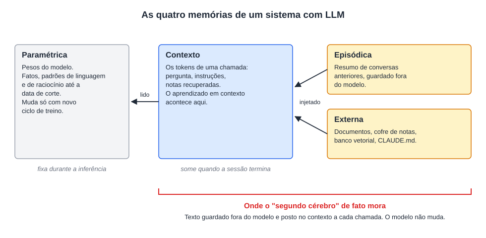
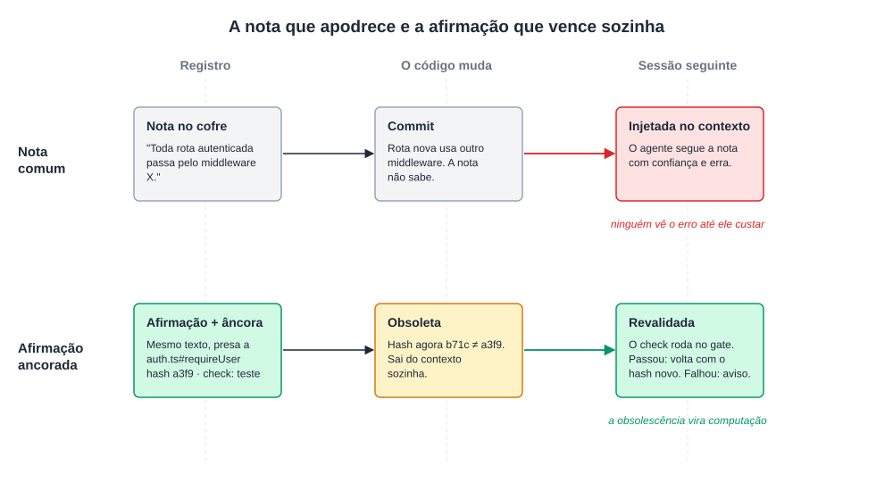
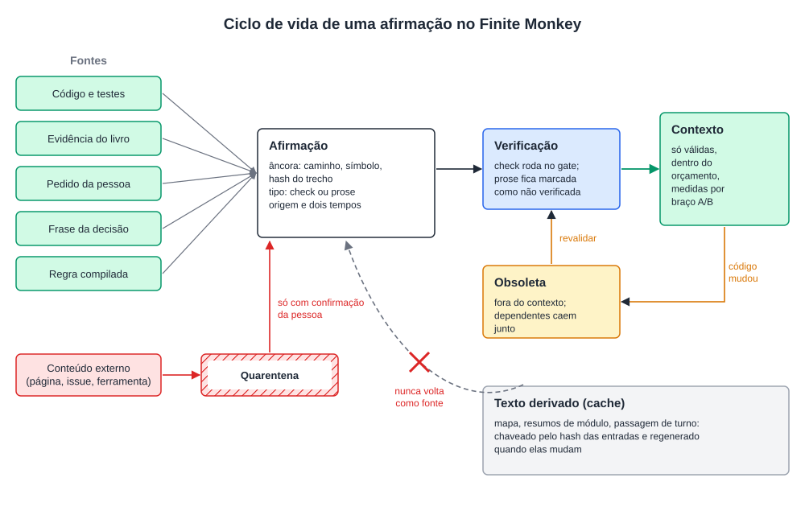
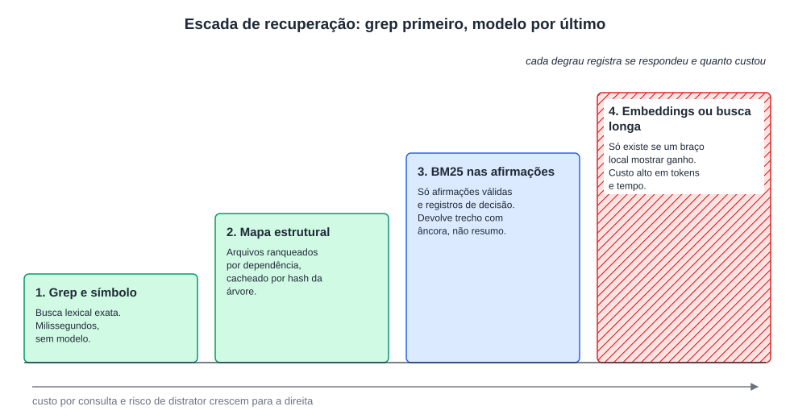
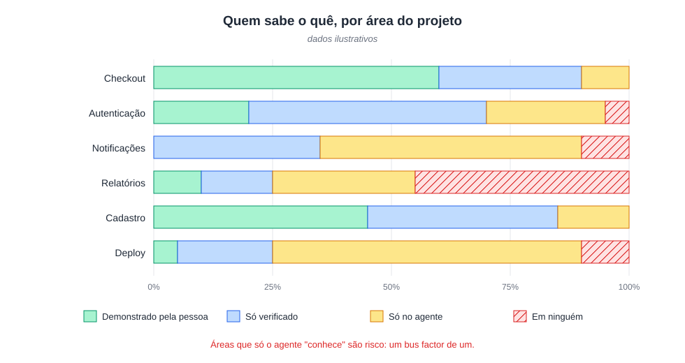

# A ilusão do segundo cérebro: uma análise crítica dos sistemas de gestão do conhecimento pessoal baseados em LLM

**Gabriel Vieira Flores**
NovusTec, São Paulo, SP, Brasil
gabrielvieira.ifsc@gmail.com · ORCID [0009-0000-2613-8284](https://orcid.org/0009-0000-2613-8284)

Versão 2.1, outubro de 2026 (versão 1: abril de 2026). [English](second-brain.md) | Português (Brasil) | [Español](second-brain.es.md)

> Este ensaio é a segunda base teórica do [Finite Monkey](../../README.pt-BR.md), ao lado do ensaio [Efeito Ricochete](../ricochet/ricochet.pt-BR.md). As seções 1 a 9 analisam o "segundo cérebro" pessoal feito com LLM e propõem um roteiro de avaliação. A seção 10 reúne o que já foi medido sobre a versão de projeto e de empresa dessa ideia, em que arquivos de contexto e memórias são escritos para agentes de programação. A seção 11 mostra o que o Finite Monkey faz com o conhecimento de um projeto a partir dessa evidência e o que ainda é hipótese a medir.

## Resumo

A integração entre modelos de linguagem de grande escala (LLMs) e ferramentas de anotação deu origem a um mercado que vende arquiteturas de "segundo cérebro" como solução para a gestão do conhecimento. Este ensaio examina essa promessa em sua genealogia: dos sistemas especialistas das décadas de 1960 a 1980, passando pela virada estatística e pela arquitetura transformer, até a popularização abrupta a partir de novembro de 2022. O argumento central é que o ecossistema Obsidian com LLM é o episódio mais recente de um padrão da história da inteligência artificial: a promessa de que uma nova tecnologia de representação do conhecimento resolverá o que as anteriores não resolveram, feita por quem não estudou por que as anteriores falharam. O ensaio distingue memória paramétrica de não paramétrica, separa o aprendizado em contexto da mudança de pesos que o discurso popular imagina, reúne as limitações documentadas da recuperação aumentada (RAG) e do fine-tuning, e propõe perguntas diagnósticas para separar uso útil de automação performática. Em seguida, aplica o mesmo exame ao "segundo cérebro" de projeto, o conjunto de arquivos de contexto e memórias escritos para agentes de programação. Os estudos controlados disponíveis acharam efeito nulo ou pequeno desses arquivos no acerto dos agentes, custo de 19% a 23% maior, referências a código que já não existe em 23% dos repositórios e memórias persistentes envenenáveis por conteúdo externo. O que mostrou efeito foi orientação validada por sondas e instrução convertida em verificação executável. A partir disso, o ensaio propõe tratar o conhecimento de um projeto como artefato de build: cada afirmação presa ao hash do código que descreve, verificada por execução quando possível, invalidada automaticamente quando o código muda, medida por braço A/B antes de ocupar contexto, e devolvida à pessoa como pergunta que ela responde, em vez de resumo que ela lê.

**Palavras-chave:** modelos de linguagem de grande escala; sistemas especialistas; gestão do conhecimento pessoal; geração aumentada por recuperação; agentes de programação; arquivos de contexto; manutenção da verdade; proveniência; efeito de geração; engenharia de software.

## 1. Introdução: o culto da visualização em grafo

Por volta de 2023 surgiu um gênero de conteúdo: o especialista em produtividade que descobriu que ligar o cofre de arquivos Markdown do Obsidian a uma API de modelo de linguagem criaria um "segundo cérebro". Vieram tutoriais em vídeo, newsletters pagas com acesso a "sistemas" e cursos que vendiam estruturas de pastas como se a organização de diretórios fosse conhecimento proprietário.

O fenômeno acelerou em abril de 2026, quando Andrej Karpathy publicou um gist descrevendo um padrão pessoal de "LLM Wiki" (KARPATHY, 2026). Três dias depois já havia repositórios empacotando a ideia para o Obsidian com o Claude Code, um deles anunciado como "segundo cérebro de IA que se organiza sozinho" (AGRICIDANIEL, 2026), e o padrão passou a circular em comunidades como método de epistemologia pessoal.

O que esse ecossistema costuma ignorar é que a questão central, como fazer uma máquina representar, recuperar e raciocinar sobre conhecimento humano, é o problema fundador da inteligência artificial. Não é novo e não está resolvido. Cada geração que o redescobre sem conhecer as tentativas anteriores tende a reproduzir os mesmos modos de falha, agora com outro vocabulário e um marketplace de plugins.

Este ensaio não rejeita a gestão do conhecimento apoiada por LLM. Exige precisão histórica e técnica. O argumento passa pela genealogia dos sistemas especialistas, pela virada estatística, pelo que um LLM é de fato, pelo mito do aprendizado contínuo, pela literatura empírica sobre RAG, pelo arco de popularização e seus custos, pela crítica ao ecossistema, pelo padrão de Karpathy e seus derivados, e por um roteiro de avaliação. As seções 10 e 11 levam a análise ao conhecimento de projetos de software, onde agentes passaram a ler e escrever memórias por conta própria.

## 2. Genealogia: o problema antigo que os praticantes não conhecem

### 2.1 Sistemas especialistas: a primeira grande promessa

A ideia de que conhecimento especializado pode ser formalizado em regras executáveis por máquina tem sessenta anos de história documentada. O DENDRAL, desenvolvido em Stanford a partir de 1965 por Edward Feigenbaum, Joshua Lederberg, Bruce Buchanan e Carl Djerassi, é em geral apontado como o primeiro sistema especialista: um programa que aplicava regras de química orgânica para inferir estruturas moleculares a partir de dados de espectrometria de massa (FEIGENBAUM; BUCHANAN, 1993). A inovação não era algorítmica; era epistemológica: a competência de um especialista podia ser escrita como regras.

O MYCIN, desenvolvido por Edward Shortliffe em Stanford na década de 1970, tornou essa tese famosa. Era um sistema de regras de produção para escolher a terapia antimicrobiana em infecções bacterianas, com algumas centenas de regras na forma SE condição 1 E condição 2 ENTÃO conclusão COM fator de certeza, cerca de 450 na versão madura (SHORTLIFFE, 1976; BUCHANAN; SHORTLIFFE, 1984). Numa avaliação cega com dez casos de meningite, oito especialistas julgaram aceitáveis as prescrições do MYCIN com frequência igual ou maior que as de docentes de Stanford (YU et al., 1979).

A década de 1980 foi a era de ouro desses sistemas. A indústria de IA passou de alguns milhões de dólares em 1980 para alguns bilhões em 1988 (RUSSELL; NORVIG, 2010), um otimismo que precedeu o chamado inverno da IA. A promessa era a mesma que circula hoje nos servidores de Discord sobre Obsidian: capturar o conhecimento especializado, organizá-lo e consultá-lo de forma confiável, liberando o trabalhador do conhecimento de reter e recuperar à mão o que já foi documentado.

### 2.2 Por que os sistemas especialistas falharam: o gargalo da aquisição de conhecimento

O problema fundamental ficou conhecido como *knowledge acquisition bottleneck*. Extrair o conhecimento de especialistas humanos para regras formais revelou-se muito mais difícil do que os fundadores esperavam: especialistas muitas vezes não sabem articular as regras que seguem, porque operam por reconhecimento de padrão e intuição acumulada, que resistem à formalização proposicional.

O segundo modo de falha era a generalização frágil. Um sistema que funcionava bem no domínio de treinamento degradava sem aviso fora dele. O terceiro era a manutenção em escala. Algumas centenas de regras são auditáveis por um especialista; milhares se tornam opacas. O XCON (R1), que configurava computadores VAX na DEC, chegou a milhares de regras e exigia uma equipe dedicada a mantê-las (McDERMOTT, 1982). Regras interagem de modos não previstos: acrescentar uma para corrigir um comportamento pode invalidar outras em silêncio.

O inverno da IA, de 1987 ao início dos anos 1990, foi em parte uma reação a esses modos de falha (CREVIER, 1993). O que caiu de forma abrupta foi o investimento e o mercado de máquinas Lisp; os sistemas em si foram sendo absorvidos por software corporativo comum. O Quadro 1 resume os três modos de falha e seus paralelos no ecossistema de gestão do conhecimento pessoal (PKM) com LLM.

**Quadro 1 – Modos de falha dos sistemas especialistas e seus paralelos em PKM com LLM**

| Modo de falha | Sistemas especialistas (1965–1993) | PKM com LLM (2022–2026) |
|---|---|---|
| Gargalo da aquisição de conhecimento | Especialistas não conseguem escrever em regras formais o conhecimento tácito que aplicam por reconhecimento de padrão | O conhecimento que a pessoa não consegue escrever em notas de qualidade não se torna recuperável porque há um LLM no meio do caminho |
| Generalização frágil | Bom dentro do domínio, degradação sem aviso fora dele, sem forma de expressar incerteza estrutural | A recuperação ingênua degrada do mesmo jeito em temas pouco representados no cofre ou em perguntas que cruzam domínios |
| Manutenção em escala | Centenas de regras são auditáveis; milhares ficam opacas; uma regra nova pode invalidar outras em silêncio | Um cofre de 500 notas é manejável; um de 5.000 acumula afirmações conflitantes, sobretudo quando é o LLM quem compila o wiki |

Fonte: elaboração própria (2026), com base em Feigenbaum e Buchanan (1993), McDermott (1982) e Crevier (1993).

### 2.3 Representação simbólica do conhecimento

Enquanto os sistemas especialistas cresciam e caíam, uma linha paralela desenvolvia os fundamentos formais da representação do conhecimento. As redes semânticas organizavam conceitos em hierarquias de herança e foram testadas como modelo da memória humana (COLLINS; QUILLIAN, 1969). Os *frames* de Minsky (1975) são estruturas que representam estereótipos de objetos, com campos para atributos, valores padrão e herança. A analogia com as notas de um cofre do Obsidian com metadados YAML é imediata e não é acidental.

O grafo do Obsidian que os influenciadores filmam como prova de seu segundo cérebro é, funcionalmente, uma rede semântica sem semântica nas arestas. Links sem tipo entre notas não têm poder inferencial. São visualizações de conectividade, não estruturas de conhecimento que um programa possa explorar.

O Cyc, iniciado por Doug Lenat em 1984, é o caso mais revelador. Seu objetivo era codificar à mão o conhecimento de senso comum necessário para raciocinar como um adulto (LENAT, 1995). Em 2006, depois de cerca de 900 pessoas-ano de trabalho, a base tinha mais de 2,2 milhões de asserções sobre mais de 250 mil termos (MATUSZEK et al., 2006). O projeto continuou por quase quatro décadas e não resolveu o problema. A lição para o ecossistema Obsidian com LLM é direta: se décadas de engenharia manual em escala industrial não formalizaram o senso comum para raciocínio computável, um cofre de 500 notas lido por recuperação ingênua não o fará.

### 2.4 A virada estatística

A superação dos sistemas especialistas não veio de uma representação simbólica melhor. Veio da troca de modelos baseados em regras por modelos baseados em distribuições aprendidas dos dados. Frederick Jelinek, que chefiava o grupo de reconhecimento contínuo de fala da IBM, ficou associado à frase "toda vez que eu demito um linguista, o desempenho do reconhecedor de fala melhora", dita em algum momento entre 1985 e 1988 em versões ligeiramente diferentes, como ele mesmo comentou depois (JELINEK, 2005).

O Word2Vec mostrou que palavras podiam ser representadas como vetores num espaço contínuo, com propriedades aritméticas surpreendentes (MIKOLOV et al., 2013). Bahdanau, Cho e Bengio (2014) introduziram o mecanismo de atenção em redes recorrentes, a peça que Vaswani et al. (2017) generalizaram no transformer, base dos LLMs atuais.

O ponto que importa aqui: a virada estatística resolveu problemas que o simbolismo declarara intratáveis não porque achou uma representação mais verdadeira do conhecimento, mas porque abandonou a pretensão de representá-lo de forma explícita. Um LLM não "sabe" que um antibiótico cobre certa classe de bactérias no sentido em que uma regra do MYCIN sabia. Ele aprendeu que, em contextos linguísticos como os do seu corpus de treino, certas continuações são mais prováveis que outras. É a distinção mais importante para este ensaio e a mais ignorada no discurso sobre PKM.

## 3. O que um LLM é de fato

### 3.1 Memória paramétrica e o que um modelo sabe

Um LLM é uma rede neural baseada em transformer, treinada para prever o próximo token de uma sequência com aprendizado autossupervisionado sobre grandes corpora de texto (VASWANI et al., 2017; BROWN et al., 2020). O modelo codifica conhecimento de forma implícita nos pesos, o que a literatura chama de memória paramétrica, fixada no treino. Nos modelos comerciais usados no modo padrão, os pesos não mudam durante a inferência.

Daí vem a primeira incompreensão do discurso dos praticantes: um LLM não é um banco de dados. Quando alguém envia notas a um pipeline ligado ao Obsidian e recebe uma síntese, o modelo não "armazenou" nada. Processou tokens numa janela de contexto limitada e gerou uma resposta probabilística. Quando o contexto é limpo, a adaptação que ocorreu ali dentro desaparece, salvo se um mecanismo externo a guardar e reinjetar.

### 3.2 O efeito *lost in the middle*

Liu et al. (2024) mostraram, em experimentos controlados, que o desempenho dos modelos de linguagem depende da posição da informação relevante dentro do contexto:

> "o desempenho é frequentemente mais alto quando a informação relevante ocorre no início ou no fim do contexto de entrada, e se degrada significativamente quando os modelos precisam acessar informação relevante no meio de contextos longos, mesmo para modelos explicitamente de contexto longo" (LIU et al., 2024, p. 157, tradução nossa).

No pior caso, com 20 ou 30 documentos, a queda passou de 20 pontos para o GPT-3.5-Turbo, que ficou abaixo do próprio desempenho sem documento nenhum. A causa da curva em U ainda é debatida. Uma explicação aponta o decaimento de longo alcance do RoPE (ZHANG, Z. et al., 2024); outras apontam um viés posicional intrínseco da atenção (HSIEH et al., 2024) ou a máscara causal combinada com o decaimento (WU, X. et al., 2025). O próprio estudo de Liu et al. encontrou a curva no MPT, que usa ALiBi e não RoPE. A implicação prática não depende da causa: quem monta uma janela de 10 mil tokens com notas do cofre e espera que o modelo as use de forma uniforme está operando com uma ideia errada do sistema que usa.

Trabalhos posteriores tornaram o quadro mais duro. Quando a pergunta e o trecho relevante não compartilham palavras, o GPT-4o cai de 99,3% para 69,7% de acerto em 32 mil tokens (MODARRESSI et al., 2025). Um estudo com 18 modelos mostrou que o desempenho varia com o tamanho da entrada mesmo em tarefas simples e que um único distrator já piora o resultado (HONG; TROYNIKOV; HUBER, 2025).

### 3.3 Alucinação: redutível, não eliminável

Modelos de linguagem geram texto amostrando distribuições aprendidas sobre sequências de tokens. Não recuperam verdades de um repositório; produzem continuações plausíveis. Há resultados teóricos de que a alucinação não pode ser eliminada por completo num modelo de uso geral (XU; JAIN; KANKANHALLI, 2024), e há trabalhos que atribuem boa parte dela a incentivos de treino e avaliação que premiam o chute em vez da abstenção, o que a torna redutível (KALAI et al., 2025). As duas leituras concordam no que importa aqui: não há garantia de que uma síntese gerada esteja correta.

Quando um LLM mantém um wiki, lendo notas brutas, sintetizando páginas e criando referências cruzadas, cada etapa é uma superfície de alucinação. Uma síntese errada na compilação entra na estrutura da base e depois é usada como contexto para novas sínteses. Os comentários ao gist de Karpathy chegam a esse ponto sem rodeios. Um participante observa que, quando os arquivos de origem mudam, o conhecimento compilado pode estar errado sem que o sistema saiba, e que as checagens de saúde se resumem ao LLM relendo as páginas e adivinhando se algo mudou; outro lembra que a ausência de citações alucinadas é uma aspiração, não uma garantia técnica (KARPATHY, 2026, comentários).

## 4. O mito do aprendizado contínuo

### 4.1 A ficção científica como modelo mental

Há um equívoco tão difundido quanto consequente: a crença de que o modelo fica mais inteligente, mais pessoal e mais capaz conforme o usuário conversa com ele. A origem é a ficção científica. HAL 9000 aprende com a tripulação; o JARVIS da Marvel evolui com Tony Stark; Samantha, em *Her*, desenvolve uma relação singular com Theodore. Em todos os casos, a IA é um agente com memória episódica contínua e desenvolvimento ao longo do tempo.

Os LLMs comerciais de 2026 não funcionam assim. A diferença entre o modelo popular e o técnico é de tipo, não de grau, e entendê-la é condição para avaliar qualquer sistema de conhecimento baseado em LLM.

### 4.2 Treino e inferência

A operação de um LLM tem dois regimes separados. No treino, o modelo processa corpora enormes, faz predições sobre o próximo token, calcula uma função de perda e ajusta, por retropropagação, os bilhões de parâmetros da rede. O processo roda em clusters de GPU durante semanas ou meses e termina num arquivo estático de pesos.

Na inferência, esse arquivo é carregado com os parâmetros congelados e aplicado a cada nova entrada. Não há retropropagação nem escrita de informação nova no modelo. Isso não quer dizer que nada se adapta: dentro da janela de contexto o modelo aprende com exemplos e instruções, o chamado aprendizado em contexto (BROWN et al., 2020), e há trabalhos mostrando que esse mecanismo implementa algo próximo de um passo de gradiente implícito (VON OSWALD et al., 2023). Pesquisas com *test-time training* e com memórias treináveis atualizam pesos ou estados durante a inferência (AKYÜREK et al., 2024; BEHROUZ; ZHONG; MIRROKNI, 2024), mas não são o padrão dos produtos. A formulação precisa é esta: nos LLMs comerciais usados no modo padrão, os pesos não mudam durante a inferência; a adaptação acontece no contexto e some com ele, a menos que um sistema externo a guarde e a devolva.

Quando o Claude "parece lembrar" que o usuário prefere respostas curtas, não é porque aprendeu a preferência; é porque o sistema reinjetou um resumo de interações anteriores no contexto da nova conversa. A própria Anthropic descreve sua memória como um resumo editável e opcional, por projeto (ANTHROPIC, 2025a). Hagoel (2025), escrevendo para quem constrói esses sistemas, resume a situação: "LLMs como existem hoje, mesmo equipados com as melhores ferramentas disponíveis, não conseguem fazer nada disso. Eles não têm estado e estão congelados no tempo. [...] A única forma de introduzir informação nova ou 'ensinar' habilidades novas a um LLM é fornecer exemplos, instruções e toda a informação relevante acumulada, repetidamente, a cada invocação" (tradução nossa).

### 4.3 Quatro tipos de memória

Um levantamento recente organiza a memória em sistemas com LLM em quatro categorias, com propriedades muito diferentes (ZHANG, D. et al., 2025). O discurso popular junta as quatro numa só, e isso impede raciocinar sobre falhas.

A **memória paramétrica** é o conhecimento codificado nos pesos durante o pré-treino: fatos do mundo, padrões de linguagem e de raciocínio, conhecimento de domínio até a data de corte. É fixa na inferência e só muda com novo ciclo de treino.

A **memória de contexto** é a janela ativa, o conjunto de tokens processados numa chamada. É efêmera. Um cofre do Obsidian injetado como contexto existe só nesta camada e está sujeito ao efeito descrito na seção 3.2.

A **memória episódica** é o histórico recuperável de conversas, guardado fora do modelo e reinserido em sessões seguintes. Não é memória do modelo: é engenharia de sistema que simula continuidade, por sumarização e reinjeção.

A **memória externa**, ou não paramétrica, é o conjunto de documentos recuperáveis por RAG, bancos vetoriais ou outro armazenamento. É infraestrutura ao redor do modelo, e sua qualidade depende do acervo e da estratégia de recuperação.

A confusão entre essas categorias está por trás da maior parte das promessas sem base no ecossistema PKM com LLM. Quem alimenta notas no Obsidian e liga um LLM por RAG opera só na memória externa e na de contexto. O modelo não fica mais inteligente nem mais pessoal. O que muda é o que é posto no contexto antes de cada resposta. A Figura 1 mostra onde cada camada vive e o que acontece com ela quando a sessão termina.

*Figura 1 – As quatro memórias de um sistema com LLM e onde o "segundo cérebro" de fato mora. Fonte: elaboração própria (2026), com base em Zhang, D. et al. (2025).*

### 4.4 Como os modelos evoluem de verdade

A evolução de modelos como Claude, GPT ou Gemini não acontece durante as conversas. Acontece em ciclos discretos de treino, cada um com requisitos de computação e dados em escala industrial.

O pré-treino expõe o modelo a trilhões de tokens: cerca de 15 trilhões no Llama 3 (GRATTAFIORI et al., 2024) e 36 trilhões no Qwen3 (YANG et al., 2025). O objetivo não é ensinar respostas corretas, e sim construir uma representação estatística da linguagem e do conhecimento codificado nela.

O ajuste fino supervisionado vem em seguida: exemplos curados de entrada e saída ajustam os pesos para seguir instruções e manter formato, transformando um modelo de completar texto num assistente. O aprendizado por reforço com feedback humano (RLHF), popularizado pelo InstructGPT (OUYANG et al., 2022), treina um modelo de recompensa a partir de comparações feitas por anotadores e otimiza o modelo principal para maximizá-la. Variantes como DPO dispensam o modelo de recompensa intermediário, mas mantêm a estrutura de aprendizado por preferência (RAFAILOV et al., 2023).

O ciclo inteiro, com planejamento, experimentos de escala, pré-treino, ajuste, avaliação de segurança e lançamento, leva meses; só a fase de alinhamento e testes do GPT-4 levou cerca de seis meses (OPENAI, 2023). Essa escala de tempo não combina com nenhuma ideia de aprendizado em tempo real a partir de conversas individuais.

### 4.5 A corrida de parâmetros e a virada para a qualidade dos dados

Por anos o progresso foi guiado por uma regra simples: modelos maiores, com mais parâmetros e mais dados, são melhores. Kaplan et al. (2020) formalizaram a intuição nas primeiras leis de escala, relações de potência entre tamanho do modelo, volume de dados e perda.

O trabalho do Chinchilla foi o primeiro grande questionamento. Treinando mais de 400 modelos de 70 milhões a 16 bilhões de parâmetros, com 5 a 500 bilhões de tokens, a DeepMind mostrou que os modelos da época eram subtreinados em dados: para o melhor uso da computação, parâmetros e tokens deveriam crescer na mesma proporção. O Gopher, de 280 bilhões de parâmetros, foi superado pelo Chinchilla, de 70 bilhões treinado com quatro vezes mais dados (HOFFMANN et al., 2022).

A lei do Chinchilla otimiza o custo de treino, não o de uso. Quando se conta o custo de inferência, vale treinar modelos menores com mais dados do que ela recomenda (SARDANA et al., 2024). As famílias Llama 2, Llama 3 e Qwen3 seguiram esse caminho. O Qwen3 de 0,6 bilhão de parâmetros foi treinado com os mesmos 36 trilhões de tokens da família, o que dá cerca de 60 mil tokens por parâmetro (YANG et al., 2025; THOMPSON, 2026).

A virada mais relevante, porém, é da quantidade para a qualidade dos dados. Subramanyam, Chen e Grossman (2025) incluíram um parâmetro de qualidade na lei de escala e mostraram que um bilhão de tokens de alta qualidade pode valer bem mais que um bilhão de tokens ruidosos ou redundantes. Os modelos de raciocínio, como a família o1 e o DeepSeek-R1, acrescentaram um terceiro eixo: gastar computação na inferência, produzindo tokens de "pensamento" antes da resposta (DEEPSEEK-AI, 2025; SNELL et al., 2024).

Quem acredita que pôr mais notas no cofre torna o LLM "mais inteligente" está confundindo esses três eixos com injeção de contexto. O modelo não muda. O que muda é o contexto disponível. São fenômenos de ordens completamente diferentes.

### 4.6 O fine-tuning e seus limites

O ajuste fino aparece no ecossistema como solução para as limitações da memória paramétrica: se o modelo não sabe o que está nas suas notas, treine-o com elas. A proposta esbarra em problemas que o discurso popular ignora.

O primeiro é o esquecimento catastrófico. Ajustar um modelo com dados novos pode degradar o que ele sabia antes (KIRKPATRICK et al., 2017). Luo et al. (2023) observaram, em modelos de 1 a 7 bilhões de parâmetros ajustados em sequência de tarefas, que o esquecimento aumentava com o tamanho; outro estudo encontrou o oposto, com modelos pré-treinados maiores esquecendo menos (RAMASESH; LEWKOWYCZ; DYER, 2022). O que se pode afirmar é que um ajuste com os 5 mil artigos do cofre pode produzir um modelo que responde melhor sobre aquele acervo e raciocina pior sobre o resto, e que o tamanho do efeito não é previsível de antemão.

O segundo é o custo do alinhamento. O InstructGPT registrou regressões em alguns benchmarks públicos depois do RLHF, o que os autores chamaram de *alignment tax*, e mostrou que uma variante do método as reduzia (OUYANG et al., 2022). Kirk et al. (2024) mostraram que o RLHF reduz bastante a diversidade das saídas em relação ao ajuste supervisionado. Em PKM, um modelo ajustado para responder de forma consistente sobre um domínio pode ficar menos capaz justamente de produzir conexões inesperadas, o tipo de *insight* que os praticantes dizem querer.

O terceiro é a qualidade dos dados. Em mais de mil modelos ajustados sob condições controladas, a perplexidade do modelo sobre os dados de treino muitas vezes previu melhor o efeito do ajuste do que a semelhança superficial entre os dados e o benchmark (HARADA et al., 2025). Extrapolando para o caso aqui discutido: ajustar um modelo com notas fragmentadas e inconsistentes tende a produzir um modelo especializado em responder de forma fragmentada e inconsistente sobre aquele acervo.

O LoRA e variantes como QLoRA e AdaLoRA reduzem o custo do ajuste treinando matrizes de baixo posto acopladas às camadas do transformer (HU et al., 2021; DETTMERS et al., 2023; ZHANG, Q. et al., 2023). Atenuam o esquecimento e o custo, sem eliminá-los, e exigem uma infraestrutura de avaliação que não existe nas implementações populares de cofre do Obsidian.

A conclusão honesta: o ajuste fino é uma ferramenta válida de adaptação de domínio quando há dados de qualidade, avaliação rigorosa e consciência das perdas. Para o caso médio de PKM, um acervo de 500 a 5 mil notas de qualidade desigual mantido por uma pessoa sem infraestrutura de avaliação, ele provavelmente cria mais problemas do que resolve.

### 4.7 Contexto como falsa memória

A personalização que os usuários percebem em Claude, ChatGPT ou Gemini não é produto de aprendizado; é produto de engenharia de contexto. Ao iniciar uma conversa, o sistema recupera fragmentos de interações anteriores, resume e injeta no início do contexto. O modelo processa esse texto como qualquer outra entrada. A sensação de que o assistente "lembra" é a de ler um documento sobre si mesmo, não a de ser reconhecido.

Um cofre do Obsidian ligado a um LLM por RAG oferece exatamente o mesmo tipo de "memória": documentos recuperados e injetados. O modelo não formou representação interna do usuário, das suas preferências ou do seu estilo de pensar. A cada nova consulta, recomeça com o contexto fornecido, e a qualidade da resposta depende da qualidade do que foi recuperado.

A comparação com o aprendizado de máquina clássico é reveladora. Em sistemas de recomendação, o perfil do usuário é um vetor de parâmetros que o sistema reestima periodicamente a partir do comportamento (KOREN; BELL; VOLINSKY, 2009). Um LLM não tem esse mecanismo entre chamadas. Trabalhos que tentam acoplar memória persistente treinada a modelos congelados partem da mesma constatação; para modelos codificador-decodificador congelados, "a representação latente é descartada depois de cada passagem, então nenhuma informação persiste entre sessões" (JEONG, 2026, tradução nossa). A pesquisa da Databricks sobre memória de agentes em escala registra progresso, mas na infraestrutura externa ao modelo, e lista como trabalho pendente manter a memória correta, atual e acessível conforme ela cresce (DATABRICKS, 2026).

### 4.8 LLM e aprendizado de máquina clássico

No aprendizado de máquina clássico, como regressão logística, árvores com *boosting* e redes rasas, o modelo costuma ser o próprio veículo do conhecimento de domínio e pode ser retreinado periodicamente: um filtro de spam é retreinado com spam novo e seus pesos mudam a cada ciclo. Num LLM, o modelo é um *prior* estatístico enorme sobre a linguagem, e o conhecimento de domínio entra por contexto, por ajuste fino em ciclos discretos ou por RAG, nunca por interação em tempo real.

Isso tem consequência direta para a metáfora. Um segundo cérebro de verdade precisaria adquirir conhecimento de forma contínua, esquecer seletivamente o que ficou obsoleto, integrar o novo ao que já existe e manter uma representação persistente do histórico do usuário. Nenhuma dessas propriedades existe num LLM em inferência padrão. A metáfora descreve o sistema que os praticantes gostariam de ter.

O que os LLMs oferecem é impressionante, mas é outra coisa: processar e sintetizar grandes volumes de texto dentro de uma janela, gerar linguagem fluente condicionada a documentos fornecidos, medir semelhança semântica por embeddings e transformar texto com qualidade razoável. Isso tem valor. Mas não é um cérebro, e não aprende entre uma conversa e outra.

## 5. A literatura sobre RAG: o que as evidências dizem

### 5.1 Arquitetura e promessas

A geração aumentada por recuperação foi formalizada por Lewis et al. (2020) como forma de complementar a memória paramétrica do modelo com documentos externos recuperáveis. A promessa comum é que o RAG mitiga duas falhas dos LLMs: conhecimento desatualizado e alucinação. A literatura empírica é menos otimista que o discurso dos praticantes.

### 5.2 Limitações documentadas

**Mais documentos não é sempre melhor.** Modelos se distraem com contexto irrelevante (SHI, F. et al., 2023). O efeito depende do tipo de ruído: documentos irrelevantes mas parecidos com a pergunta prejudicam, enquanto documentos aleatórios podem até ajudar (CUCONASU et al., 2024). Para quem acredita que um cofre maior é sempre melhor, o recado é que o tamanho importa menos do que o que é recuperado.

**A coerência se rompe sob recuperação frequente.** Recuperar a intervalos curtos durante a geração reduz métricas de coerência, porque as trocas constantes interrompem a continuidade do contexto (LI et al., 2025).

**O RAG não elimina a alucinação.** Uma revisão sistemática na área da saúde concluiu que a qualidade da recuperação continua sendo um desafio e que trechos irrelevantes recuperados obrigam o modelo a raciocinar em torno de material que confunde (AMUGONGO et al., 2025).

**A posição na janela impõe um teto.** Como visto na seção 3.2, a queda pode passar de 20 pontos quando a informação relevante sai das pontas e vai para o meio do contexto (LIU et al., 2024).

**A segmentação destrói estrutura.** Implementações ingênuas cortam documentos em pedaços de tamanho fixo e perdem parágrafos, hierarquia de seções e referências cruzadas (GAO et al., 2023). E dois trechos podem estar ligados logicamente sem compartilhar vocabulário; é exatamente o caso em que a busca por semelhança falha, como mostra a queda de 99,3% para 69,7% quando pergunta e trecho não têm palavras em comum (MODARRESSI et al., 2025).

Abordagens hierárquicas como o RAPTOR (SARTHI et al., 2024) e baseadas em grafos como o GraphRAG (EDGE et al., 2024) atacam o problema da segmentação com abstrações em vários níveis. São sistemas de pesquisa, com ganhos em perguntas globais sobre acervos grandes, e estão a outra distância de arrastar arquivos Markdown para uma pasta. Para avaliar um pipeline de RAG existem métricas e corpora próprios, como o RAGAS (ES et al., 2024) e o RAGTruth (NIU et al., 2024), que quase nenhum praticante usa.

## 6. O arco da popularização e seus custos epistêmicos

### 6.1 Da sala de máquinas ao servidor de Discord

Há uma trajetória sociológica que liga *Attention Is All You Need* (VASWANI et al., 2017) à proliferação de cofres do Obsidian. Em 2017, transformers eram assunto de pesquisadores com formação em aprendizado de máquina e acesso a clusters de GPU. O ChatGPT, lançado em 30 de novembro de 2022, foi o ponto de inflexão: passou de um milhão de usuários em cinco dias, segundo o próprio Sam Altman (ALTMAN, 2022), e uma estimativa de analistas atribuiu a ele 100 milhões de usuários ativos em janeiro de 2023 (HU, K., 2023).

**Quadro 2 – O arco da popularização e a transformação do discurso**

| Período | Evento | Perfil de quem pratica | Estado do discurso |
|---|---|---|---|
| 2017 | Vaswani et al., *Attention Is All You Need* | Pesquisadores com formação em aprendizado de máquina | Modos de falha descritos tecnicamente na literatura primária |
| 2020 | API do GPT-3 em beta (OpenAI) | Engenheiros de software interessados em linguagem natural | Ecossistema técnico; expectativas calibradas |
| Nov. 2022 | Lançamento do ChatGPT | Um milhão de usuários em cinco dias; interface de chat | Começa a degradação semântica do vocabulário técnico |
| 2023–2026 | Ecossistema Obsidian com LLM, padrão de Karpathy, Smart Connections com mais de 1,25 milhão de downloads | Influenciadores de produtividade sem formação em aprendizado de máquina | Ritual elaborado, ausência de benchmarks |

Fonte: elaboração própria (2026), com base em Vaswani et al. (2017), Altman (2022), Hu, K. (2023) e Obsidian (2026).

### 6.2 A degradação semântica do vocabulário técnico

Cada conceito que migra de um artigo revisado por pares para um tutorial em vídeo perde precisão. *Memória* é o caso mais consequente. Na literatura de LLMs ela tem definições técnicas (paramétrica, de contexto, episódica, externa); no discurso dos praticantes, virou qualquer coisa que "o sistema guarda". Essa promiscuidade terminológica impede raciocinar sobre falhas.

*Conhecimento* sofreu a mesma degradação. Na IA simbólica, tinha representação formal com semântica explícita; nos LLMs, é implícito e estatístico; no discurso dos praticantes, virou qualquer texto em qualquer arquivo.

*Aprendizado* talvez tenha sofrido a degradação mais grave. Em aprendizado de máquina, denota ajuste de parâmetros por gradiente; em LLMs, denota pré-treino em escala industrial ou ajuste fino com dados curados, além do aprendizado em contexto que desaparece com a janela. No discurso popular, passou a significar qualquer aparência de adaptação, inclusive a simples recuperação de contexto injetado. Essa confusão é o substrato do mito do segundo cérebro que aprende.

O mesmo fenômeno aparece no nível individual. O ensaio sobre o Efeito Ricochete descreve a mimetização do vocabulário técnico: a pessoa adquire as palavras de um domínio antes da estrutura que as liga, e passa a pedir e a avaliar com termos cujo significado operacional não domina (FLORES, 2026). Um ecossistema inteiro em que "memória", "conhecimento" e "aprendizado" circulam sem definição operacional é a versão coletiva dessa mimetização.

### 6.3 Autoconfiança sem metacognição em escala de ecossistema

Kruger e Dunning (1999) argumentaram que a incompetência num domínio prejudica a metacognição necessária para reconhecê-la. O efeito é debatido: parte dele pode ser regressão à média e artefato de medida (NUHFER et al., 2016; GIGNAC; ZAJENKOWSKI, 2020), embora haja defesas de que um componente metacognitivo permanece (JANSEN; RAFFERTY; GRIFFITHS, 2021). A curva com um "pico" de confiança que circula em redes sociais não está no artigo original.

Mesmo sem apoiar o argumento no efeito, há uma assimetria de incentivo que dispensa psicologia individual. Quem domina a ferramenta o bastante para operá-la, mas não o bastante para conhecer seus limites, pode prometer mais com menos ressalvas, e promessas simples rendem mais alcance que ressalvas precisas. O resultado é um ecossistema que produz mais conteúdo de baixa confiabilidade porque o incentivo econômico premia a simplicidade da promessa, não a precisão técnica.

### 6.4 Culto à carga como estrutura recorrente

Richard Feynman chamou de *cargo cult science* a forma externa da investigação científica sem o seu conteúdo (FEYNMAN, 1974). O ecossistema Obsidian com LLM tem essa estrutura. Os praticantes notaram que pipelines com LLM às vezes produzem algo parecido com o que um sistema de conhecimento inteligente produziria e replicaram a forma (cofre estruturado, CLAUDE.md, metadados YAML, scripts de ingestão, grafo) sem entender por que o sistema funciona quando funciona nem por que falha quando falha.

Os sistemas especialistas tiveram o seu culto à carga: empresas comprando *shells* de sistemas especialistas sem ter especialistas para alimentar as regras com conteúdo de qualidade. A diferença agora é a escala e a velocidade de difusão, ampliadas por plataformas que remuneram promessas não verificáveis com alcance orgânico.

## 7. Crítica ao ecossistema Obsidian com LLM

### 7.1 Lacunas técnicas sistêmicas

O que une as camadas do ecossistema, dos plugins de semelhança semântica aos wikis compilados por LLM, é a ausência frequente dos controles que a literatura aponta como necessários. A maioria das implementações populares não usa reordenação por *cross-encoder* para atenuar o efeito de posição, não combina busca lexical BM25 com embeddings, não rastreia a proveniência de cada afirmação e não é avaliada com corpora como RAGAS ou RAGTruth. As exceções existem e confirmam a regra: o próprio gist de Karpathy recomenda, quando o wiki cresce, uma ferramenta de busca híbrida BM25 e vetorial com reordenação por LLM (KARPATHY, 2026), recomendação que boa parte dos derivados não seguiu.

### 7.2 O orçamento de tokens e a economia da complexidade

Um cofre de 500 notas de 300 palavras tem cerca de 150 mil palavras, algo em torno de 200 mil tokens em inglês e mais em português. Mandar tudo isso numa consulta custa, nos preços de 2026, de vinte centavos a cerca de um dólar, processa sobretudo texto irrelevante e, pelo que se viu na seção 3.2, piora a precisão para o que estiver no meio da janela. Um índice BM25 ou um grep devolveria a nota relevante em milissegundos e a custo marginal quase nulo.

### 7.3 O problema identificado errado

A falha central do discurso é identificar errado o problema. A literatura sobre gestão de informação pessoal documenta que as pessoas guardam muito mais do que recuperam, que o esforço de organizar antecipadamente rende pouco e que a recuperação depende sobretudo de lembrar onde e por que algo foi guardado (WHITTAKER, 2011; BERGMAN; WHITTAKER, 2016). Os próprios defensores do método do segundo cérebro põem a falha na disciplina de captura e de síntese, não na ferramenta (FORTE, 2022), embora como opinião e não como pesquisa. Nenhuma das duas leituras sugere que o gargalo seja a ausência de um LLM.

Se o cofre é um depósito de notas pela metade, tags inconsistentes e artigos capturados há meses e nunca lidos, pôr um modelo de linguagem sobre ele não transforma entrada de baixa qualidade em síntese de alta qualidade. *Garbage in, garbage out* é uma das observações mais antigas e duráveis da computação.

### 7.4 O problema epistemológico da síntese delegada

A pesquisa em ciência cognitiva mostra que os processos elaborativos da aquisição de conhecimento (reler, resumir com as próprias palavras, criar conexões, explicar) não são acessórios da formação do conhecimento; são a formação do conhecimento. O que é processado com mais profundidade é mais bem lembrado (CRAIK; LOCKHART, 1972). O que a pessoa gera é lembrado melhor do que o que ela apenas lê (SLAMECKA; GRAF, 1978). Atividades construtivas e interativas produzem mais aprendizado que atividades passivas (CHI; WYLIE, 2014). A prática de Luhmann com o fichário, descrita por ele mesmo como uma conversa com um parceiro que surpreende, dependia de escrever cada ficha à mão e de ligá-la de propósito às outras (LUHMANN, 1981).

Delegar essas operações por inteiro a um LLM não é ampliação cognitiva; é transferência do trabalho cognitivo para fora, com custos conhecidos (RISKO; GILBERT, 2016). Os dados recentes com IA vão na mesma direção: num experimento controlado, quem aprendeu uma biblioteca nova com ajuda de IA teve pior compreensão conceitual, leitura de código e depuração, sem ganho médio de tempo; só os padrões de uso com engajamento cognitivo preservaram o aprendizado (SHEN; TAMKIN, 2026). A promessa de "zero atrito" do marketing não automatiza o conhecimento. Automatiza a aparência dele.

## 8. Distinguindo padrões legítimos de derivados de culto à carga

### 8.1 O que o padrão de Karpathy propõe

Lido com cuidado, o gist de Karpathy é uma proposta específica e modesta. A inovação central é a diferença entre RAG de consulta única, em que o LLM "redescobre o conhecimento do zero a cada pergunta", e um wiki persistente que acumula e melhora conforme chegam novas fontes (KARPATHY, 2026). Ele descreve três camadas (fontes brutas imutáveis, o wiki e um esquema) e três operações (ingerir, consultar e revisar), esta última procurando contradições, afirmações superadas e páginas órfãs.

Karpathy delimita a escala: o padrão "funciona surpreendentemente bem em escala moderada (~100 fontes, ~centenas de páginas)" e, conforme o wiki cresce, pede busca adequada, com indexação híbrida e reordenação. Lista usos pessoais e também um wiki interno de equipe ou empresa, e avisa que o texto descreve uma ideia, não uma implementação (KARPATHY, 2026). O que não existe no gist é um mecanismo de verificação: as checagens são o próprio modelo relendo as páginas. A diferença entre o gist e seus derivados reproduz a diferença entre o MYCIN e as *shells* que vieram depois: os derivados venderam a forma sem as ressalvas.

### 8.2 Quando PKM com LLM tem valor

O argumento deste ensaio não é que LLMs nunca servem em bases pessoais de conhecimento. É que a maior parte dos usos vendidos não se qualifica. Os seguintes usos são defensáveis:

**Síntese sobre acervos heterogêneos em escala manejável:** quando um pesquisador reuniu de 50 a 200 documentos bem anotados sobre um tema, uma passada de compilação pode poupar tempo, desde que o resultado seja tratado como rascunho a verificar.

**Tarefas estruturais repetitivas:** gerar links, normalizar tags, achar notas vazias e formatar citações são operações de baixa carga semântica, cujo valor está em executá-las, não em pensar.

**Consulta sobre acervo autorizado e verificado:** quando o acervo tem autoridade, como uma coleção curada de artigos revisados, o RAG pode ter valor, desde que inclua citação, rastreamento de proveniência e revisão humana.

## 9. Roteiro de avaliação

### 9.1 Cinco perguntas diagnósticas

Qualquer pessoa que ponha um LLM ao lado de uma base de conhecimento deveria responder a cinco perguntas antes de afirmar que o sistema traz benefício cognitivo:

1. **Qual é o mecanismo real?** O sistema faz injeção de contexto, recuperação semântica ou consulta a um wiki compilado? Quem não sabe responder não consegue raciocinar sobre falhas.
2. **Qual é o orçamento de tokens?** Quantos tokens cada consulta consome, a que custo e latência? Esse custo é proporcional ao valor entregue, comparado com uma recuperação determinística?
3. **Qual é a estratégia contra alucinação?** Como as afirmações geradas são verificadas? Há rastreamento de proveniência? As saídas são tratadas como rascunho ou como verdade?
4. **Qual é a qualidade da entrada?** O cofre tem anotações curadas ou é um depósito de recortes da web nunca sintetizados? O LLM não melhora retroativamente a entrada.
5. **Qual é o contrafactual?** Quanto custaria a mesma tarefa com uma ferramenta mais simples: busca textual, grep, um índice bem mantido? Se o LLM não supera de forma demonstrável o contrafactual, a complexidade não se justifica.

### 9.2 Perguntas sobre aprendizado e memória

Dada a confusão documentada na seção 4, três perguntas a mais:

1. **O sistema está confundindo contexto com memória?** Toda aparência de "o LLM lembra do meu trabalho" deve ser atribuída à injeção de contexto. Se o contexto for removido, o "conhecimento" some.
2. **O ajuste fino está sendo considerado?** Se sim: qual a qualidade dos dados, como será avaliado depois, como o esquecimento será medido, o custo do alinhamento foi considerado? Sem respostas técnicas, não deveria ser feito.
3. **O modelo está sendo tratado como agente com objetivos ou como ferramenta estocástica?** Sistemas que dependem de o modelo "entender" o domínio do usuário ao longo do tempo, sem mecanismos explícitos de persistência e verificação, partem de uma premissa errada.

### 9.3 Matriz de casos de uso

**Quadro 3 – Matriz de avaliação de casos de uso de PKM com LLM**

| Caso de uso | Abordagem recomendada | Papel do LLM | Risco principal |
|---|---|---|---|
| Acervo de pesquisa curado (menos de 200 documentos) | Wiki no padrão de Karpathy | Compilação e manutenção | Alucinação em referências cruzadas; saídas tratadas como rascunho |
| Grande repositório corporativo | GraphRAG ou RAPTOR com avaliação | Indexação hierárquica e RAG | Ruído de recuperação, latência, alucinação em escala |
| Captura e recuperação de notas pessoais | Zettelkasten e busca textual BM25 | Nenhum | Custo de oportunidade de um LLM desnecessário |
| Respostas sobre acervo com autoridade | RAG com proveniência e reordenação | Geração condicionada a documentos recuperados | Citações fabricadas; exige verificação sistemática |
| Conexões semânticas entre notas existentes | Embeddings locais, sem API | Semelhança por embeddings | Segmentação fixa perde o contexto entre trechos |
| Estética de grafo e sinalização social | Obsidian sem LLM | Nenhum | Tokens desperdiçados, falsa confiança, síntese sem validação |

Fonte: elaboração própria (2026).

## 10. O segundo cérebro de projeto: o que foi medido

### 10.1 Da nota pessoal ao arquivo de contexto

A mesma promessa mudou de escala. Hoje se vende "segundo cérebro da empresa" e "segundo cérebro do projeto": um cofre do Obsidian ou um espaço no Notion com a história, as decisões e as convenções de uma equipe, lido por agentes. No desenvolvimento de software a ideia já tem forma padronizada. O Claude Code carrega em toda sessão um arquivo CLAUDE.md e uma memória automática que o próprio agente escreve; outros agentes leem um AGENTS.md; equipes mantêm pastas de regras e de *skills*. A documentação do Claude Code é franca sobre o estatuto desse texto: o agente o trata como contexto, não como configuração imposta; para bloquear algo de verdade, é preciso um *hook*. Recomenda menos de 200 linhas por arquivo, porque arquivos maiores consomem contexto e reduzem a aderência, e avisa que, se duas instruções se contradizem, o modelo pode escolher uma de forma arbitrária (ANTHROPIC, 2026a).

Ao contrário do cofre pessoal, esse caso já tem estudos controlados. Eles permitem aplicar ao segundo cérebro de projeto as perguntas da seção 9 com números.

### 10.2 Arquivos de contexto quase não ajudam e custam caro

Gloaguen et al. (2026) avaliaram arquivos de contexto com agentes de programação em dois conjuntos: 300 tarefas do SWE-bench Lite e 138 tarefas de 12 repositórios que já tinham arquivos escritos pelos próprios desenvolvedores. Arquivos gerados por LLM mudaram o sucesso em −0,5 e −2 pontos, sem significância, e aumentaram o custo em 20% e 23%, com mais passos por tarefa. Arquivos escritos por desenvolvedores deram +2,4 pontos, também sem significância, com custo até 19% maior. Visões gerais do repositório, embora populares e recomendadas pelos fornecedores, não ajudaram. As instruções foram seguidas; elas só não faziam diferença.

Khatri (2026) fez uma ablação com 288 execuções do Claude Code e do Codex em 17 tarefas reais. A estratégia de contexto não moveu a correção de forma mensurável, com efeito limitado a no máximo 10 a 15 pontos por teste de equivalência. Os agentes falharam em desenho de funcionalidade, escolha de padrão e integração, e não por falta de conhecimento do repositório que um arquivo de contexto pudesse dar.

Os arquivos que existem também têm defeitos medidos. Em 100 repositórios populares, 62% dos AGENTS.md escreviam como prosa regras que caberiam num linter, 42% tinham contexto inchado e 35% embutiam procedimentos que deveriam ser *skills* (SANTOS et al., 2026). Em 2.303 arquivos de 1.925 repositórios, esses textos evoluíram como código de configuração, por pequenos acréscimos, e quase nunca falavam de segurança ou desempenho (CHATLATANAGULCHAI et al., 2025).

### 10.3 O que mostrou efeito

Dois tipos de orientação tiveram efeito significativo. O primeiro é orientação **validada por sondas**: ajustar o guia do repositório com bugs sintéticos plantados elevou o sucesso para 33,0%, contra 28,3% com um guia estático e 25,5% sem guia (p < 0,001); o ganho veio de o agente achar os arquivos certos (SHEPARD; ALBRECHT, 2026). O segundo é instrução **convertida em verificação executável**: transformar as regras de um AGENTS.md em consultas à árvore sintática, *shims* de shell e validadores de arquitetura levou o cumprimento a 88,3%, contra 67,0% com a regra só no prompt e 50,3% com autocrítica do modelo, sem perder correção funcional (SHARMA, 2026).

As duas formas têm algo em comum: o conhecimento deixa de ser texto que o modelo pode seguir ou não e passa a ser algo que se executa e que falha de forma visível.

### 10.4 O conhecimento escrito apodrece

Treude e Baltes (2026) aplicaram um verificador de consistência de documentação a arquivos de contexto de agentes e acharam referências a elementos de código que já não existem em 23,0% de 356 repositórios. Fora dos agentes, mudanças de código feitas sem atualizar o comentário correspondente têm cerca de 1,5 vez mais chance de introduzir bug (RADMANESH et al., 2024). Praticantes relatam o mesmo. Um desenvolvedor descreve o agente escrevendo para PostgreSQL com toda a confiança meses depois de o projeto ter migrado para MySQL, porque a memória dizia PostgreSQL; a ferramenta que ele construiu em resposta guarda, em cada memória, o hash dos arquivos de que ela depende e a marca como obsoleta quando eles mudam (CHUGH, 2026). A documentação acoplada ao código já faz algo parecido em produtos comerciais, usando o histórico do git para decidir se uma mudança foi só de lugar ou pede revisão (SWIMM, 2025). Nenhum dos dois publica avaliação.

### 10.5 Memória persistente é superfície de ataque

Quando o agente escreve a própria memória, o que entra nela passa a valer em todas as sessões seguintes. Huang, Zhang e Jia (2026) mostraram que instruções maliciosas vindas de fontes externas, como uma página ou uma issue, entraram na memória persistente do Claude Code em 66,9% dos casos e foram executadas numa sessão posterior em 81,7%, e que defesas no prompt dão proteção limitada depois que a memória foi envenenada. Um segundo cérebro que aceita qualquer coisa que o agente leu é, do ponto de vista de segurança, uma porta aberta que se lembra de ficar aberta.

### 10.6 Recuperação em código: lexical primeiro, sem dogma

A equipe do Claude Code afirmou que, nos seus testes, a busca agêntica superou o RAG para o tipo de trabalho feito com a ferramenta (CHERNY, 2025), sem publicar números. Um estudo com vários *harnesses* achou grep com acerto maior que recuperação vetorial na maioria deles, com resultado muito dependente do *harness* (SEN et al., 2026). Do outro lado, um fornecedor mediu 12,5% a mais de acerto ao somar busca semântica ao grep em bases grandes (CURSOR, 2025), e um índice estrutural de símbolos dentro do agente melhorou a localização e a resolução sem custo extra (BHOLA et al., 2026). Num banco de 427 amostras, nenhuma família de recuperação dominou, e um mapa estrutural do repositório rendeu mais contexto útil por orçamento de tokens (QIN; XIE, 2026). A leitura conjunta é que a busca lexical é o ponto de partida barato e quase sempre suficiente para localizar, que estrutura ajuda em mudanças que atravessam vários arquivos, e que embeddings são um degrau a justificar caso a caso.

### 10.7 Memória de agente: arquitetura sofisticada sem vantagem demonstrada

Sistemas de memória para agentes multiplicaram-se: memória paginada como num sistema operacional, grafos de conhecimento com tempo, camadas de extração de fatos. Os números publicados são disputados entre os próprios fornecedores, e um agente que só usava ferramentas de arquivo obteve 74,0% no LoCoMo, acima de um concorrente baseado em grafo (LETTA, 2025). O LongMemEval separa as habilidades que importam e mostra assistentes comerciais perdendo 30% de acerto em interações longas, com destaque para duas: atualizar um fato que mudou e saber se abster quando não sabe (WU, D. et al., 2025). Nenhum desses benchmarks tem código mudando debaixo da memória, que é o caso de um projeto de software. O que o grafo temporal do Zep acerta, e que vale levar, é o modelo de dois tempos: quando um fato valia no mundo e quando o sistema soube dele (RASMUSSEN et al., 2025).

### 10.8 A teoria do programa está na pessoa

Há, por fim, um argumento mais antigo. Naur (1985) sustentou que programar é construir uma teoria: o que importa num programa é o entendimento de quem o construiu, que não se transfere só por documentação. Wegner (1987) descreveu a memória transativa: grupos lembram distribuindo quem sabe o quê, e o que precisa estar na cabeça de cada um é o diretório, não o conteúdo. Storey (2026) propôs os termos dívida cognitiva, a erosão do entendimento compartilhado, e dívida de intenção, a falta de razões e restrições registradas. Mehra et al. (2026) chamaram de dívida de conhecimento as mudanças feitas por agentes que o desenvolvedor não entende. Um wiki do projeto não é a teoria do programa. A pessoa que entende é.

**Quadro 4 – O que a evidência diz sobre o segundo cérebro de projeto**

| Prática | Efeito medido | Fonte |
|---|---|---|
| Arquivo de contexto gerado por LLM, com visão geral do repositório | Sucesso −0,5 a −2 pontos (sem significância); custo +20% a +23% | Gloaguen et al. (2026) |
| Arquivo de contexto escrito por desenvolvedores | +2,4 pontos (sem significância); custo até +19% | Gloaguen et al. (2026) |
| Estratégias de contexto em tarefas reais com Claude Code e Codex | Sem efeito mensurável na correção (limite de 10 a 15 pontos) | Khatri (2026) |
| Guia ajustado por sondas de bug | 33,0% contra 28,3% (guia estático), p < 0,001 | Shepard e Albrecht (2026) |
| Regras convertidas em verificações executáveis | 88,3% de cumprimento contra 67,0% (só prompt) | Sharma (2026) |
| Referências a código inexistente em arquivos de contexto | 23,0% de 356 repositórios | Treude e Baltes (2026) |
| Memória persistente exposta a conteúdo externo | Injeção em 66,9%; execução em sessão seguinte em 81,7% | Huang, Zhang e Jia (2026) |
| Grep contra recuperação vetorial | Grep à frente na maioria dos *harnesses*; resultado depende do *harness* | Sen et al. (2026) |

Fonte: elaboração própria (2026), com base nos estudos citados.

## 11. Do diagnóstico ao instrumento: o conhecimento do projeto no Finite Monkey

### 11.1 O princípio: conhecimento como artefato de build

As seções anteriores apontam três razões pelas quais o segundo cérebro falha, tanto o pessoal quanto o de projeto. O conhecimento escrito **envelhece sem que ninguém saiba**, porque nada liga a nota ao que ela descreve. **Não se sabe de onde veio** cada afirmação, e o modelo, ao compilar sínteses de sínteses, mistura fonte com derivado. E a pessoa **terceiriza o entendimento**, lendo um resumo bem escrito que alimenta a ilusão de que entendeu (ROZENBLIT; KEIL, 2002).

O Finite Monkey já resolve um problema com a mesma forma. Seu *gate* não aceita a palavra do agente de que os testes passaram: guarda num livro de evidências a saída dos comandos que rodaram, presa ao hash da árvore do git em que rodaram, e invalida a evidência quando um arquivo muda. Esta seção estende esse desenho ao conhecimento do projeto, e o Finite Monkey já o implementa, a maior parte em sombra; o Quadro 5 diz o que ficou de fora. O princípio é tomado dos sistemas de build: uma afirmação sobre o código é uma tarefa de build cuja saída é "ainda é verdade?", e cujas entradas são o conteúdo dos trechos que ela descreve. Sistemas de build com *traces* verificados guardam o hash das entradas de cada tarefa e só a refazem quando ele muda (MOKHOV; MITCHELL; PEYTON JONES, 2018). Aplicado ao conhecimento, isso transforma a obsolescência de opinião do modelo em computação.

Daí seguem quatro regras de desenho. A máquina guarda, invalida e verifica. A pessoa entende e decide. O modelo entra só onde o determinístico não basta. E nenhum pedaço de memória ocupa o contexto sem provar, por medição, que ajuda. A Figura 2 contrasta o ciclo de uma nota comum com o de uma afirmação ancorada.

*Figura 2 – A nota que apodrece em silêncio e a afirmação ancorada que vence sozinha quando o código muda. Fonte: elaboração própria (2026), com base em Treude e Baltes (2026) e Mokhov, Mitchell e Peyton Jones (2018).*

### 11.2 Afirmações ancoradas, executáveis e com proveniência

**Âncora por hash.** Cada afirmação sobre o projeto ("o checkout arredonda em centavos em `totals.ts`", "toda rota autenticada passa pelo middleware X") guarda âncoras: caminho, símbolo e o hash do conteúdo normalizado do trecho, de preferência o corpo da função, não o arquivo inteiro. A cada mudança da árvore, o Finite Monkey recalcula os hashes das âncoras e marca como obsoleta toda afirmação cuja entrada mudou. Afirmação obsoleta sai do contexto até ser revalidada. O risco é de calibragem: âncora larga demais vence a cada edição; estreita demais deixa passar a mudança relevante noutro arquivo. Por isso a âncora é por símbolo, uma refatoração que só move código não invalida nada, e a precisão da invalidação é medida por amostragem.

**Afirmação executável.** Cada afirmação tem um tipo. As do tipo *check* carregam um comando, um teste, uma consulta à árvore sintática ou um exemplo de entrada e saída, que o *gate* roda como qualquer critério; quando passam, a afirmação é renovada no hash atual. As do tipo *prose* aparecem marcadas como não verificadas. O Finite Monkey sugere converter prosa em *check* quando reconhece o padrão: regra de lint, comando proibido, fronteira de import. É a conversão que mostrou efeito na seção 10.3 (SHARMA, 2026). Um *check* que nunca falha é decorativo; o Finite Monkey já mede a força de exemplos de comportamento contra mutantes do código alterado, e o mesmo vale aqui.

**Justificação e retração.** Uma afirmação pode depender de outras e de evidências. Quando uma premissa cai, tudo o que dependia dela passa a fora, com o motivo encadeado, como nos sistemas de manutenção da verdade (DOYLE, 1979). Cada conclusão pode carregar o conjunto de premissas sob o qual vale, o que permite ver o que cai se uma premissa for refutada (DE KLEER, 1986). É a resposta ao modo de falha da seção 2.2, em que uma regra nova invalidava outras em silêncio. O grafo fica raso de propósito: só entram dependências que o próprio Finite Monkey registrou, como uma decisão que cita uma evidência, nunca dependências inferidas por modelo.

**Proveniência e dois tempos.** Cada afirmação diz de onde veio (a evidência, o commit, o pedido da pessoa, a sessão), quem a fez (a pessoa, o agente, um subagente, uma ferramenta) e dois tempos: o intervalo de commits em que valia e o momento em que o sistema soube dela. O vocabulário é o do W3C PROV (W3C, 2013), e o modelo de tempo é o bitemporal (RASMUSSEN et al., 2025). Afirmações não são apagadas; são encerradas. Assim, "de onde veio isso?" e "o que o projeto achava em março?" têm resposta.

**Texto gerado é cache, nunca fonte.** Qualquer texto que o Finite Monkey ou o agente gerem sobre o projeto (mapa, resumo de módulo, passagem de turno) é saída de build: chaveado pelo hash das entradas, regenerado quando elas mudam e nunca usado como entrada de outro texto. São fonte só o código, os testes, as evidências do livro, os registros de decisão com a frase da pessoa e as afirmações verificadas. Isso corta a cadeia de síntese de síntese descrita na seção 3.3. Quando a pessoa quer corrigir uma página gerada, a correção vira uma afirmação nova com origem "pessoa", não uma edição do cache.

A Figura 3 mostra o ciclo de vida completo: o que é fonte, o que é derivado, o que fica em quarentena e o que chega ao contexto.

*Figura 3 – Ciclo de vida de uma afirmação no Finite Monkey: fontes, quarentena, verificação, invalidação e o que chega ao contexto. Fonte: elaboração própria (2026).*

### 11.3 Recuperar com o mínimo e medir o resto

**Grep primeiro, modelo por último.** Perguntas sobre o projeto passam por uma escada fixa, com orçamento de tokens por degrau e registro de qual degrau respondeu: símbolo exato e grep; mapa estrutural do repositório ranqueado por dependência, no estilo do mapa do Aider; busca BM25 nas afirmações válidas e nos registros de decisão; e embeddings ou busca agêntica longa só se um braço local mostrar ganho. Afirmações obsoletas nunca entram. O que volta é trecho com âncora, não resumo. É a recomendação da conclusão deste ensaio transformada em procedimento, e é compatível com a evidência mista da seção 10.6.

**Contexto mínimo, compilado do que foi verificado.** A parte do AGENTS.md que o Finite Monkey gerencia contém só comandos que rodaram com sucesso no hash atual, convenções do projeto que existem como *check* e indicações de onde procurar, sem visão geral do repositório, com tamanho máximo contado. A pessoa continua livre para escrever fora desse bloco. É a leitura direta da seção 10.2: visão geral gerada não ajuda e custa.

**Contradições.** O *doctor* do Finite Monkey acusa referência a caminho, comando ou símbolo que não existe, regra contradita pelo próprio repositório (a instrução diz `pnpm` e o *lockfile* é do npm), duas instruções carregadas que se contradizem, cada uma com seu arquivo, e regra que aparece com frequência no registro de violações, sinal de que o texto não está funcionando e deve virar *check* ou sair. Só a terceira checagem usa modelo, e só para propor.

**Quarentena.** Nenhuma memória nova entra direto no contexto. Toda entrada nasce em quarentena com sua origem. Conteúdo vindo de fora (página, issue, saída de ferramenta) nunca é promovido sem confirmação da pessoa, e texto com forma de instrução vindo de fonte externa é recusado. A promoção acontece depois que a entrada foi usada numa tarefa que terminou verde. É a resposta à seção 10.5, e a eficácia da quarentena pode ser testada com o próprio ataque: uma página com instrução plantada, rodada no CI do Finite Monkey.

**Todo artefato de memória é um braço.** Cada fonte de conhecimento injetada (o bloco do AGENTS.md, o CLAUDE.md, a memória automática, as afirmações) é um fator que o Finite Monkey pode desligar por tarefa, em sombra ou por sorteio, como já faz com suas próprias regras. O resultado é medido pelo livro de evidências: "pronto" falso, tentativas até o verde, tokens e se o arquivo lido antes da edição era o certo. A entrada que não move nada depois de N tarefas é rebaixada. É a pergunta 5 da seção 9.1, "qual é o contrafactual?", executada em vez de perguntada. É também o que separa esse desenho de quem vende segundo cérebro: cada pedaço de memória precisa provar efeito. Com poucas tarefas por pessoa o poder estatístico é baixo, e "sem efeito detectável" é aceito como motivo para cortar.

A Figura 4 mostra a escada de recuperação com o custo de cada degrau.

*Figura 4 – A escada de recuperação: cada degrau só é usado quando o anterior não respondeu, e o último só existe se um braço local mostrar ganho. Fonte: elaboração própria (2026), com base em Sen et al. (2026), Qin e Xie (2026) e Bhola et al. (2026).*

### 11.4 A pessoa, não o resumo

Nada do que foi dito até aqui faz a pessoa entender o projeto. Faz o agente errar menos. A seção 7.4 e o ensaio sobre o Efeito Ricochete apontam na mesma direção: a pessoa só julga o que consegue julgar, e o que ela lê sem gerar não vira entendimento (FLORES, 2026). Três mecanismos tratam disso, e o efeito dos três é hipótese. O registro de decisão está ligado por padrão; o mapa de quem sabe o quê roda em sombra e só age com consentimento; a conferência por *teach-back* ainda não foi implementada.

**A frase da decisão.** Quando uma tarefa fecha com mudança de dependência, de fornecedor ou de arquitetura, o Finite Monkey monta o registro de decisão sem modelo, a partir do livro de evidências: o contrato e seu hash, as alternativas consideradas, os critérios escritos antes dos candidatos, as evidências verdes e o custo medido. Depois preenche o resultado: se houve reversão em sete dias, incidentes, regressões. A única parte que a pessoa escreve é uma frase: por que escolheu. Sem ela, o registro aparece como "sem razão", e a razão não é inventada. O formato segue o registro de decisão de arquitetura (NYGARD, 2011); a frase escrita pela pessoa usa o efeito de geração no lugar de uma razão escrita pelo modelo e lida por ela (SLAMECKA; GRAF, 1978), e ataca diretamente a dívida de intenção (STOREY, 2026).

**Explicar na faixa proximal e conferir com teach-back.** Quando a tarefa toca um domínio em que o perfil da pessoa a coloca na borda, onde sabe pedir mas não sabe julgar, o Finite Monkey não gera resumo. Mostra a afirmação ancorada e o trecho de código, pede que a pessoa preveja o comportamento numa entrada concreta ou o explique numa frase, confere a resposta com o gabarito executável e só depois mostra a diferença. Acerto conta como demonstração no livro de conceitos, e o pedido some ali; é o andaime que vai embora. A base é a prática de recuperação (ROEDIGER; KARPICKE, 2006), a autoexplicação (CHI et al., 1994) e a ilusão de profundidade explicativa, que um resumo bem escrito alimenta (ROZENBLIT; KEIL, 2002). O risco principal é o falso positivo de "não entende", tratado com o mesmo cuidado que o ensaio sobre o Efeito Ricochete dedica à mimetização: nenhum rótulo na interface, poucas perguntas por semana, e o pedido some rápido.

**Quem sabe o quê.** Para cada área do código, o Finite Monkey registra onde o conhecimento está: demonstrado pela pessoa, só em afirmações verificadas, só no agente ou em ninguém. Quando uma afirmação numa área que a pessoa dominava é revalidada com conteúdo diferente, uma pergunta curta de recuperação é agendada para uma sessão seguinte, espaçada, não imediata. Áreas que só o agente "conhece" aparecem como risco, como um *bus factor* de um. É a memória transativa de Wegner (1987) aplicada a um time de uma pessoa e um agente: o diretório precisa estar na pessoa.

**Quadro 5 – Das perguntas diagnósticas aos mecanismos do Finite Monkey**

| Pergunta (seção 9) | Mecanismo | Base no Finite Monkey | Situação |
|---|---|---|---|
| Qual é o mecanismo real? | Afirmações com tipo (*check* ou *prose*) e origem declarada | Contratos, *gate*, livro de evidências | Implementado, em sombra até ser medido; evidência forte para o tipo *check* |
| Qual é o orçamento de tokens? | Escada de recuperação com orçamento por degrau; contexto mínimo | Mapa do repositório cacheado por hash, *onboard* | Implementado; o último degrau fica em sombra e sem provedor por padrão; ordem da escada com evidência mista |
| Qual é a estratégia contra alucinação? | Âncora por hash, retração encadeada, texto gerado como cache | Livro de evidências preso ao hash da árvore | Parcial, em sombra: o bloco do AGENTS.md ainda não é tratado como cache; necessidade com evidência, calibragem a medir |
| Qual é a qualidade da entrada? | Quarentena por origem; detector de contradição | *doctor*, registro de instruções e de violações | Implementado; a promoção de afirmações do agente fica em sombra; ameaça com evidência |
| Qual é o contrafactual? | Cada artefato de memória como braço A/B | Braços de experimento, regras em sombra | Parcial: só as afirmações e os aprendizados viram braço; o bloco do AGENTS.md, o CLAUDE.md e a memória automática ficam de fora; poder estatístico local a confirmar |
| O sistema confunde contexto com memória? | Frase da decisão, *teach-back*, mapa de quem sabe o quê | Perfil, livro de conceitos, sondas | Parcial: registro de decisão ligado, mapa em sombra e só com consentimento, *teach-back* não implementado; efeito é hipótese |

Fonte: elaboração própria (2026).

Os mecanismos saíram na versão 0.1.0-next.41 do Finite Monkey. Nenhum teve o efeito medido: a bancada ainda não rodou os braços que diriam se algum deles ajuda.

A Figura 5 mostra o mapa de quem sabe o quê. No Finite Monkey ele sai do comando `knowledge map`, ainda sem painel.

*Figura 5 – Mapa de quem sabe o quê por área do projeto: onde o conhecimento está demonstrado pela pessoa, só verificado, só no agente ou em ninguém. Dados ilustrativos. Fonte: elaboração própria (2026), com base em Wegner (1987).*

### 11.5 O que não fazer, e o que faria a proposta cair

Da evidência reunida seguem algumas recusas: não gerar visão geral do repositório para o arquivo de contexto; não usar wiki compilado por LLM como fonte ou como entrada de novas sínteses; não deixar um juiz de LLM decidir se uma afirmação ainda vale, já que o modelo só propõe e a âncora e o *check* decidem; não exigir banco vetorial; não gravar memória a partir de conteúdo externo sem quarentena; não entregar resumo para a pessoa ler no lugar de entender; e não prometer que o sistema aprende. Ele guarda, invalida e verifica. Quem aprende é a pessoa.

A proposta cai se a invalidação por hash tiver precisão tão baixa que a pessoa passe a ignorá-la, como se ignora um alarme que dispara sempre; se as afirmações executáveis não reduzirem "pronto" falso nem violações de regra em relação às mesmas regras em prosa; se o braço A/B mostrar que, para os agentes atuais, nenhum artefato de memória tem efeito detectável, caso em que o certo é carregar menos e não mais; ou se o *teach-back* não melhorar a reparação sem ajuda semanas depois, no mesmo domínio. As duas primeiras condições são testáveis na bancada do próprio Finite Monkey. Nenhum benchmark de memória existente tem código mudando debaixo da memória, então a bancada precisa de tarefas em que um fato do projeto muda entre sessões. As outras pedem uso real e tempo.

## 12. Conclusão

Pôr modelos de linguagem ao lado de ferramentas de gestão do conhecimento não é um erro em si. Em condições específicas e com controles de engenharia adequados, pode trazer benefício cognitivo e operacional. O ecossistema em torno do Obsidian, porém, separou em grande parte essa prática da literatura técnica que permitiria a seus praticantes entender o que fazem, por que poderia funcionar e como perceber quando não funciona.

O mito do aprendizado contínuo é o equívoco mais consequente desse ecossistema. Os LLMs comerciais não mudam seus pesos com o uso. Não ficam mais inteligentes à medida que o cofre cresce. Não formam uma representação persistente do modo de pensar do usuário. Adaptam-se dentro do contexto de cada chamada e geram continuações prováveis. Isso é poderoso, e é de outra natureza que aquilo que a maioria acredita estar construindo.

A versão de projeto da mesma ideia herdou o mesmo erro e já tem números contra ela: arquivos de contexto que custam mais e não ajudam, referências a código que não existe, memórias que um texto de fora consegue envenenar. Os mesmos estudos mostram o caminho. O conhecimento que ajuda é pouco, específico e executável, e é medido antes de ocupar o contexto. O entendimento que importa continua sendo o da pessoa, e ele não se terceiriza.

A história da IA mostra o arco que as tecnologias de representação do conhecimento costumam percorrer: promessa inicial apoiada em resultados impressionantes em domínios controlados, comercialização que ultrapassa o possível, choque com os limites do domínio e substituição por outro paradigma. Sistemas especialistas, Web Semântica (BERNERS-LEE; HENDLER; LASSILA, 2001) e agora o PKM com LLM têm essa estrutura.

A recomendação prática continua simples: antes de pôr um LLM sobre uma base de conhecimento, pergunte qual é a ferramenta mais simples que responderia à pergunta. Se é um buscador, use um buscador. Se é grep, use grep. Reserve o modelo para o que exige gerar linguagem, sintetizar sobre fontes verificadas ou raciocinar sob uma complexidade que sistemas determinísticos não alcançam. O resto não é um segundo cérebro. É a reinvenção de um problema de sessenta anos, desta vez com interface de chat e um cofre em Markdown. O problema não ficou mais fácil. O que ficou mais fácil foi não perceber isso, e confundir o contexto injetado com aprendizado, o arquivo estático com inteligência e a ilusão de continuidade com memória.

## Conflito de interesses

O autor é o criador do Finite Monkey, software de código aberto distribuído sob a licença Apache 2.0, descrito na seção 11. O projeto não tem fins comerciais na data desta versão. As seções 1 a 10 não dependem do software. Os mecanismos da seção 11 estão implementados, a maior parte em sombra, mas o efeito deles ainda não foi medido: são hipóteses, não resultados.

## Disponibilidade de dados de pesquisa

Este manuscrito é um ensaio e não envolveu a coleta de novos dados. O código, o pré-registro da bancada e os resultados que vierem a ser produzidos ficam públicos no repositório do Finite Monkey: <https://github.com/gabrielvieiraf/finitemonkey>.

## Declaração de uso de inteligência artificial

Nesta versão, o autor utilizou o assistente Claude (Anthropic) na conferência das referências, na busca da literatura sobre arquivos de contexto e memória de agentes, na revisão do texto, na tradução para inglês e espanhol e na produção das figuras em formato vetorial, a partir de especificações e decisões próprias. Toda referência foi conferida na fonte; citações que não puderam ser localizadas na fonte primária foram retiradas da versão 1. O conteúdo é de responsabilidade exclusiva do autor.

## Referências

AGRICIDANIEL. **claude-obsidian**. GitHub, 2026. Repositório. Disponível em: https://github.com/AgriciDaniel/claude-obsidian. Acesso em: 29 out. 2026.

AKYÜREK, E. et al. The surprising effectiveness of test-time training for few-shot learning. **arXiv**, 2411.07279, 2024. Disponível em: https://arxiv.org/abs/2411.07279.

ALTMAN, S. ChatGPT launched on wednesday. today it crossed 1 million users! **X (Twitter)**, 5 dez. 2022. Disponível em: https://x.com/sama/status/1599668808285028353.

AMUGONGO, L. M. et al. Retrieval augmented generation for large language models in healthcare: a systematic review. **PLOS Digital Health**, v. 4, n. 6, e0000877, 2025. DOI: 10.1371/journal.pdig.0000877.

ANTHROPIC. Bringing memory to Claude. **Claude Blog**, 2025a. Disponível em: https://claude.com/blog/memory. Acesso em: 29 out. 2026.

ANTHROPIC. Manage Claude's memory. **Claude Code Docs**, 2026a. Disponível em: https://code.claude.com/docs/en/memory. Acesso em: 29 out. 2026.

BAHDANAU, D.; CHO, K.; BENGIO, Y. Neural machine translation by jointly learning to align and translate. **arXiv**, 1409.0473, 2014. Publicado na ICLR 2015.

BEHROUZ, A.; ZHONG, P.; MIRROKNI, V. Titans: learning to memorize at test time. **arXiv**, 2501.00663, 2024.

BERGMAN, O.; WHITTAKER, S. **The science of managing our digital stuff**. Cambridge, MA: MIT Press, 2016.

BERNERS-LEE, T.; HENDLER, J.; LASSILA, O. The Semantic Web. **Scientific American**, v. 284, n. 5, p. 34-43, 2001. DOI: 10.1038/scientificamerican0501-34.

BHOLA, I. et al. Code isn't memory: a structural codebase index inside a coding agent. **arXiv**, 2606.22417, 2026.

BROWN, T. et al. Language models are few-shot learners. In: ADVANCES IN NEURAL INFORMATION PROCESSING SYSTEMS (NeurIPS), 33., 2020. arXiv: 2005.14165.

BUCHANAN, B. G.; SHORTLIFFE, E. H. (ed.). **Rule-based expert systems**: the MYCIN experiments of the Stanford Heuristic Programming Project. Reading, MA: Addison-Wesley, 1984.

CHATLATANAGULCHAI, W. et al. Agent READMEs: an empirical study of context files for agentic coding. **arXiv**, 2511.12884, 2025.

CHERNY, B. [Comentário sobre o Claude Code não usar RAG]. **Hacker News**, 24 fev. 2025. Disponível em: https://news.ycombinator.com/item?id=43164253.

CHI, M. T. H. et al. Eliciting self-explanations improves understanding. **Cognitive Science**, v. 18, n. 3, p. 439-477, 1994. DOI: 10.1207/s15516709cog1803_3.

CHI, M. T. H.; WYLIE, R. The ICAP framework: linking cognitive engagement to active learning outcomes. **Educational Psychologist**, v. 49, n. 4, p. 219-243, 2014. DOI: 10.1080/00461520.2014.965823.

CHUGH, A. **Mnemolith**. GitHub, 2026. Repositório e apresentação no Hacker News (Show HN, 22 out. 2026). Disponível em: https://github.com/anishchugh05/mnemolith e https://news.ycombinator.com/item?id=50199581.

COLLINS, A. M.; QUILLIAN, M. R. Retrieval time from semantic memory. **Journal of Verbal Learning and Verbal Behavior**, v. 8, n. 2, p. 240-247, 1969. DOI: 10.1016/S0022-5371(69)80069-1.

CRAIK, F. I. M.; LOCKHART, R. S. Levels of processing: a framework for memory research. **Journal of Verbal Learning and Verbal Behavior**, v. 11, n. 6, p. 671-684, 1972. DOI: 10.1016/S0022-5371(72)80001-X.

CREVIER, D. **AI**: the tumultuous history of the search for artificial intelligence. New York: Basic Books, 1993.

CUCONASU, F. et al. The power of noise: redefining retrieval for RAG systems. In: ACM SIGIR CONFERENCE, 47., 2024. arXiv: 2401.14887.

CURSOR. Improving agent with semantic search. **Cursor Blog**, 6 nov. 2025. Disponível em: https://cursor.com/blog/semsearch.

DATABRICKS. Memory scaling for AI agents. **Databricks Blog**, 10 abr. 2026. Disponível em: https://www.databricks.com/blog/memory-scaling-ai-agents.

DE KLEER, J. An assumption-based TMS. **Artificial Intelligence**, v. 28, n. 2, p. 127-162, 1986. DOI: 10.1016/0004-3702(86)90080-9.

DEEPSEEK-AI. DeepSeek-R1: incentivizing reasoning capability in LLMs via reinforcement learning. **arXiv**, 2501.12948, 2025.

DETTMERS, T. et al. QLoRA: efficient finetuning of quantized LLMs. In: ADVANCES IN NEURAL INFORMATION PROCESSING SYSTEMS (NeurIPS), 36., 2023. arXiv: 2305.14314.

DOYLE, J. A truth maintenance system. **Artificial Intelligence**, v. 12, n. 3, p. 231-272, 1979. DOI: 10.1016/0004-3702(79)90008-0.

EDGE, D. et al. From local to global: a graph RAG approach to query-focused summarization. **arXiv**, 2404.16130, 2024.

ES, S. et al. RAGAS: automated evaluation of retrieval augmented generation. In: CONFERENCE OF THE EUROPEAN CHAPTER OF THE ACL (EACL): system demonstrations, 2024. arXiv: 2309.15217.

FEIGENBAUM, E. A.; BUCHANAN, B. G. DENDRAL and Meta-DENDRAL: roots of knowledge systems and expert system applications. **Artificial Intelligence**, v. 59, n. 1-2, p. 233-240, 1993. DOI: 10.1016/0004-3702(93)90191-D.

FEYNMAN, R. P. Cargo cult science. **Engineering and Science**, v. 37, n. 7, p. 10-13, 1974.

FLORES, G. V. **Efeito Ricochete**: o usuário como limite invisível da inteligência artificial. Versão 2. São Paulo, 2026. Disponível em: https://github.com/gabrielvieiraf/finitemonkey/blob/main/docs/ricochet/ricochet.pt-BR.md.

FORTE, T. **Building a second brain**. New York: Atria Books, 2022.

GAO, Y. et al. Retrieval-augmented generation for large language models: a survey. **arXiv**, 2312.10997, 2023.

GIGNAC, G. E.; ZAJENKOWSKI, M. The Dunning-Kruger effect is (mostly) a statistical artefact. **Intelligence**, v. 80, 101449, 2020. DOI: 10.1016/j.intell.2020.101449.

GLOAGUEN, T. et al. Evaluating AGENTS.md: are repository-level context files helpful for coding agents? **arXiv**, 2602.11988, 2026.

GRATTAFIORI, A. et al. The Llama 3 herd of models. **arXiv**, 2407.21783, 2024.

HAGOEL, I. Why LLM memory still fails: a field guide for builders. **DEV Community**, 29 jul. 2025. Disponível em: https://dev.to/isaachagoel/why-llm-memory-still-fails-a-field-guide-for-builders-3d78.

HARADA, Y. et al. Massive supervised fine-tuning experiments reveal how data, layer, and training factors shape LLM alignment quality. In: CONFERENCE ON EMPIRICAL METHODS IN NATURAL LANGUAGE PROCESSING (EMNLP), 2025. arXiv: 2506.14681.

HOFFMANN, J. et al. Training compute-optimal large language models. In: ADVANCES IN NEURAL INFORMATION PROCESSING SYSTEMS (NeurIPS), 35., 2022. arXiv: 2203.15556.

HONG, K.; TROYNIKOV, A.; HUBER, J. Context rot: how increasing input tokens impacts LLM performance. **Chroma Research**, 14 jul. 2025. Disponível em: https://www.trychroma.com/research/context-rot.

HSIEH, C.-Y. et al. Found in the middle: calibrating positional attention bias improves long context utilization. In: FINDINGS OF THE ACL, 2024. arXiv: 2406.16008.

HU, E. et al. LoRA: low-rank adaptation of large language models. **arXiv**, 2106.09685, 2021. Publicado na ICLR 2022.

HU, K. ChatGPT sets record for fastest-growing user base: analyst note. **Reuters**, 1 fev. 2023. Disponível em: https://www.reuters.com/technology/chatgpt-sets-record-fastest-growing-user-base-analyst-note-2023-02-01/.

HUANG, S.; ZHANG, J.; JIA, H. When malicious instructions persist: persistent memory poisoning attack on harness-based agents. **arXiv**, 2609.13889, 2026.

JANSEN, R. A.; RAFFERTY, A. N.; GRIFFITHS, T. L. A rational model of the Dunning-Kruger effect supports insensitivity to evidence in low performers. **Nature Human Behaviour**, v. 5, p. 756-763, 2021. DOI: 10.1038/s41562-021-01057-0.

JELINEK, F. Some of my best friends are linguists. **Language Resources and Evaluation**, v. 39, n. 1, p. 25-34, 2005. DOI: 10.1007/s10579-005-2693-4.

JEONG, H. Trained persistent memory for frozen encoder-decoder LLMs: six architectural methods. **arXiv**, 2603.16413, 2026.

KALAI, A. T. et al. Why language models hallucinate. **arXiv**, 2509.04664, 2025.

KAPLAN, J. et al. Scaling laws for neural language models. **arXiv**, 2001.08361, 2020.

KARPATHY, A. LLM Wiki: a pattern for building personal knowledge bases using LLMs. **GitHub Gist**, 4 abr. 2026. Disponível em: https://gist.github.com/karpathy/442a6bf555914893e9891c11519de94f. Acesso em: 29 out. 2026.

KHATRI, P. Do context files help coding agents? A two-agent ablation study on real repositories. **arXiv**, 2607.27250, 2026.

KIRK, R. et al. Understanding the effects of RLHF on LLM generalisation and diversity. In: INTERNATIONAL CONFERENCE ON LEARNING REPRESENTATIONS (ICLR), 2024. arXiv: 2310.06452.

KIRKPATRICK, J. et al. Overcoming catastrophic forgetting in neural networks. **Proceedings of the National Academy of Sciences**, v. 114, n. 13, p. 3521-3526, 2017. DOI: 10.1073/pnas.1611835114.

KOREN, Y.; BELL, R.; VOLINSKY, C. Matrix factorization techniques for recommender systems. **Computer**, v. 42, n. 8, p. 30-37, 2009. DOI: 10.1109/MC.2009.263.

KRUGER, J.; DUNNING, D. Unskilled and unaware of it: how difficulties in recognizing one's own incompetence lead to inflated self-assessments. **Journal of Personality and Social Psychology**, v. 77, n. 6, p. 1121-1134, 1999. DOI: 10.1037/0022-3514.77.6.1121.

LENAT, D. B. CYC: a large-scale investment in knowledge infrastructure. **Communications of the ACM**, v. 38, n. 11, p. 33-38, 1995. DOI: 10.1145/219717.219745.

LETTA. Benchmarking AI agent memory: is a filesystem all you need? **Letta Blog**, 12 ago. 2025. Disponível em: https://www.letta.com/blog/benchmarking-ai-agent-memory.

LEWIS, P. et al. Retrieval-augmented generation for knowledge-intensive NLP tasks. In: ADVANCES IN NEURAL INFORMATION PROCESSING SYSTEMS (NeurIPS), 33., 2020. arXiv: 2005.11401.

LI, S. et al. Enhancing retrieval-augmented generation: a study of best practices. In: INTERNATIONAL CONFERENCE ON COMPUTATIONAL LINGUISTICS (COLING), 2025. arXiv: 2501.07391.

LIU, N. F. et al. Lost in the middle: how language models use long contexts. **Transactions of the Association for Computational Linguistics**, v. 12, p. 157-173, 2024. DOI: 10.1162/tacl_a_00638.

LUHMANN, N. Kommunikation mit Zettelkästen: ein Erfahrungsbericht. In: BAIER, H.; KEPPLINGER, H. M.; REUMANN, K. (ed.). **Öffentliche Meinung und sozialer Wandel**. Opladen: Westdeutscher Verlag, 1981. p. 222-228.

LUO, Y. et al. An empirical study of catastrophic forgetting in large language models during continual fine-tuning. **arXiv**, 2308.08747, 2023.

MATUSZEK, C. et al. An introduction to the syntax and content of Cyc. In: AAAI SPRING SYMPOSIUM: formalizing and compiling background knowledge and its applications to knowledge representation and question answering, 2006. Technical Report SS-06-05, p. 44-49.

McDERMOTT, J. R1: a rule-based configurer of computer systems. **Artificial Intelligence**, v. 19, n. 1, p. 39-88, 1982. DOI: 10.1016/0004-3702(82)90021-2.

MEHRA, R. et al. Agents that teach: towards designing incidental learning back into AI-assisted software development. **arXiv**, 2607.06101, 2026.

MIKOLOV, T. et al. Efficient estimation of word representations in vector space. **arXiv**, 1301.3781, 2013.

MINSKY, M. A framework for representing knowledge. In: WINSTON, P. H. (ed.). **The psychology of computer vision**. New York: McGraw-Hill, 1975. p. 211-277.

MODARRESSI, A. et al. NoLiMa: long-context evaluation beyond literal matching. **arXiv**, 2502.05167, 2025.

MOKHOV, A.; MITCHELL, N.; PEYTON JONES, S. Build systems à la carte. **Proceedings of the ACM on Programming Languages**, v. 2, n. ICFP, art. 79, 2018. DOI: 10.1145/3236774.

NAUR, P. Programming as theory building. **Microprocessing and Microprogramming**, v. 15, n. 5, p. 253-261, 1985. DOI: 10.1016/0165-6074(85)90032-8.

NIU, C. et al. RAGTruth: a hallucination corpus for developing trustworthy retrieval-augmented language models. In: ANNUAL MEETING OF THE ACL, 62., 2024. arXiv: 2401.00396.

NUHFER, E. et al. Random number simulations reveal how random noise affects the measurements and graphical portrayals of self-assessed competency. **Numeracy**, v. 9, n. 1, art. 4, 2016. DOI: 10.5038/1936-4660.9.1.4.

NYGARD, M. Documenting architecture decisions. **Cognitect Blog**, 15 nov. 2011. Disponível em: https://cognitect.com/blog/2011/11/15/documenting-architecture-decisions.

OBSIDIAN. **community-plugin-stats.json**. GitHub, obsidianmd/obsidian-releases, 2026. Contagem de downloads do plugin Smart Connections consultada em 29 out. 2026.

OPENAI. GPT-4 technical report. **arXiv**, 2303.08774, 2023.

OUYANG, L. et al. Training language models to follow instructions with human feedback. In: ADVANCES IN NEURAL INFORMATION PROCESSING SYSTEMS (NeurIPS), 35., 2022. arXiv: 2203.02155.

QIN, B.; XIE, Y. Agent Retrieval Bench: evaluating repository context retrieval for coding agents. **arXiv**, 2607.24882, 2026.

RADMANESH, S. et al. Investigating the impact of code comment inconsistency on bug introducing. **arXiv**, 2409.10781, 2024.

RAFAILOV, R. et al. Direct preference optimization: your language model is secretly a reward model. In: ADVANCES IN NEURAL INFORMATION PROCESSING SYSTEMS (NeurIPS), 36., 2023. arXiv: 2305.18290.

RAMASESH, V. V.; LEWKOWYCZ, A.; DYER, E. Effect of scale on catastrophic forgetting in neural networks. In: INTERNATIONAL CONFERENCE ON LEARNING REPRESENTATIONS (ICLR), 2022.

RASMUSSEN, P. et al. Zep: a temporal knowledge graph architecture for agent memory. **arXiv**, 2501.13956, 2025.

RISKO, E. F.; GILBERT, S. J. Cognitive offloading. **Trends in Cognitive Sciences**, v. 20, n. 9, p. 676-688, 2016. DOI: 10.1016/j.tics.2016.07.002.

ROEDIGER, H. L.; KARPICKE, J. D. Test-enhanced learning: taking memory tests improves long-term retention. **Psychological Science**, v. 17, n. 3, p. 249-255, 2006. DOI: 10.1111/j.1467-9280.2006.01693.x.

ROZENBLIT, L.; KEIL, F. The misunderstood limits of folk science: an illusion of explanatory depth. **Cognitive Science**, v. 26, n. 5, p. 521-562, 2002. DOI: 10.1207/s15516709cog2605_1.

RUSSELL, S.; NORVIG, P. **Artificial intelligence**: a modern approach. 3. ed. Upper Saddle River: Prentice Hall, 2010.

SANTOS, H. V. F. dos et al. Configuration smells in AGENTS.md files: common mistakes in configuring coding agents. **arXiv**, 2606.15828, 2026.

SARDANA, N. et al. Beyond Chinchilla-optimal: accounting for inference in language model scaling laws. In: INTERNATIONAL CONFERENCE ON MACHINE LEARNING (ICML), 2024. arXiv: 2401.00448.

SARTHI, P. et al. RAPTOR: recursive abstractive processing for tree-organized retrieval. In: INTERNATIONAL CONFERENCE ON LEARNING REPRESENTATIONS (ICLR), 2024. arXiv: 2401.18059.

SEN, S. et al. Is grep all you need? How agent harnesses reshape agentic search. **arXiv**, 2605.15184, 2026.

SHARMA, R. K. ContextCov: deriving and enforcing executable constraints from agent instruction files. **arXiv**, 2603.00822, 2026.

SHEN, J. H.; TAMKIN, A. How AI impacts skill formation. **arXiv**, 2601.20245, 2026.

SHEPARD, A.; ALBRECHT, J. Probe-and-refine tuning of repository guidance for coding agents. **arXiv**, 2606.20512, 2026.

SHI, F. et al. Large language models can be easily distracted by irrelevant context. In: INTERNATIONAL CONFERENCE ON MACHINE LEARNING (ICML), 2023. arXiv: 2302.00093.

SHORTLIFFE, E. H. **Computer-based medical consultations**: MYCIN. New York: American Elsevier, 1976.

SLAMECKA, N. J.; GRAF, P. The generation effect: delineation of a phenomenon. **Journal of Experimental Psychology: Human Learning and Memory**, v. 4, n. 6, p. 592-604, 1978. DOI: 10.1037/0278-7393.4.6.592.

SNELL, C. et al. Scaling LLM test-time compute optimally can be more effective than scaling model parameters. **arXiv**, 2408.03314, 2024.

STOREY, M.-A. From technical debt to cognitive and intent debt: rethinking software health in the age of AI. **arXiv**, 2603.22106, 2026.

SUBRAMANYAM, A.; CHEN, Y.; GROSSMAN, R. L. Scaling laws revisited: modeling the role of data quality in language model pretraining. **arXiv**, 2510.03313, 2025.

SWIMM. How does Swimm's Auto-sync feature work? **Swimm Blog**, 2025. Disponível em: https://swimm.io/blog/how-does-swimm-s-auto-sync-feature-work. Acesso em: 29 out. 2026.

THOMPSON, A. D. Chinchilla data-optimal scaling laws: in plain English. **LifeArchitect.ai**, 2026. Disponível em: https://lifearchitect.ai/chinchilla/. Acesso em: 29 out. 2026.

TREUDE, C.; BALTES, S. Context rot in AI-assisted software development: repurposing documentation consistency for AI configuration artifacts. **arXiv**, 2606.09090, 2026.

VASWANI, A. et al. Attention is all you need. In: ADVANCES IN NEURAL INFORMATION PROCESSING SYSTEMS (NeurIPS), 30., 2017. arXiv: 1706.03762.

VON OSWALD, J. et al. Transformers learn in-context by gradient descent. In: INTERNATIONAL CONFERENCE ON MACHINE LEARNING (ICML), 2023. arXiv: 2212.07677.

W3C. **PROV-Overview**: an overview of the PROV family of documents. W3C Working Group Note, 30 abr. 2013. Disponível em: https://www.w3.org/TR/prov-overview/.

WEGNER, D. M. Transactive memory: a contemporary analysis of the group mind. In: MULLEN, B.; GOETHALS, G. R. (ed.). **Theories of group behavior**. New York: Springer, 1987. p. 185-208. DOI: 10.1007/978-1-4612-4634-3_9.

WHITTAKER, S. Personal information management: from information consumption to curation. **Annual Review of Information Science and Technology**, v. 45, n. 1, p. 1-62, 2011. DOI: 10.1002/aris.2011.1440450108.

WU, D. et al. LongMemEval: benchmarking chat assistants on long-term interactive memory. In: INTERNATIONAL CONFERENCE ON LEARNING REPRESENTATIONS (ICLR), 2025. arXiv: 2410.10813.

WU, X. et al. On the emergence of position bias in transformers. In: INTERNATIONAL CONFERENCE ON MACHINE LEARNING (ICML), 2025. arXiv: 2502.01951.

XU, Z.; JAIN, S.; KANKANHALLI, M. Hallucination is inevitable: an innate limitation of large language models. **arXiv**, 2401.11817, 2024.

YANG, A. et al. Qwen3 technical report. **arXiv**, 2505.09388, 2025.

YU, V. L. et al. Antimicrobial selection by a computer: a blinded evaluation by infectious diseases experts. **JAMA**, v. 242, n. 12, p. 1279-1282, 1979. DOI: 10.1001/jama.1979.03300120033020.

ZHANG, D. et al. Memory in large language models: mechanisms, evaluation and evolution. **arXiv**, 2509.18868, 2025.

ZHANG, Q. et al. AdaLoRA: adaptive budget allocation for parameter-efficient fine-tuning. In: INTERNATIONAL CONFERENCE ON LEARNING REPRESENTATIONS (ICLR), 2023. arXiv: 2303.10512.

ZHANG, Z. et al. Found in the middle: how language models use long contexts better via plug-and-play positional encoding. **arXiv**, 2403.04797, 2024.
